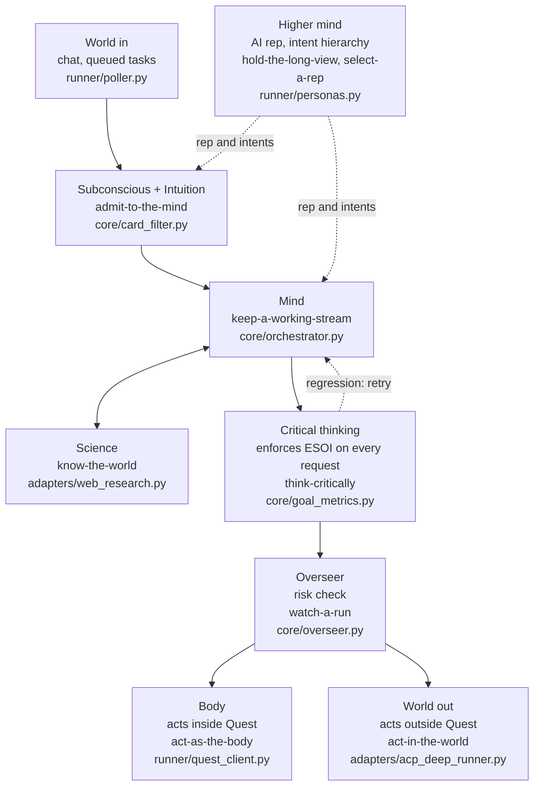
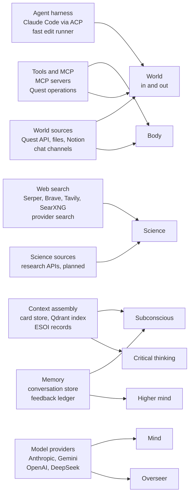

# QAR anatomy: a mind and a hub of hubs

QAR is described by two pictures. The first maps the parts of a mind to the code and
solutions that play them. The second shows the outside tools, services and data QAR builds on
(its hubs) and which part of the mind uses each. The part definitions live in the ESOI records
(`esoi/solutions.csv`); this page only draws them.

## A. QAR as a mind

A request enters from the world, the Subconscious admits only what bears on the goal (with a hint
from how similar past requests ended), and the Mind works on it, asking Science for evidence.
Critical thinking holds the result to its ESOI metric, the Overseer checks the risk, and then the
Body acts inside Quest or the World acts outside it. The Higher mind sits above all of it: the AI
rep chosen for the request and the intents it serves decide whose long view grounds the work.

## B. QAR as a hub of hubs

Each box on the left is a hub: a ready-made tool, service or data source that QAR picks the best of
by metric instead of building its own. QAR's own code sits in the mind parts on the right, which
choose among the hubs and wrap them in one set of checks. The hub list and how hubs connect to each
other is in [hub-of-hubs.md](hub-of-hubs.md).

## The parts, from the records

The table is generated from `esoi/solutions.csv` and `esoi/metrics.csv` by
`scripts/anatomy_table.py --write`, and `tests/test_anatomy_table.py` fails when it is stale.

<!-- anatomy-table:begin -->
| Part | QAR component | Solution | Metric id | Status |
|---|---|---|---|---|
| World (input) | `quest_ai_runner/runner/poller.py` | `run-queued-tasks` | `metric-run-queued-tasks` | arm built, selected: qar_runner |
| Subconscious, incl. Intuition | `quest_ai_runner/core/card_filter.py` | `admit-to-the-mind` | `metric-admit-to-the-mind` | arm built, selected: recency_window |
| Mind | `quest_ai_runner/core/orchestrator.py` | `keep-a-working-stream` | `metric-keep-a-working-stream` | arm built, selected: rebuilt_per_step |
| Science | `quest_ai_runner/adapters/web_research.py` | `know-the-world` | `metric-know-the-world` | spec only, no arm yet, selected: web_with_support_check |
| Critical thinking | `quest_ai_runner/core/goal_metrics.py` | `think-critically` | `metric-think-critically` | spec only, no arm yet, selected: deep_runs_only |
| Overseer | `quest_ai_runner/core/overseer.py` | `watch-a-run` | `metric-watch-a-run` | arm built, selected: overseer |
| Body | `quest_ai_runner/runner/quest_client.py` | `act-as-the-body` | `metric-act-as-the-body` | arm built, selected: card_and_reads |
| World (act) | `quest_ai_runner/adapters/acp_deep_runner.py` | `act-in-the-world` | `metric-act-in-the-world` | spec only, no arm yet, selected: coding_agent_prompt_reach |
| Higher mind | `quest_ai_runner/runner/personas.py` | `hold-the-long-view` | `metric-hold-the-long-view` | arm built, selected: separate_stores |
| Rep selection | `quest_ai_runner/runner/personas.py` | `select-a-rep` | `metric-select-a-rep` | arm built, selected: persona_resolver_precedence |
<!-- anatomy-table:end -->
