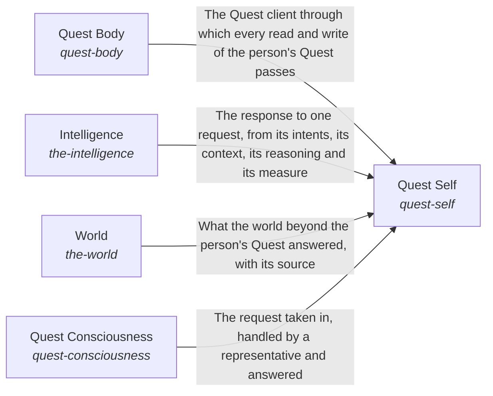

# Quest AI Runner

**Vision statement:** A Quest user's AI system continuously evolves to help the user continuously evolve towards their intents.

Breadcrumb: Top

Opportunities: Other products that need an AI which works from a person's own goals and material could reuse this engine, so the grounding, the standard for delegated work and the scope fences are built once and shared.

## How the solutions fit together

Quest AI Runner turns what a Quest user asks into work that moves their intents, and Quest Self is the one assistant that does it. Quest Self first learns from Quest Consciousness who is asking and what they are growing toward. It then reads the account and the person's own material through Quest Body. It hands each request to Intelligence, which understands it against what the person is working toward. When the request needs more than the person's own material, Quest Self reaches the outside through World.

## Diagram

An arrow runs from the solution that provides to the solution that builds on it; its label is what the provider outputs.

## One level below

This intent is implemented by the sub-intents and solutions below it; each shows whether it goes deeper.

- [Quest Body](../quest_ai_runner/the_body/README.md) (sub-intent): Quest is the AI's body.
- [Quest Consciousness](../quest_ai_runner/the_consciousness/README.md) (sub-intent): The AI acts for each person the way that person would want.
- [Intelligence](../quest_ai_runner/the_intelligence/README.md) (sub-intent): Each request is understood against what the person is working toward.
- [Quest Self](../quest_ai_runner/the_self/README.md) (sub-intent): Each Quest user meets one whole assistant.
- [World](../quest_ai_runner/the_world/README.md) (sub-intent): What lies beyond a person's Quest reaches the AI through one measured path.

## Solutions at a glance

| Solution | Handle | Entry call | Selected implementation | Metric |
|---|---|---|---|---|
| Quest Self | `quest-self` | `quest_ai_runner.run("quest-self", 'What should I work on first this week?')` | quest-ai-runner library (`library`) | Judge pass rate over the chat quality cases, Whole-path turns right on a small mixed set, Quest answers that name the person's goal and circumstance and fit features to them, Day-with-Jarvis turns right end to end, Asks filed and deletes held before anything outward or irreversible happens, Replies that claim only what was done, Passing chat turns per dollar, Delegated tasks meeting their standard, Exact and consented changes, Data kept in scope, Engine reuse, Measured coverage, QAR overall score |
| Quest Body | `quest-body` | `quest_ai_runner.run("quest-body", 'quest-id')` | Quest HTTP client from the environment (`quest_client`) | Parity of Quest operations across access points |
| Intelligence | `the-intelligence` | no entry declared | `composition` | none yet |
| World | `the-world` | no entry declared | `composition` | none yet |
| Quest Consciousness | `quest-consciousness` | no entry declared | `composition` | Quest Consciousness on Quest cases |

## Solutions from a library

- [The Self](https://github.com/SpiritualData/ai-hub-of-hubs-structure/esoi/README.md) (`quest-self`): Keeps the five kinds of part working as one whole: the Assembler builds them and reports the coverage, Integrity keeps the whole honest and generic and audits the run record, and Role Understanding says what each part is for. Specializes the library `hub`.
- [Body](https://github.com/SpiritualData/ai-hub-of-hubs-structure/esoi/README.md) (`quest-body`): The AI system's form and internal context. Specializes the library `hub`.
- [Intelligence](https://github.com/SpiritualData/ai-hub-of-hubs-structure/esoi/README.md) (`the-intelligence`): How information is processed for one request: the long view is read, the request becomes a measurable goal, the Mind plans and writes the response from what the Subconscious and the World bring, and the result is checked for goal completion and response quality. Adopted from the library `hub`.
- [World](https://github.com/SpiritualData/ai-hub-of-hubs-structure/esoi/README.md) (`the-world`): Awareness of the outside and interaction with it: public science, the tools of the outside, the models the hub asks, and how current the hub's own research is. Adopted from the library `hub`.
- [Consciousness](https://github.com/SpiritualData/ai-hub-of-hubs-structure/esoi/README.md) (`quest-consciousness`): The humans who interact with the system: AI Representatives act for a person, Prioritization turns the person's priorities into ESOI, Judgment Calls decide when to ask that person, and Feedback Learning applies the person's feedback to specs and metrics. Specializes the library `hub`.

## Problems and ideals

**Problems**

- Different Science Evidence In Two Chats (`prob-science-search-duplicates-research-chat`): One science question can get different evidence in Quest chat than in Quest's research chat.
- Different Answers On Different Surfaces (`QP4`): The same request can get a different answer depending on the Quest surface it came from.
- Parts Pass While The Assistant Fails (`prob-assistant-not-jarvis-from-the-users-seat`): Each part of QAR can pass its own test while the assistant, as a person meets it across a day, forgets what it knows, acts unasked, claims work it did not do, or answers a vague request with a generic plan, and the person is the one who finds out.

**Ideals**

- Consistent Science Evidence (`ideal-science-through-one-search`): A science question gets the same evidence, weighed the same way, in Quest chat and in the research chat.
- Same Assistant Everywhere (`QI4`): A person gets the same assistant, with the same answer to the same request, on every Quest surface.
- Capable From The User's Seat (`ideal-jarvis-from-the-users-seat`): The assistant is judged as the person meets it across a day: one capable assistant that gets real work done in the person's own quests, asks before it does anything outward or hard to undo, and says only what it did.
- Present And Prompt (`ideal-jarvis-j01-always-there-and-fast`): The assistant answers whenever the person asks, and quickly enough that asking it is easier than doing the thing alone.

## Metrics and their leaders

- Provider routing, fallback, retry and cost correctness (`metric-call-a-model`): leader `multi_provider`, 56 of 56 cases
- Channel transport conformance to the gateway wire contract (`metric-talk-over-a-channel`): leader `openclaw_bridge`, 20 of 20 cases
- Overseer digest evidence and signal correctness on labelled scenarios (`metric-watch-a-run`): leader `digest_probe`, 16 of 16 cases
- Parts selected by measurement (`QME7`): leader `structure_library`, 13 of 17 cases
- Supported and calibrated answers to world questions (`metric-know-the-world`): leader `web_with_support_check`, 9 of 9 cases
- Hub of hubs (`metric-hub-of-hubs`): leader `registry_scan`, 244 of 271 cases
- Hub of hubs (`QME9`): leader `registry_scan`, 244 of 271 cases
- Correct selection decisions over the evolve-by-metric cases (`metric-metric-earns-its-run`): leader `structure_library`, 13 of 17 cases
- Intents whose solutions one paragraph and one diagram explain as the code builds them (`metric-solution-coherence`)
- Task lifecycle correctness over offline cases (`metric-run-queued-tasks`): leader `qar_runner`, 43 of 43 cases
- and 5 more: all 15 are in [metrics](#metrics) of the full record below

## Where to go next

- Sub-intent: [Quest Body](../quest_ai_runner/the_body/README.md)
- Sub-intent: [Quest Consciousness](../quest_ai_runner/the_consciousness/README.md)
- Sub-intent: [Intelligence](../quest_ai_runner/the_intelligence/README.md)
- Sub-intent: [Quest Self](../quest_ai_runner/the_self/README.md)
- Sub-intent: [World](../quest_ai_runner/the_world/README.md)
- Repository: [top README](../README.md)
- Records beside the code: [quest_ai_runner](../quest_ai_runner/README.md), [evaluation/components/chat_quality/impls](../evaluation/components/chat_quality/impls/README.md), [evaluation/components/choose_a_model_tier/impls](../evaluation/components/choose_a_model_tier/impls/README.md), [evaluation/components/claim_reach/impls](../evaluation/components/claim_reach/impls/README.md), [evaluation/components/deep_run/impls](../evaluation/components/deep_run/impls/README.md), [evaluation/components/deep_runner/impls](../evaluation/components/deep_runner/impls/README.md), [evaluation/components/evolve_by_metric/impls](../evaluation/components/evolve_by_metric/impls/README.md), [evaluation/components/hand_off_a_goal/impls](../evaluation/components/hand_off_a_goal/impls/README.md), [evaluation/components/hub_of_hubs/impls](../evaluation/components/hub_of_hubs/impls/README.md), [evaluation/components/know_the_world/impls](../evaluation/components/know_the_world/impls/README.md), [evaluation/components/model_providers/impls](../evaluation/components/model_providers/impls/README.md), [evaluation/components/overseer_signals/impls](../evaluation/components/overseer_signals/impls/README.md), [evaluation/components/quest_ops/impls](../evaluation/components/quest_ops/impls/README.md), [evaluation/components/talk_over_a_channel/impls](../evaluation/components/talk_over_a_channel/impls/README.md), [evaluation/components/track_usage_and_cost/impls](../evaluation/components/track_usage_and_cost/impls/README.md), [evaluation/components/write_files/impls](../evaluation/components/write_files/impls/README.md), [evaluation/components/write_through_mcp/impls](../evaluation/components/write_through_mcp/impls/README.md)
- Records: [intent.csv](intent.csv), [metrics.csv](metrics.csv)
- Diagram page: [diagram.md](diagram.md)

---

## The full record

### Problems

- Different Science Evidence In Two Chats (`prob-science-search-duplicates-research-chat`): One science question can get different evidence in Quest chat than in Quest's research chat.
- Different Answers On Different Surfaces (`QP4`): The same request can get a different answer depending on the Quest surface it came from.
- Parts Pass While The Assistant Fails (`prob-assistant-not-jarvis-from-the-users-seat`): Each part of QAR can pass its own test while the assistant, as a person meets it across a day, forgets what it knows, acts unasked, claims work it did not do, or answers a vague request with a generic plan, and the person is the one who finds out.

### Ideals

- Consistent Science Evidence (`ideal-science-through-one-search`): A science question gets the same evidence, weighed the same way, in Quest chat and in the research chat.
- Same Assistant Everywhere (`QI4`): A person gets the same assistant, with the same answer to the same request, on every Quest surface.
- Capable From The User's Seat (`ideal-jarvis-from-the-users-seat`): The assistant is judged as the person meets it across a day: one capable assistant that gets real work done in the person's own quests, asks before it does anything outward or hard to undo, and says only what it did.
- Present And Prompt (`ideal-jarvis-j01-always-there-and-fast`): The assistant answers whenever the person asks, and quickly enough that asking it is easier than doing the thing alone.

### Solutions

| Solution | Handle | Selected | Metric |
|---|---|---|---|
| Quest Self | `quest-self` | quest-ai-runner library (`library`) | Judge pass rate over the chat quality cases, Whole-path turns right on a small mixed set, Quest answers that name the person's goal and circumstance and fit features to them, Day-with-Jarvis turns right end to end, Asks filed and deletes held before anything outward or irreversible happens, Replies that claim only what was done, Passing chat turns per dollar, Delegated tasks meeting their standard, Exact and consented changes, Data kept in scope, Engine reuse, Measured coverage, QAR overall score |
| Quest Body | `quest-body` | Quest HTTP client from the environment (`quest_client`) | Parity of Quest operations across access points |
| Intelligence | `the-intelligence` | `composition` | none yet |
| World | `the-world` | `composition` | none yet |
| Quest Consciousness | `quest-consciousness` | `composition` | Quest Consciousness on Quest cases |

### Implementations

| Implementation | Handle | Where | Sub-intent |
|---|---|---|---|
| Per-consumer worker | `quest-self:per-consumer-worker` |  |  |
| Agent framework with Quest glue | `quest-self:agent-framework-with-quest-glue` |  |  |
| Deep runner only | `quest-self:deep-runner-only` |  |  |
| quest-ai-runner library | `quest-self:library` | [quest_ai_runner/the_self/respond.py](../quest_ai_runner/the_self/respond.py) | [the_self](../quest_ai_runner/the_self/README.md) |
| Quest HTTP client from the environment | `quest-body:quest_client` | [quest_ai_runner/the_body/area_body.py](../quest_ai_runner/the_body/area_body.py) | [the_body](../quest_ai_runner/the_body/README.md) |
| Composition | `quest-consciousness:composition` | [quest_ai_runner/the_consciousness/flow.py](../quest_ai_runner/the_consciousness/flow.py) | [the_consciousness](../quest_ai_runner/the_consciousness/README.md) |
| Composition | `the-intelligence:composition` | [quest_ai_runner/the_intelligence/flow.py](../quest_ai_runner/the_intelligence/flow.py) | [the_intelligence](../quest_ai_runner/the_intelligence/README.md) |
| Composition | `the-world:composition` | [quest_ai_runner/the_world/flow.py](../quest_ai_runner/the_world/flow.py) | [the_world](../quest_ai_runner/the_world/README.md) |
| QAR as shipped, live on the subscription (today) | `quest-self:qar_live` | [quest_ai_runner/the_intelligence/mind/orchestrator.py](../quest_ai_runner/the_intelligence/mind/orchestrator.py) |  |
| Scripted ideal planner (offline) | `quest-self:reference_script` |  |  |
| Rules only, no model (floor) | `quest-self:rules_only` |  |  |
| One turn of the orchestrator over the model | `quest-self:orchestrator_turn` | [quest_ai_runner/the_intelligence/mind/area_mind.py](../quest_ai_runner/the_intelligence/mind/area_mind.py) |  |
| The shipped path as one call | `quest-self:shipped_path` | [quest_ai_runner/the_intelligence/mind/area_mind.py](../quest_ai_runner/the_intelligence/mind/area_mind.py) |  |
| Live chat on a disposable world | `quest-self:dev_quest_chat` | [evaluation/components/chat_quality/impls/dev_quest_chat.py](../evaluation/components/chat_quality/impls/dev_quest_chat.py) |  |
| Offline metric validity check | `quest-self:reference_replies` | [evaluation/components/chat_quality/impls/reference_replies.py](../evaluation/components/chat_quality/impls/reference_replies.py) |  |
| Live selection evaluation arm | `model-tier-chooser:qar_selection` | [evaluation/components/choose_a_model_tier/impls/qar_selection.py](../evaluation/components/choose_a_model_tier/impls/qar_selection.py) |  |
| Scripted ideal decisions, no model call (offline) | `the-tools:scripted_ideal` | [evaluation/components/claim_reach/impls/scripted_ideal.py](../evaluation/components/claim_reach/impls/scripted_ideal.py) |  |
| Rules only, no model (floor) | `the-tools:rules_only` | [evaluation/components/claim_reach/impls/rules_only.py](../evaluation/components/claim_reach/impls/rules_only.py) |  |
| Goal contract rules check | `delegated-agent-sessions:goal_contract` | [evaluation/components/deep_run/impls/goal_contract.py](../evaluation/components/deep_run/impls/goal_contract.py) |  |
| Subprocess runner scenarios | `delegated-agent-sessions:subprocess_runner` | [evaluation/components/deep_runner/impls/subprocess_runner.py](../evaluation/components/deep_runner/impls/subprocess_runner.py) |  |
| Agent-protocol runner scenarios | `delegated-agent-sessions:acp_runner` | [evaluation/components/deep_runner/impls/acp_runner.py](../evaluation/components/deep_runner/impls/acp_runner.py) |  |
| Evolvable-structure library decides (live) | `system-integrity:structure_library` | [evaluation/components/evolve_by_metric/impls/structure_library.py](../evaluation/components/evolve_by_metric/impls/structure_library.py) |  |
| Keep the selection as written (floor) | `system-integrity:keep_current` | [evaluation/components/evolve_by_metric/impls/keep_current.py](../evaluation/components/evolve_by_metric/impls/keep_current.py) |  |
| Creator keeps the goal, no model call (floor, proposed) | `quest-representatives:creator_keeps_it` | [evaluation/components/hand_off_a_goal/impls/creator_keeps_it.py](../evaluation/components/hand_off_a_goal/impls/creator_keeps_it.py) |  |
| Registry read together with the code (today) | `system-integrity:registry_scan` | [evaluation/components/hub_of_hubs/impls/registry_scan.py](../evaluation/components/hub_of_hubs/impls/registry_scan.py) |  |
| Memory only, no research (floor) | `the-science:memory_only` | [evaluation/components/know_the_world/impls/memory_only.py](../evaluation/components/know_the_world/impls/memory_only.py) |  |
| Single flat provider floor | `vendor-model-caller:single_provider` | [evaluation/components/model_providers/impls/single_provider.py](../evaluation/components/model_providers/impls/single_provider.py) |  |
| No-judgement digest probe | `nervous-system:digest_probe` | [evaluation/components/overseer_signals/impls/digest_probe.py](../evaluation/components/overseer_signals/impls/digest_probe.py) |  |
| Live overseer model arm | `nervous-system:live_model` | [evaluation/components/overseer_signals/impls/live_model.py](../evaluation/components/overseer_signals/impls/live_model.py) |  |
| Direct tool-call ablation | `quest-change-executor:direct_tool_call` | [evaluation/components/quest_ops/impls/direct_tool_call.py](../evaluation/components/quest_ops/impls/direct_tool_call.py) |  |
| Fake-gateway conformance arm | `intake-sources:openclaw_bridge` | [evaluation/components/talk_over_a_channel/impls/openclaw_bridge.py](../evaluation/components/talk_over_a_channel/impls/openclaw_bridge.py) |  |
| Live usage evaluation arm | `model-plumbing:qar_usage` | [evaluation/components/track_usage_and_cost/impls/qar_usage.py](../evaluation/components/track_usage_and_cost/impls/qar_usage.py) |  |
| Scratch-tree boundary check | `file-editing:bounded_writer` | [evaluation/components/write_files/impls/bounded_writer.py](../evaluation/components/write_files/impls/bounded_writer.py) |  |
| Fake-client allowlist check | `quest-change-executor:allowlist_writer` | [evaluation/components/write_through_mcp/impls/allowlist_writer.py](../evaluation/components/write_through_mcp/impls/allowlist_writer.py) |  |

### Metrics

- Provider routing, fallback, retry and cost correctness (`metric-call-a-model`): `esoi run model_providers --impl multi_provider`
- Channel transport conformance to the gateway wire contract (`metric-talk-over-a-channel`): `esoi run talk_over_a_channel --impl openclaw_bridge`
- Overseer digest evidence and signal correctness on labelled scenarios (`metric-watch-a-run`): `esoi run overseer_signals --impl live_model; esoi run overseer_signals --impl digest_probe`
- Parts selected by measurement (`QME7`): `esoi run evolve_by_metric --impl structure_library`
- Supported and calibrated answers to world questions (`metric-know-the-world`): `esoi run know_the_world --impl web_with_support_check`
- Hub of hubs (`metric-hub-of-hubs`): `esoi run hub_of_hubs --impl registry_scan`
- Hub of hubs (`QME9`): `esoi run hub_of_hubs --impl registry_scan`
- Correct selection decisions over the evolve-by-metric cases (`metric-metric-earns-its-run`): `esoi run evolve_by_metric --impl structure_library`
- Intents whose solutions one paragraph and one diagram explain as the code builds them (`metric-solution-coherence`): `python3 -m esoi.structure.structure_check.coherence --gate`
- Task lifecycle correctness over offline cases (`metric-run-queued-tasks`): `esoi run run_queued_tasks --impl qar_runner`
- Requests held to their ESOI metric by code (`metric-think-critically`): `esoi run think_critically --impl deep_runs_only`
- Retrieval recall of the right document over handbook questions (`metric-gather-evidence`): `esoi run retrieval --impl composite; esoi run retrieval_sources --impl files_adapter`
- Combined world score (`metric-claim-reach`): `esoi run claim_reach --impl scripted_ideal`
- Ways in that pass their own metric (`metric-take-in-the-world`): `none`
- Parity of Quest operations across access points (`metric-quest-operations-parity`): `none`

*Generated from the CSV files beside this page by `esoi readmes`. Edit the CSV files, not this page.*
