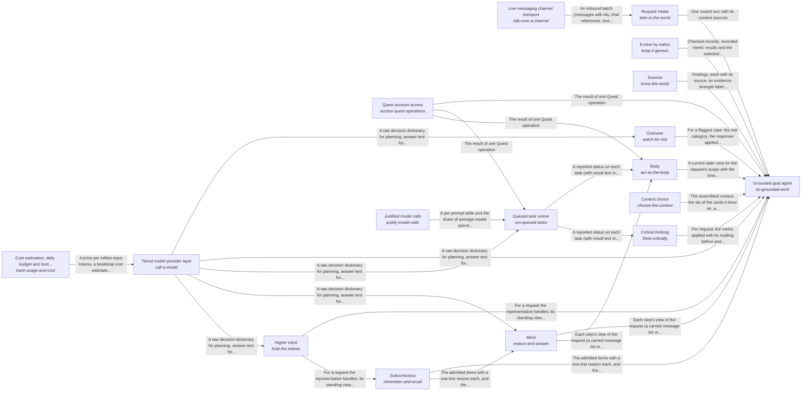

# Grounded AI that advances people's goals

Goals keep moving between a person's sessions, because the work they delegated gets done to the standard they wrote, and every answer and action rests on the person's own goals, material and preferences, and never on another person's.

*ESOI records of this intent (evolvable structure that optimizes intent), generated from the CSV files beside this page by `esoi readmes`. Edit the CSV files, not this page.*

Opportunities: Other products that need an AI which works from a person's own goals and material could reuse this engine, so the grounding, the standard for delegated work and the scope fences are built once and shared.

## How the solutions fit together

quest-ai-runner turns a person's request or queued task into grounded work in one loop, and the Grounded goal agent is that loop. It asks the model through the Tiered model provider layer, works in the person's Quest account through Quest account access and takes in requests through Request intake. It reasons step by step through Mind, recalls what a request needs through Subconscious and acts on the account through Body. It holds its work to the metric that serves it through Critical thinking, has every run watched through Overseer and keeps the long view across turns through Higher mind. It stays comparable by metric through Evolve by metric, answers questions beyond the person's own material through Science and chooses what a planner reads through Context choice. Subconscious recalls the cards that match a request through Hub card store. Tiered model provider layer accounts for every call through Cost estimation, daily budget and host load guard. Mind sends the prompt of each step to the model through Tiered model provider layer. Overseer has the model oversee a run through Tiered model provider layer. Queued-task runner claims, runs and reports a queued task, asking the model through Tiered model provider layer and working in the account through Quest account access. It writes each prompt as a registered spec with an owner and a metric through Justified model calls. Body reads and changes the quest through Context card persistence backend, Quest account access and Queued-task runner. Higher mind saves what it learned through Context card persistence backend. Request intake hears from a live channel through Live messaging channel transport.

## Diagram

An arrow runs from the solution that provides to the solution that builds on it; its label is what the provider outputs.

## Solutions at a glance

| Solution | Handle | Entry call | Selected implementation | Metric |
|---|---|---|---|---|
| Tiered model provider layer | `call-a-model` | `quest_ai_runner.run("call-a-model", ...)` | `multi_provider` | Provider routing, fallback, retry and cost correctness |
| Live messaging channel transport | `talk-over-a-channel` | `quest_ai_runner.run("talk-over-a-channel")` | `openclaw` | Channel transport conformance to the gateway wire contract |
| Overseer | `watch-for-risk` | `quest_ai_runner.run("watch-for-risk", 'delete the old backup folder')` | `overseer` | Overseer digest evidence and signal correctness on labelled scenarios |
| Cost estimation, daily budget and host load guard | `track-usage-and-cost` | no entry declared | `qar_usage` | Cost, budget and resource-guard correctness |
| Evolve by metric | `keep-it-generic` | `quest_ai_runner.run("keep-it-generic", ['examplevendor'])` | `structure-library` | Parts selected by measurement, Correct selection decisions over the evolve-by-metric cases, Intents whose solutions one paragraph and one diagram explain as the code builds them, Hub of hubs |
| Science | `know-the-world` | `quest_ai_runner.run("know-the-world", 'meditation and attention')` | `web_with_support_check` | Supported and calibrated answers to world questions |
| Grounded goal agent | `do-grounded-work` | `quest_ai_runner.run("do-grounded-work", 'What should I work on first this week?')` | `library` | QAR overall score, Passing chat turns per dollar, Delegated tasks meeting their standard, Exact and consented changes, Data kept in scope, Engine reuse, Measured coverage |
| Queued-task runner | `run-queued-tasks` | `quest_ai_runner.run("run-queued-tasks", 'team-1')` | `qar_runner` | Task lifecycle correctness over offline cases |
| Mind | `reason-and-answer` | `quest_ai_runner.run("reason-and-answer", ...)` | `rebuilt_per_step` | Step continuity at cost over multi-step requests |
| Body | `act-as-the-body` | `quest_ai_runner.run("act-as-the-body", 'NOTES.md')` | `card_and_reads` | Account-state consistency across scripted sessions |
| Higher mind | `hold-the-intents` | `quest_ai_runner.run("hold-the-intents", ...)` | `separate_stores` | Representative long-view carry-through across assigned quests, with nothing outside its branch |
| Critical thinking | `think-critically` | `quest_ai_runner.run("think-critically", ...)` | `deep_runs_only` | Requests held to their ESOI metric by code |
| Quest account access | `access-quest-operations` | `quest_ai_runner.run("access-quest-operations", 'quest-id')` | `quest_client` | Parity of Quest operations across access points |
| Request intake | `take-in-the-world` | `quest_ai_runner.run("take-in-the-world", 'Save a note that the launch moves to Friday.')` | `ways_in` | Ways in that pass their own metric |
| Context choice | `choose-the-context` | `quest_ai_runner.run("choose-the-context", 'What should I work on first this week?')` | `per_lane_assembly` | Context handed to the planner |
| Subconscious | `remember-and-recall` | `quest_ai_runner.run("remember-and-recall", 'rust release')` | `recency_window` | Goal-relevant admission at a precision floor with nothing out of scope |
| Justified model calls | `justify-model-calls` | no entry declared | `spec_registry` | Justified share of model spend |

## Problems and ideals

**Problems**

- `QP5`: Models, prices, tools and techniques change every few months, so a router, a retrieval method or a model choice that was right becomes wrong, and nobody notices until quality drops or cost rises.
- `QP6`: Operators learn what AI work cost, and whether it was any good, only after the fact: a runaway run, a large model on an easy question, or a quiet drop in answer quality.
- `prob-misrouted-message`: A short chat message is sometimes handled the wrong way: a plain question starts expensive autonomous work, a request to change something only gets talked about, or a destructive request runs without...
- `prob-claimed-done-not-done`: A run reports that it finished when the written goal was not met, or describes work that was never executed.
- `prob-human-only-steps-slip`: Steps that only a person should decide (spending, sending, deleting, anything irreversible) are sometimes taken without them, or are surfaced without the detail needed to decide, or are dropped...
- `prob-spend-surprises`: Operators learn what AI work cost only after it has been spent, and a runaway loop, a long prompt or an overloaded host can burn a daily allowance or fail other jobs.
- `prob-big-model-for-easy-work`: Most turns are easy yet are served by the largest model, or the cheapest model is used for work it cannot do, so quality or cost is wrong for the task.
- `prob-queued-task-falls-through`: A task someone queued for the AI can be lost, run twice, run before its time, run by the wrong persona, or end with no report.
- `prob-channel-messages-misdelivered`: A live two-way chat over an external channel can drop, duplicate or reorder messages, or break when a payload arrives in an unexpected shape.
- `prob-world-claims-unweighed`: A question about the world rather than the person's own material (health, training, research, experiences others have reported) is answered from the model's general knowledge or one web passage, with...
- and 23 more: all 33 are in [problems](#problems) of the full record below

**Ideals**

- Metric-led evolution (`QI5`): Every part of QAR improves as the state of the art moves, with the best implementation chosen by its metric.
- Visible value (`QI6`): What AI work costs and how good it is are known before they surprise anyone.
- Proportionate Routing (`ideal-proportionate-routing`): Each message gets the cheapest handling that still gets the right outcome.
- Exact Change (`ideal-exact-change`): The final state matches the request: everything asked, nothing else, once.
- Verified Completion (`ideal-verified-completion`): A report of done is true.
- Informed Consent (`ideal-informed-consent`): A human-only step reaches a person with enough detail to decide, and the AI stops until they do.
- Predictable Spend (`ideal-predictable-spend`): Cost is known before it is spent and bounded while it is spent.
- Right-Sized Model (`ideal-right-sized-model`): The cheapest model that can do the task does it, and waiting beats failing.
- Dependable Delivery (`ideal-dependable-delivery`): What is handed to the system arrives once, in order, and is accounted for.
- Weighed World Knowledge (`ideal-weighed-knowledge`): A claim about the world comes with where it came from and how strong its evidence is, and the best evidence source available is consulted before the cheapest.
- and 27 more: all 37 are in [ideals](#ideals) of the full record below

## Metrics and their leaders

- Provider routing, fallback, retry and cost correctness (`metric-call-a-model`): leader `multi_provider`, 56 of 56 cases
- Channel transport conformance to the gateway wire contract (`metric-talk-over-a-channel`): leader `openclaw_bridge`, 20 of 20 cases
- Overseer digest evidence and signal correctness on labelled scenarios (`metric-watch-a-run`): leader `digest_probe`, 16 of 16 cases
- Cost, budget and resource-guard correctness (`metric-track-usage-and-cost`): leader `qar_usage`, 38 of 39 cases
- Parts selected by measurement (`QME7`): leader `structure_library`, 13 of 17 cases
- Supported and calibrated answers to world questions (`metric-know-the-world`): leader `web_with_support_check`, 9 of 9 cases
- Hub of hubs (`metric-hub-of-hubs`): leader `registry_scan`, 244 of 271 cases
- Hub of hubs (`QME9`): leader `registry_scan`, 244 of 271 cases
- Correct selection decisions over the evolve-by-metric cases (`metric-metric-earns-its-run`): leader `structure_library`, 13 of 17 cases
- Intents whose solutions one paragraph and one diagram explain as the code builds them (`metric-solution-coherence`)
- and 18 more: all 28 are in [metrics](#metrics) of the full record below

## Where to go next

- Sub-intent: [Acting in the person's account as the AI's own body](../quest_ai_runner/act_as_the_body/README.md) (What the AI says about a person's account is the account as it is now, and what it changed in the account is read back after the change, so the person can trust both.)
- Sub-intent: [Holding the intents across quests](../quest_ai_runner/hold_the_intents/README.md) (Each AI representative starts every request from the standing view of the quests it is assigned and the intents above them, so a correction is made once and a thread is never restated.)
- Sub-intent: [Keeping every part generic and measured](../quest_ai_runner/keep_it_generic/README.md) (Every part of QAR stays specified as a solution with alternatives and a metric, so the best implementation runs as the state of the art moves and no vendor is built into the brain.)
- Sub-intent: [Knowing the world with its source](../quest_ai_runner/know_the_world/README.md) (What a request needs to know beyond the person's own material comes from the world with its source, so the person can weigh it.)
- Sub-intent: [Reasoning and answering each step of a request](../quest_ai_runner/reason_and_answer/README.md) (Every step of a person's request acts on everything the request has established so far, so a reply rests on the work done for it and the person can follow that work, at the cost of the fast tier.)
- Sub-intent: [Remembering and recalling the person's own knowledge](../quest_ai_runner/remember_and_recall/README.md) (A request recalls the part of the person's own knowledge its goal needs, from cards that are current with their sources, found by meaning and proportionate in size, and never from anyone else's.)
- Sub-intent: [Selecting the context a planner reads](../quest_ai_runner/select_context/README.md) (The material a planner reads before it plans, whether a card, a file, a conversation or a specification record, is the material the request concerns, however the request is worded.)
- Sub-intent: [Taking in requests from anywhere](../quest_ai_runner/take_in_the_world/README.md) (A person or a program reaches the runner from wherever they work, by a message, a terminal, a live channel or the package itself, and is understood the same way.)
- Sub-intent: [Thinking critically by metric](../quest_ai_runner/think_critically/README.md) (Everything the AI does for a person's goals is held to the metric that serves it, and what it says is held to what is known.)
- Sub-intent: [Watching every run for risk](../quest_ai_runner/watch_for_risk/README.md) (Every run is watched through cheap checks, and a step only a person may take reaches that person with enough detail to decide.)
- Repository: [top README](../README.md)
- Records beside the code: [quest_ai_runner](../quest_ai_runner/README.md), [quest_ai_runner/adapters](../quest_ai_runner/adapters/README.md), [quest_ai_runner/core](../quest_ai_runner/core/README.md), [quest_ai_runner/runner](../quest_ai_runner/runner/README.md), [evaluation/components/evolve_by_metric/impls](../evaluation/components/evolve_by_metric/impls/README.md), [evaluation/components/hub_of_hubs/impls](../evaluation/components/hub_of_hubs/impls/README.md), [evaluation/components/know_the_world/impls](../evaluation/components/know_the_world/impls/README.md), [evaluation/components/model_providers/impls](../evaluation/components/model_providers/impls/README.md), [evaluation/components/overseer_signals/impls](../evaluation/components/overseer_signals/impls/README.md), [evaluation/components/talk_over_a_channel/impls](../evaluation/components/talk_over_a_channel/impls/README.md), [evaluation/components/track_usage_and_cost/impls](../evaluation/components/track_usage_and_cost/impls/README.md)
- Records: [intent.csv](intent.csv), [problems.csv](problems.csv), [ideals.csv](ideals.csv), [solutions.csv](solutions.csv), [implementations.csv](implementations.csv), [metrics.csv](metrics.csv)
- Diagram page: [diagram.md](diagram.md)

---

## The full record

### Problems

- `QP5`: Models, prices, tools and techniques change every few months, so a router, a retrieval method or a model choice that was right becomes wrong, and nobody notices until quality drops or cost rises.
- `QP6`: Operators learn what AI work cost, and whether it was any good, only after the fact: a runaway run, a large model on an easy question, or a quiet drop in answer quality.
- `prob-misrouted-message`: A short chat message is sometimes handled the wrong way: a plain question starts expensive autonomous work, a request to change something only gets talked about, or a destructive request runs without anyone confirming it. A clear instruction can also get a clarifying question back instead of being done.
- `prob-claimed-done-not-done`: A run reports that it finished when the written goal was not met, or describes work that was never executed.
- `prob-human-only-steps-slip`: Steps that only a person should decide (spending, sending, deleting, anything irreversible) are sometimes taken without them, or are surfaced without the detail needed to decide, or are dropped without anyone noticing.
- `prob-spend-surprises`: Operators learn what AI work cost only after it has been spent, and a runaway loop, a long prompt or an overloaded host can burn a daily allowance or fail other jobs.
- `prob-big-model-for-easy-work`: Most turns are easy yet are served by the largest model, or the cheapest model is used for work it cannot do, so quality or cost is wrong for the task.
- `prob-queued-task-falls-through`: A task someone queued for the AI can be lost, run twice, run before its time, run by the wrong persona, or end with no report.
- `prob-channel-messages-misdelivered`: A live two-way chat over an external channel can drop, duplicate or reorder messages, or break when a payload arrives in an unexpected shape.
- `prob-world-claims-unweighed`: A question about the world rather than the person's own material (health, training, research, experiences others have reported) is answered from the model's general knowledge or one web passage, with no sign of how strong the evidence is, and research sources a host already has are not consulted.
- `prob-work-handed-back`: A run ends by handing the person steps the AI could have done itself, or is marked done with part of the original ask left undone, instead of continuing until the original ask is met.
- `prob-risk-handled-uniformly`: Risky moments in a run (re-proposing a declined act, claiming work that did not run, handing back a step the AI could do, a wrong route, an irreversible act, a cross-scope read) are watched by one overseer that reviews a digest with one prompt on one tier, whatever the risk, and nothing shows which response works for which kind of risk.
- `prob-evaluation-not-staged-on-real-inputs`: A part is evaluated either only on offline fixtures, which may not hold on real inputs, or in full on real inputs through paid model calls, so the evidence arrives either too thin to trust or too late and too costly.
- `prob-science-search-duplicates-research-chat`: QAR's search for evidence about the world is built apart from the research chat's search of science, so one science question can be searched twice by two routes that each gather and weigh evidence in their own way.
- `QP1`: People can attach AI tasks to their goals in Quest and schedule them, but nothing runs them: Quest queues the work and has no worker. The same gap exists for anyone who wants AI to keep working on their goals between conversations.
- `QP2`: A general assistant answers from general knowledge. It does not know the person's quests, plans, documents, past conversations or preferences, so its help is plausible but not theirs, and sometimes states things about their account that are not true.
- `QP3`: An AI that may act on someone's behalf tends to one of two failures: it asks permission for everything, so nothing moves without a person, or it takes steps that only a person should decide (spending, sending, deleting, anything irreversible).
- `QP4`: Grounding, routing, deep work, escalation, a task executor, cost control: each product or team that wants AI help writes these again, privately, and the copies drift apart.
- `prob-step-loses-the-request`: Within one request, each planning step is a separate model call rebuilt from parts, not a continuation of the step before. From the second step on, the transcript and the whole context block (the resolved request, declined proposals, standing corrections, recent context and cards) are replaced by a note saying they were provided at step one, which a separate call never saw, and older observations are collapsed to one line, so a later step decides from the raw message and the newest reads alone.
- `prob-account-state-contradicts`: What the AI says about the person's own account (which quests exist, what changed, whether a change ran) is re-derived each turn from whatever slice it read, and a change it made is not read back, so within one session it reports the same state two ways, repeats a change it already made, or proposes again what it said was done.
- `prob-long-view-scattered`: What is known across requests (what a quest has decided, declined and learned, what the person corrected, where the work is heading) is kept in several stores with their own keys, budgets and retrieval: past conversations, recent context, the feedback ledger and its guidance, the prediction store, the host's reflections and the quest cards. None of them holds the quest's standing view, so each request rebuilds it from fragments, background work can lack what the chat already knew, and each store needs its own scope fence.
- `prob-app-help-unreliable`: Questions about how to use the app itself (how to do something, what a feature is for) should be answered from the product's own documentation, but that path is untested, the AI sometimes says it cannot do what it can, and many team members do not know what the AI can do for them.
- `prob-no-environment-tasks-untested`: Most people have no external environment connected, so their delegated tasks can use only the app's own operations, its documentation, a review of their own data and web search, and that path has not been tested end to end.
- `prob-experiments-not-proposed`: Advice and plans are given as one answer, not as the option most likely to work for this person with a metric to check it, and when the better option is unknown the AI does not propose or find an experiment that would settle it, though the app has an Experiments feature built for that.
- `prob-metric-enforced-on-deep-runs-only`: The before-and-after reading of the relevant ESOI metric is enforced by code only on deep runs. Chat turns and other in-process work find no slice and take no reading; a request whose records hold no slice or no metric ends with nothing measured and nothing proposed; a reading that got worse is recorded and shown, but nothing acts on it; and a run that ends with no metric on record is marked and then forgotten.
- `prob-long-view-scope-not-hierarchical`: A representative's high-level view legitimately spans its assigned quests and the intents above them, but the library's fence compares flat tag sets: an item is visible to a turn only when their tags intersect, or everywhere when it has none. Nothing can say visible to this representative's assigned quests and their ancestor intents, never to another representative's quests, a sibling intent or another person; and a representative's learned notes and context preferences carry no scope at all, so what it learned on one quest reaches every other.
- `prob-quest-feature-why-unexplained`: People ask Quest AI why a Quest feature works as it does (why creating a quest asks many questions, what a daily reflection is for) and get a description of the feature, or a generic answer, instead of the reason it exists and how it helps their own goal.
- `prob-goal-condition-restated-not-evidence`: A run can be judged against its goal condition by a reply that restates the condition as if it were met, so the done-standard is satisfied in words and no evidence shows the work was done.
- `prob-partial-coverage-reported-as-complete`: A goal that covers a set (every entry, all records) can be reported as done after only part of the set was processed, because the reply reads well and does not admit the gap.
- `prob-long-run-silent-until-the-end`: A long run shows nothing of itself until it ends, so the person cannot tell whether it is working, stuck or finished, and cannot steer it.
- `prob-two-access-points-to-quest-diverge`: Quest's operations can be reached in the same process as Quest and over its HTTP API, and two access points to the same operations can drift apart, so the same request may behave or return differently depending on how it arrived.
- `prob-harness-dear-and-slow-on-the-subscription`: Running a coding-agent harness on the Claude Code subscription for each step of a request is costly in tokens and slow to start, while a cheap fast model alone lacks the context discipline and reliability of a long coding-agent session.
- `prob-admission-by-recency-not-relevance`: What of the person's own material enters a step's view is decided by position and size, not by what the request needs: cards are chosen once from the request text at the start, the newest few observations are shown in full and older ones collapsed, and a lookup's result is admitted whether or not it is what was asked for. A finding the goal turns on can be collapsed out while an irrelevant read stays in full, and a near miss can be treated as the thing requested.

### Ideals

- Metric-led evolution (`QI5`): Every part of QAR improves as the state of the art moves, with the best implementation chosen by its metric.
- Visible value (`QI6`): What AI work costs and how good it is are known before they surprise anyone.
- Proportionate Routing (`ideal-proportionate-routing`): Each message gets the cheapest handling that still gets the right outcome.
- Exact Change (`ideal-exact-change`): The final state matches the request: everything asked, nothing else, once.
- Verified Completion (`ideal-verified-completion`): A report of done is true.
- Informed Consent (`ideal-informed-consent`): A human-only step reaches a person with enough detail to decide, and the AI stops until they do.
- Predictable Spend (`ideal-predictable-spend`): Cost is known before it is spent and bounded while it is spent.
- Right-Sized Model (`ideal-right-sized-model`): The cheapest model that can do the task does it, and waiting beats failing.
- Dependable Delivery (`ideal-dependable-delivery`): What is handed to the system arrives once, in order, and is accounted for.
- Weighed World Knowledge (`ideal-weighed-knowledge`): A claim about the world comes with where it came from and how strong its evidence is, and the best evidence source available is consulted before the cheapest.
- Risk Handled Where It Is (`ideal-risk-handled-where-it-is`): Each high-risk case gets the response proven best for its kind of risk, and a low-risk case pays nothing for review.
- Staged Real-Input Evaluation (`ideal-staged-evaluation-on-real-inputs`): Evaluation starts free and offline, then moves to small samples of real inputs, and a larger paid run happens only when a decision still depends on it.
- One Science Search (`ideal-science-through-one-search`): A science question is answered through one search path shared by the chat and the research interface, so evidence is gathered and weighed once.
- Self-advancing goals (`QI1`): Goals keep moving between a person's sessions, because the work they delegated gets done to the standard they wrote.
- Personally grounded help (`QI2`): Every answer and action rests on the person's own goals, material and preferences, and never on another person's.
- Trusted autonomy (`QI3`): The AI acts first on what it may decide and brings the person exactly the decisions that are theirs.
- One shared engine (`QI4`): One domain-free engine serves every consumer, every lane and both chat and scheduled work, and differs only in configuration.
- Grounded Reply (`ideal-grounded-reply`): A reply says only what the person's own account and its sources support, and says what it found.
- Remembered Work (`ideal-remembered-work`): Work already worked out once is not worked out again, and what was learned is kept.
- Reliable Verdict (`ideal-reliable-verdict`): A narrow judgment changes a turn only when it is usable.
- Checked Improvement per Run (`ideal-checked-improvement`): Every run leaves, on the record it served, what it measured, what it moved and what it changed in the record and why, so improvement is checked per run instead of hoped for.
- Continuous Mind (`ideal-continuous-mind`): Every step of a request acts with everything the request has established so far: what the person said, refused and corrected, what the request was resolved to mean, and what earlier steps found.
- Known Reach (`ideal-known-reach`): The AI says it can do only what it can, says it cannot only after checking, and claims an outside act only with the receipt of the act.
- Consistent Account State (`ideal-consistent-account-state`): What the AI says about the person's own account is true of the account when it says it, every time in a session.
- Standing Perspective (`ideal-standing-perspective`): Each quest carries one view across requests of what was decided, declined, learned and where it is heading, and every request on it starts from that view.
- Questions Only Where Theirs (`ideal-asks-only-what-is-theirs`): The person is asked only what is theirs to decide, and a question they waved off is not asked again.
- Self-Explaining App (`ideal-self-explaining-app`): Any question about how to use the app gets a correct answer from its own documentation, and the AI knows what it can do.
- Most-Likely Path (`ideal-most-likely-path`): Every recommendation is the option most likely to move the person's own metric toward their intent, and what is not known becomes an experiment.
- Hierarchy-Contained Scope (`ideal-hierarchy-contained-scope`): What a representative learns reaches its own assigned quests and the intents above them, and never another representative's quests, a sibling intent or another person.
- Right Representative (`ideal-right-rep`): Each request is handled by the representative whose role and assigned quests fit it, and work spawned from a thread keeps that thread's representative unless the person chooses another.
- Explained Feature Purpose (`ideal-quest-feature-why-explained`): When a person asks why a Quest feature works as it does, the answer gives the reason the feature exists and how it serves their goal, not only what it is.
- Evidenced Completion (`ideal-done-standard-evidenced`): Work is reported as done only when evidence shows its written done-standard was met, and the evidence is not a restatement of the standard.
- Stated Coverage (`ideal-coverage-met-or-gap-stated`): When a goal covers a set (every entry, all records), either the whole set was processed or the report states exactly how much was and what remains.
- Visible Progress (`ideal-incremental-output-while-working`): While work is running, the person can see that it is still working and what it has done so far, at a level they choose.
- Shared Quest Operations (`ideal-one-implementation-two-access-points`): Quest's operations are implemented once, and each way of reaching them (in the same process as Quest, or over its HTTP API) gives the same results.
- Lean Context Harness (`ideal-cheap-fast-harness-with-ideal-context`): The harness that runs Quest AI's steps is as capable as a coding agent but costs and takes about what the fast tier does, because every step sees exactly the context its goal needs.
- Goal-Relevant Attention (`ideal-goal-relevant-attention`): Only what bears on the request's goal enters the working stream, and nothing from outside the request's scope ever does.

### Solutions

| Solution | Handle | Selected | Metric |
|---|---|---|---|
| Tiered model provider layer | `call-a-model` | multi_provider | Provider routing, fallback, retry and cost correctness |
| Live messaging channel transport | `talk-over-a-channel` | openclaw | Channel transport conformance to the gateway wire contract |
| Overseer | `watch-for-risk` | overseer | Overseer digest evidence and signal correctness on labelled scenarios |
| Cost estimation, daily budget and host load guard | `track-usage-and-cost` | qar_usage | Cost, budget and resource-guard correctness |
| Evolve by metric | `keep-it-generic` | structure-library | Parts selected by measurement, Correct selection decisions over the evolve-by-metric cases, Intents whose solutions one paragraph and one diagram explain as the code builds them, Hub of hubs |
| Science | `know-the-world` | web_with_support_check | Supported and calibrated answers to world questions |
| Grounded goal agent | `do-grounded-work` | library | QAR overall score, Passing chat turns per dollar, Delegated tasks meeting their standard, Exact and consented changes, Data kept in scope, Engine reuse, Measured coverage |
| Queued-task runner | `run-queued-tasks` | qar_runner | Task lifecycle correctness over offline cases |
| Mind | `reason-and-answer` | rebuilt_per_step | Step continuity at cost over multi-step requests |
| Body | `act-as-the-body` | card_and_reads | Account-state consistency across scripted sessions |
| Higher mind | `hold-the-intents` | separate_stores | Representative long-view carry-through across assigned quests, with nothing outside its branch |
| Critical thinking | `think-critically` | deep_runs_only | Requests held to their ESOI metric by code |
| Quest account access | `access-quest-operations` | quest_client | Parity of Quest operations across access points |
| Request intake | `take-in-the-world` | ways_in | Ways in that pass their own metric |
| Context choice | `choose-the-context` | per_lane_assembly | Context handed to the planner |
| Subconscious | `remember-and-recall` | recency_window | Goal-relevant admission at a precision floor with nothing out of scope |
| Justified model calls | `justify-model-calls` | spec_registry | Justified share of model spend |

### Implementations

| Implementation | Handle | Where | Sub-intent |
|---|---|---|---|
| Per-consumer worker | `do-grounded-work:per-consumer-worker` |  |  |
| Agent framework with Quest glue | `do-grounded-work:agent-framework-with-quest-glue` |  |  |
| Deep runner only | `do-grounded-work:deep-runner-only` |  |  |
| Carried message stream per request (proposed) | `reason-and-answer:append_only_stream` |  |  |
| Carried stream with compaction (proposed) | `reason-and-answer:stream_with_compaction` |  |  |
| Small-model judge of every candidate (proposed) | `remember-and-recall:goal_judge` |  |  |
| Score thresholds per source (proposed) | `remember-and-recall:score_thresholds` |  |  |
| Thresholds with a judge on the borderline (proposed) | `remember-and-recall:thresholds_then_judge` |  |  |
| Host research sources first, then the web (proposed) | `know-the-world:research_sources_first` |  |  |
| Findings weighed by a host's evidence-estimation service (proposed) | `know-the-world:evidence_weighted` |  |  |
| Read back what a change touched (proposed) | `act-as-the-body:read_after_write` |  |  |
| A live read behind every state claim (proposed) | `act-as-the-body:live_read_only` |  |  |
| Maintained view per quest only (proposed) | `hold-the-intents:per_quest_note` |  |  |
| Periodic reflection on the best tier (proposed) | `hold-the-intents:periodic_reflection` |  |  |
| Outcome precedents surfaced at admission (proposed) | `remember-and-recall:outcome_precedents` |  |  |
| Overseer that asks questions of fact (proposed) | `watch-for-risk:fact_questions` |  |  |
| Every request measured by code (proposed) | `think-critically:every_request_measured` |  |  |
| Measured, proposed and answered (proposed) | `think-critically:measured_proposed_and_answered` |  |  |
| Per-risk response chosen by metric (proposed) | `watch-for-risk:per_risk_response` |  |  |
| One view per intent, cascading down (proposed) | `hold-the-intents:per_intent_cascade` |  |  |
| One view per representative across its assigned quests, placed in the hierarchy (proposed, recommended) | `hold-the-intents:per_rep_assigned_view` |  |  |
| Registry plus per-call ablation against the owner metric (proposed) | `justify-model-calls:spec_registry_ablation` |  |  |
| quest-ai-runner library | `do-grounded-work:library` | [quest_ai_runner/goal_agent.py](../quest_ai_runner/goal_agent.py) |  |
| Prefix-routing multi-provider | `call-a-model:multi_provider` | [quest_ai_runner/providers.py](../quest_ai_runner/providers.py) |  |
| Digest-driven overseer | `watch-for-risk:overseer` | [quest_ai_runner/watch_for_risk/area.py](../quest_ai_runner/watch_for_risk/area.py) | [watch_for_risk](watch_for_risk/README.md) |
| Offline lifecycle harness | `run-queued-tasks:qar_runner` | [quest_ai_runner/area_act_as_the_body.py](../quest_ai_runner/area_act_as_the_body.py) |  |
| Static price table lookup | `track-usage-and-cost:pricing` | [quest_ai_runner/pricing.py](../quest_ai_runner/pricing.py) |  |
| Persisted daily token tracker | `track-usage-and-cost:usage` | [quest_ai_runner/usage.py](../quest_ai_runner/usage.py) |  |
| Hysteresis resource guard | `track-usage-and-cost:resources` | [quest_ai_runner/resources.py](../quest_ai_runner/resources.py) |  |
| Apply the evolvable-structure library | `keep-it-generic:structure-library` | [quest_ai_runner/keep_it_generic/area.py](../quest_ai_runner/keep_it_generic/area.py) | [keep_it_generic](keep_it_generic/README.md) |
| Rebuilt prompt per step with a referenced context (today) | `reason-and-answer:rebuilt_per_step` | [quest_ai_runner/area_reason_and_answer.py](../quest_ai_runner/area_reason_and_answer.py) | [reason_and_answer](reason_and_answer/README.md) |
| Web research with the answer's support check (today) | `know-the-world:web_with_support_check` | [quest_ai_runner/know_the_world/area.py](../quest_ai_runner/know_the_world/area.py) | [know_the_world](know_the_world/README.md) |
| Managed quest card plus optional live reads (today) | `act-as-the-body:card_and_reads` | [quest_ai_runner/area_act_as_the_body.py](../quest_ai_runner/area_act_as_the_body.py) | [act_as_the_body](act_as_the_body/README.md) |
| Separate stores read at the start of a request (today) | `hold-the-intents:separate_stores` | [quest_ai_runner/hold_the_intents/area.py](../quest_ai_runner/hold_the_intents/area.py) | [hold_the_intents](hold_the_intents/README.md) |
| Code-enforced before and after on deep runs only (today) | `think-critically:deep_runs_only` | [quest_ai_runner/think_critically/area.py](../quest_ai_runner/think_critically/area.py) | [think_critically](think_critically/README.md) |
| Channels, terminal and package as ways in | `take-in-the-world:ways_in` | [quest_ai_runner/area_take_in_the_world.py](../quest_ai_runner/area_take_in_the_world.py) | [take_in_the_world](take_in_the_world/README.md) |
| Quest HTTP client from the environment | `access-quest-operations:quest_client` | [quest_ai_runner/area_act_as_the_body.py](../quest_ai_runner/area_act_as_the_body.py) |  |
| Per-lane assembly of the context members (today) | `choose-the-context:per_lane_assembly` | [quest_ai_runner/select_context/area.py](../quest_ai_runner/select_context/area.py) | [select_context](select_context/README.md) |
| Keyless command-line provider | `call-a-model:claude_cli` | [quest_ai_runner/adapters/claude_cli_provider.py](../quest_ai_runner/adapters/claude_cli_provider.py) |  |
| MCP gateway bridge transport | `talk-over-a-channel:openclaw` | [quest_ai_runner/adapters/openclaw_channel.py](../quest_ai_runner/adapters/openclaw_channel.py) |  |
| Rebuilt prompt per step with the context re-sent from cache | `reason-and-answer:rebuilt_full_context` | [quest_ai_runner/core/orchestrator_planning.py](../quest_ai_runner/core/orchestrator_planning.py) |  |
| Start-of-run card filter and a recency window (today) | `remember-and-recall:recency_window` | [quest_ai_runner/core/planner_context.py](../quest_ai_runner/core/planner_context.py) | [remember_and_recall](remember_and_recall/README.md) |
| No overseer (configuration off) | `watch-for-risk:no_overseer` | [quest_ai_runner/core/orchestrator_types.py](../quest_ai_runner/core/orchestrator_types.py) |  |
| Standing instruction alone (floor) | `think-critically:instruction_only` | [quest_ai_runner/core/standing_instructions.py](../quest_ai_runner/core/standing_instructions.py) |  |
| Registered prompt specs with an enforcement test (today) | `justify-model-calls:spec_registry` | [quest_ai_runner/core/prompt_specs.py](../quest_ai_runner/core/prompt_specs.py) |  |
| Task poller and claimer | `run-queued-tasks:poller` | [quest_ai_runner/runner/poller.py](../quest_ai_runner/runner/poller.py) |  |
| Single-task executor | `run-queued-tasks:executor` | [quest_ai_runner/runner/executor.py](../quest_ai_runner/runner/executor.py) |  |
| Configured persona resolver | `run-queued-tasks:personas` | [quest_ai_runner/runner/personas.py](../quest_ai_runner/runner/personas.py) |  |
| Work-folder sync | `run-queued-tasks:quest_folder_sync` | [quest_ai_runner/runner/quest_folder_sync.py](../quest_ai_runner/runner/quest_folder_sync.py) |  |
| Shared lane entry point | `run-queued-tasks:lane` | [quest_ai_runner/runner/lane.py](../quest_ai_runner/runner/lane.py) |  |
| Evolvable-structure library decides (live) | `keep-it-generic:structure_library` | [evaluation/components/evolve_by_metric/impls/structure_library.py](../evaluation/components/evolve_by_metric/impls/structure_library.py) |  |
| Keep the selection as written (floor) | `keep-it-generic:keep_current` | [evaluation/components/evolve_by_metric/impls/keep_current.py](../evaluation/components/evolve_by_metric/impls/keep_current.py) |  |
| Registry read together with the code (today) | `keep-it-generic:registry_scan` | [evaluation/components/hub_of_hubs/impls/registry_scan.py](../evaluation/components/hub_of_hubs/impls/registry_scan.py) |  |
| Memory only, no research (floor) | `know-the-world:memory_only` | [evaluation/components/know_the_world/impls/memory_only.py](../evaluation/components/know_the_world/impls/memory_only.py) |  |
| Single flat provider floor | `call-a-model:single_provider` | [evaluation/components/model_providers/impls/single_provider.py](../evaluation/components/model_providers/impls/single_provider.py) |  |
| No-judgement digest probe | `watch-for-risk:digest_probe` | [evaluation/components/overseer_signals/impls/digest_probe.py](../evaluation/components/overseer_signals/impls/digest_probe.py) |  |
| Live overseer model arm | `watch-for-risk:live_model` | [evaluation/components/overseer_signals/impls/live_model.py](../evaluation/components/overseer_signals/impls/live_model.py) |  |
| Fake-gateway conformance arm | `talk-over-a-channel:openclaw_bridge` | [evaluation/components/talk_over_a_channel/impls/openclaw_bridge.py](../evaluation/components/talk_over_a_channel/impls/openclaw_bridge.py) |  |
| Live usage evaluation arm | `track-usage-and-cost:qar_usage` | [evaluation/components/track_usage_and_cost/impls/qar_usage.py](../evaluation/components/track_usage_and_cost/impls/qar_usage.py) |  |

### Metrics

- Provider routing, fallback, retry and cost correctness (`metric-call-a-model`): `esoi run model_providers --impl multi_provider`
- Channel transport conformance to the gateway wire contract (`metric-talk-over-a-channel`): `esoi run talk_over_a_channel --impl openclaw_bridge`
- Overseer digest evidence and signal correctness on labelled scenarios (`metric-watch-a-run`): `esoi run overseer_signals --impl live_model; esoi run overseer_signals --impl digest_probe`
- Cost, budget and resource-guard correctness (`metric-track-usage-and-cost`): `esoi run track_usage_and_cost --impl qar_usage`
- Parts selected by measurement (`QME7`): `esoi run evolve_by_metric --impl structure_library`
- Supported and calibrated answers to world questions (`metric-know-the-world`): `esoi run know_the_world --impl web_with_support_check`
- Hub of hubs (`metric-hub-of-hubs`): `esoi run hub_of_hubs --impl registry_scan`
- Hub of hubs (`QME9`): `esoi run hub_of_hubs --impl registry_scan`
- Correct selection decisions over the evolve-by-metric cases (`metric-metric-earns-its-run`): `esoi run evolve_by_metric --impl structure_library`
- Intents whose solutions one paragraph and one diagram explain as the code builds them (`metric-solution-coherence`): `python3 -m esoi.coherence --gate`
- Passing chat turns per dollar (`QME1`): `esoi run chat_quality --impl dev_quest_chat --sample 10 --max-calls 300`
- Delegated tasks meeting their standard (`QME2`): `none`
- Exact and consented changes (`QME3`): `none`
- Data kept in scope (`QME4`): `none`
- Engine reuse (`QME5`): `none`
- Measured coverage (`QME6`): `none`
- QAR overall score (`metric-qar-overall`): `esoi run qar_overall --impl recorded_rows`
- Task lifecycle correctness over offline cases (`metric-run-queued-tasks`): `esoi run run_queued_tasks --impl qar_runner`
- Step continuity at cost over multi-step requests (`metric-keep-a-working-stream`): `esoi run keep_a_working_stream --impl rebuilt_per_step --sample 3 --max-calls 40`
- Account-state consistency across scripted sessions (`metric-act-as-the-body`): `esoi run act_as_the_body --impl card_and_reads`
- Representative long-view carry-through across assigned quests, with nothing outside its branch (`metric-hold-the-long-view`): `esoi run hold_the_long_view --impl separate_stores`
- Requests held to their ESOI metric by code (`metric-think-critically`): `esoi run think_critically --impl deep_runs_only`
- Parity of Quest operations across access points (`metric-quest-operations-parity`): `none`
- Ways in that pass their own metric (`metric-take-in-the-world`): `none`
- Context handed to the planner (`metric-choose-the-context`): `esoi run context_choice --impl per_lane_assembly`
- Goal-relevant admission at a precision floor with nothing out of scope (`metric-admit-to-the-mind`): `esoi run admit_to_the_mind --impl recency_window`
- Justified share of model spend (`metric-justified-model-spend`): `esoi run justified_model_spend --impl spec_registry_ablation`
- Justified model spend (`QME8`): `esoi run justified_model_spend --impl spec_registry_ablation`
