# Grounded AI that advances people's goals

Goals keep moving between a person's sessions, because the work they delegated gets done to the standard they wrote, and every answer and action rests on the person's own goals, material and preferences, and never on another person's.

*ESOI records of this intent (evolvable structure that optimizes intent), generated from the CSV files beside this page by `esoi readmes`. Edit the CSV files, not this page.*

Opportunities: Other products that need an AI which works from a person's own goals and material could reuse this engine, so the grounding, the standard for delegated work and the scope fences are built once and shared.

## How the solutions fit together

quest-ai-runner turns a person's request or queued task into grounded work in one loop, and do-grounded-work is that loop: do-grounded-work asks the model through call-a-model, remembers through remember-and-recall, keeps the cards in card-store, takes requests in through take-in-the-world, reasons step by step through reason-and-answer, acts through act-as-the-body, holds its work to the metric that serves it through think-critically, has every run watched for risk through watch-for-risk and works in the person's Quest account through access-quest-operations. The other areas of the loop are know-the-world, hold-the-intents and keep-it-generic. take-in-the-world receives a request from talk-over-a-channel, operate-from-a-terminal, assist-a-terminal-session or the package that expose-the-public-api offers. It also lets receive-input-mid-run reach a run that is already working, describes attachments through describe-an-attachment, adds what changed in a work item through feed-context-sources, and hands each request to route-a-message. learn-by-example shows how to use the package through expose-the-public-api. explain-qar documents the package through expose-the-public-api. remember-and-recall recalls the cards that match a request through card-store. select-context ranks stored cards, files and conversations, resolves their references through resolve-references and searches cards and specification records together through search-cards-and-specs. card-store keeps the cards through persist-cards, serves the last known listing through cache-cards while a backend is down, finds them by meaning through index-by-meaning, labels them through label-context-cards, reports stale ones through detect-stale-cards, holds their growth in check through bound-card-growth and shrinks an inflated store through repair-a-card-store. repair-a-card-store rewrites the stored cards through persist-cards and asks choose-what-to-index which sources deserve cards. reason-and-answer rebuilds each step's prompt through assemble-a-prompt, calls call-a-model at the tier choose-a-model-tier picks, answers chat turns through answer-a-turn, reuses requests that worked before through replay-known-operations, classifies inputs through core-ml-tasks, proves a message is handled end to end through answer-end-to-end, and keeps the person informed through reply-in-steps and show-the-ais-work. answer-a-turn, answer-end-to-end, core-ml-tasks, route-a-message, describe-an-attachment and assist-a-terminal-session each ask the model through call-a-model. claim-reach, hand-off-a-goal, operate-a-quest and run-queued-tasks each ask the model through call-a-model. operate-a-quest and run-queued-tasks work in the Quest account through access-quest-operations. ground-in-intent reads the frame of an intent through access-quest-operations. gate-an-autopilot-pass reads each quest's settings through access-quest-operations. draft-a-metric reads the metric card through access-quest-operations and asks the model through call-a-model. call-a-model accounts for every call through justify-model-calls and track-usage-and-cost. reply-in-steps sends the lines of narrate-a-turn and the prose of explain-an-answer, and files the one ask a block only a person can lift needs. show-the-ais-work lays out the steps that show-progress streams. know-the-world answers questions about the world from search-the-web results it checks for support, answering the way answer-a-turn does. think-critically holds deep runs to their metric through iterate-by-spec on the records spec-selection picks, settles narrow questions through judge-a-decision, stops unsafe replies through guard-a-reply, ties work to its purpose through ground-in-intent, tells a stuck run from a slow one through detect-a-stalled-run, drafts a missing metric through draft-a-metric, and keeps background work inside its hours and budget through gate-an-autopilot-pass. act-as-the-body does the work and reports it truthfully. It reads the quest through operate-a-quest, gather-evidence and persist-cards, and claims only the reach that claim-reach grants. It writes files through write-files and reaches Quest's operations through access-quest-operations. It runs queued requests through run-queued-tasks and decides who owns a new goal through hand-off-a-goal. claim-reach hands real work to run-deep-work, write-through-mcp, talk-over-a-channel or gather-evidence. watch-for-risk asks the model through call-a-model to oversee a run and brings a step only a person may take to that person through escalate-to-a-human. escalate-to-a-human files each decision in the Quest account through access-quest-operations. hold-the-intents keeps the long view across turns. It carries what was said and found through remember-conversations and recall-recent-context. It keeps and applies a person's corrections through store-feedback and guide-by-feedback. It saves what was learned through persist-predictions and persist-cards. It keeps work aimed at the person's end through guide-toward-the-long-term-goal, and picks the representative a request runs as through select-a-rep. select-a-rep sends the queued work of that representative through run-queued-tasks. keep-it-generic keeps every part specified as a solution with measured alternatives. It picks the arm that runs through select-an-implementation and finds what a change touches through tag-solutions. It measures whether the assistant acts by ESOI through behave-by-esoi and judge-esoi-behavior. It wires the selected arms per lane through configure-a-lane. It keeps the test suite and the public code trustworthy through verify-offline and keep-secrets-out, and scores how much of QAR's wiring is configuration through @hub-of-hubs/score-hub-connections.

## Diagram

An arrow runs from the solution that provides to the solution that builds on it; its label is what the provider outputs.

```mermaid
flowchart LR
    s0["Grounded goal agent: the engine that...<br/>do-grounded-work"]
    s1["Cost-aware message router<br/>route-a-message"]
    s2["Grounded chat turn handler<br/>answer-a-turn"]
    s3["Quest change executor<br/>operate-a-quest"]
    s4["Multi-source evidence retriever<br/>gather-evidence"]
    s5["Bounded web research<br/>search-the-web"]
    s6["Tiered model provider layer<br/>call-a-model"]
    s7["Bounded autonomous work runner<br/>run-deep-work"]
    s8["Run liveness reviewer<br/>detect-a-stalled-run"]
    s9["Bounded reversible file writer<br/>write-files"]
    s10["Allowlisted operation writer<br/>write-through-mcp"]
    s11["Human decision escalation channel<br/>escalate-to-a-human"]
    s12["Mode-aware progress surfacing<br/>show-progress"]
    s13["Cross-conversation recall store<br/>remember-conversations"]
    s14["Context card selector<br/>select-context"]
    s15["Context card persistence backend<br/>persist-cards"]
    s16["Semantic vector index<br/>index-by-meaning"]
    s17["Feedback-to-guidance loop<br/>guide-by-feedback"]
    s18["Live messaging channel transport<br/>talk-over-a-channel"]
    s19["Learned-operation fast path<br/>replay-known-operations"]
    s20["Overseer: risk management that raises...<br/>watch-for-risk"]
    s21["Source-change staleness detector<br/>detect-stale-cards"]
    s22["Budgeted prompt assembler<br/>assemble-a-prompt"]
    s23["Guarded model-verdict judge<br/>judge-a-decision"]
    s24["Reply safety and anticipation guards<br/>guard-a-reply"]
    s25["Incremental context-update feed<br/>feed-context-sources"]
    s26["Verbatim feedback ledger<br/>store-feedback"]
    s27["Scoped recent-context warm start<br/>recall-recent-context"]
    s28["Conversation-keyed mid-run input inbox<br/>receive-input-mid-run"]
    s29["Fail-safe card reference resolver<br/>resolve-references"]
    s30["Offline card cache and write outbox<br/>cache-cards"]
    s31["Standing-instruction behaviour layer<br/>behave-by-esoi"]
    s32["Behaviour-grading judge<br/>judge-esoi-behavior"]
    s33["Public package surface contract<br/>expose-the-public-api"]
    s34["Runnable example set<br/>learn-by-example"]
    s35["Queued-task runner lane<br/>run-queued-tasks"]
    s36["Layered lane configuration loader<br/>configure-a-lane"]
    s37["Non-interactive command-line surface<br/>operate-from-a-terminal"]
    s38["Cost-ordered model tier selector with...<br/>choose-a-model-tier"]
    s39["Cost estimation, daily budget and host...<br/>track-usage-and-cost"]
    s40["verify-offline<br/>verify-offline"]
    s41["Public-repository hygiene scanner<br/>keep-secrets-out"]
    s42["select-an-implementation<br/>select-an-implementation"]
    s43["Documentation coverage and voice check<br/>explain-qar"]
    s44["Scoped prediction store<br/>persist-predictions"]
    s45["Autopilot run-or-skip gate<br/>gate-an-autopilot-pass"]
    s46["Evolve by metric<br/>keep-it-generic"]
    s47["Intent frame for quest-scoped prompts<br/>ground-in-intent"]
    s48["Specification slice before a task and...<br/>iterate-by-spec"]
    s49["Core ML tasks: quest classification and...<br/>core-ml-tasks"]
    s50["Select the intent specifications an...<br/>spec-selection"]
    s51["Card store growth prevention<br/>bound-card-growth"]
    s52["Card store repair<br/>repair-a-card-store"]
    s53["Unified card and specification search<br/>search-cards-and-specs"]
    s54["Problem-linked tags that identify...<br/>tag-solutions"]
    s55["Index scope decision: which folders and...<br/>choose-what-to-index"]
    s56["Mind: one goal-focused working stream...<br/>reason-and-answer"]
    s57["Subconscious: the person's own...<br/>remember-and-recall"]
    s58["Science: evidence-weighted knowledge...<br/>know-the-world"]
    s59["World: doing things outside the host...<br/>claim-reach"]
    s60["Body: the host's data model as the...<br/>act-as-the-body"]
    s61["Higher mind: an AI representative's...<br/>hold-the-intents"]
    s62["Critical thinking: the enforcer of ESOI...<br/>think-critically"]
    s63["Representative selection: which AI...<br/>select-a-rep"]
    s64["First-beat narration<br/>narrate-a-turn"]
    s65["How-I-got-this explanation<br/>explain-an-answer"]
    s66["Image description for grounding<br/>describe-an-attachment"]
    s67["Goal assignee and doability judge<br/>hand-off-a-goal"]
    s68["Metric drafting for a task<br/>draft-a-metric"]
    s69["Card categories and metadata<br/>label-context-cards"]
    s70["Terminal helper calls<br/>assist-a-terminal-session"]
    s71["Justified model calls<br/>justify-model-calls"]
    s72["Whole-path answer check<br/>answer-end-to-end"]
    s73["Guidance toward the long-term goal<br/>guide-toward-the-long-term-goal"]
    s74["access-quest-operations<br/>access-quest-operations"]
    s75["QAR card repository as the hub card...<br/>card-store"]
    s76["Show the AI's work and next steps<br/>show-the-ais-work"]
    s77["Reply in steps when the goal is not met...<br/>reply-in-steps"]
    s78["take-in-the-world: the ways a request...<br/>take-in-the-world"]
    s1 -->|"A routing decision: one of answer, tool, deep, confirm or..."| s49
    s1 -->|"A routing decision: one of answer, tool, deep, confirm or..."| s59
    s1 -->|"A routing decision: one of answer, tool, deep, confirm or..."| s78
    s2 -->|"The reply text, the routing taken (inline or delegated)..."| s56
    s3 -->|"The resulting quest state and a reply that reports what was..."| s60
    s3 -->|"The resulting quest state and a reply that reports what was..."| s62
    s4 -->|"Observation values carrying text, a path or source label..."| s58
    s4 -->|"Observation values carrying text, a path or source label..."| s59
    s4 -->|"Observation values carrying text, a path or source label..."| s60
    s5 -->|"One compact observation of title, link and snippet per hit..."| s58
    s6 -->|"A raw decision dictionary for planning, answer text for..."| s0
    s6 -->|"A raw decision dictionary for planning, answer text for..."| s1
    s6 -->|"A raw decision dictionary for planning, answer text for..."| s2
    s6 -->|"A raw decision dictionary for planning, answer text for..."| s3
    s6 -->|"A raw decision dictionary for planning, answer text for..."| s20
    s6 -->|"A raw decision dictionary for planning, answer text for..."| s35
    s6 -->|"A raw decision dictionary for planning, answer text for..."| s49
    s6 -->|"A raw decision dictionary for planning, answer text for..."| s56
    s6 -->|"A raw decision dictionary for planning, answer text for..."| s59
    s6 -->|"A raw decision dictionary for planning, answer text for..."| s61
    s6 -->|"A raw decision dictionary for planning, answer text for..."| s66
    s6 -->|"A raw decision dictionary for planning, answer text for..."| s67
    s6 -->|"A raw decision dictionary for planning, answer text for..."| s68
    s6 -->|"A raw decision dictionary for planning, answer text for..."| s70
    s6 -->|"A raw decision dictionary for planning, answer text for..."| s72
    s7 -->|"A result stating whether the goal was met, the output text..."| s59
    s8 -->|"A verdict of stop or keep running with a one-sentence..."| s62
    s9 -->|"A write result stating success, whether the file was..."| s59
    s9 -->|"A write result stating success, whether the file was..."| s60
    s10 -->|"A write result with success, error and an audit detail of..."| s59
    s11 -->|"A decision identifier the caller reports back"| s20
    s11 -->|"A decision identifier the caller reports back"| s59
    s11 -->|"A decision identifier the caller reports back"| s62
    s11 -->|"A decision identifier the caller reports back"| s63
    s12 -->|"None returned; surfaced events reach the consumer's stream..."| s76
    s13 -->|"A conversation context holding rendered text slices from..."| s61
    s14 -->|"An assembled context: rendered context view, card ids in..."| s57
    s14 -->|"An assembled context: rendered context view, card ids in..."| s59
    s14 -->|"An assembled context: rendered context view, card ids in..."| s61
    s15 -->|"Load-all returns a mapping of id to card, read returns a..."| s52
    s15 -->|"Load-all returns a mapping of id to card, read returns a..."| s60
    s15 -->|"Load-all returns a mapping of id to card, read returns a..."| s61
    s15 -->|"Load-all returns a mapping of id to card, read returns a..."| s75
    s16 -->|"Ranked hits with id, score, text and payload for search..."| s75
    s17 -->|"A list of guidance cards with bodies for the..."| s61
    s17 -->|"A list of guidance cards with bodies for the..."| s63
    s18 -->|"An inbound batch (messages with ids, chat references, text..."| s59
    s18 -->|"An inbound batch (messages with ids, chat references, text..."| s78
    s19 -->|"The reply text and exit reason of the run, with the tool..."| s56
    s19 -->|"The reply text and exit reason of the run, with the tool..."| s57
    s20 -->|"For a flagged case: the risk category, the response applied..."| s0
    s21 -->|"Whether the file is stale, and the stale card list for the..."| s75
    s22 -->|"The assembled prompt string for each assembly point"| s56
    s23 -->|"A parsed verdict (signal, reach verdict, quest ranking or..."| s20
    s23 -->|"A parsed verdict (signal, reach verdict, quest ranking or..."| s57
    s23 -->|"A parsed verdict (signal, reach verdict, quest ranking or..."| s62
    s23 -->|"A parsed verdict (signal, reach verdict, quest ranking or..."| s63
    s24 -->|"Sanitised text with a verdict per link, extracted links and..."| s62
    s25 -->|"A bundle of context updates, each with an item id, its text..."| s78
    s26 -->|"Ledger items with status lines, the open and standing sets..."| s61
    s27 -->|"Recent card records merged across scopes, narrower scope..."| s61
    s28 -->|"Drain returns and removes the pending messages in arrival..."| s78
    s29 -->|"Rendered text for the pointer, possibly marked abridged, or..."| s14
    s30 -->|"The stored listing with its update time, or none, and the..."| s75
    s31 -->|"A reply, then a pass or fail verdict with a one-line reason..."| s46
    s31 -->|"A reply, then a pass or fail verdict with a one-line reason..."| s62
    s32 -->|"A verdict of pass or fail with a one-line reason"| s46
    s33 -->|"A configured client or runner config, results of bridged..."| s34
    s33 -->|"A configured client or runner config, results of bridged..."| s43
    s33 -->|"A configured client or runner config, results of bridged..."| s78
    s35 -->|"A reported status on each task (with result text or..."| s60
    s35 -->|"A reported status on each task (with result text or..."| s62
    s35 -->|"A reported status on each task (with result text or..."| s63
    s36 -->|"A populated runner configuration object, or a..."| s46
    s37 -->|"Text on standard output and error and an integer exit code..."| s78
    s38 -->|"A starting model and ladder, a concrete model id for a tier..."| s20
    s38 -->|"A starting model and ladder, a concrete model id for a tier..."| s56
    s39 -->|"A price per million input tokens, a bootstrap cost estimate..."| s6
    s40 -->|"A report of every test that cannot start or pass offline..."| s46
    s41 -->|"A list of findings with a pattern name, a location and a..."| s46
    s42 -->|"The implementation that serves a solution, chosen by name..."| s46
    s44 -->|"The saved patterns, the unexpired predictions, a..."| s57
    s44 -->|"The saved patterns, the unexpired predictions, a..."| s61
    s45 -->|"For each quest, either a skip with a reason or passage..."| s62
    s46 -->|"Checked records, recorded metric results and the selected..."| s0
    s47 -->|"Frame text, an anchor (intent, solution, implementation..."| s61
    s47 -->|"Frame text, an anchor (intent, solution, implementation..."| s62
    s48 -->|"A slice for the brief; per record served: the last run that..."| s62
    s49 -->|"A class or a ranked list with a score for each, and the..."| s56
    s50 -->|"A SpecSelection: ids best first then linked ids, the..."| s61
    s50 -->|"A SpecSelection: ids best first then linked ids, the..."| s62
    s51 -->|"Cards written only under an id made of their origin; a..."| s75
    s52 -->|"A plan (tidy-state/last-plan.json for the startup tidy), a..."| s75
    s53 -->|"One assembled context: ranked items, each with its kind..."| s14
    s54 -->|"The solution's tags column; for a planned change, the..."| s46
    s55 -->|"A FolderGate: the set of corpus-relative folders no card..."| s52
    s56 -->|"Each step's view of the request (a carried message list or..."| s0
    s56 -->|"Each step's view of the request (a carried message list or..."| s60
    s57 -->|"The admitted items with a one-line reason each, and the..."| s0
    s57 -->|"The admitted items with a one-line reason each, and the..."| s56
    s58 -->|"Findings, each with its source, an evidence-strength label..."| s0
    s59 -->|"A reach verdict for the request (inside, outside, in the..."| s60
    s60 -->|"A current state view for the request's scope with the time..."| s0
    s61 -->|"For a request the representative handles: its standing view..."| s0
    s61 -->|"For a request the representative handles: its standing view..."| s57
    s61 -->|"For a request the representative handles: its standing view..."| s63
    s62 -->|"Per request: the metric applied with its reading before and..."| s0
    s63 -->|"The chosen representative (or none for the plain..."| s61
    s64 -->|"The text or verdict the call returns"| s77
    s65 -->|"The text or verdict the call returns"| s77
    s66 -->|"The text or verdict the call returns"| s78
    s67 -->|"The text or verdict the call returns"| s60
    s68 -->|"The text or verdict the call returns"| s62
    s69 -->|"The text or verdict the call returns"| s75
    s70 -->|"The text or verdict the call returns"| s78
    s71 -->|"A per-prompt table and the share of average model spend..."| s6
    s72 -->|"The reply, the writes that landed, the web queries made and..."| s56
    s72 -->|"The reply, the writes that landed, the web queries made and..."| s59
    s73 -->|"The reply, with or without one short pointer"| s61
    s74 -->|"The result of one Quest operation"| s0
    s74 -->|"The result of one Quest operation"| s3
    s74 -->|"The result of one Quest operation"| s11
    s74 -->|"The result of one Quest operation"| s35
    s74 -->|"The result of one Quest operation"| s45
    s74 -->|"The result of one Quest operation"| s47
    s74 -->|"The result of one Quest operation"| s60
    s74 -->|"The result of one Quest operation"| s68
    s75 -->|"Hub Card objects"| s0
    s75 -->|"Hub Card objects"| s57
    s76 -->|"The elements a viewer is shown: a live line, a summary line..."| s56
    s77 -->|"Send or skip with a reason, and the interim event payload"| s56
    s78 -->|"One routed turn with its context sources"| s0
```

## Solutions at a glance

| Solution | Entry call | Selected implementation | Metric |
|---|---|---|---|
| `do-grounded-work` | `quest_ai_runner.run("do-grounded-work", 'What should I work on first this week?')` | `library` | QAR overall: do-grounded-work's sub-metrics weighted by its ideals, with floor and ceiling, Passing chat turns per dollar, Delegated tasks meeting their standard, Exact and consented changes, Data kept in scope, Engine reuse, Measured coverage |
| `route-a-message` | `quest_ai_runner.run("route-a-message", 'Save a note that the launch moves to Friday.')` | `planner_route` | Routing correctness over the classification cases |
| `answer-a-turn` | `quest_ai_runner.run("answer-a-turn", 'What should I work on first this week?')` | `orchestrator_turn` | Judge pass rate over the chat quality cases |
| `operate-a-quest` | `quest_ai_runner.run("operate-a-quest", 'Add a goal to ship the launch note by Friday')` | `qar_orchestrator` | Final quest state against the request over the quest operation cases |
| `gather-evidence` | `quest_ai_runner.run("gather-evidence", 'NOTES.md')` | `composite` | Retrieval recall of the right document over handbook questions |
| `search-the-web` | `quest_ai_runner.run("search-the-web", 'latest Rust release')` | `web_research` | Right-passage rate and search spend over public factual questions |
| `call-a-model` | `quest_ai_runner.run("call-a-model", ...)` | `multi_provider` | Provider routing, fallback, retry and cost correctness |
| `run-deep-work` | no entry declared | `subprocess` | Outcome reporting correctness across deep runners |
| `detect-a-stalled-run` | `quest_ai_runner.run("detect-a-stalled-run", ...)` | `live_reviewer` | Stop-or-continue verdict accuracy with false stops counted apart |
| `write-files` | `quest_ai_runner.run("write-files", 'NOTES.md')` | `files` | Write boundary and reversibility over the scratch-tree cases |
| `write-through-mcp` | no entry declared | `mcp` | Allowlist enforcement and exactly-once execution |
| `escalate-to-a-human` | `quest_ai_runner.run("escalate-to-a-human")` | `quest_decision` | Escalation delivery and detail completeness |
| `show-progress` | no entry declared | `stream` | Surfaced-event policy by mode |
| `remember-conversations` | `quest_ai_runner.run("remember-conversations", ...)` | `session_file` | Past-conversation recall and isolation over synthetic cases |
| `select-context` | no entry declared | `hybrid` | Context selection ranking accuracy and card-quality outcome |
| `persist-cards` | `quest_ai_runner.run("persist-cards", 'card-1')` | `quest_api` | Card repository conformance across backends |
| `index-by-meaning` | no entry declared | `qdrant` | Semantic recall and query latency on the synthetic handbook |
| `guide-by-feedback` | `quest_ai_runner.run("guide-by-feedback", 'What should I work on first this week?')` | `universal` | Repeat-correction recall and precision over feedback sequences |
| `talk-over-a-channel` | `quest_ai_runner.run("talk-over-a-channel")` | `openclaw` | Channel transport conformance to the gateway wire contract |
| `replay-known-operations` | `quest_ai_runner.run("replay-known-operations", 'Add a note that the launch moves to Friday')` | `stored_recipes` | Fast-path hit rate and parity with the planner-only path |
| `watch-for-risk` | `quest_ai_runner.run("watch-for-risk", 'delete the old backup folder')` | `overseer` | Overseer digest evidence and signal correctness on labelled scenarios |
| `detect-stale-cards` | no entry declared | `evaluation/components/staleness/impls/store_sha256.py` | Staleness detection precision and recall over mutation cases |
| `assemble-a-prompt` | `quest_ai_runner.run("assemble-a-prompt", 'What should I work on first this week?')` | `planner_prompt` | Prompt size against budget and duplicated-block count |
| `judge-a-decision` | `quest_ai_runner.run("judge-a-decision", ...)` | `qar_judges` | Judge deterministic-half correctness with a scripted provider |
| `guard-a-reply` | `quest_ai_runner.run("guard-a-reply", 'See https://example.org/a for details.')` | `qar_guards` | Reply guard correctness over link, recipe and anticipation cases |
| `feed-context-sources` | `quest_ai_runner.run("feed-context-sources", {'quest_id': 'quest-id'})` | `quest_channels` | Update-offering correctness over synthetic quest channels |
| `store-feedback` | `quest_ai_runner.run("store-feedback", 'quest-id')` | `ledger` | Correction carry-through over the feedback-loop cases |
| `recall-recent-context` | `quest_ai_runner.run("recall-recent-context", 'quest-id')` | `file` | Warm-start accuracy with no cross-work-item leakage |
| `receive-input-mid-run` | `quest_ai_runner.run("receive-input-mid-run", 'conversation-1')` | `in_memory` | Exactly-once mid-run delivery per run, and how fast it is seen |
| `resolve-references` | no entry declared | `note` | Pointer-resolution safety over offline cases |
| `cache-cards` | no entry declared | `file` | Outage resilience of the card repository |
| `behave-by-esoi` | no entry declared | `evaluation/components/esoi_behavior/impls/insitu_standing_instructions.py` | Principle-following pass rate under standing instructions |
| `judge-esoi-behavior` | no entry declared | `evaluation/components/esoi_judge/impls/model_judge.py` | Judge agreement with labelled reference replies |
| `expose-the-public-api` | `quest_ai_runner.run("expose-the-public-api", 'run')` | `package_front_doors` | Public surface conformance on fixture inputs |
| `learn-by-example` | no entry declared | `evaluation/components/learn_by_example/impls/live_examples.py` | Example runnability on an empty environment |
| `run-queued-tasks` | `quest_ai_runner.run("run-queued-tasks", 'team-1')` | `qar_runner` | Task lifecycle correctness over offline cases |
| `configure-a-lane` | no entry declared | `evaluation/components/configure_a_lane/impls/qar_config.py` | Configuration precedence and validation correctness |
| `operate-from-a-terminal` | `quest_ai_runner.run("operate-from-a-terminal", ['--help'])` | `cli_commands` | Command-line parsing, refusal and output correctness |
| `choose-a-model-tier` | `quest_ai_runner.run("choose-a-model-tier", {'available': ['anthropic']})` | `model_registry` | Model tier selection and limit-recognition correctness |
| `track-usage-and-cost` | no entry declared | `evaluation/components/track_usage_and_cost/impls/qar_usage.py` | Cost, budget and resource-guard correctness |
| `verify-offline` | no entry declared | `evaluation/components/verify_offline/impls/collect_by_file.py` | none yet |
| `keep-secrets-out` | no entry declared | `evaluation/components/keep_secrets_out/impls/live_scanner.py` | Secret detection and placeholder tolerance |
| `select-an-implementation` | no entry declared | `evaluation/components/select_an_implementation/impls/live_resolver.py` | none yet |
| `explain-qar` | no entry declared | `evaluation/components/explain_qar/impls/shipped_docs.py` | Documentation coverage and voice conformance |
| `persist-predictions` | `quest_ai_runner.run("persist-predictions", 'quest-id')` | `file` | Prediction store contract pass rate |
| `gate-an-autopilot-pass` | `quest_ai_runner.run("gate-an-autopilot-pass", 'quest-id')` | `live_pass` | Autopilot gate decision correctness |
| `keep-it-generic` | `quest_ai_runner.run("keep-it-generic", ['examplevendor'])` | `structure-library` | Parts selected by measurement, Intents whose solutions one paragraph and one diagram explain as the code builds them, Hub of hubs: coverage, integration by configuration, research freshness, code structure |
| `ground-in-intent` | `quest_ai_runner.run("ground-in-intent", 'quest-id')` | `frame-line` | Intent-grounded pass rate |
| `iterate-by-spec` | `quest_ai_runner.run("iterate-by-spec", 'Tidy the card store')` | `slice-and-writeback` | First-pass acceptance and exploration before the first edit, Runs that leave a durable, attributed record of what they changed |
| `core-ml-tasks` | `quest_ai_runner.run("core-ml-tasks", 'Save a note that the launch moves to Friday.')` | `router_labels` | Accuracy of core ML tasks over labelled cases |
| `spec-selection` | `esoi spec index --out FILE` | `lexical-vector-gated` | Specification selection pass rate |
| `bound-card-growth` | no entry declared | `bootstrap_guards` | Cards per source-file group after repeated passes, for the guards that prevent growth |
| `repair-a-card-store` | no entry declared | `repository_tidy` | Cards per source-file group and duplicate share after a repair of an inflated store |
| `search-cards-and-specs` | no entry declared | `solutions_and_problems_with_links` | Mixed card and specification selection, with both existing selection metrics held |
| `tag-solutions` | no entry declared | `tag_list_with_check` | Right solution missed without the tag |
| `choose-what-to-index` | no entry declared | `risk_gate` | Copies kept out with real material kept in, by review availability |
| `reason-and-answer` | `quest_ai_runner.run("reason-and-answer", ...)` | `rebuilt_per_step` | Step continuity at cost over multi-step requests |
| `remember-and-recall` | `quest_ai_runner.run("remember-and-recall", 'rust release')` | `recency_window` | Goal-relevant admission at a precision floor with nothing out of scope |
| `know-the-world` | `quest_ai_runner.run("know-the-world", 'meditation and attention')` | `web_with_support_check` | Supported and calibrated answers to world questions |
| `claim-reach` | `quest_ai_runner.run("claim-reach", 'Send the launch note to the whole team')` | `coding_agent_prompt_reach` | Combined world score: goals met, honest reach and receipts, cost, time, context efficiency and safety |
| `act-as-the-body` | `quest_ai_runner.run("act-as-the-body", 'NOTES.md')` | `card_and_reads` | Account-state consistency across scripted sessions |
| `hold-the-intents` | `quest_ai_runner.run("hold-the-intents", ...)` | `separate_stores` | Representative long-view carry-through across assigned quests, with nothing outside its branch |
| `think-critically` | `quest_ai_runner.run("think-critically", ...)` | `deep_runs_only` | Requests held to their ESOI metric by code |
| `select-a-rep` | `quest_ai_runner.run("select-a-rep", {'assignee_rep_id': 'rep-1'})` | `persona_resolver_precedence` | Representative choice accuracy and thread consistency |
| `narrate-a-turn` | no entry declared | `model_beat` | Supported first beats within the time and cost the turn allows |
| `explain-an-answer` | no entry declared | `model_explanation` | Faithful explanations per unit of cost and time |
| `describe-an-attachment` | `quest_ai_runner.run("describe-an-attachment", ...)` | `vision_description` | Answer pass rate gained per image described |
| `hand-off-a-goal` | `quest_ai_runner.run("hand-off-a-goal", ...)` | `model_judge` | Hand-offs a person keeps per unit of cost and time |
| `draft-a-metric` | `quest_ai_runner.run("draft-a-metric", ...)` | `capped_model_draft` | Drafted metrics accepted per unit of cost |
| `label-context-cards` | no entry declared | `fast_model_labels` | Retrieval hits and category precision per unit of cost |
| `assist-a-terminal-session` | `quest_ai_runner.run("assist-a-terminal-session", ...)` | `fast_model_helpers` | Correct terminal helper verdicts within the wait a person accepts |
| `justify-model-calls` | no entry declared | `spec_registry` | Justified share of model spend |
| `answer-end-to-end` | `quest_ai_runner.run("answer-end-to-end", 'What should I work on first this week?')` | `shipped_path` | Whole-path turns right on a small mixed set |
| `guide-toward-the-long-term-goal` | `quest_ai_runner.run("guide-toward-the-long-term-goal", 'What should I work on first this week?')` | `guided_v2` | Two-sided long-term guidance: grounded nudges at the right level, restraint elsewhere |
| `access-quest-operations` | `quest_ai_runner.run("access-quest-operations", 'quest-id')` | `quest_client` | none yet |
| `card-store` | `quest_ai_runner.run("card-store", 'rust release')` | `quest-api-cards` | none yet |
| `show-the-ais-work` | `quest_ai_runner.run("show-the-ais-work")` | `trail` | What is shown of the AI's work is true, the same for everyone, and earns its place |
| `reply-in-steps` | `quest_ai_runner.run("reply-in-steps")` | `gated` | Interim messages and asks that are true, not repeated and only where a person is needed |
| `take-in-the-world` | `quest_ai_runner.run("take-in-the-world", 'Save a note that the launch moves to Friday.')` | `ways_in` | Ways in that pass their own metric |

## Problems and ideals

**Problems**

- `QP1`: People can attach AI tasks to their goals in Quest and schedule them, but nothing runs them: Quest queues the work and has no worker.
- `QP2`: A general assistant answers from general knowledge.
- `QP3`: An AI that may act on someone's behalf tends to one of two failures: it asks permission for everything, so nothing moves without a person, or it takes steps that only a person should decide...
- `QP4`: Grounding, routing, deep work, escalation, a task executor, cost control: each product or team that wants AI help writes these again, privately, and the copies drift apart.
- `QP5`: Models, prices, tools and techniques change every few months, so a router, a retrieval method or a model choice that was right becomes wrong, and nobody notices until quality drops or cost rises.
- `QP6`: Operators learn what AI work cost, and whether it was any good, only after the fact: a runaway run, a large model on an easy question, or a quiet drop in answer quality.
- `prob-misrouted-message`: A short chat message is sometimes handled the wrong way: a plain question starts expensive autonomous work, a request to change something only gets talked about, or a destructive request runs without...
- `prob-reply-misses-the-account`: Replies state things that are not in the person's own account, or miss facts that are, because the AI answers from general knowledge, from the wrong slice of data, or invents a link or claim that no...
- `prob-unrequested-or-partial-changes`: A request to change a quest leads to changes nobody asked for, to only part of what was asked, or to the same change made twice.
- `prob-corrections-repeat`: People give the same correction again and again because the AI does not keep what they said, or keeps it but does not apply it where it bears.
- and 64 more: all 74 are in [problems](#problems) of the full record below

**Ideals**

- `QI1`, Self-advancing goals: Goals keep moving between a person's sessions, because the work they delegated gets done to the standard they wrote.
- `QI2`, Personally grounded help: Every answer and action rests on the person's own goals, material and preferences, and never on another person's.
- `QI3`, Trusted autonomy: The AI acts first on what it may decide and brings the person exactly the decisions that are theirs.
- `QI4`, One shared engine: One domain-free engine serves every consumer, every lane and both chat and scheduled work, and differs only in configuration.
- `QI5`, Metric-led evolution: Every part of QAR improves as the state of the art moves, with the best implementation chosen by its metric.
- `QI6`, Visible value: What AI work costs and how good it is are known before they surprise anyone.
- `ideal-proportionate-routing`, Proportionate Routing: Each message gets the cheapest handling that still gets the right outcome.
- `ideal-grounded-reply`, Grounded Reply: A reply says only what the person's own account and its sources support, and says what it found.
- `ideal-exact-change`, Exact Change: The final state matches the request: everything asked, nothing else, once.
- `ideal-lasting-correction`, Lasting Correction: A correction given once is kept as said and applied wherever it bears.
- and 68 more: all 78 are in [ideals](#ideals) of the full record below

## Metrics and their leaders

- `QME1`, Passing chat turns per dollar: leader `reference_replies`, 331 of 331 cases
- `QME2`, Delegated tasks meeting their standard
- `QME3`, Exact and consented changes
- `QME4`, Data kept in scope
- `QME5`, Engine reuse
- `QME6`, Measured coverage
- `metric-qar-overall`, QAR overall: do-grounded-work's sub-metrics weighted by its ideals, with floor and ceiling: leader `qar_overall.broken.latest_row_any_age:build`, 0 of 9 cases
- `metric-route-a-message`, Routing correctness over the classification cases: leader `single_prompt`, 52 of 54 cases
- `metric-answer-a-turn`, Judge pass rate over the chat quality cases: leader `reference_replies`, 331 of 331 cases
- `metric-operate-a-quest`, Final quest state against the request over the quest operation cases: leader `orchestrator_pre_route`, 22 of 22 cases
- and 88 more: all 98 are in [metrics](#metrics) of the full record below

## Where to go next

- Repository: [top README](../README.md)
- Records: [intent.csv](intent.csv), [problems.csv](problems.csv), [ideals.csv](ideals.csv), [solutions.csv](solutions.csv), [implementations.csv](implementations.csv), [metrics.csv](metrics.csv)
- Diagram page: [diagram.md](diagram.md)

---

## The full record

### Problems

- `QP1`: People can attach AI tasks to their goals in Quest and schedule them, but nothing runs them: Quest queues the work and has no worker. The same gap exists for anyone who wants AI to keep working on their goals between conversations.
- `QP2`: A general assistant answers from general knowledge. It does not know the person's quests, plans, documents, past conversations or preferences, so its help is plausible but not theirs, and sometimes states things about their account that are not true.
- `QP3`: An AI that may act on someone's behalf tends to one of two failures: it asks permission for everything, so nothing moves without a person, or it takes steps that only a person should decide (spending, sending, deleting, anything irreversible).
- `QP4`: Grounding, routing, deep work, escalation, a task executor, cost control: each product or team that wants AI help writes these again, privately, and the copies drift apart.
- `QP5`: Models, prices, tools and techniques change every few months, so a router, a retrieval method or a model choice that was right becomes wrong, and nobody notices until quality drops or cost rises.
- `QP6`: Operators learn what AI work cost, and whether it was any good, only after the fact: a runaway run, a large model on an easy question, or a quiet drop in answer quality.
- `prob-misrouted-message`: A short chat message is sometimes handled the wrong way: a plain question starts expensive autonomous work, a request to change something only gets talked about, or a destructive request runs without anyone confirming it. A clear instruction can also get a clarifying question back instead of being done.
- `prob-reply-misses-the-account`: Replies state things that are not in the person's own account, or miss facts that are, because the AI answers from general knowledge, from the wrong slice of data, or invents a link or claim that no source supports.
- `prob-unrequested-or-partial-changes`: A request to change a quest leads to changes nobody asked for, to only part of what was asked, or to the same change made twice.
- `prob-corrections-repeat`: People give the same correction again and again because the AI does not keep what they said, or keeps it but does not apply it where it bears.
- `prob-follow-up-loses-thread`: A follow-up such as "and the other one?", or a message sent while the AI is still working, is treated as a fresh start, so the person has to restate what they just said.
- `prob-prompt-overflow-and-duplication`: Prompts grow past what the model window or the budget allows, or repeat the same block, so calls fail, cost more than expected, or bury the relevant part under noise.
- `prob-context-drifts-from-its-source`: Context cards drift from the sources they describe: a file changes or disappears and the card still says the old thing, and when a card backend is unreachable the AI loses its cards or silently drops writes.
- `prob-relevant-card-not-found`: The card or passage that would answer a question exists, but it is worded differently from the question, so keyword search does not surface it and the answer is built without it.
- `prob-web-answers-unsafe-or-costly`: Answering from the live web risks fetching addresses that should never be fetched, paying again for the same search, or returning the wrong passage from the right page.
- `prob-deep-work-wanders`: Long autonomous work can run without bound, get stuck, repeat the same action, wait forever on a person, hit a usage limit unnoticed, or be killed while a slow build or download was actually still making progress.
- `prob-claimed-done-not-done`: A run reports that it finished when the written goal was not met, or describes work that was never executed.
- `prob-progress-unreadable`: A person waiting on background work cannot tell what is happening, or is flooded with every internal step and cannot find the one thing that needs them.
- `prob-human-only-steps-slip`: Steps that only a person should decide (spending, sending, deleting, anything irreversible) are sometimes taken without them, or are surfaced without the detail needed to decide, or are dropped without anyone noticing.
- `prob-spend-surprises`: Operators learn what AI work cost only after it has been spent, and a runaway loop, a long prompt or an overloaded host can burn a daily allowance or fail other jobs.
- `prob-big-model-for-easy-work`: Most turns are easy yet are served by the largest model, or the cheapest model is used for work it cannot do, so quality or cost is wrong for the task.
- `prob-vendor-outage-halts-work`: One model vendor's outage, quota or price change stops all AI work, and moving to another vendor means code changes.
- `prob-public-repo-leaks`: A public repository grown from private code can leak keys, real machine paths, real ids or real addresses, and nobody notices until it is published.
- `prob-integration-is-trial-and-error`: A developer embedding the library cannot tell which names are stable, how to configure a lane, whether the examples still run, or where to look, so integration is trial and error.
- `prob-queued-task-falls-through`: A task someone queued for the AI can be lost, run twice, run before its time, run by the wrong persona, or end with no report.
- `prob-autopilot-works-when-unwanted`: Recurring background passes can work when the person's settings say they should not: past the daily budget, on a day nobody is rostered, or without a cadence being due.
- `prob-same-ask-repeats-cost`: People ask for the same operation again and again, and each time the AI searches and plans from scratch at full cost, while what it learned about their habits is lost on restart or mixes between people.
- `prob-ai-skips-structure-thinking`: AI collaborators produce changes without naming the problem, the ideal or a metric, duplicate what already exists, or add structure whose cost outweighs its benefit.
- `prob-grader-fooled-by-vocabulary`: A grader for AI replies rewards the right words without the right behaviour, or was calibrated only against its own author's labels, so passing scores mean less than they appear to.
- `prob-channel-messages-misdelivered`: A live two-way chat over an external channel can drop, duplicate or reorder messages, or break when a payload arrives in an unexpected shape.
- `prob-private-data-crosses-scope`: Data from one user, team or quest reaches another one's prompt or store, through retrieval, caches, conversation recall, shared stores or the sources fed to the AI.
- `prob-narrow-verdicts-unreliable`: A small model call used to settle one narrow question (reach, quest choice, overseer signal, sufficiency) can return a malformed, hallucinated or missing verdict, and a wrong verdict silently changes the turn.
- `prob-work-misses-its-why`: Replies, experiments and finished work are chosen and judged from the quest alone, never from the top intent and metrics the quest serves, so effort drifts from what the person cares about most and gaps under an intent go unnoticed.
- `prob-core-ml-tasks-unspecified`: Quest relies on a few core machine-learning tasks in many places: classifying a quest or an input (which quest, which kind of ask, which route) and recommending (which goal, step or quest comes next). Each has had alternative implementations, but QAR's records do not name them as one solution, so no alternative is compared on a metric.
- `prob-intent-specs-not-found-for-input`: A new request or input arrives and the system cannot tell which of a project's intent specifications (problems, ideals, solutions, implementations, metrics) concern it, so it either loads none, loads all, or relies on whichever the person remembers to mention.
- `prob-context-rediscovered-each-run`: An agent asked to answer or work from a person's own material has to find the relevant part of it first. With nothing kept between runs it re-discovers the same files and facts on every run (the planner asks what to read, retrieval searches, the loop re-plans), which costs tokens and latency, can miss what an earlier run already found, and leaves no record of where an answer came from.
- `prob-card-store-inflates`: A card store grows far past the distinct content of its corpus. In copy mode a store nested in another store's corpus copied that store's cards under a namespaced id on every bootstrap pass, copies of copies were kept, and each pass stacked another namespace, so two real stores reached 8,557 and 32,070 cards on 2026-10-05 for corpora that need hundreds, and a search over them took minutes. A terminal chat log of 2026-10-21 reported a vector seed of 142,781 items, a figure not yet explained: the same evening both live stores held about 4.4k cards (the chat log's line 'Card store has 4380 cards').
- `prob-two-searches-for-one-context`: A run's context comes from two retrieval pipelines that repeat the same stages separately: context card selection (keyword IDF, vector search, weighted reciprocal-rank fusion, then a cheap-model filter and consolidation) and ESOI record selection (field-weighted TF-IDF, an optional vector search, reciprocal-rank fusion, then a gated cheap-model choice). They keep separate indexes, budgets and output shapes, and only the card result is put into a run's context: ESOI records reach a run only through tools it has to think to call, or as a lexical-only slice for a deep goal, so the problem, ideal and metric a run serves are often not in view.
- `prob-run-improvement-unchecked`: Whether a run improved anything is recorded only in part and only for a while. A deep run records a metric reading before and after (the record_metric_result tool and GoalMetrics) into a per-run file of readings in a temporary folder that is cleared after two days, and the task report carries it to Quest; but nothing says what the run moved, the reading never reaches the record it concerns, a card's last_outcome comes from the kind of turn rather than from any metric, and when the work shows a record is wrong or missing nothing makes the run fix it. Improvement is hoped for rather than checked per run.
- `prob-solution-not-identified`: A person or a run about to build or change something does not identify the solutions that already cover it or constrain it. The evolvable-structure skill names four structural risks of this kind, recorded here as its sub-problems R1 to R4: a solution that duplicates an existing one (esoi-r1-duplicate-solution), an existing solution's benefits not leveraged (esoi-r2-overlap-not-leveraged), solutions that must change with something else not noticed (esoi-r3-co-change-missed), and a solution used where it should not be (esoi-r4-solution-misused). The former area column grouped solutions under numbered names that closed none of these risks.
- `esoi-r1-duplicate-solution`: R1: Adding a new solution that duplicates an existing one.
- `esoi-r2-overlap-not-leveraged`: R2: Not leveraging the benefits of an existing solution, such as partial overlap of purpose.
- `esoi-r3-co-change-missed`: R3: Not being aware of solutions that need to change definition or implementation due to something else changing.
- `esoi-r4-solution-misused`: R4: Using a solution when it should not be for the particular use case.
- `prob-index-walks-into-copies`: A corpus's walk and its card sources read folders that are not its knowledge, and the worst of them look harmless by file count. A machine's daily backup snapshots, one dated folder per day and each a copy of the whole tree, each carried the card store the tree had that day: one backups folder held 155 stores with 760,608 cards, and any corpus rooted above it would have walked, imported and mounted every one of them. Earlier, on one real corpus of 81,465 indexable files, most of the files were a single vendored tree present twice and generated data. Before the risk gate, the folder review that decides this ran only above a 2,000-file floor and failed open: with no model, the review switched off or a failed call, every folder was read.
- `prob-step-loses-the-request`: Within one request, each planning step is a separate model call rebuilt from parts, not a continuation of the step before. From the second step on, the transcript and the whole context block (the resolved request, declined proposals, standing corrections, recent context and cards) are replaced by a note saying they were provided at step one, which a separate call never saw, and older observations are collapsed to one line, so a later step decides from the raw message and the newest reads alone.
- `prob-admission-by-recency-not-relevance`: What of the person's own material enters a step's view is decided by position and size, not by what the request needs: cards are chosen once from the request text at the start, the newest few observations are shown in full and older ones collapsed, and a lookup's result is admitted whether or not it is what was asked for. A finding the goal turns on can be collapsed out while an irrelevant read stays in full, and a near miss can be treated as the thing requested.
- `prob-world-claims-unweighed`: A question about the world rather than the person's own material (health, training, research, experiences others have reported) is answered from the model's general knowledge or one web passage, with no sign of how strong the evidence is, and research sources a host already has are not consulted.
- `prob-reach-claims-unfounded`: The AI states what it can and cannot do outside the host's own data without a source of truth for it: it describes a capability that does not exist, reports a setting as blocking when the setting was never read, or says outside work has started when nothing ran. It also says it cannot do something it can.
- `prob-account-state-contradicts`: What the AI says about the person's own account (which quests exist, what changed, whether a change ran) is re-derived each turn from whatever slice it read, and a change it made is not read back, so within one session it reports the same state two ways, repeats a change it already made, or proposes again what it said was done.
- `prob-long-view-scattered`: What is known across requests (what a quest has decided, declined and learned, what the person corrected, where the work is heading) is kept in several stores with their own keys, budgets and retrieval: past conversations, recent context, the feedback ledger and its guidance, the prediction store, the host's reflections and the quest cards. None of them holds the quest's standing view, so each request rebuilds it from fragments, background work can lack what the chat already knew, and each store needs its own scope fence.
- `prob-work-handed-back`: A run ends by handing the person steps the AI could have done itself, or is marked done with part of the original ask left undone, instead of continuing until the original ask is met.
- `prob-asks-what-is-not-theirs`: The AI asks the person about implementation details they neither care about nor understand, and when told it should not have asked, does not learn which kinds of question to stop asking.
- `prob-harness-weaker-than-a-coding-agent`: The same request is handled less capably through the chat than as a task sent to a coding agent: the chat's own loop is a partial agent harness, so it fails, stops early or asks again where the coding agent completes the work, while sending every request to the coding agent pays its slow, token-heavy context search each time.
- `prob-app-help-unreliable`: Questions about how to use the app itself (how to do something, what a feature is for) should be answered from the product's own documentation, but that path is untested, the AI sometimes says it cannot do what it can, and many team members do not know what the AI can do for them.
- `prob-no-environment-tasks-untested`: Most people have no external environment connected, so their delegated tasks can use only the app's own operations, its documentation, a review of their own data and web search, and that path has not been tested end to end.
- `prob-experiments-not-proposed`: Advice and plans are given as one answer, not as the option most likely to work for this person with a metric to check it, and when the better option is unknown the AI does not propose or find an experiment that would settle it, though the app has an Experiments feature built for that.
- `prob-metric-enforced-on-deep-runs-only`: The before-and-after reading of the relevant ESOI metric is enforced by code only on deep runs. Chat turns and other in-process work find no slice and take no reading; a request whose records hold no slice or no metric ends with nothing measured and nothing proposed; a reading that got worse is recorded and shown, but nothing acts on it; and a run that ends with no metric on record is marked and then forgotten.
- `prob-risk-handled-uniformly`: Risky moments in a run (re-proposing a declined act, claiming work that did not run, handing back a step the AI could do, a wrong route, an irreversible act, a cross-scope read) are watched by one overseer that reviews a digest with one prompt on one tier, whatever the risk, and nothing shows which response works for which kind of risk.
- `prob-long-view-scope-not-hierarchical`: A representative's high-level view legitimately spans its assigned quests and the intents above them, but the library's fence compares flat tag sets: an item is visible to a turn only when their tags intersect, or everywhere when it has none. Nothing can say visible to this representative's assigned quests and their ancestor intents, never to another representative's quests, a sibling intent or another person; and a representative's learned notes and context preferences carry no scope at all, so what it learned on one quest reaches every other.
- `prob-wrong-or-inconsistent-rep`: Which AI representative handles a message, a queued task or an autopilot pass is decided in three places by three rules (the host's chat classifier among a quest's assigned representatives, the task runner's precedence of assignment field, explicit ask and domain cards, and the autopilot roster by day), with no shared definition of the right representative, no labelled measure of how often it is right, and no rule that work spawned from a thread keeps that thread's representative. A quest can have several representatives, each with its own higher mind, so a wrong choice also grounds the request in the wrong view.
- `prob-long-term-goal-goes-quiet`: The AI answers the request in front of it and lets the person's long-term goal go quiet, so each small task is done without the end in sight; the opposite fix, a plug for the goal in every reply, nags, hijacks a simple question or lands on a person who is in a hurry or upset.
- `prob-quest-answer-not-tied-to-my-goal`: 
- `prob-quest-feature-why-unexplained`: 
- `prob-assistant-not-jarvis-from-the-users-seat`: 
- `prob-goal-condition-restated-not-evidence`: 
- `prob-work-not-planned-backwards-from-done`: 
- `prob-partial-coverage-reported-as-complete`: 
- `prob-long-run-silent-until-the-end`: 
- `prob-two-access-points-to-quest-diverge`: 
- `prob-evaluation-not-staged-on-real-inputs`: 
- `prob-science-search-duplicates-research-chat`: 
- `prob-harness-dear-and-slow-on-the-subscription`: 
- `prob-unmet-turn-leaves-person-guessing`: A turn that cannot finish yet ends with a bare answer, or with text that only looks like a question, so the person cannot tell whether work continues, why, or what only they can do.

### Ideals

- `QI1`, Self-advancing goals: Goals keep moving between a person's sessions, because the work they delegated gets done to the standard they wrote.
- `QI2`, Personally grounded help: Every answer and action rests on the person's own goals, material and preferences, and never on another person's.
- `QI3`, Trusted autonomy: The AI acts first on what it may decide and brings the person exactly the decisions that are theirs.
- `QI4`, One shared engine: One domain-free engine serves every consumer, every lane and both chat and scheduled work, and differs only in configuration.
- `QI5`, Metric-led evolution: Every part of QAR improves as the state of the art moves, with the best implementation chosen by its metric.
- `QI6`, Visible value: What AI work costs and how good it is are known before they surprise anyone.
- `ideal-proportionate-routing`, Proportionate Routing: Each message gets the cheapest handling that still gets the right outcome.
- `ideal-grounded-reply`, Grounded Reply: A reply says only what the person's own account and its sources support, and says what it found.
- `ideal-exact-change`, Exact Change: The final state matches the request: everything asked, nothing else, once.
- `ideal-lasting-correction`, Lasting Correction: A correction given once is kept as said and applied wherever it bears.
- `ideal-unbroken-thread`, Unbroken Thread: A conversation carries what the person just said, wherever in time it appears.
- `ideal-bounded-prompt`, Bounded Prompt: Every prompt stays within a budget derived from the model window and the cost per call, with nothing repeated.
- `ideal-current-knowledge`, Current Knowledge: What the AI reads still matches the source it came from, and outages are loud but harmless.
- `ideal-findable-knowledge`, Findable Knowledge: The knowledge that bears on a question is found whatever words it uses.
- `ideal-safe-search`, Safe Search: Web answers come from the right passage, fetched safely and paid for once.
- `ideal-accountable-autonomy`, Accountable Autonomy: Autonomous work runs to a written goal, within bounds, and stops exactly when it should.
- `ideal-verified-completion`, Verified Completion: A report of done is true.
- `ideal-legible-progress`, Legible Progress: The person sees what they need and no more, for the mode they are in.
- `ideal-informed-consent`, Informed Consent: A human-only step reaches a person with enough detail to decide, and the AI stops until they do.
- `ideal-predictable-spend`, Predictable Spend: Cost is known before it is spent and bounded while it is spent.
- `ideal-right-sized-model`, Right-Sized Model: The cheapest model that can do the task does it, and waiting beats failing.
- `ideal-clean-publication`, Clean Publication: Nothing secret or consumer specific is ever published.
- `ideal-trustworthy-interface`, Trustworthy Interface: What the documents say is true of the code, and a newcomer can start from them.
- `ideal-dependable-delivery`, Dependable Delivery: What is handed to the system arrives once, in order, and is accounted for.
- `ideal-permitted-timing`, Permitted Timing: Background work happens exactly when the person's settings allow and never otherwise.
- `ideal-remembered-work`, Remembered Work: Work already worked out once is not worked out again, and what was learned is kept.
- `ideal-structured-habit`, Structured Habit: An AI that works here names the problem, the ideal and the metric, reuses what exists, and adds only structure that earns its cost.
- `ideal-honest-grading`, Honest Grading: A grade means the reply did what the principle asks, whatever words it used.
- `ideal-contained-scope`, Contained Scope: Data stays inside the user, team and quest it belongs to, on every read and write path.
- `ideal-reliable-verdict`, Reliable Verdict: A narrow judgment changes a turn only when it is usable.
- `ideal-purposeful-work`, Purposeful Work: Every piece of work names the ideal or gap it serves and is judged by that intent's metric.
- `ideal-measured-core-ml`, Measured Core ML: Every classification and recommendation Quest depends on has a defined input and output, a held-out labelled case set, and a recorded comparison of its alternatives.
- `ideal-specs-that-apply-are-in-view`, Specifications that apply are in view: Every run sees the intent specifications that concern its input, and only those, at the cheapest tier that lets it decide.
- `ideal-compounding-context`, Compounding Context: What one run found is kept as a card that later runs reuse, so every run starts grounded in the person's material at little cost, reads only what is current, and can name where each piece came from.
- `ideal-proportionate-store`, Proportionate Card Store: A store holds one card per distinct topic of its corpus, so its size follows the corpus's distinct content and never grows by re-importing what it already has.
- `ideal-one-ranked-context`, One Ranked Context: A run's context comes from one search over everything it may be grounded in, with one ranking and one budget, and every result says what kind of thing it is and where it lives.
- `ideal-checked-improvement`, Checked Improvement per Run: Every run leaves, on the record it served, what it measured, what it moved and what it changed in the record and why, so improvement is checked per run instead of hoped for.
- `ideal-risks-identified-by-tag`, Constraining Solutions Identified: Before something is built or changed, every solution that already covers it or constrains it is identified, through a short flat list of tags each of which names the problems it mitigates.
- `ideal-proportionate-index-scope`, Proportionate Index Scope: The system itself decides, proportionately and without a person, whether a large or high-risk folder is worth looking into: a cheap call per folder, never per file, and it fails closed only where the risk is real.
- `ideal-continuous-mind`, Continuous Mind: Every step of a request acts with everything the request has established so far: what the person said, refused and corrected, what the request was resolved to mean, and what earlier steps found.
- `ideal-goal-relevant-attention`, Goal-Relevant Attention: Only what bears on the request's goal enters the working stream, and nothing from outside the request's scope ever does.
- `ideal-weighed-knowledge`, Weighed World Knowledge: A claim about the world comes with where it came from and how strong its evidence is, and the best evidence source available is consulted before the cheapest.
- `ideal-known-reach`, Known Reach: The AI says it can do only what it can, says it cannot only after checking, and claims an outside act only with the receipt of the act.
- `ideal-consistent-account-state`, Consistent Account State: What the AI says about the person's own account is true of the account when it says it, every time in a session.
- `ideal-standing-perspective`, Standing Perspective: Each quest carries one view across requests of what was decided, declined, learned and where it is heading, and every request on it starts from that view.
- `ideal-asks-only-what-is-theirs`, Questions Only Where Theirs: The person is asked only what is theirs to decide, and a question they waved off is not asked again.
- `ideal-self-explaining-app`, Self-Explaining App: Any question about how to use the app gets a correct answer from its own documentation, and the AI knows what it can do.
- `ideal-most-likely-path`, Most-Likely Path: Every recommendation is the option most likely to move the person's own metric toward their intent, and what is not known becomes an experiment.
- `ideal-risk-handled-where-it-is`, Risk Handled Where It Is: Each high-risk case gets the response proven best for its kind of risk, and a low-risk case pays nothing for review.
- `ideal-hierarchy-contained-scope`, Hierarchy-Contained Scope: What a representative learns reaches its own assigned quests and the intents above them, and never another representative's quests, a sibling intent or another person.
- `ideal-right-rep`, Right Representative: Each request is handled by the representative whose role and assigned quests fit it, and work spawned from a thread keeps that thread's representative unless the person chooses another.
- `ideal-moves-me-forward`, Moves Me Forward Without Nagging: every reply answers what was asked first and, at a natural moment, keeps the person's next milestone in view, at the intent level they are working at.
- `ideal-quest-answer-fits-my-goal`, : 
- `ideal-quest-feature-why-explained`, : 
- `ideal-jarvis-from-the-users-seat`, : 
- `ideal-jarvis-j01-always-there-and-fast`, : 
- `ideal-jarvis-j02-knows-my-context`, : 
- `ideal-jarvis-j03-nudges-at-the-right-moment`, : 
- `ideal-jarvis-j04-does-things-and-asks-first`, : 
- `ideal-jarvis-j05-multi-step-with-conditions`, : 
- `ideal-jarvis-j06-background-work-with-notice`, : 
- `ideal-jarvis-j07-honest-about-limits-and-actions`, : 
- `ideal-jarvis-j08-good-questions-when-vague`, : 
- `ideal-jarvis-j09-same-assistant-across-sessions`, : 
- `ideal-jarvis-j10-stable-adjustable-personality`, : 
- `ideal-jarvis-j11-treats-my-team-appropriately`, : 
- `ideal-jarvis-j12-gets-better-over-time`, : 
- `ideal-jarvis-j13-cheap-and-reliable-all-day`, : 
- `ideal-jarvis-j14-accurate-brief-personal-quest-answers`, : 
- `ideal-done-standard-evidenced`, : 
- `ideal-plan-from-the-done-standard`, : 
- `ideal-coverage-met-or-gap-stated`, : 
- `ideal-incremental-output-while-working`, : 
- `ideal-one-implementation-two-access-points`, : 
- `ideal-staged-evaluation-on-real-inputs`, : 
- `ideal-science-through-one-search`, : 
- `ideal-cheap-fast-harness-with-ideal-context`, : 
- `ideal-never-left-guessing`, Never Left Guessing: The person always knows whether work continues, why, and what only they can do.

### Solutions

| Solution | Name | Selected | Metric |
|---|---|---|---|
| `do-grounded-work` | Grounded goal agent: the engine that answers and works on a person's goals from their own material, and the executor that runs their queued AI tasks | library | QAR overall: do-grounded-work's sub-metrics weighted by its ideals, with floor and ceiling, Passing chat turns per dollar, Delegated tasks meeting their standard, Exact and consented changes, Data kept in scope, Engine reuse, Measured coverage |
| `route-a-message` | Cost-aware message router | planner_route | Routing correctness over the classification cases |
| `answer-a-turn` | Grounded chat turn handler | orchestrator_turn | Judge pass rate over the chat quality cases |
| `operate-a-quest` | Quest change executor | qar_orchestrator | Final quest state against the request over the quest operation cases |
| `gather-evidence` | Multi-source evidence retriever | composite | Retrieval recall of the right document over handbook questions |
| `search-the-web` | Bounded web research | web_research | Right-passage rate and search spend over public factual questions |
| `call-a-model` | Tiered model provider layer | multi_provider | Provider routing, fallback, retry and cost correctness |
| `run-deep-work` | Bounded autonomous work runner | subprocess | Outcome reporting correctness across deep runners |
| `detect-a-stalled-run` | Run liveness reviewer | live_reviewer | Stop-or-continue verdict accuracy with false stops counted apart |
| `write-files` | Bounded reversible file writer | files | Write boundary and reversibility over the scratch-tree cases |
| `write-through-mcp` | Allowlisted operation writer | mcp | Allowlist enforcement and exactly-once execution |
| `escalate-to-a-human` | Human decision escalation channel | quest_decision | Escalation delivery and detail completeness |
| `show-progress` | Mode-aware progress surfacing | stream | Surfaced-event policy by mode |
| `remember-conversations` | Cross-conversation recall store | session_file | Past-conversation recall and isolation over synthetic cases |
| `select-context` | Context card selector | hybrid | Context selection ranking accuracy and card-quality outcome |
| `persist-cards` | Context card persistence backend | quest_api | Card repository conformance across backends |
| `index-by-meaning` | Semantic vector index | qdrant | Semantic recall and query latency on the synthetic handbook |
| `guide-by-feedback` | Feedback-to-guidance loop | universal | Repeat-correction recall and precision over feedback sequences |
| `talk-over-a-channel` | Live messaging channel transport | openclaw | Channel transport conformance to the gateway wire contract |
| `replay-known-operations` | Learned-operation fast path | stored_recipes | Fast-path hit rate and parity with the planner-only path |
| `watch-for-risk` | Overseer: risk management that raises the overall metric | overseer | Overseer digest evidence and signal correctness on labelled scenarios |
| `detect-stale-cards` | Source-change staleness detector | evaluation/components/staleness/impls/store_sha256.py | Staleness detection precision and recall over mutation cases |
| `assemble-a-prompt` | Budgeted prompt assembler | planner_prompt | Prompt size against budget and duplicated-block count |
| `judge-a-decision` | Guarded model-verdict judge | qar_judges | Judge deterministic-half correctness with a scripted provider |
| `guard-a-reply` | Reply safety and anticipation guards | qar_guards | Reply guard correctness over link, recipe and anticipation cases |
| `feed-context-sources` | Incremental context-update feed | quest_channels | Update-offering correctness over synthetic quest channels |
| `store-feedback` | Verbatim feedback ledger | ledger | Correction carry-through over the feedback-loop cases |
| `recall-recent-context` | Scoped recent-context warm start | file | Warm-start accuracy with no cross-work-item leakage |
| `receive-input-mid-run` | Conversation-keyed mid-run input inbox | in_memory | Exactly-once mid-run delivery per run, and how fast it is seen |
| `resolve-references` | Fail-safe card reference resolver | note | Pointer-resolution safety over offline cases |
| `cache-cards` | Offline card cache and write outbox | file | Outage resilience of the card repository |
| `behave-by-esoi` | Standing-instruction behaviour layer | evaluation/components/esoi_behavior/impls/insitu_standing_instructions.py | Principle-following pass rate under standing instructions |
| `judge-esoi-behavior` | Behaviour-grading judge | evaluation/components/esoi_judge/impls/model_judge.py | Judge agreement with labelled reference replies |
| `expose-the-public-api` | Public package surface contract | package_front_doors | Public surface conformance on fixture inputs |
| `learn-by-example` | Runnable example set | evaluation/components/learn_by_example/impls/live_examples.py | Example runnability on an empty environment |
| `run-queued-tasks` | Queued-task runner lane | qar_runner | Task lifecycle correctness over offline cases |
| `configure-a-lane` | Layered lane configuration loader | evaluation/components/configure_a_lane/impls/qar_config.py | Configuration precedence and validation correctness |
| `operate-from-a-terminal` | Non-interactive command-line surface | cli_commands | Command-line parsing, refusal and output correctness |
| `choose-a-model-tier` | Cost-ordered model tier selector with outage and allowance recovery | model_registry | Model tier selection and limit-recognition correctness |
| `track-usage-and-cost` | Cost estimation, daily budget and host load guard | evaluation/components/track_usage_and_cost/impls/qar_usage.py | Cost, budget and resource-guard correctness |
| `verify-offline` |  | evaluation/components/verify_offline/impls/collect_by_file.py | none yet |
| `keep-secrets-out` | Public-repository hygiene scanner | evaluation/components/keep_secrets_out/impls/live_scanner.py | Secret detection and placeholder tolerance |
| `select-an-implementation` |  | evaluation/components/select_an_implementation/impls/live_resolver.py | none yet |
| `explain-qar` | Documentation coverage and voice check | evaluation/components/explain_qar/impls/shipped_docs.py | Documentation coverage and voice conformance |
| `persist-predictions` | Scoped prediction store | file | Prediction store contract pass rate |
| `gate-an-autopilot-pass` | Autopilot run-or-skip gate | live_pass | Autopilot gate decision correctness |
| `keep-it-generic` | Evolve by metric | structure-library | Parts selected by measurement, Intents whose solutions one paragraph and one diagram explain as the code builds them, Hub of hubs: coverage, integration by configuration, research freshness, code structure |
| `ground-in-intent` | Intent frame for quest-scoped prompts | frame-line | Intent-grounded pass rate |
| `iterate-by-spec` | Specification slice before a task and write-back after | slice-and-writeback | First-pass acceptance and exploration before the first edit, Runs that leave a durable, attributed record of what they changed |
| `core-ml-tasks` | Core ML tasks: quest classification and recommendation | router_labels | Accuracy of core ML tasks over labelled cases |
| `spec-selection` | Select the intent specifications an input concerns | lexical-vector-gated | Specification selection pass rate |
| `bound-card-growth` | Card store growth prevention | bootstrap_guards | Cards per source-file group after repeated passes, for the guards that prevent growth |
| `repair-a-card-store` | Card store repair | repository_tidy | Cards per source-file group and duplicate share after a repair of an inflated store |
| `search-cards-and-specs` | Unified card and specification search | solutions_and_problems_with_links | Mixed card and specification selection, with both existing selection metrics held |
| `tag-solutions` | Problem-linked tags that identify solutions | tag_list_with_check | Right solution missed without the tag |
| `choose-what-to-index` | Index scope decision: which folders and card stores a corpus may read | risk_gate | Copies kept out with real material kept in, by review availability |
| `reason-and-answer` | Mind: one goal-focused working stream per request | rebuilt_per_step | Step continuity at cost over multi-step requests |
| `remember-and-recall` | Subconscious: the person's own knowledge, admitted to the working stream by the goal | recency_window | Goal-relevant admission at a precision floor with nothing out of scope |
| `know-the-world` | Science: evidence-weighted knowledge about the world | web_with_support_check | Supported and calibrated answers to world questions |
| `claim-reach` | World: doing things outside the host through the best harness, with declared reach and receipts | coding_agent_prompt_reach | Combined world score: goals met, honest reach and receipts, cost, time, context efficiency and safety |
| `act-as-the-body` | Body: the host's data model as the agent's own consistent state | card_and_reads | Account-state consistency across scripted sessions |
| `hold-the-intents` | Higher mind: an AI representative's standing view across its assigned quests, placed in the intent hierarchy | separate_stores | Representative long-view carry-through across assigned quests, with nothing outside its branch |
| `think-critically` | Critical thinking: the enforcer of ESOI metrics on every request | deep_runs_only | Requests held to their ESOI metric by code |
| `select-a-rep` | Representative selection: which AI representative handles a request, and whose higher mind grounds it | persona_resolver_precedence | Representative choice accuracy and thread consistency |
| `narrate-a-turn` | First-beat narration | model_beat | Supported first beats within the time and cost the turn allows |
| `explain-an-answer` | How-I-got-this explanation | model_explanation | Faithful explanations per unit of cost and time |
| `describe-an-attachment` | Image description for grounding | vision_description | Answer pass rate gained per image described |
| `hand-off-a-goal` | Goal assignee and doability judge | model_judge | Hand-offs a person keeps per unit of cost and time |
| `draft-a-metric` | Metric drafting for a task | capped_model_draft | Drafted metrics accepted per unit of cost |
| `label-context-cards` | Card categories and metadata | fast_model_labels | Retrieval hits and category precision per unit of cost |
| `assist-a-terminal-session` | Terminal helper calls | fast_model_helpers | Correct terminal helper verdicts within the wait a person accepts |
| `justify-model-calls` | Justified model calls | spec_registry | Justified share of model spend |
| `answer-end-to-end` | Whole-path answer check | shipped_path | Whole-path turns right on a small mixed set |
| `guide-toward-the-long-term-goal` | Guidance toward the long-term goal | guided_v2 | Two-sided long-term guidance: grounded nudges at the right level, restraint elsewhere |
| `access-quest-operations` | access-quest-operations | quest_client | none yet |
| `card-store` | QAR card repository as the hub card store | quest-api-cards | none yet |
| `show-the-ais-work` | Show the AI's work and next steps | trail | What is shown of the AI's work is true, the same for everyone, and earns its place |
| `reply-in-steps` | Reply in steps when the goal is not met yet | gated | Interim messages and asks that are true, not repeated and only where a person is needed |
| `take-in-the-world` | take-in-the-world: the ways a request reaches QAR | ways_in | Ways in that pass their own metric |

### Implementations

| Implementation | Name | Where | Sub-intent |
|---|---|---|---|
| `do-grounded-work:library` | quest-ai-runner library | [quest_ai_runner/goal_agent.py](../quest_ai_runner/goal_agent.py) |  |
| `do-grounded-work:per-consumer-worker` | Per-consumer worker |  |  |
| `do-grounded-work:agent-framework-with-quest-glue` | Agent framework with Quest glue |  |  |
| `do-grounded-work:deep-runner-only` | Deep runner only |  |  |
| `route-a-message:qar_planner` | Full planner decision | [evaluation/components/classification/impls/qar_planner.py](../evaluation/components/classification/impls/qar_planner.py) |  |
| `route-a-message:keyword_rules` | Keyword rules floor | [evaluation/components/classification/impls/keyword_rules.py](../evaluation/components/classification/impls/keyword_rules.py) |  |
| `answer-a-turn:dev_quest_chat` | Live chat on a disposable world | [evaluation/components/chat_quality/impls/dev_quest_chat.py](../evaluation/components/chat_quality/impls/dev_quest_chat.py) |  |
| `answer-a-turn:reference_replies` | Offline metric validity check | [evaluation/components/chat_quality/impls/reference_replies.py](../evaluation/components/chat_quality/impls/reference_replies.py) |  |
| `operate-a-quest:qar_orchestrator` | Planner-only orchestration | [quest_ai_runner/area_act_as_the_body.py](../quest_ai_runner/area_act_as_the_body.py) |  |
| `operate-a-quest:direct_tool_call` | Direct tool-call ablation | [evaluation/components/quest_ops/impls/direct_tool_call.py](../evaluation/components/quest_ops/impls/direct_tool_call.py) |  |
| `gather-evidence:files` | Local file tree reader | [quest_ai_runner/adapters/files_adapter.py](../quest_ai_runner/adapters/files_adapter.py) |  |
| `gather-evidence:cached_db` | Cached live-database reader | [quest_ai_runner/adapters/cached_db_adapter.py](../quest_ai_runner/adapters/cached_db_adapter.py) |  |
| `gather-evidence:composite` | Parallel multi-source composite | [quest_ai_runner/adapters/composite_retrieval_adapter.py](../quest_ai_runner/adapters/composite_retrieval_adapter.py) |  |
| `gather-evidence:mcp` | MCP server reader | [quest_ai_runner/adapters/mcp_retrieval_adapter.py](../quest_ai_runner/adapters/mcp_retrieval_adapter.py) |  |
| `gather-evidence:remote_files_adapter` | Remote file server reader | [quest_ai_runner/adapters/remote_files_adapter.py](../quest_ai_runner/adapters/remote_files_adapter.py) |  |
| `gather-evidence:notion` | Notion database reader | [quest_ai_runner/adapters/notion_adapter.py](../quest_ai_runner/adapters/notion_adapter.py) |  |
| `gather-evidence:google_drive` | Drive document reader | [quest_ai_runner/adapters/google_drive_adapter.py](../quest_ai_runner/adapters/google_drive_adapter.py) |  |
| `gather-evidence:google_chat` | Chat conversation reader | [quest_ai_runner/adapters/google_chat_adapter.py](../quest_ai_runner/adapters/google_chat_adapter.py) |  |
| `gather-evidence:quest` | Quest API context reader | [quest_ai_runner/adapters/quest_retrieval_adapter.py](../quest_ai_runner/adapters/quest_retrieval_adapter.py) |  |
| `search-the-web:web_research` | Snippet-first research with page extraction | [quest_ai_runner/adapters/web_research.py](../quest_ai_runner/adapters/web_research.py) |  |
| `search-the-web:provider_web_search` | Model-native search | [quest_ai_runner/adapters/provider_web_search_adapter.py](../quest_ai_runner/adapters/provider_web_search_adapter.py) |  |
| `search-the-web:serper` | Pluggable search backends with fallback | [quest_ai_runner/adapters/web_search_backends.py](../quest_ai_runner/adapters/web_search_backends.py) |  |
| `call-a-model:claude_cli` | Keyless command-line provider | [quest_ai_runner/adapters/claude_cli_provider.py](../quest_ai_runner/adapters/claude_cli_provider.py) |  |
| `call-a-model:multi_provider` | Prefix-routing multi-provider | [quest_ai_runner/providers.py](../quest_ai_runner/providers.py) |  |
| `call-a-model:single_provider` | Single flat provider floor | [evaluation/components/model_providers/impls/single_provider.py](../evaluation/components/model_providers/impls/single_provider.py) |  |
| `run-deep-work:subprocess` | Subprocess goal runner | [quest_ai_runner/core/goal_runner.py](../quest_ai_runner/core/goal_runner.py) |  |
| `run-deep-work:acp` | Agent-protocol deep runner | [quest_ai_runner/adapters/acp_deep_runner.py](../quest_ai_runner/adapters/acp_deep_runner.py) |  |
| `run-deep-work:fast_edit` | One-call fast file editor | [quest_ai_runner/config_resolvers.py](../quest_ai_runner/config_resolvers.py) |  |
| `run-deep-work:mcp_write` | One-call MCP operation runner | [quest_ai_runner/config_resolvers.py](../quest_ai_runner/config_resolvers.py) |  |
| `run-deep-work:subprocess_runner` | Subprocess runner scenarios | [evaluation/components/deep_runner/impls/subprocess_runner.py](../evaluation/components/deep_runner/impls/subprocess_runner.py) |  |
| `run-deep-work:acp_runner` | Agent-protocol runner scenarios | [evaluation/components/deep_runner/impls/acp_runner.py](../evaluation/components/deep_runner/impls/acp_runner.py) |  |
| `run-deep-work:goal_contract` | Goal contract rules check | [evaluation/components/deep_run/impls/goal_contract.py](../evaluation/components/deep_run/impls/goal_contract.py) |  |
| `detect-a-stalled-run:goal_runner` | Production liveness review in the goal runner | [quest_ai_runner/core/goal_runner.py](../quest_ai_runner/core/goal_runner.py) |  |
| `detect-a-stalled-run:live_reviewer` | Live model reviewer arm | [quest_ai_runner/area_think_critically.py](../quest_ai_runner/area_think_critically.py) |  |
| `detect-a-stalled-run:rule_floor` | Keyword and threshold rule floor | [evaluation/components/deep_review/impls/rule_floor.py](../evaluation/components/deep_review/impls/rule_floor.py) |  |
| `write-files:files` | Contained backed-up writer | [quest_ai_runner/adapters/files_writer.py](../quest_ai_runner/adapters/files_writer.py) |  |
| `write-files:bounded_writer` | Scratch-tree boundary check | [evaluation/components/write_files/impls/bounded_writer.py](../evaluation/components/write_files/impls/bounded_writer.py) |  |
| `write-through-mcp:mcp` | MCP operation writer | [quest_ai_runner/adapters/mcp_write_adapter.py](../quest_ai_runner/adapters/mcp_write_adapter.py) |  |
| `write-through-mcp:allowlist_writer` | Fake-client allowlist check | [evaluation/components/write_through_mcp/impls/allowlist_writer.py](../evaluation/components/write_through_mcp/impls/allowlist_writer.py) |  |
| `escalate-to-a-human:quest_decision` | Decision-request sink | [quest_ai_runner/runner/quest_client.py](../quest_ai_runner/runner/quest_client.py) |  |
| `escalate-to-a-human:quest_decision_sink` | Fake-backend delivery check | [evaluation/components/escalate_to_a_human/impls/quest_decision_sink.py](../evaluation/components/escalate_to_a_human/impls/quest_decision_sink.py) |  |
| `show-progress:stream` | Stream, milestone and fan-out sinks | [quest_ai_runner/core/adapters_sinks.py](../quest_ai_runner/core/adapters_sinks.py) |  |
| `show-progress:progress_sinks` | Sink policy cases | [evaluation/components/show_progress/impls/progress_sinks.py](../evaluation/components/show_progress/impls/progress_sinks.py) |  |
| `remember-conversations:session_file` | Local session-file conversation store | [quest_ai_runner/adapters/session_file_conversation_store.py](../quest_ai_runner/adapters/session_file_conversation_store.py) |  |
| `select-context:idf_docstrings` | Field-weighted keyword arm | [evaluation/components/context_selection/impls/idf_docstrings.py](../evaluation/components/context_selection/impls/idf_docstrings.py) |  |
| `select-context:idf_paths_only` | Docstring ablation of the keyword arm | [evaluation/components/context_selection/impls/idf_paths_only.py](../evaluation/components/context_selection/impls/idf_paths_only.py) |  |
| `select-context:blind_grep` | Blind text-search floor | [evaluation/components/context_selection/impls/blind_grep.py](../evaluation/components/context_selection/impls/blind_grep.py) |  |
| `select-context:vector_bge_small` | Plain cosine semantic baseline | [evaluation/components/context_selection/impls/vector_bge_small.py](../evaluation/components/context_selection/impls/vector_bge_small.py) |  |
| `select-context:hybrid_union` | Keyword plus vector fusion (measured live class) | [evaluation/components/context_selection/impls/hybrid_union.py](../evaluation/components/context_selection/impls/hybrid_union.py) |  |
| `select-context:file` | Card-file keyword store | [quest_ai_runner/adapters/file_context_store.py](../quest_ai_runner/adapters/file_context_store.py) |  |
| `select-context:vector` | Semantic card retrieval | [quest_ai_runner/adapters/vector_context_assembler.py](../quest_ai_runner/adapters/vector_context_assembler.py) |  |
| `select-context:hybrid` | Parallel keyword and vector fusion | [quest_ai_runner/adapters/hybrid_context_assembler.py](../quest_ai_runner/adapters/hybrid_context_assembler.py) |  |
| `select-context:bm25` | Exact-content BM25 arm | [quest_ai_runner/adapters/bm25_content_store.py](../quest_ai_runner/adapters/bm25_content_store.py) |  |
| `select-context:rep` | Per-agent preference wrapper | [quest_ai_runner/adapters/rep_context_assembler.py](../quest_ai_runner/adapters/rep_context_assembler.py) |  |
| `select-context:composite` | Ordered assembler composition | [quest_ai_runner/config_assembler.py](../quest_ai_runner/config_assembler.py) |  |
| `select-context:seeded_keyword_store` | Seeded keyword card-quality arm | [evaluation/components/card_quality/impls/seeded_keyword_store.py](../evaluation/components/card_quality/impls/seeded_keyword_store.py) |  |
| `select-context:seeded_keyword_open` | Open-gate ablation of the card-quality arm | [evaluation/components/card_quality/impls/seeded_keyword_open.py](../evaluation/components/card_quality/impls/seeded_keyword_open.py) |  |
| `select-context:live_updater_hybrid` | Live learner plus hybrid store arm | [evaluation/components/card_quality/impls/live_updater_hybrid.py](../evaluation/components/card_quality/impls/live_updater_hybrid.py) |  |
| `select-context:idf_hint` | Offline warm-hint builder | [evaluation/components/claude_code_ab/impls/idf_hint.py](../evaluation/components/claude_code_ab/impls/idf_hint.py) |  |
| `select-context:cold_claude` | Agent without hint | [evaluation/components/claude_code_ab/impls/cold_claude.py](../evaluation/components/claude_code_ab/impls/cold_claude.py) |  |
| `select-context:warm_claude` | Agent with hint | [evaluation/components/claude_code_ab/impls/warm_claude.py](../evaluation/components/claude_code_ab/impls/warm_claude.py) |  |
| `persist-cards:filesystem` | Atomic JSON file repository | [quest_ai_runner/config_assembler.py](../quest_ai_runner/config_assembler.py) |  |
| `persist-cards:qdrant` | Vector database repository | [quest_ai_runner/adapters/qdrant_card_repository.py](../quest_ai_runner/adapters/qdrant_card_repository.py) |  |
| `persist-cards:quest_api` | Hosted card API repository | [quest_ai_runner/adapters/quest_api_card_repository.py](../quest_ai_runner/adapters/quest_api_card_repository.py) |  |
| `index-by-meaning:qdrant` | Qdrant-backed vector store | [quest_ai_runner/adapters/qdrant_vector_store.py](../quest_ai_runner/adapters/qdrant_vector_store.py) |  |
| `guide-by-feedback:universal` | Universal guidance provider | [quest_ai_runner/adapters/guidance_card_manager.py](../quest_ai_runner/adapters/guidance_card_manager.py) |  |
| `guide-by-feedback:ledger_guidance` | Live ledger and provider arm | [evaluation/components/feedback_loop/impls/ledger_guidance.py](../evaluation/components/feedback_loop/impls/ledger_guidance.py) |  |
| `guide-by-feedback:no_memory` | No-feedback floor | [evaluation/components/feedback_loop/impls/no_memory.py](../evaluation/components/feedback_loop/impls/no_memory.py) |  |
| `guide-by-feedback:dump_all` | Show-everything baseline | [evaluation/components/feedback_loop/impls/dump_all.py](../evaluation/components/feedback_loop/impls/dump_all.py) |  |
| `talk-over-a-channel:openclaw` | MCP gateway bridge transport | [quest_ai_runner/adapters/openclaw_channel.py](../quest_ai_runner/adapters/openclaw_channel.py) |  |
| `talk-over-a-channel:openclaw_bridge` | Fake-gateway conformance arm | [evaluation/components/talk_over_a_channel/impls/openclaw_bridge.py](../evaluation/components/talk_over_a_channel/impls/openclaw_bridge.py) |  |
| `replay-known-operations:recipe_replay` | Live recipe replay arm | [evaluation/components/recipe_fast_path/impls/recipe_replay.py](../evaluation/components/recipe_fast_path/impls/recipe_replay.py) |  |
| `replay-known-operations:planner_only` | Live planner-only baseline | [evaluation/components/recipe_fast_path/impls/planner_only.py](../evaluation/components/recipe_fast_path/impls/planner_only.py) |  |
| `replay-known-operations:recipe_replay_offline` | Offline recipe replay arm | [evaluation/components/recipe_fast_path/impls/recipe_replay_offline.py](../evaluation/components/recipe_fast_path/impls/recipe_replay_offline.py) |  |
| `replay-known-operations:planner_only_offline` | Offline planner-only baseline | [evaluation/components/recipe_fast_path/impls/planner_only_offline.py](../evaluation/components/recipe_fast_path/impls/planner_only_offline.py) |  |
| `watch-for-risk:overseer` | Digest-driven overseer | [quest_ai_runner/area_watch_for_risk.py](../quest_ai_runner/area_watch_for_risk.py) |  |
| `watch-for-risk:digest_probe` | No-judgement digest probe | [evaluation/components/overseer_signals/impls/digest_probe.py](../evaluation/components/overseer_signals/impls/digest_probe.py) |  |
| `watch-for-risk:live_model` | Live overseer model arm | [evaluation/components/overseer_signals/impls/live_model.py](../evaluation/components/overseer_signals/impls/live_model.py) |  |
| `detect-stale-cards:store_sha256` | Content-hash fingerprint check | [evaluation/components/staleness/impls/store_sha256.py](../evaluation/components/staleness/impls/store_sha256.py) |  |
| `detect-stale-cards:mtime_size` | Timestamp-and-size baseline | [evaluation/components/staleness/impls/mtime_size.py](../evaluation/components/staleness/impls/mtime_size.py) |  |
| `assemble-a-prompt:live` | Live assembly-point driver | [evaluation/components/prompt_size/impls/live.py](../evaluation/components/prompt_size/impls/live.py) |  |
| `judge-a-decision:qar_judges` | Production judges under a scripted provider | [quest_ai_runner/area_think_critically.py](../quest_ai_runner/area_think_critically.py) |  |
| `guard-a-reply:qar_guards` | Production guard engines under test | [quest_ai_runner/area_think_critically.py](../quest_ai_runner/area_think_critically.py) |  |
| `feed-context-sources:base` | Source interface with shared channel flags | [quest_ai_runner/runner/context_sources_base.py](../quest_ai_runner/runner/context_sources_base.py) |  |
| `feed-context-sources:update_engine` | Live engine over fake quest channels | [evaluation/components/feed_context_sources/impls/update_engine.py](../evaluation/components/feed_context_sources/impls/update_engine.py) |  |
| `store-feedback:ledger` | File-backed feedback ledger | [quest_ai_runner/runner/feedback_ledger.py](../quest_ai_runner/runner/feedback_ledger.py) |  |
| `store-feedback:ledger_guidance` | Ledger plus guidance bridge, end to end | [evaluation/components/feedback_loop/impls/ledger_guidance.py](../evaluation/components/feedback_loop/impls/ledger_guidance.py) |  |
| `store-feedback:no_memory` | No-memory floor | [evaluation/components/feedback_loop/impls/no_memory.py](../evaluation/components/feedback_loop/impls/no_memory.py) |  |
| `store-feedback:dump_all` | Remember-everything baseline | [evaluation/components/feedback_loop/impls/dump_all.py](../evaluation/components/feedback_loop/impls/dump_all.py) |  |
| `recall-recent-context:file` | Lexical-gated scoped file store | [quest_ai_runner/core/recent_context.py](../quest_ai_runner/core/recent_context.py) |  |
| `receive-input-mid-run:in_memory` | In-memory thread-safe inbox | [quest_ai_runner/core/inbox.py](../quest_ai_runner/core/inbox.py) |  |
| `resolve-references:note` | Registry of built-in and host resolvers | [quest_ai_runner/config_assembler.py](../quest_ai_runner/config_assembler.py) |  |
| `resolve-references:card_resolvers` | Production registry under scripted host resolvers | [evaluation/components/resolve_references/impls/card_resolvers.py](../evaluation/components/resolve_references/impls/card_resolvers.py) |  |
| `cache-cards:null` | Card repository with a cache seam and a null cache | [quest_ai_runner/adapters/quest_api_card_repository.py](../quest_ai_runner/adapters/quest_api_card_repository.py) |  |
| `cache-cards:file` | Durable file cache | [quest_ai_runner/adapters/card_cache_file.py](../quest_ai_runner/adapters/card_cache_file.py) |  |
| `cache-cards:null_cache` | No-op cache (shipped default of the seam) | [evaluation/components/cache_cards/impls/null_cache.py](../evaluation/components/cache_cards/impls/null_cache.py) |  |
| `cache-cards:memory_cache` | In-process memory cache | [evaluation/components/cache_cards/impls/memory_cache.py](../evaluation/components/cache_cards/impls/memory_cache.py) |  |
| `cache-cards:file_cache` | Durable file cache under outage scenarios | [evaluation/components/cache_cards/impls/file_cache.py](../evaluation/components/cache_cards/impls/file_cache.py) |  |
| `behave-by-esoi:insitu_standing_instructions` | Shipped deep-run prompt with standing instructions | [evaluation/components/esoi_behavior/impls/insitu_standing_instructions.py](../evaluation/components/esoi_behavior/impls/insitu_standing_instructions.py) |  |
| `behave-by-esoi:insitu_plain` | In-situ prompt without the instruction layer | [evaluation/components/esoi_behavior/impls/insitu_plain.py](../evaluation/components/esoi_behavior/impls/insitu_plain.py) |  |
| `behave-by-esoi:standing_instructions` | Chat-completion ablation with instructions | [evaluation/components/esoi_behavior/impls/standing_instructions.py](../evaluation/components/esoi_behavior/impls/standing_instructions.py) |  |
| `behave-by-esoi:plain` | Chat-completion baseline without instructions | [evaluation/components/esoi_behavior/impls/plain.py](../evaluation/components/esoi_behavior/impls/plain.py) |  |
| `judge-esoi-behavior:model_judge` | Rubric-based model judge | [evaluation/components/esoi_judge/impls/model_judge.py](../evaluation/components/esoi_judge/impls/model_judge.py) |  |
| `judge-esoi-behavior:regex_only` | Regex-check floor | [evaluation/components/esoi_judge/impls/regex_only.py](../evaluation/components/esoi_judge/impls/regex_only.py) |  |
| `expose-the-public-api:__init__` | Package root with front doors | [quest_ai_runner/__init__.py](../quest_ai_runner/__init__.py) |  |
| `expose-the-public-api:async_bridge` | Long-lived background loop bridge | [quest_ai_runner/core/async_bridge.py](../quest_ai_runner/core/async_bridge.py) |  |
| `expose-the-public-api:live_surface` | Live package-surface driver | [evaluation/components/expose_the_public_api/impls/live_surface.py](../evaluation/components/expose_the_public_api/impls/live_surface.py) |  |
| `learn-by-example:minimal_lane` | Minimal lane example | [examples/minimal_lane.py](../examples/minimal_lane.py) |  |
| `learn-by-example:custom_consumer` | Custom consumer configuration example | [examples/custom_consumer.py](../examples/custom_consumer.py) |  |
| `learn-by-example:live_examples` | Example check harness | [evaluation/components/learn_by_example/impls/live_examples.py](../evaluation/components/learn_by_example/impls/live_examples.py) |  |
| `run-queued-tasks:poller` | Task poller and claimer | [quest_ai_runner/runner/poller.py](../quest_ai_runner/runner/poller.py) |  |
| `run-queued-tasks:executor` | Single-task executor | [quest_ai_runner/runner/executor.py](../quest_ai_runner/runner/executor.py) |  |
| `run-queued-tasks:personas` | Configured persona resolver | [quest_ai_runner/runner/personas.py](../quest_ai_runner/runner/personas.py) |  |
| `run-queued-tasks:quest_folder_sync` | Work-folder sync | [quest_ai_runner/runner/quest_folder_sync.py](../quest_ai_runner/runner/quest_folder_sync.py) |  |
| `run-queued-tasks:lane` | Shared lane entry point | [quest_ai_runner/runner/lane.py](../quest_ai_runner/runner/lane.py) |  |
| `run-queued-tasks:qar_runner` | Offline lifecycle harness | [quest_ai_runner/area_act_as_the_body.py](../quest_ai_runner/area_act_as_the_body.py) |  |
| `configure-a-lane:config` | Configuration dataclass and file entry point | [quest_ai_runner/config.py](../quest_ai_runner/config.py) |  |
| `configure-a-lane:config_file` | Strict TOML file loader | [quest_ai_runner/config_file.py](../quest_ai_runner/config_file.py) |  |
| `configure-a-lane:config_environment` | Environment and env-file layering | [quest_ai_runner/config_environment.py](../quest_ai_runner/config_environment.py) |  |
| `configure-a-lane:config_core_settings` | Environment-backed tuning settings | [quest_ai_runner/config_core_settings.py](../quest_ai_runner/config_core_settings.py) |  |
| `configure-a-lane:runtime_settings` | Injected core settings holder | [quest_ai_runner/core/runtime_settings.py](../quest_ai_runner/core/runtime_settings.py) |  |
| `configure-a-lane:qar_config` | Layered configuration evaluation arm | [evaluation/components/configure_a_lane/impls/qar_config.py](../evaluation/components/configure_a_lane/impls/qar_config.py) |  |
| `operate-from-a-terminal:cli` | Command dispatcher | [quest_ai_runner/cli.py](../quest_ai_runner/cli.py) |  |
| `operate-from-a-terminal:cli_parser` | Declarative argument tree | [quest_ai_runner/cli_parser.py](../quest_ai_runner/cli_parser.py) |  |
| `operate-from-a-terminal:cli_quest` | Quest API subcommands | [quest_ai_runner/cli_quest.py](../quest_ai_runner/cli_quest.py) |  |
| `operate-from-a-terminal:store_cli` | Card-store maintenance commands | [quest_ai_runner/store_cli.py](../quest_ai_runner/store_cli.py) |  |
| `operate-from-a-terminal:__main__` | Tool catalog shell entry | [quest_ai_runner/tools/__main__.py](../quest_ai_runner/tools/__main__.py) |  |
| `operate-from-a-terminal:qar_main` | Real-entry-point evaluation arm | [evaluation/components/operate_from_a_terminal/impls/qar_main.py](../evaluation/components/operate_from_a_terminal/impls/qar_main.py) |  |
| `choose-a-model-tier:deep_model_selection` | Difficulty-to-rung starter | [quest_ai_runner/core/deep_model_selection.py](../quest_ai_runner/core/deep_model_selection.py) |  |
| `choose-a-model-tier:model_registry` | Live tier registry | [quest_ai_runner/core/model_registry.py](../quest_ai_runner/core/model_registry.py) |  |
| `choose-a-model-tier:usage_limit` | Subscription allowance limit detector | [quest_ai_runner/core/usage_limit.py](../quest_ai_runner/core/usage_limit.py) |  |
| `choose-a-model-tier:qar_selection` | Live selection evaluation arm | [evaluation/components/choose_a_model_tier/impls/qar_selection.py](../evaluation/components/choose_a_model_tier/impls/qar_selection.py) |  |
| `track-usage-and-cost:pricing` | Static price table lookup | [quest_ai_runner/pricing.py](../quest_ai_runner/pricing.py) |  |
| `track-usage-and-cost:usage` | Persisted daily token tracker | [quest_ai_runner/usage.py](../quest_ai_runner/usage.py) |  |
| `track-usage-and-cost:resources` | Hysteresis resource guard | [quest_ai_runner/resources.py](../quest_ai_runner/resources.py) |  |
| `track-usage-and-cost:qar_usage` | Live usage evaluation arm | [evaluation/components/track_usage_and_cost/impls/qar_usage.py](../evaluation/components/track_usage_and_cost/impls/qar_usage.py) |  |
| `verify-offline:conftest` |  | [tests/conftest.py](../tests/conftest.py) |  |
| `verify-offline:collect_by_file` |  | [evaluation/components/verify_offline/impls/collect_by_file.py](../evaluation/components/verify_offline/impls/collect_by_file.py) |  |
| `keep-secrets-out:live_scanner` | Planted-secret evaluation arm | [evaluation/components/keep_secrets_out/impls/live_scanner.py](../evaluation/components/keep_secrets_out/impls/live_scanner.py) |  |
| `select-an-implementation:resolve` |  | [quest_ai_runner/core/resolve.py](../quest_ai_runner/core/resolve.py) |  |
| `select-an-implementation:live_resolver` |  | [evaluation/components/select_an_implementation/impls/live_resolver.py](../evaluation/components/select_an_implementation/impls/live_resolver.py) |  |
| `explain-qar:README.md` | Documentation index | [docs/README.md](../docs/README.md) |  |
| `explain-qar:shipped_docs` | Shipped-documents evaluation arm | [evaluation/components/explain_qar/impls/shipped_docs.py](../evaluation/components/explain_qar/impls/shipped_docs.py) |  |
| `persist-predictions:file` | Atomic file prediction store | [quest_ai_runner/core/anticipation_store.py](../quest_ai_runner/core/anticipation_store.py) |  |
| `persist-predictions:memory_store` | In-memory reference store | [evaluation/components/persist_predictions/impls/memory_store.py](../evaluation/components/persist_predictions/impls/memory_store.py) |  |
| `gate-an-autopilot-pass:autopilot_gates` | Eligibility gate mixin | [quest_ai_runner/runner/autopilot_gates.py](../quest_ai_runner/runner/autopilot_gates.py) |  |
| `gate-an-autopilot-pass:live_pass` | Scripted-client gate evaluation arm | [quest_ai_runner/area_think_critically.py](../quest_ai_runner/area_think_critically.py) |  |
| `keep-it-generic:structure-library` | Apply the evolvable-structure library | [quest_ai_runner/area_keep_it_generic.py](../quest_ai_runner/area_keep_it_generic.py) |  |
| `search-the-web:brave` | Brave search backend | [quest_ai_runner/adapters/web_search_backends.py](../quest_ai_runner/adapters/web_search_backends.py) |  |
| `search-the-web:gemini` | Gemini grounded search backend | [quest_ai_runner/adapters/web_search_backends.py](../quest_ai_runner/adapters/web_search_backends.py) |  |
| `search-the-web:provider` | Provider-native search backend | [quest_ai_runner/adapters/web_search_backends.py](../quest_ai_runner/adapters/web_search_backends.py) |  |
| `search-the-web:searxng` | SearXNG search backend | [quest_ai_runner/adapters/web_search_backends.py](../quest_ai_runner/adapters/web_search_backends.py) |  |
| `search-the-web:tavily` | Tavily search backend | [quest_ai_runner/adapters/web_search_backends.py](../quest_ai_runner/adapters/web_search_backends.py) |  |
| `show-progress:milestone` | Milestone sink | [quest_ai_runner/core/adapters_sinks.py](../quest_ai_runner/core/adapters_sinks.py) |  |
| `ground-in-intent:none` | Prompts without the intent frame | [quest_ai_runner/runner/autopilot_briefs.py](../quest_ai_runner/runner/autopilot_briefs.py) |  |
| `ground-in-intent:frame-line` | Computed frame in the prompt | [quest_ai_runner/area_think_critically.py](../quest_ai_runner/area_think_critically.py) |  |
| `ground-in-intent:frame-card-drilldown` | Frame plus intent card and record drill-down | [quest_ai_runner/runner/quest_client_intents.py](../quest_ai_runner/runner/quest_client_intents.py) |  |
| `ground-in-intent:frame-lazy-spec` | Frame plus a lazily generated quest specification | [quest_ai_runner/core/tools_quest_intents.py](../quest_ai_runner/core/tools_quest_intents.py) |  |
| `iterate-by-spec:generic-doctrine` | Generic method in the standing instructions | [quest_ai_runner/core/goal_iteration.py](../quest_ai_runner/core/goal_iteration.py) |  |
| `iterate-by-spec:slice-only` | Slice of the specification before the task | [quest_ai_runner/core/goal_iteration.py](../quest_ai_runner/core/goal_iteration.py) |  |
| `iterate-by-spec:slice-and-writeback` | Slice before and write-back after | [quest_ai_runner/core/goal_iteration.py](../quest_ai_runner/core/goal_iteration.py) |  |
| `run-deep-work:stream_json` | Persistent stream-json runner | [quest_ai_runner/core/goal_runner_stream.py](../quest_ai_runner/core/goal_runner_stream.py) |  |
| `core-ml-tasks:message-route-family` | Classify through the message router alternatives | evaluation/components/classification/impls |  |
| `core-ml-tasks:registry-conditioned-routing` | Route with the registry of examples, by model tier |  |  |
| `core-ml-tasks:shared-quest-ranker` | Pick the quest with the shared ranker (embeddings lead, the model picks by number) |  |  |
| `core-ml-tasks:hybrid-candidate-ranker` | Rank quests by words and meaning, with evidence |  |  |
| `core-ml-tasks:category-vector-match` | Match a goal to an area of life by vector similarity |  |  |
| `core-ml-tasks:intent-placement-llm` | Place quests under top intents with the model |  |  |
| `core-ml-tasks:intent-suggestion-llm` | Recommend top intents with the model |  |  |
| `core-ml-tasks:period-placement-llm` | Recommend where backlog goals go in the next period |  |  |
| `spec-selection:lexical-vector-llm` | Lexical TF-IDF, optional vector search, parallel batched model judging | [quest_ai_runner/core/spec_selection.py](../quest_ai_runner/core/spec_selection.py) |  |
| `spec-selection:lexical-only` | Lexical top few only | [quest_ai_runner/core/spec_selection.py](../quest_ai_runner/core/spec_selection.py) |  |
| `spec-selection:lexical-vector-gated` | Lexical vector gated | [quest_ai_runner/core/spec_selection.py](../quest_ai_runner/core/spec_selection.py) |  |
| `repair-a-card-store:quarantine_tool` | Card quarantine tool | [evaluation/components/card_growth/impls/quarantine_tool.py](../evaluation/components/card_growth/impls/quarantine_tool.py) |  |
| `bound-card-growth:no_cleanup` | Copy mode with no guard | [evaluation/components/card_growth/impls/no_cleanup.py](../evaluation/components/card_growth/impls/no_cleanup.py) |  |
| `bound-card-growth:bootstrap_guards` | Bootstrap guards against re-import | [evaluation/components/card_growth/impls/bootstrap_guards.py](../evaluation/components/card_growth/impls/bootstrap_guards.py) |  |
| `search-cards-and-specs:two_pipelines` | Two pipelines side by side (today) | [quest_ai_runner/core/unified_search.py](../quest_ai_runner/core/unified_search.py) |  |
| `search-cards-and-specs:every_record_a_view` | Every record kind ranked beside cards (planned) |  |  |
| `iterate-by-spec:writeback-on-the-record` | Slice before and write-back onto each record (planned) |  |  |
| `search-cards-and-specs:solutions_and_problems_with_links` | Cards, solutions and problems ranked; intents, ideals and metrics reached through links | [quest_ai_runner/core/unified_search.py](../quest_ai_runner/core/unified_search.py) |  |
| `tag-solutions:tag_list_with_check` | Problem-linked tag list with a check rule and a lookup | [scripts/esoi_tags.py](../scripts/esoi_tags.py) |  |
| `choose-what-to-index:risk_gate` | Risk-gated folder review | [evaluation/components/choose_what_to_index/impls/risk_gate.py](../evaluation/components/choose_what_to_index/impls/risk_gate.py) |  |
| `choose-what-to-index:review_only` | Model-judged folder review before the gate | [evaluation/components/choose_what_to_index/impls/review_only.py](../evaluation/components/choose_what_to_index/impls/review_only.py) |  |
| `choose-what-to-index:index_everything` | Index everything (broken baseline) | [evaluation/components/choose_what_to_index/broken/index_everything.py](../evaluation/components/choose_what_to_index/broken/index_everything.py) |  |
| `repair-a-card-store:repository_tidy` | Repository tidy | [quest_ai_runner/adapters/card_store_tidy.py](../quest_ai_runner/adapters/card_store_tidy.py) |  |
| `repair-a-card-store:local_folder_tidy` | Tidy at open of a local folder | [quest_ai_runner/adapters/context_store_heal.py](../quest_ai_runner/adapters/context_store_heal.py) |  |
| `repair-a-card-store:no_cleanup` | Store as copy mode leaves it | [evaluation/components/card_growth/impls/no_cleanup.py](../evaluation/components/card_growth/impls/no_cleanup.py) |  |
| `reason-and-answer:rebuilt_per_step` | Rebuilt prompt per step with a referenced context (today) | [quest_ai_runner/area_reason_and_answer.py](../quest_ai_runner/area_reason_and_answer.py) |  |
| `reason-and-answer:rebuilt_full_context` | Rebuilt prompt per step with the context re-sent from cache | [quest_ai_runner/core/orchestrator_planning.py](../quest_ai_runner/core/orchestrator_planning.py) |  |
| `reason-and-answer:append_only_stream` | Carried message stream per request (proposed) |  |  |
| `reason-and-answer:stream_with_compaction` | Carried stream with compaction (proposed) |  |  |
| `remember-and-recall:recency_window` | Start-of-run card filter and a recency window (today) | [quest_ai_runner/core/planner_context.py](../quest_ai_runner/core/planner_context.py) |  |
| `remember-and-recall:goal_judge` | Small-model judge of every candidate (proposed) |  |  |
| `remember-and-recall:score_thresholds` | Score thresholds per source (proposed) |  |  |
| `remember-and-recall:thresholds_then_judge` | Thresholds with a judge on the borderline (proposed) |  |  |
| `know-the-world:web_with_support_check` | Web research with the answer's support check (today) | [quest_ai_runner/area_know_the_world.py](../quest_ai_runner/area_know_the_world.py) |  |
| `know-the-world:research_sources_first` | Host research sources first, then the web (proposed) |  |  |
| `know-the-world:evidence_weighted` | Findings weighed by a host's evidence-estimation service (proposed) |  |  |
| `claim-reach:coding_agent_prompt_reach` | Coding agent, reach described in the prompt (today) | [quest_ai_runner/area_act_as_the_body.py](../quest_ai_runner/area_act_as_the_body.py) |  |
| `claim-reach:coding_agent_reach_judge` | Coding agent with the host reach summary and reach judge (built, off by default) | [quest_ai_runner/core/reach_judge.py](../quest_ai_runner/core/reach_judge.py) |  |
| `claim-reach:coding_agent_declared_inventory` | Coding agent with one declared inventory and receipts (proposed) |  |  |
| `act-as-the-body:card_and_reads` | Managed quest card plus optional live reads (today) | [quest_ai_runner/area_act_as_the_body.py](../quest_ai_runner/area_act_as_the_body.py) |  |
| `act-as-the-body:read_after_write` | Read back what a change touched (proposed) |  |  |
| `act-as-the-body:live_read_only` | A live read behind every state claim (proposed) |  |  |
| `hold-the-intents:separate_stores` | Separate stores read at the start of a request (today) | [quest_ai_runner/area_hold_the_intents.py](../quest_ai_runner/area_hold_the_intents.py) |  |
| `hold-the-intents:per_quest_note` | Maintained view per quest only (proposed) |  |  |
| `hold-the-intents:periodic_reflection` | Periodic reflection on the best tier (proposed) |  |  |
| `remember-and-recall:outcome_precedents` | Intuition: outcome precedents surfaced at admission (proposed) |  |  |
| `watch-for-risk:no_overseer` | No overseer (configuration off) | [quest_ai_runner/core/orchestrator_types.py](../quest_ai_runner/core/orchestrator_types.py) |  |
| `watch-for-risk:fact_questions` | Overseer that asks questions of fact (proposed) |  |  |
| `think-critically:deep_runs_only` | Code-enforced before and after on deep runs only (today) | [quest_ai_runner/area_think_critically.py](../quest_ai_runner/area_think_critically.py) |  |
| `think-critically:instruction_only` | Standing instruction alone (floor) | [quest_ai_runner/core/standing_instructions.py](../quest_ai_runner/core/standing_instructions.py) |  |
| `think-critically:every_request_measured` | Every request measured by code (proposed) |  |  |
| `think-critically:measured_proposed_and_answered` | Measured, proposed and answered (proposed) |  |  |
| `claim-reach:best_open_source_harness` | Best open-source agent harness by the combined metric, with declared inventory (proposed) |  |  |
| `watch-for-risk:per_risk_response` | Per-risk response chosen by metric (proposed) |  |  |
| `hold-the-intents:per_intent_cascade` | One view per intent, cascading down (proposed) |  |  |
| `hold-the-intents:per_rep_assigned_view` | One view per representative across its assigned quests, placed in the hierarchy (proposed, recommended) |  |  |
| `select-a-rep:persona_resolver_precedence` | Persona resolver precedence for queued tasks (today) | [quest_ai_runner/runner/personas.py](../quest_ai_runner/runner/personas.py) |  |
| `select-a-rep:host_assigned_classifier` | Host chat classifier among assigned representatives (today, in the host) |  |  |
| `select-a-rep:thread_holds_its_rep` | A thread keeps its representative (proposed) |  |  |
| `select-a-rep:fit_by_role_and_quests` | Fit by role, assigned quests and intent branch (proposed) |  |  |
| `select-a-rep:ask_the_person` | Ask the person on an equal fit (proposed) |  |  |
| `narrate-a-turn:model_beat` | One cheap model call per turn writes the beat (today) | [quest_ai_runner/core/orchestrator_turn.py](../quest_ai_runner/core/orchestrator_turn.py) |  |
| `narrate-a-turn:no_beat` | Fixed status line, no model call (floor, proposed) |  |  |
| `explain-an-answer:model_explanation` | One model call writes the explanation from the trace (today) | [quest_ai_runner/core/orchestrator_judges.py](../quest_ai_runner/core/orchestrator_judges.py) |  |
| `explain-an-answer:trace_template` | Template over the trace, no model call (floor, proposed) |  |  |
| `describe-an-attachment:vision_description` | One vision-model call per image (today) | [quest_ai_runner/core/attachments.py](../quest_ai_runner/core/attachments.py) |  |
| `describe-an-attachment:skip_images` | No description, the image is named only (floor, proposed) |  |  |
| `hand-off-a-goal:model_judge` | Two small model verdicts when a goal is created (today) | [quest_ai_runner/area_act_as_the_body.py](../quest_ai_runner/area_act_as_the_body.py) |  |
| `hand-off-a-goal:creator_keeps_it` | Creator keeps the goal, no model call (floor, proposed) | [evaluation/components/hand_off_a_goal/impls/creator_keeps_it.py](../evaluation/components/hand_off_a_goal/impls/creator_keeps_it.py) |  |
| `draft-a-metric:capped_model_draft` | Capped model draft per task (today) | [quest_ai_runner/area_think_critically.py](../quest_ai_runner/area_think_critically.py) |  |
| `draft-a-metric:ask_owner` | Ask the owner to write it (floor, proposed) | [evaluation/components/draft_a_metric/impls/ask_owner.py](../evaluation/components/draft_a_metric/impls/ask_owner.py) |  |
| `label-context-cards:fast_model_labels` | Fast-tier model writes metadata and categories (today) | [quest_ai_runner/adapters/card_metadata_generator.py](../quest_ai_runner/adapters/card_metadata_generator.py) |  |
| `label-context-cards:path_rules` | Path and title rules, no model call (floor, proposed) | [evaluation/components/label_context_cards/impls/path_rules.py](../evaluation/components/label_context_cards/impls/path_rules.py) |  |
| `assist-a-terminal-session:fast_model_helpers` | Fast-tier model calls in the terminal (today) | [quest_ai_runner/cli_config.py](../quest_ai_runner/cli_config.py) |  |
| `assist-a-terminal-session:rules_only` | Rules only, no model call (floor, proposed) |  |  |
| `justify-model-calls:spec_registry` | Registered prompt specs with an enforcement test (today) | [quest_ai_runner/core/prompt_specs.py](../quest_ai_runner/core/prompt_specs.py) |  |
| `justify-model-calls:spec_registry_ablation` | Registry plus per-call ablation against the owner metric (proposed) |  |  |
| `judge-a-decision:no_call_floor` | No-call floor of the quest ranker and reach judge | [evaluation/components/judge_live_decisions/impls/no_call_floor.py](../evaluation/components/judge_live_decisions/impls/no_call_floor.py) |  |
| `judge-a-decision:live_judges` | Live quest ranker and reach judge on a small model | [evaluation/components/judge_live_decisions/impls/live_judges.py](../evaluation/components/judge_live_decisions/impls/live_judges.py) |  |
| `answer-end-to-end:qar_live` | QAR as shipped, live on the subscription (today) | [quest_ai_runner/core/orchestrator.py](../quest_ai_runner/core/orchestrator.py) |  |
| `answer-end-to-end:reference_script` | Scripted ideal planner (offline) |  |  |
| `answer-end-to-end:rules_only` | Rules only, no model (floor) |  |  |
| `guide-toward-the-long-term-goal:reply_voice` | Reply voice before the long-term guidance section (prior) |  |  |
| `guide-toward-the-long-term-goal:guided` | Reply voice plus a long-term guidance directive (proposed) |  |  |
| `guide-toward-the-long-term-goal:no_nudge` | Plain answer only (floor) |  |  |
| `keep-it-generic:registry_scan` | Registry read together with the code (today) | [evaluation/components/hub_of_hubs/impls/registry_scan.py](../evaluation/components/hub_of_hubs/impls/registry_scan.py) |  |
| `guide-toward-the-long-term-goal:guided_v2` | Long-term guidance section in the reply voice | [quest_ai_runner/core/auxiliary_prompts.py](../quest_ai_runner/core/auxiliary_prompts.py) |  |
| `keep-it-generic:structure_library` |  | [evaluation/components/evolve_by_metric/impls/structure_library.py](../evaluation/components/evolve_by_metric/impls/structure_library.py) |  |
| `keep-it-generic:keep_current` |  | [evaluation/components/evolve_by_metric/impls/keep_current.py](../evaluation/components/evolve_by_metric/impls/keep_current.py) |  |
| `core-ml-tasks:labelled_rows` |  | [evaluation/components/core_ml_tasks/impls/labelled_rows.py](../evaluation/components/core_ml_tasks/impls/labelled_rows.py) |  |
| `core-ml-tasks:none_mapped` |  | [evaluation/components/core_ml_tasks/impls/none_mapped.py](../evaluation/components/core_ml_tasks/impls/none_mapped.py) |  |
| `know-the-world:memory_only` |  | [evaluation/components/know_the_world/impls/memory_only.py](../evaluation/components/know_the_world/impls/memory_only.py) |  |
| `claim-reach:scripted_ideal` |  | [evaluation/components/act_in_the_world/impls/scripted_ideal.py](../evaluation/components/act_in_the_world/impls/scripted_ideal.py) |  |
| `claim-reach:rules_only` |  | [evaluation/components/act_in_the_world/impls/rules_only.py](../evaluation/components/act_in_the_world/impls/rules_only.py) |  |
| `assemble-a-prompt:situational` |  | [evaluation/components/prompt_size/impls/situational.py](../evaluation/components/prompt_size/impls/situational.py) |  |
| `card-store:qar-card-repository` | qar-card-repository | [quest_ai_runner/adapters/hub_card_store.py](../quest_ai_runner/adapters/hub_card_store.py) |  |
| `run-deep-work:lean_guarded` | Lean guarded launch of the deep worker | [quest_ai_runner/core/deep_launch.py](../quest_ai_runner/core/deep_launch.py) |  |
| `show-the-ais-work:no_trace` | Nothing shown (the status quo before the Trail) | [evaluation/components/work_trace_experience/impls/no_trace.py](../evaluation/components/work_trace_experience/impls/no_trace.py) |  |
| `show-the-ais-work:plain_list` | A plain list of every step | [evaluation/components/work_trace_experience/impls/plain_list.py](../evaluation/components/work_trace_experience/impls/plain_list.py) |  |
| `show-the-ais-work:trail` | The Trail: live line, one summary line, expandable groups | [quest_ai_runner/core/work_trace.py](../quest_ai_runner/core/work_trace.py) |  |
| `reply-in-steps:today` | Behaviour before the build: no interim for an unmet attempt | [evaluation/components/interim_reply/impls/today.py](../evaluation/components/interim_reply/impls/today.py) |  |
| `reply-in-steps:every_attempt` | An interim on every unmet attempt (spam baseline) | [evaluation/components/interim_reply/impls/every_attempt.py](../evaluation/components/interim_reply/impls/every_attempt.py) |  |
| `reply-in-steps:gated` | The structural gate of core/interim_policy.py | [quest_ai_runner/core/interim_policy.py](../quest_ai_runner/core/interim_policy.py) |  |
| `show-the-ais-work:terminal_trail` | The terminal draws the Trail from the hub's renderers | [quest_ai_runner/textual_ui_trail.py](../quest_ai_runner/textual_ui_trail.py) |  |
| `take-in-the-world:ways_in` | Channels, terminal and package as ways in | [quest_ai_runner/area_take_in_the_world.py](../quest_ai_runner/area_take_in_the_world.py) |  |
| `access-quest-operations:quest_client` | Quest HTTP client from the environment | [quest_ai_runner/area_act_as_the_body.py](../quest_ai_runner/area_act_as_the_body.py) |  |
| `card-store:quest-api-cards` | Quest backend card API from the environment | [quest_ai_runner/adapters/hub_card_store.py](../quest_ai_runner/adapters/hub_card_store.py) |  |
| `assemble-a-prompt:planner_prompt` | The planner prompt written by the real loop | [quest_ai_runner/area_reason_and_answer.py](../quest_ai_runner/area_reason_and_answer.py) |  |
| `answer-a-turn:orchestrator_turn` | One turn of the orchestrator over the model | [quest_ai_runner/area_reason_and_answer.py](../quest_ai_runner/area_reason_and_answer.py) |  |
| `answer-end-to-end:shipped_path` | The shipped path as one call | [quest_ai_runner/area_reason_and_answer.py](../quest_ai_runner/area_reason_and_answer.py) |  |
| `replay-known-operations:stored_recipes` | The recipe store of the loop | [quest_ai_runner/area_reason_and_answer.py](../quest_ai_runner/area_reason_and_answer.py) |  |
| `core-ml-tasks:router_labels` | The route as the classification label | [quest_ai_runner/area_reason_and_answer.py](../quest_ai_runner/area_reason_and_answer.py) |  |
| `route-a-message:planner_route` | The loop planner decides the route | [quest_ai_runner/message_routing.py](../quest_ai_runner/message_routing.py) |  |
| `feed-context-sources:quest_channels` | The update engine over its built-in channels | [quest_ai_runner/runner/context_updates.py](../quest_ai_runner/runner/context_updates.py) |  |
| `operate-from-a-terminal:cli_commands` | The command dispatcher run in process | [quest_ai_runner/area_take_in_the_world.py](../quest_ai_runner/area_take_in_the_world.py) |  |
| `expose-the-public-api:package_front_doors` | The names in the package __all__ | [quest_ai_runner/area_take_in_the_world.py](../quest_ai_runner/area_take_in_the_world.py) |  |

### Metrics

- `QME1`, Passing chat turns per dollar: `esoi run chat_quality --impl dev_quest_chat --sample 10 --max-calls 300`
- `QME2`, Delegated tasks meeting their standard: `none`
- `QME3`, Exact and consented changes: `none`
- `QME4`, Data kept in scope: `none`
- `QME5`, Engine reuse: `none`
- `QME6`, Measured coverage: `none`
- `metric-qar-overall`, QAR overall: do-grounded-work's sub-metrics weighted by its ideals, with floor and ceiling: `esoi run qar_overall --impl recorded_rows`
- `metric-route-a-message`, Routing correctness over the classification cases: `esoi run classification --impl qar_planner`
- `metric-answer-a-turn`, Judge pass rate over the chat quality cases: `esoi run chat_quality --impl dev_quest_chat`
- `metric-operate-a-quest`, Final quest state against the request over the quest operation cases: `esoi run quest_ops --impl qar_orchestrator`
- `metric-gather-evidence`, Retrieval recall of the right document over handbook questions: `esoi run retrieval --impl composite; esoi run retrieval_sources --impl files_adapter`
- `metric-search-the-web`, Right-passage rate and search spend over public factual questions: `esoi run web_search_live --impl web_research; esoi run web_search --impl fallback_chain`
- `metric-call-a-model`, Provider routing, fallback, retry and cost correctness: `esoi run model_providers --impl multi_provider`
- `metric-run-deep-work`, Outcome reporting correctness across deep runners: `esoi run deep_runner --impl subprocess_runner; esoi run deep_run --impl goal_contract`
- `metric-detect-a-stalled-run`, Stop-or-continue verdict accuracy with false stops counted apart: `esoi run deep_review --impl live_reviewer`
- `metric-write-files`, Write boundary and reversibility over the scratch-tree cases: `esoi run write_files --impl bounded_writer`
- `metric-write-through-mcp`, Allowlist enforcement and exactly-once execution: `esoi run write_through_mcp --impl allowlist_writer`
- `metric-escalate-to-a-human`, Escalation delivery and detail completeness: `esoi run escalate_to_a_human --impl quest_decision_sink`
- `metric-show-progress`, Surfaced-event policy by mode: `esoi run show_progress --impl progress_sinks`
- `metric-remember-conversations`, Past-conversation recall and isolation over synthetic cases: `esoi run conversation_recall --impl session_files`
- `metric-select-context`, Context selection ranking accuracy and card-quality outcome: `esoi run context_selection --impl hybrid_union; esoi run card_quality --impl seeded_keyword_store; esoi run claude_code_ab --impl idf_hint`
- `metric-persist-cards`, Card repository conformance across backends: `esoi run persist_cards --impl quest_api`
- `metric-index-by-meaning`, Semantic recall and query latency on the synthetic handbook: `esoi run vector_recall --impl qdrant_embedded`
- `metric-guide-by-feedback`, Repeat-correction recall and precision over feedback sequences: `esoi run feedback_loop --impl ledger_guidance`
- `metric-talk-over-a-channel`, Channel transport conformance to the gateway wire contract: `esoi run talk_over_a_channel --impl openclaw_bridge`
- `metric-replay-known-operations`, Fast-path hit rate and parity with the planner-only path: `esoi run recipe_fast_path --impl recipe_replay_offline`
- `metric-watch-a-run`, Overseer digest evidence and signal correctness on labelled scenarios: `esoi run overseer_signals --impl live_model; esoi run overseer_signals --impl digest_probe`
- `metric-detect-stale-cards`, Staleness detection precision and recall over mutation cases: `esoi run staleness --impl store_sha256`
- `metric-assemble-a-prompt`, Prompt size against budget and duplicated-block count: `esoi run prompt_size --impl live`
- `metric-judge-a-decision`, Judge deterministic-half correctness with a scripted provider: `esoi run judges --impl qar_judges; esoi run judge_live_decisions --impl live_judges`
- `metric-guard-a-reply`, Reply guard correctness over link, recipe and anticipation cases: `esoi run reply_guards --impl qar_guards`
- `metric-feed-context-sources`, Update-offering correctness over synthetic quest channels: `esoi run feed_context_sources --impl update_engine`
- `metric-store-feedback`, Correction carry-through over the feedback-loop cases: `esoi run feedback_loop --impl ledger_guidance`
- `metric-recall-recent-context`, Warm-start accuracy with no cross-work-item leakage: `esoi run recent_context --impl file_store_filter`
- `metric-receive-input-mid-run`, Exactly-once mid-run delivery per run, and how fast it is seen: `esoi run receive_input_mid_run --impl in_memory`
- `metric-resolve-references`, Pointer-resolution safety over offline cases: `esoi run resolve_references --impl card_resolvers`
- `metric-cache-cards`, Outage resilience of the card repository: `esoi run cache_cards --impl file_cache`
- `metric-behave-by-esoi`, Principle-following pass rate under standing instructions: `esoi run esoi_behavior --impl insitu_standing_instructions`
- `metric-judge-esoi-behavior`, Judge agreement with labelled reference replies: `esoi run esoi_judge --impl model_judge`
- `metric-expose-the-public-api`, Public surface conformance on fixture inputs: `esoi run expose_the_public_api --impl live_surface`
- `metric-learn-by-example`, Example runnability on an empty environment: `esoi run learn_by_example --impl live_examples`
- `metric-run-queued-tasks`, Task lifecycle correctness over offline cases: `esoi run run_queued_tasks --impl qar_runner`
- `metric-configure-a-lane`, Configuration precedence and validation correctness: `esoi run configure_a_lane --impl qar_config`
- `metric-operate-from-a-terminal`, Command-line parsing, refusal and output correctness: `esoi run operate_from_a_terminal --impl qar_main`
- `metric-choose-a-model-tier`, Model tier selection and limit-recognition correctness: `esoi run choose_a_model_tier --impl qar_selection`
- `metric-track-usage-and-cost`, Cost, budget and resource-guard correctness: `esoi run track_usage_and_cost --impl qar_usage`
- `metric-verify-offline`, : `esoi run verify_offline --impl collect_by_file`
- `metric-keep-secrets-out`, Secret detection and placeholder tolerance: `esoi run keep_secrets_out --impl live_scanner`
- `metric-select-an-implementation`, : `esoi run select_an_implementation --impl live_resolver`
- `metric-explain-qar`, Documentation coverage and voice conformance: `esoi run explain_qar --impl shipped_docs`
- `metric-persist-predictions`, Prediction store contract pass rate: `esoi run persist_predictions --impl file_store`
- `metric-gate-an-autopilot-pass`, Autopilot gate decision correctness: `esoi run gate_an_autopilot_pass --impl live_pass`
- `QME7`, Parts selected by measurement: `esoi run evolve_by_metric --impl structure_library`
- `metric-ground-in-intent`, Intent-grounded pass rate: `esoi run intent_grounding --impl frame_line`
- `metric-iterate-by-spec`, First-pass acceptance and exploration before the first edit: `esoi run task_replay --impl slice_and_writeback`
- `metric-core-ml-tasks`, Accuracy of core ML tasks over labelled cases: `esoi run core_ml_tasks --impl labelled_rows; esoi run classification --impl qar_planner`
- `metric-spec-selection`, Specification selection pass rate: `esoi run spec_selection --impl lexical_vector_gated; esoi run spec_selection --impl lexical_vector_llm; esoi run spec_selection --impl lexical_vector; esoi run spec_selection --impl lexical_only`
- `metric-bound-card-growth`, Cards per source-file group after repeated passes, for the guards that prevent growth: `esoi run card_growth --impl bootstrap_guards; esoi run card_store_growth --impl live_store; esoi run card_growth --impl no_cleanup`
- `metric-repair-a-card-store`, Cards per source-file group and duplicate share after a repair of an inflated store: `esoi run card_growth --impl repository_tidy; esoi run card_growth --impl quarantine_tool; esoi run card_growth --impl no_cleanup`
- `metric-search-cards-and-specs`, Mixed card and specification selection, with both existing selection metrics held: `esoi run context_and_specs --impl solutions_and_problems_with_links; esoi run spec_selection --impl solutions_and_problems_with_links; esoi run context_selection --impl solutions_and_problems_with_links`
- `metric-track-runs-on-records`, Runs that leave a durable, attributed record of what they changed: `esoi run record_tracking`
- `metric-tag-solutions`, Right solution missed without the tag: `esoi run tag_solutions --impl tag_list_with_check`
- `metric-choose-what-to-index`, Copies kept out with real material kept in, by review availability: `esoi run choose_what_to_index --impl risk_gate; esoi run choose_what_to_index --impl review_only`
- `metric-keep-a-working-stream`, Step continuity at cost over multi-step requests: `esoi run keep_a_working_stream --impl rebuilt_per_step --sample 3 --max-calls 40`
- `metric-admit-to-the-mind`, Goal-relevant admission at a precision floor with nothing out of scope: `esoi run admit_to_the_mind --impl recency_window`
- `metric-know-the-world`, Supported and calibrated answers to world questions: `esoi run know_the_world --impl web_with_support_check`
- `metric-claim-reach`, Combined world score: goals met, honest reach and receipts, cost, time, context efficiency and safety: `esoi run act_in_the_world --impl scripted_ideal`
- `metric-act-as-the-body`, Account-state consistency across scripted sessions: `esoi run act_as_the_body --impl card_and_reads`
- `metric-hold-the-long-view`, Representative long-view carry-through across assigned quests, with nothing outside its branch: `esoi run hold_the_long_view --impl separate_stores`
- `metric-think-critically`, Requests held to their ESOI metric by code: `esoi run think_critically --impl deep_runs_only`
- `metric-select-a-rep`, Representative choice accuracy and thread consistency: `esoi run select_a_rep --impl persona_resolver_precedence`
- `metric-narrate-a-turn`, Supported first beats within the time and cost the turn allows: `esoi run narrate_a_turn --impl model_beat`
- `metric-explain-an-answer`, Faithful explanations per unit of cost and time: `esoi run explain_an_answer --impl model_explanation`
- `metric-describe-an-attachment`, Answer pass rate gained per image described: `esoi run describe_an_attachment --impl vision_description`
- `metric-hand-off-a-goal`, Hand-offs a person keeps per unit of cost and time: `esoi run hand_off_a_goal --impl model_judge`
- `metric-draft-a-metric`, Drafted metrics accepted per unit of cost: `esoi run draft_a_metric --impl capped_model_draft`
- `metric-label-context-cards`, Retrieval hits and category precision per unit of cost: `esoi run label_context_cards --impl fast_model_labels`
- `metric-assist-a-terminal-session`, Correct terminal helper verdicts within the wait a person accepts: `esoi run assist_a_terminal_session --impl fast_model_helpers_live; esoi run assist_a_terminal_session --impl fast_model_helpers`
- `metric-justified-model-spend`, Justified share of model spend: `esoi run justified_model_spend --impl spec_registry_ablation`
- `QME8`, Justified model spend: `esoi run justified_model_spend --impl spec_registry_ablation`
- `metric-answer-end-to-end`, Whole-path turns right on a small mixed set: `esoi run end_to_end --impl qar_live --sample 3 --max-calls 60`
- `metric-guide-toward-the-long-term-goal`, Two-sided long-term guidance: grounded nudges at the right level, restraint elsewhere: `esoi run proactive_guidance --impl guided_v2`
- `metric-hub-of-hubs`, Hub of hubs: coverage, integration by configuration, research freshness, code structure: `esoi run hub_of_hubs --impl registry_scan`
- `QME9`, Hub of hubs: `esoi run hub_of_hubs --impl registry_scan`
- `metric-quest-answer-tied-to-goal-and-circumstance`, : `esoi run end_to_end --impl qar_live`
- `metric-jarvis-ness`, : `esoi run end_to_end --impl qar_live`
- `metric-jarvis-floor-consent`, : `esoi run end_to_end --impl qar_live`
- `metric-jarvis-floor-honesty`, : `esoi run end_to_end --impl qar_live`
- `metric-goal-met-by-evidence-and-coverage`, : `esoi run deep_run --impl goal_contract`
- `metric-incremental-output-and-still-working`, : `esoi run show_progress --impl progress_sinks`
- `metric-quest-operations-parity`, : `none`
- `metric-metric-earns-its-run`, : `esoi run evolve_by_metric --impl structure_library`
- `metric-harness-context-subagents-recursion-ranked`, : `esoi run deep_runner --impl subprocess_runner`
- `metric-work-trace-experience`, What is shown of the AI's work is true, the same for everyone, and earns its place: `esoi run work_trace_experience --impl trail`
- `metric-interim-reply-truthful-and-useful`, Interim messages and asks that are true, not repeated and only where a person is needed: `esoi run interim_reply --impl gated`
- `metric-terminal-uses-hub-renderers`, The terminal shows the AI's work with the hub's rules and words, and keeps no copy: `python3 -m pytest tests/test_terminal_trail.py tests/test_terminal_uses_hub_renderers.py`
- `metric-take-in-the-world`, Ways in that pass their own metric: `none`
- `metric-solution-coherence`, Intents whose solutions one paragraph and one diagram explain as the code builds them: `python3 -m esoi.coherence --gate`
