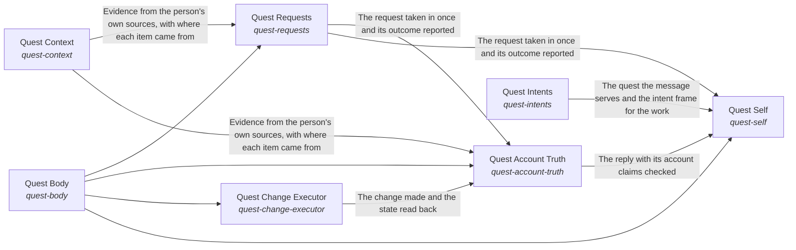

# Grounded AI that advances people's goals

Goals keep moving between a person's sessions, because the work they delegated gets done to the standard they wrote, and every answer and action rests on the person's own goals, material and preferences, and never on another person's.

*ESOI records of this intent (evolvable structure that optimizes intent), generated from the CSV files beside this page by `esoi readmes`. Edit the CSV files, not this page.*

Opportunities: Other products that need an AI which works from a person's own goals and material could reuse this engine, so the grounding, the standard for delegated work and the scope fences are built once and shared.

## How the solutions fit together

quest-ai-runner turns a person's request or queued task into grounded work in one flow, and the Grounded goal agent is that flow. It takes the request in through Request intake, says what the person is working toward through Higher mind and chooses the context the request needs through Context choice. It reasons step by step through Mind, acts on the account through Body and Quest account access, and answers questions beyond the person's own material through Science. It has every run watched through Nervous System and holds the work to the metric that serves it through Critical Thinking. It asks the model through the Tiered model provider layer and stays comparable by metric through Integrity. It recalls what a request needs through Subconscious. Subconscious recalls the cards that match a request through Hub card store. Tiered model provider layer accounts for every call through Cost estimation, daily budget and host load guard. Mind starts each step on the model tier it picks through Cost-ordered model tier selector with outage and allowance recovery. Nervous System has the model oversee a run through Tiered model provider layer. Queued-task runner claims, runs and reports a queued task, asking the model through Tiered model provider layer and working in the account through Quest account access. It writes each prompt as a registered spec with an owner and a metric through Justified model calls. Body reads and changes the quest through Context card persistence backend, Quest account access and Queued-task runner. Higher mind saves what it learned through Context card persistence backend. Request intake hears from a live channel through Live messaging channel transport. Body changes the quest as the person asks through Quest change executor and writes files inside one folder through Bounded reversible file writer. Body reads from the sources the person's work lives in through Multi-source evidence retriever and hands a new goal to the right owner through Goal assignee and doability judge. Body does heavy work through Bounded autonomous work runner, makes one named change on an outside tool server through Allowlisted operation writer and claims only the reach that World grants. Quest change executor reaches the account through Quest account access and decides through Tiered model provider layer. Goal assignee and doability judge asks the model whether a goal is doable through Tiered model provider layer. World reaches a person through Live messaging channel transport and judges through Tiered model provider layer.

## Diagram

An arrow runs from the solution that provides to the solution that builds on it; its label is what the provider outputs.

## Solutions at a glance

| Solution | Handle | Entry call | Selected implementation | Metric |
|---|---|---|---|---|
| Quest Context | `quest-context` | no entry declared | Parallel multi-source composite (`composite`) | Retrieval recall of the right document over handbook questions, Update-offering correctness over synthetic quest channels, Pointer-resolution safety over offline cases |
| Quest Requests | `quest-requests` | no entry declared | Offline lifecycle harness (`qar_runner`) | Task lifecycle correctness over offline cases, Exactly-once mid-run delivery per run, and how fast it is seen, Answer pass rate gained per image described, Ways in that pass their own metric |
| Quest Body | `quest-body` | no entry declared | Quest HTTP client from the environment (`quest_client`) | Parity of Quest operations across access points |
| Quest Account Truth | `quest-account-truth` | no entry declared | Managed quest card plus optional live reads (today) (`card_and_reads`) | Account-state consistency across scripted sessions |
| Quest Change Executor | `quest-change-executor` | no entry declared | Planner-only orchestration (`qar_orchestrator`) | Final quest state against the request over the quest operation cases, Allowlist enforcement and exactly-once execution |
| Quest Consciousness | `quest-consciousness` | no entry declared | none selected | none yet |
| Intent Evolution | `intent-evolution` | no entry declared | none selected | none yet |
| Quest Intents | `quest-intents` | no entry declared | Separate stores read at the start of a request (today) (`separate_stores`) | Representative long-view carry-through across assigned quests, with nothing outside its branch |
| Quest Self | `quest-self` | no entry declared | quest-ai-runner library (`library`) | Judge pass rate over the chat quality cases, Whole-path turns right on a small mixed set, Quest answers that name the person's goal and circumstance and fit features to them, Day-with-Jarvis turns right end to end, Asks filed and deletes held before anything outward or irreversible happens, Replies that claim only what was done, Passing chat turns per dollar, Delegated tasks meeting their standard, Exact and consented changes, Data kept in scope, Engine reuse, Measured coverage, QAR overall score |

## Solutions from a library

- [Integrity](https://github.com/SpiritualData/ai-hub-of-hubs-structure/hubofhubs/the_self/README.md) (`system-integrity`): Keeps the hub generic: claims match evidence, records match code, and only failures that are hidden are reported. Adopted from the library `hub`.
- [Intake Sources](https://github.com/SpiritualData/ai-hub-of-hubs-structure/hubofhubs/the_body/README.md) (`talk-over-a-channel`): Declares where this system's requests come from (a chat, a task queue, a place where meeting action items are written) and reads the requests waiting at each, handing each over once. Adopted from the library `hub`.
- [Nervous System](https://github.com/SpiritualData/ai-hub-of-hubs-structure/hubofhubs/the_intelligence/README.md) (`nervous-system`): Watches a run and raises at most one small risk signal, with a severity and a reason, when a step cannot be undone or belongs to a person, and leaves ordinary work alone. Adopted from the library `hub`.
- [Vendor Model Caller](https://github.com/SpiritualData/ai-hub-of-hubs-structure/hubofhubs/the_world/model_plumbing/README.md) (`vendor-model-caller`): Plans, answers and lists models for one vendor, or for several through a router that steps to the next model when a provider fails. Adopted from the library `hub`.
- [Science](https://github.com/SpiritualData/ai-hub-of-hubs-structure/hubofhubs/the_world/README.md) (`the-science`): Looks up what public research says and returns observations a reader can cite. Adopted from the library `hub`.
- [Intelligence](https://github.com/SpiritualData/ai-hub-of-hubs-structure/esoi/README.md) (`the-intelligence`): How information is processed for one request: the long view is read, the request becomes a measurable goal, the Mind plans and writes the response from what the Subconscious and the World bring, and the result is checked for goal completion and response quality. Adopted from the library `hub`.
- [World](https://github.com/SpiritualData/ai-hub-of-hubs-structure/esoi/README.md) (`the-world`): Awareness of the outside and interaction with it: public science, the tools of the outside, the models the hub asks, and how current the hub's own research is. Adopted from the library `hub`.
- [Critical Thinking](https://github.com/SpiritualData/ai-hub-of-hubs-structure/hubofhubs/the_intelligence/README.md) (`critical-thinking`): Turns a request into a measurable target, and holds the result to it. Adopted from the library `hub`.
- [Goal Completion](https://github.com/SpiritualData/ai-hub-of-hubs-structure/hubofhubs/the_intelligence/critical_thinking/README.md) (`goal-completion`): Says whether the goal condition of a request or sub-goal was met, against the done-standard its metric names. Adopted from the library `hub`.
- [Response Quality](https://github.com/SpiritualData/ai-hub-of-hubs-structure/hubofhubs/the_intelligence/critical_thinking/README.md) (`response-quality`): Judges a response against a quality profile: a named set of criteria with weights and target values. Adopted from the library `hub`.
- [Higher Mind](https://github.com/SpiritualData/ai-hub-of-hubs-structure/hubofhubs/the_intelligence/README.md) (`higher-mind`): The long view across requests: Long-Term Memory retains and recalls what happened, Objectives holds the live hierarchy of intents and goals, and Guidance gives the Planner an infrequent longer-term nudge. Adopted from the library `hub`.
- [Guidance](https://github.com/SpiritualData/ai-hub-of-hubs-structure/hubofhubs/the_intelligence/higher_mind/README.md) (`guidance`): An infrequent, longer-term nudge to the Planner, drawn from the objectives and memory, and the context-specific criteria for what a good response is in this situation. Adopted from the library `hub`.
- [Tools](https://github.com/SpiritualData/ai-hub-of-hubs-structure/hubofhubs/the_world/README.md) (`the-tools`): What the AI can use or do outside the system, grouped by category. Adopted from the library `hub`.
- [Delegated Agent Sessions](https://github.com/SpiritualData/ai-hub-of-hubs-structure/hubofhubs/the_world/tools/README.md) (`run-deep-work`): Hands open-ended work to an agent that runs in its own session and reports back. Adopted from the library `hub`.
- [File Editing](https://github.com/SpiritualData/ai-hub-of-hubs-structure/hubofhubs/the_world/tools/README.md) (`write-files`): Changes a file by instruction and reports what changed. Adopted from the library `hub`.
- [Subconscious](https://github.com/SpiritualData/ai-hub-of-hubs-structure/hubofhubs/the_intelligence/README.md) (`the-subconscious`): Finds and prepares information for the Mind. Adopted from the library `hub`.
- [Mind](https://github.com/SpiritualData/ai-hub-of-hubs-structure/hubofhubs/the_intelligence/README.md) (`the-mind`): What the planning and responding AI can see for one request and how it outputs plans, requests and communications. Adopted from the library `hub`.
- [Model Plumbing](https://github.com/SpiritualData/ai-hub-of-hubs-structure/hubofhubs/the_world/README.md) (`justify-model-calls`): The one measured path every part uses to ask a model: the Model Tier Chooser picks the model for a tier and the Vendor Model Caller reaches the vendor and steps to the next provider when one fails. Adopted from the library `hub`.
- [Model Tier Chooser](https://github.com/SpiritualData/ai-hub-of-hubs-structure/hubofhubs/the_world/model_plumbing/README.md) (`model-tier-chooser`): Picks, for each model tier, the provider and model that passes the most work per dollar on the same cases, counting prepaid credits as cost. Adopted from the library `hub`.
- [Internal Context](https://github.com/SpiritualData/ai-hub-of-hubs-structure/hubofhubs/the_body/README.md) (`quest-context`): Declares where the system's data lives and which World tool reads it. Specializes the library `hub`.
- [Request Intake](https://github.com/SpiritualData/ai-hub-of-hubs-structure/hubofhubs/the_consciousness/README.md) (`quest-requests`): Takes in the requests people make from every source Body declares and attaches each to the person who made it, so the rest of the flow can ask for that person's Representative. Specializes the library `hub`.
- [Body](https://github.com/SpiritualData/ai-hub-of-hubs-structure/esoi/README.md) (`quest-body`): The AI system's form and internal context. Specializes the library `hub`.
- [Response Quality](https://github.com/SpiritualData/ai-hub-of-hubs-structure/hubofhubs/the_intelligence/critical_thinking/README.md) (`quest-account-truth`): Judges a response against a quality profile: a named set of criteria with weights and target values. Specializes the library `hub`.
- [Connected System Operations](https://github.com/SpiritualData/ai-hub-of-hubs-structure/hubofhubs/the_world/tools/README.md) (`quest-change-executor`): Calls an operation of a connected system, such as a write through an MCP server. Specializes the library `hub`.
- [Consciousness](https://github.com/SpiritualData/ai-hub-of-hubs-structure/esoi/README.md) (`quest-consciousness`): The humans who interact with the system: AI Representatives act for a person, Prioritization turns the person's priorities into ESOI, Judgment Calls decide when to ask that person, and Feedback Learning applies the person's feedback to specs and metrics. Specializes the library `hub`.
- [Objectives](https://github.com/SpiritualData/ai-hub-of-hubs-structure/hubofhubs/the_intelligence/higher_mind/README.md) (`quest-intents`): The live hierarchy of intents and goals across requests. Specializes the library `hub`.
- [The Self](https://github.com/SpiritualData/ai-hub-of-hubs-structure/esoi/README.md) (`quest-self`): Keeps the five kinds of part working as one whole: the Assembler builds them and reports the coverage, Integrity keeps the whole honest and generic and audits the run record, and Role Understanding says what each part is for. Specializes the library `hub`.

## Problems and ideals

**Problems**

- Help That Does Not Know The Person (`QP2`): A general assistant answers from general knowledge.
- Unreliable Help With The App (`prob-app-help-unreliable`): Questions about how to use Quest, or what its AI can do for the person, are answered from guesses instead of the product's documentation and actual reach: the AI describes a capability it does not have, or says it cannot do something it can.
- Lost Or Unreported Tasks (`QP1`): Quest tasks attached to goals can be lost, run twice, or end without an outcome the person sees.
- Different Answers On Different Surfaces (`QP4`): The same request can get a different answer depending on the Quest surface it came from.
- Contradictory Account State (`prob-account-state-contradicts`): What the AI says about the person's own account (which quests exist, what changed, whether a change ran) is re-derived each turn from whatever slice it read, and a change it made is not read back, so within one session it can report the same state two ways, repeat a change it already made, or propose again what it said was done.
- Different Science Evidence In Two Chats (`prob-science-search-duplicates-research-chat`): One science question can get different evidence in Quest chat than in Quest's research chat.
- Unrequested Or Partial Changes (`prob-unrequested-or-partial-changes`): A request to change a quest leads to changes that were not asked for, to only part of what was asked, or to the same change made twice.
- Advice Without A Way To Check It (`prob-experiments-not-proposed`): Advice and plans are given as one answer, not as the option most likely to work for this person with a metric to check it, and when the better option is unknown the AI does not propose an experiment that would settle it, though the app has an Experiments feature built for that.
- Work Cut Off From Its Purpose (`prob-work-misses-its-why`): Replies, experiments and finished work are chosen and judged from the quest alone, not from the top intent and metrics the quest serves, so effort can drift from what the person cares about most and gaps under an intent can go unnoticed.
- Answers Not Tied To The Person's Goal (`prob-quest-answer-not-tied-to-my-goal`): Asked how Quest could help, what a feature is for, or whether it is worth it, Quest AI can answer with a list of everything Quest has, or with a generic description, instead of the few features that fit this person's goal and circumstance, or it can assume a circumstance the person did not give.

**Ideals**

- Personally Grounded Help (`QI2`): Every answer and action rests on the person's own goals, material and preferences, and never on another person's.
- Self-Explaining App (`ideal-self-explaining-app`): Any question about how to use the app gets a correct answer from its own documentation, and the AI knows what it can do.
- Right Representative (`ideal-right-rep`): Each request is handled by the representative whose role and assigned quests fit it, and work spawned from a thread keeps that thread's representative unless the person chooses another.
- Dependable Delivery (`ideal-dependable-delivery`): What is handed to the system arrives once, in order, and is accounted for.
- Same Assistant Everywhere (`QI4`): A person gets the same assistant, with the same answer to the same request, on every Quest surface.
- Consistent Account State (`ideal-consistent-account-state`): What the AI says about the person's own account is true of the account when it says it, every time in a session.
- Exact Change (`ideal-exact-change`): The final state matches the request: everything asked, nothing else, once.
- Consistent Science Evidence (`ideal-science-through-one-search`): A science question gets the same evidence, weighed the same way, in Quest chat and in the research chat.
- Most-Likely Path (`ideal-most-likely-path`): Every recommendation is the option most likely to move the person's own metric toward their intent, and what is not known becomes an experiment.
- Purposeful Work (`ideal-purposeful-work`): Every piece of work names the ideal or gap it serves and is judged by that intent's metric.
- and 1 more: all 11 are in [ideals](#ideals) of the full record below

## Metrics and their leaders

- Provider routing, fallback, retry and cost correctness (`metric-call-a-model`): leader `multi_provider`, 56 of 56 cases
- Channel transport conformance to the gateway wire contract (`metric-talk-over-a-channel`): leader `openclaw_bridge`, 20 of 20 cases
- Overseer digest evidence and signal correctness on labelled scenarios (`metric-watch-a-run`): leader `digest_probe`, 16 of 16 cases
- Parts selected by measurement (`QME7`): leader `structure_library`, 13 of 17 cases
- Supported and calibrated answers to world questions (`metric-know-the-world`): leader `web_with_support_check`, 9 of 9 cases
- Hub of hubs (`metric-hub-of-hubs`): leader `registry_scan`, 244 of 271 cases
- Hub of hubs (`QME9`): leader `registry_scan`, 244 of 271 cases
- Correct selection decisions over the evolve-by-metric cases (`metric-metric-earns-its-run`): leader `structure_library`, 13 of 17 cases
- Intents whose solutions one paragraph and one diagram explain as the code builds them (`metric-solution-coherence`)
- Task lifecycle correctness over offline cases (`metric-run-queued-tasks`): leader `qar_runner`, 43 of 43 cases
- and 28 more: all 38 are in [metrics](#metrics) of the full record below

## Where to go next

- Sub-intent: [Body](../quest_ai_runner/the_body/internal_context/README.md) (What the AI says about a person's account is the account as it is now.)
- Sub-intent: [Taking in requests from anywhere](../quest_ai_runner/the_consciousness/request_intake/README.md) (A person or program reaches the runner from wherever they work and is understood the same way.)
- Sub-intent: [Critical Thinking](../quest_ai_runner/the_intelligence/critical_thinking/README.md) (Everything the AI does and says is continuously held to the metric that serves the person's goals.)
- Sub-intent: [Mind](../quest_ai_runner/the_intelligence/mind/README.md) (Every request is answered from everything its work has established so far, in the best way possible.)
- Sub-intent: [Nervous System](../quest_ai_runner/the_intelligence/nervous_system/README.md) (The AI system watches every run and brings in a person only where only a person can decide.)
- Sub-intent: [Subconscious](../quest_ai_runner/the_intelligence/subconscious/README.md) (The AI optimally recalls the part of the person's own knowledge that each request needs.)
- Sub-intent: [Integrity](../quest_ai_runner/the_self/integrity/README.md) (Every part of QAR is a specified solution whose best implementation runs as the state of the art moves.)
- Sub-intent: [Science](../quest_ai_runner/the_world/science/README.md) (What a request needs from beyond the person's own material comes from the world, with its source.)
- Sub-intent: [Holding the intents across quests](../quest_ai_runner/the_intelligence/higher_mind/objectives/README.md) (Each AI representative continuously acts from the standing view of the person's quests and intents.)
- Repository: [top README](../README.md)
- Records beside the code: [quest_ai_runner](../quest_ai_runner/README.md), [quest_ai_runner/the_body](../quest_ai_runner/the_body/README.md), [quest_ai_runner/the_consciousness](../quest_ai_runner/the_consciousness/README.md), [quest_ai_runner/the_intelligence](../quest_ai_runner/the_intelligence/README.md), [quest_ai_runner/the_self](../quest_ai_runner/the_self/README.md), [quest_ai_runner/the_body/configuration](../quest_ai_runner/the_body/configuration/README.md), [quest_ai_runner/the_body/host](../quest_ai_runner/the_body/host/README.md), [quest_ai_runner/the_consciousness/representatives](../quest_ai_runner/the_consciousness/representatives/README.md), [quest_ai_runner/the_world/model_plumbing/model_tier_chooser](../quest_ai_runner/the_world/model_plumbing/model_tier_chooser/README.md), [quest_ai_runner/the_world/model_plumbing/spend](../quest_ai_runner/the_world/model_plumbing/spend/README.md), [quest_ai_runner/the_world/model_plumbing/vendor_model_caller](../quest_ai_runner/the_world/model_plumbing/vendor_model_caller/README.md), [quest_ai_runner/the_world/tools/connected_system_operations](../quest_ai_runner/the_world/tools/connected_system_operations/README.md), [quest_ai_runner/the_world/tools/delegated_agent_sessions](../quest_ai_runner/the_world/tools/delegated_agent_sessions/README.md), [quest_ai_runner/the_world/tools/file_editing](../quest_ai_runner/the_world/tools/file_editing/README.md), [quest_ai_runner/the_world/tools/file_reading](../quest_ai_runner/the_world/tools/file_reading/README.md), [quest_ai_runner/the_world/tools/web_search](../quest_ai_runner/the_world/tools/web_search/README.md), [evaluation/components/choose_a_model_tier/impls](../evaluation/components/choose_a_model_tier/impls/README.md), [evaluation/components/claim_reach/impls](../evaluation/components/claim_reach/impls/README.md), [evaluation/components/deep_run/impls](../evaluation/components/deep_run/impls/README.md), [evaluation/components/deep_runner/impls](../evaluation/components/deep_runner/impls/README.md), [evaluation/components/evolve_by_metric/impls](../evaluation/components/evolve_by_metric/impls/README.md), [evaluation/components/hand_off_a_goal/impls](../evaluation/components/hand_off_a_goal/impls/README.md), [evaluation/components/hub_of_hubs/impls](../evaluation/components/hub_of_hubs/impls/README.md), [evaluation/components/know_the_world/impls](../evaluation/components/know_the_world/impls/README.md), [evaluation/components/model_providers/impls](../evaluation/components/model_providers/impls/README.md), [evaluation/components/overseer_signals/impls](../evaluation/components/overseer_signals/impls/README.md), [evaluation/components/quest_ops/impls](../evaluation/components/quest_ops/impls/README.md), [evaluation/components/talk_over_a_channel/impls](../evaluation/components/talk_over_a_channel/impls/README.md), [evaluation/components/track_usage_and_cost/impls](../evaluation/components/track_usage_and_cost/impls/README.md), [evaluation/components/write_files/impls](../evaluation/components/write_files/impls/README.md), [evaluation/components/write_through_mcp/impls](../evaluation/components/write_through_mcp/impls/README.md)
- Records: [intent.csv](intent.csv), [solutions.csv](solutions.csv), [implementations.csv](implementations.csv), [metrics.csv](metrics.csv)
- Diagram page: [diagram.md](diagram.md)

---

## The full record

### Problems

- Help That Does Not Know The Person (`QP2`): A general assistant answers from general knowledge.
- Unreliable Help With The App (`prob-app-help-unreliable`): Questions about how to use Quest, or what its AI can do for the person, are answered from guesses instead of the product's documentation and actual reach: the AI describes a capability it does not have, or says it cannot do something it can.
- Lost Or Unreported Tasks (`QP1`): Quest tasks attached to goals can be lost, run twice, or end without an outcome the person sees.
- Different Answers On Different Surfaces (`QP4`): The same request can get a different answer depending on the Quest surface it came from.
- Contradictory Account State (`prob-account-state-contradicts`): What the AI says about the person's own account (which quests exist, what changed, whether a change ran) is re-derived each turn from whatever slice it read, and a change it made is not read back, so within one session it can report the same state two ways, repeat a change it already made, or propose again what it said was done.
- Different Science Evidence In Two Chats (`prob-science-search-duplicates-research-chat`): One science question can get different evidence in Quest chat than in Quest's research chat.
- Unrequested Or Partial Changes (`prob-unrequested-or-partial-changes`): A request to change a quest leads to changes that were not asked for, to only part of what was asked, or to the same change made twice.
- Advice Without A Way To Check It (`prob-experiments-not-proposed`): Advice and plans are given as one answer, not as the option most likely to work for this person with a metric to check it, and when the better option is unknown the AI does not propose an experiment that would settle it, though the app has an Experiments feature built for that.
- Work Cut Off From Its Purpose (`prob-work-misses-its-why`): Replies, experiments and finished work are chosen and judged from the quest alone, not from the top intent and metrics the quest serves, so effort can drift from what the person cares about most and gaps under an intent can go unnoticed.
- Answers Not Tied To The Person's Goal (`prob-quest-answer-not-tied-to-my-goal`): Asked how Quest could help, what a feature is for, or whether it is worth it, Quest AI can answer with a list of everything Quest has, or with a generic description, instead of the few features that fit this person's goal and circumstance, or it can assume a circumstance the person did not give.

### Ideals

- Personally Grounded Help (`QI2`): Every answer and action rests on the person's own goals, material and preferences, and never on another person's.
- Self-Explaining App (`ideal-self-explaining-app`): Any question about how to use the app gets a correct answer from its own documentation, and the AI knows what it can do.
- Right Representative (`ideal-right-rep`): Each request is handled by the representative whose role and assigned quests fit it, and work spawned from a thread keeps that thread's representative unless the person chooses another.
- Dependable Delivery (`ideal-dependable-delivery`): What is handed to the system arrives once, in order, and is accounted for.
- Same Assistant Everywhere (`QI4`): A person gets the same assistant, with the same answer to the same request, on every Quest surface.
- Consistent Account State (`ideal-consistent-account-state`): What the AI says about the person's own account is true of the account when it says it, every time in a session.
- Exact Change (`ideal-exact-change`): The final state matches the request: everything asked, nothing else, once.
- Consistent Science Evidence (`ideal-science-through-one-search`): A science question gets the same evidence, weighed the same way, in Quest chat and in the research chat.
- Most-Likely Path (`ideal-most-likely-path`): Every recommendation is the option most likely to move the person's own metric toward their intent, and what is not known becomes an experiment.
- Purposeful Work (`ideal-purposeful-work`): Every piece of work names the ideal or gap it serves and is judged by that intent's metric.
- Goal-Fitted Answer (`ideal-quest-answer-fits-my-goal`): When a person asks what Quest can do for them, the answer picks the few features that fit their own goal and circumstance and says why each helps, instead of listing everything.

### Solutions

| Solution | Handle | Selected | Metric |
|---|---|---|---|
| Quest Context | `quest-context` | Parallel multi-source composite (`composite`) | Retrieval recall of the right document over handbook questions, Update-offering correctness over synthetic quest channels, Pointer-resolution safety over offline cases |
| Quest Requests | `quest-requests` | Offline lifecycle harness (`qar_runner`) | Task lifecycle correctness over offline cases, Exactly-once mid-run delivery per run, and how fast it is seen, Answer pass rate gained per image described, Ways in that pass their own metric |
| Quest Body | `quest-body` | Quest HTTP client from the environment (`quest_client`) | Parity of Quest operations across access points |
| Quest Account Truth | `quest-account-truth` | Managed quest card plus optional live reads (today) (`card_and_reads`) | Account-state consistency across scripted sessions |
| Quest Change Executor | `quest-change-executor` | Planner-only orchestration (`qar_orchestrator`) | Final quest state against the request over the quest operation cases, Allowlist enforcement and exactly-once execution |
| Quest Consciousness | `quest-consciousness` | none selected | none yet |
| Intent Evolution | `intent-evolution` | none selected | none yet |
| Quest Intents | `quest-intents` | Separate stores read at the start of a request (today) (`separate_stores`) | Representative long-view carry-through across assigned quests, with nothing outside its branch |
| Quest Self | `quest-self` | quest-ai-runner library (`library`) | Judge pass rate over the chat quality cases, Whole-path turns right on a small mixed set, Quest answers that name the person's goal and circumstance and fit features to them, Day-with-Jarvis turns right end to end, Asks filed and deletes held before anything outward or irreversible happens, Replies that claim only what was done, Passing chat turns per dollar, Delegated tasks meeting their standard, Exact and consented changes, Data kept in scope, Engine reuse, Measured coverage, QAR overall score |

### Implementations

| Implementation | Handle | Where | Sub-intent |
|---|---|---|---|
| Per-consumer worker | `quest-self:per-consumer-worker` |  |  |
| Agent framework with Quest glue | `quest-self:agent-framework-with-quest-glue` |  |  |
| Deep runner only | `quest-self:deep-runner-only` |  |  |
| Carried message stream per request (proposed) | `the-mind:append_only_stream` |  |  |
| Carried stream with compaction (proposed) | `the-mind:stream_with_compaction` |  |  |
| Small-model judge of every candidate (proposed) | `the-subconscious:goal_judge` |  |  |
| Score thresholds per source (proposed) | `the-subconscious:score_thresholds` |  |  |
| Thresholds with a judge on the borderline (proposed) | `the-subconscious:thresholds_then_judge` |  |  |
| Host research sources first, then the web (proposed) | `the-science:research_sources_first` |  |  |
| Findings weighed by a host's evidence-estimation service (proposed) | `the-science:evidence_weighted` |  |  |
| Read back what a change touched (proposed) | `quest-account-truth:read_after_write` |  |  |
| A live read behind every state claim (proposed) | `quest-account-truth:live_read_only` |  |  |
| Maintained view per quest only (proposed) | `quest-intents:per_quest_note` |  |  |
| Periodic reflection on the best tier (proposed) | `quest-intents:periodic_reflection` |  |  |
| Outcome precedents surfaced at admission (proposed) | `the-subconscious:outcome_precedents` |  |  |
| Overseer that asks questions of fact (proposed) | `nervous-system:fact_questions` |  |  |
| Every request measured by code (proposed) | `critical-thinking:every_request_measured` |  |  |
| Measured, proposed and answered (proposed) | `critical-thinking:measured_proposed_and_answered` |  |  |
| Per-risk response chosen by metric (proposed) | `nervous-system:per_risk_response` |  |  |
| One view per intent, cascading down (proposed) | `quest-intents:per_intent_cascade` |  |  |
| One view per representative across its assigned quests, placed in the hierarchy (proposed, recommended) | `quest-intents:per_rep_assigned_view` |  |  |
| Registry plus per-call ablation against the owner metric (proposed) | `justify-model-calls:spec_registry_ablation` |  |  |
| Subprocess goal runner | `run-deep-work:subprocess` | [quest_ai_runner/the_intelligence/mind/delegation/goal_runner.py](../quest_ai_runner/the_intelligence/mind/delegation/goal_runner.py) |  |
| Coding agent with the host reach summary and reach judge (built, off by default) | `the-tools:coding_agent_reach_judge` | [quest_ai_runner/the_intelligence/mind/planner/reach_judge.py](../quest_ai_runner/the_intelligence/mind/planner/reach_judge.py) |  |
| Offline lifecycle harness | `quest-requests:qar_runner` | [quest_ai_runner/the_body/area_body.py](../quest_ai_runner/the_body/area_body.py) |  |
| Managed quest card plus optional live reads (today) | `quest-account-truth:card_and_reads` | [quest_ai_runner/the_body/area_body.py](../quest_ai_runner/the_body/area_body.py) | [internal_context](internal_context/README.md) |
| Quest HTTP client from the environment | `quest-body:quest_client` | [quest_ai_runner/the_body/area_body.py](../quest_ai_runner/the_body/area_body.py) |  |
| Planner-only orchestration | `quest-change-executor:qar_orchestrator` | [quest_ai_runner/the_body/area_body.py](../quest_ai_runner/the_body/area_body.py) |  |
| Coding agent, reach described in the prompt (today) | `the-tools:coding_agent_prompt_reach` | [quest_ai_runner/the_body/area_body.py](../quest_ai_runner/the_body/area_body.py) |  |
| Two small model verdicts when a goal is created (today) | `quest-representatives:model_judge` | [quest_ai_runner/the_body/area_body.py](../quest_ai_runner/the_body/area_body.py) |  |
| Task poller and claimer | `quest-requests:poller` | [quest_ai_runner/the_consciousness/request_intake/poller.py](../quest_ai_runner/the_consciousness/request_intake/poller.py) |  |
| Single-task executor | `quest-requests:executor` | [quest_ai_runner/the_consciousness/request_intake/executor.py](../quest_ai_runner/the_consciousness/request_intake/executor.py) |  |
| Shared lane entry point | `quest-requests:lane` | [quest_ai_runner/the_consciousness/request_intake/lane.py](../quest_ai_runner/the_consciousness/request_intake/lane.py) |  |
| Digest-driven overseer | `nervous-system:overseer` | [quest_ai_runner/the_intelligence/nervous_system/area.py](../quest_ai_runner/the_intelligence/nervous_system/area.py) | [nervous_system](nervous_system/README.md) |
| Apply the evolvable-structure library | `system-integrity:structure-library` | [quest_ai_runner/the_intelligence/critical_thinking/response_quality/area.py](../quest_ai_runner/the_intelligence/critical_thinking/response_quality/area.py) | [integrity](integrity/README.md) |
| Rebuilt prompt per step with a referenced context (today) | `the-mind:rebuilt_per_step` | [quest_ai_runner/the_intelligence/mind/area_mind.py](../quest_ai_runner/the_intelligence/mind/area_mind.py) | [mind](mind/README.md) |
| Separate stores read at the start of a request (today) | `quest-intents:separate_stores` | [quest_ai_runner/the_intelligence/higher_mind/objectives/area.py](../quest_ai_runner/the_intelligence/higher_mind/objectives/area.py) | [objectives](objectives/README.md) |
| Code-enforced before and after on deep runs only (today) | `critical-thinking:deep_runs_only` | [quest_ai_runner/the_intelligence/critical_thinking/area.py](../quest_ai_runner/the_intelligence/critical_thinking/area.py) | [critical_thinking](critical_thinking/README.md) |
| Channels, terminal and package as ways in | `quest-requests:ways_in` | [quest_ai_runner/the_intelligence/mind/planner/area_take_in_the_world.py](../quest_ai_runner/the_intelligence/mind/planner/area_take_in_the_world.py) | [request_intake](request_intake/README.md) |
| Rebuilt prompt per step with the context re-sent from cache | `the-mind:rebuilt_full_context` | [quest_ai_runner/the_intelligence/mind/planner/orchestrator_planning.py](../quest_ai_runner/the_intelligence/mind/planner/orchestrator_planning.py) |  |
| Start-of-run card filter and a recency window (today) | `the-subconscious:recency_window` | [quest_ai_runner/the_intelligence/mind/context_intake/planner_context.py](../quest_ai_runner/the_intelligence/mind/context_intake/planner_context.py) | [subconscious](subconscious/README.md) |
| No overseer (configuration off) | `nervous-system:no_overseer` | [quest_ai_runner/the_intelligence/mind/orchestrator_types.py](../quest_ai_runner/the_intelligence/mind/orchestrator_types.py) |  |
| Work-folder sync | `quest-requests:quest_folder_sync` | [quest_ai_runner/the_intelligence/higher_mind/objectives/quest_folder_sync.py](../quest_ai_runner/the_intelligence/higher_mind/objectives/quest_folder_sync.py) |  |
| quest-ai-runner library | `quest-self:library` | [quest_ai_runner/the_self/respond.py](../quest_ai_runner/the_self/respond.py) |  |
| Standing instruction alone (floor) | `critical-thinking:instruction_only` | [quest_ai_runner/the_self/integrity/prompts/standing_instructions.py](../quest_ai_runner/the_self/integrity/prompts/standing_instructions.py) |  |
| Registered prompt specs with an enforcement test (today) | `justify-model-calls:spec_registry` | [quest_ai_runner/the_self/integrity/prompts/prompt_specs.py](../quest_ai_runner/the_self/integrity/prompts/prompt_specs.py) |  |
| One-call fast file editor | `run-deep-work:fast_edit` | [quest_ai_runner/the_body/configuration/config_resolvers.py](../quest_ai_runner/the_body/configuration/config_resolvers.py) |  |
| One-call MCP operation runner | `run-deep-work:mcp_write` | [quest_ai_runner/the_body/configuration/config_resolvers.py](../quest_ai_runner/the_body/configuration/config_resolvers.py) |  |
| Lean guarded launch of the deep worker | `run-deep-work:lean_guarded` | [quest_ai_runner/the_body/configuration/deep_launch.py](../quest_ai_runner/the_body/configuration/deep_launch.py) |  |
| Hysteresis resource guard | `justify-model-calls:resources` | [quest_ai_runner/the_body/host/resources.py](../quest_ai_runner/the_body/host/resources.py) |  |
| Configured persona resolver | `quest-requests:personas` | [quest_ai_runner/the_consciousness/representatives/personas.py](../quest_ai_runner/the_consciousness/representatives/personas.py) |  |
| Difficulty-to-rung starter | `model-tier-chooser:deep_model_selection` | [quest_ai_runner/the_world/model_plumbing/model_tier_chooser/deep_model_selection.py](../quest_ai_runner/the_world/model_plumbing/model_tier_chooser/deep_model_selection.py) |  |
| Live tier registry | `model-tier-chooser:model_registry` | [quest_ai_runner/the_world/model_plumbing/model_tier_chooser/model_registry.py](../quest_ai_runner/the_world/model_plumbing/model_tier_chooser/model_registry.py) |  |
| Subscription allowance limit detector | `model-tier-chooser:usage_limit` | [quest_ai_runner/the_world/model_plumbing/model_tier_chooser/usage_limit.py](../quest_ai_runner/the_world/model_plumbing/model_tier_chooser/usage_limit.py) |  |
| Static price table lookup | `justify-model-calls:pricing` | [quest_ai_runner/the_world/model_plumbing/spend/pricing.py](../quest_ai_runner/the_world/model_plumbing/spend/pricing.py) |  |
| Persisted daily token tracker | `justify-model-calls:usage` | [quest_ai_runner/the_world/model_plumbing/spend/usage.py](../quest_ai_runner/the_world/model_plumbing/spend/usage.py) |  |
| Prefix-routing multi-provider | `vendor-model-caller:multi_provider` | [quest_ai_runner/the_world/model_plumbing/vendor_model_caller/providers.py](../quest_ai_runner/the_world/model_plumbing/vendor_model_caller/providers.py) |  |
| Keyless command-line provider | `vendor-model-caller:claude_cli` | [quest_ai_runner/the_world/model_plumbing/vendor_model_caller/claude_cli_provider.py](../quest_ai_runner/the_world/model_plumbing/vendor_model_caller/claude_cli_provider.py) |  |
| MCP gateway bridge transport | `talk-over-a-channel:openclaw` | [quest_ai_runner/the_world/tools/connected_system_operations/openclaw_channel.py](../quest_ai_runner/the_world/tools/connected_system_operations/openclaw_channel.py) |  |
| Parallel multi-source composite | `quest-context:composite` | [quest_ai_runner/the_world/tools/connected_system_operations/composite_retrieval_adapter.py](../quest_ai_runner/the_world/tools/connected_system_operations/composite_retrieval_adapter.py) |  |
| MCP server reader | `quest-context:mcp` | [quest_ai_runner/the_world/tools/connected_system_operations/mcp_retrieval_adapter.py](../quest_ai_runner/the_world/tools/connected_system_operations/mcp_retrieval_adapter.py) |  |
| Notion database reader | `quest-context:notion` | [quest_ai_runner/the_world/tools/connected_system_operations/notion_adapter.py](../quest_ai_runner/the_world/tools/connected_system_operations/notion_adapter.py) |  |
| Drive document reader | `quest-context:google_drive` | [quest_ai_runner/the_world/tools/connected_system_operations/google_drive_adapter.py](../quest_ai_runner/the_world/tools/connected_system_operations/google_drive_adapter.py) |  |
| Chat conversation reader | `quest-context:google_chat` | [quest_ai_runner/the_world/tools/connected_system_operations/google_chat_adapter.py](../quest_ai_runner/the_world/tools/connected_system_operations/google_chat_adapter.py) |  |
| MCP operation writer | `quest-change-executor:mcp` | [quest_ai_runner/the_world/tools/connected_system_operations/mcp_write_adapter.py](../quest_ai_runner/the_world/tools/connected_system_operations/mcp_write_adapter.py) |  |
| Agent-protocol deep runner | `run-deep-work:acp` | [quest_ai_runner/the_world/tools/delegated_agent_sessions/acp_deep_runner.py](../quest_ai_runner/the_world/tools/delegated_agent_sessions/acp_deep_runner.py) |  |
| Persistent stream-json runner | `run-deep-work:stream_json` | [quest_ai_runner/the_world/tools/delegated_agent_sessions/goal_runner_stream.py](../quest_ai_runner/the_world/tools/delegated_agent_sessions/goal_runner_stream.py) |  |
| Contained backed-up writer | `write-files:files` | [quest_ai_runner/the_world/tools/file_editing/files_writer.py](../quest_ai_runner/the_world/tools/file_editing/files_writer.py) |  |
| Local file tree reader | `quest-context:files` | [quest_ai_runner/the_world/tools/file_reading/files_adapter.py](../quest_ai_runner/the_world/tools/file_reading/files_adapter.py) |  |
| Remote file server reader | `quest-context:remote_files_adapter` | [quest_ai_runner/the_world/tools/file_reading/remote_files_adapter.py](../quest_ai_runner/the_world/tools/file_reading/remote_files_adapter.py) |  |
| Web research with the answer's support check (today) | `the-science:web_with_support_check` | [quest_ai_runner/the_world/tools/web_search/area.py](../quest_ai_runner/the_world/tools/web_search/area.py) | [science](science/README.md) |
| Live selection evaluation arm | `model-tier-chooser:qar_selection` | [evaluation/components/choose_a_model_tier/impls/qar_selection.py](../evaluation/components/choose_a_model_tier/impls/qar_selection.py) |  |
| Scripted ideal decisions, no model call (offline) | `the-tools:scripted_ideal` | [evaluation/components/claim_reach/impls/scripted_ideal.py](../evaluation/components/claim_reach/impls/scripted_ideal.py) |  |
| Rules only, no model (floor) | `the-tools:rules_only` | [evaluation/components/claim_reach/impls/rules_only.py](../evaluation/components/claim_reach/impls/rules_only.py) |  |
| Goal contract rules check | `run-deep-work:goal_contract` | [evaluation/components/deep_run/impls/goal_contract.py](../evaluation/components/deep_run/impls/goal_contract.py) |  |
| Subprocess runner scenarios | `run-deep-work:subprocess_runner` | [evaluation/components/deep_runner/impls/subprocess_runner.py](../evaluation/components/deep_runner/impls/subprocess_runner.py) |  |
| Agent-protocol runner scenarios | `run-deep-work:acp_runner` | [evaluation/components/deep_runner/impls/acp_runner.py](../evaluation/components/deep_runner/impls/acp_runner.py) |  |
| Evolvable-structure library decides (live) | `system-integrity:structure_library` | [evaluation/components/evolve_by_metric/impls/structure_library.py](../evaluation/components/evolve_by_metric/impls/structure_library.py) |  |
| Keep the selection as written (floor) | `system-integrity:keep_current` | [evaluation/components/evolve_by_metric/impls/keep_current.py](../evaluation/components/evolve_by_metric/impls/keep_current.py) |  |
| Creator keeps the goal, no model call (floor, proposed) | `quest-representatives:creator_keeps_it` | [evaluation/components/hand_off_a_goal/impls/creator_keeps_it.py](../evaluation/components/hand_off_a_goal/impls/creator_keeps_it.py) |  |
| Registry read together with the code (today) | `system-integrity:registry_scan` | [evaluation/components/hub_of_hubs/impls/registry_scan.py](../evaluation/components/hub_of_hubs/impls/registry_scan.py) |  |
| Memory only, no research (floor) | `the-science:memory_only` | [evaluation/components/know_the_world/impls/memory_only.py](../evaluation/components/know_the_world/impls/memory_only.py) |  |
| Single flat provider floor | `vendor-model-caller:single_provider` | [evaluation/components/model_providers/impls/single_provider.py](../evaluation/components/model_providers/impls/single_provider.py) |  |
| No-judgement digest probe | `nervous-system:digest_probe` | [evaluation/components/overseer_signals/impls/digest_probe.py](../evaluation/components/overseer_signals/impls/digest_probe.py) |  |
| Live overseer model arm | `nervous-system:live_model` | [evaluation/components/overseer_signals/impls/live_model.py](../evaluation/components/overseer_signals/impls/live_model.py) |  |
| Direct tool-call ablation | `quest-change-executor:direct_tool_call` | [evaluation/components/quest_ops/impls/direct_tool_call.py](../evaluation/components/quest_ops/impls/direct_tool_call.py) |  |
| Fake-gateway conformance arm | `talk-over-a-channel:openclaw_bridge` | [evaluation/components/talk_over_a_channel/impls/openclaw_bridge.py](../evaluation/components/talk_over_a_channel/impls/openclaw_bridge.py) |  |
| Live usage evaluation arm | `justify-model-calls:qar_usage` | [evaluation/components/track_usage_and_cost/impls/qar_usage.py](../evaluation/components/track_usage_and_cost/impls/qar_usage.py) |  |
| Scratch-tree boundary check | `write-files:bounded_writer` | [evaluation/components/write_files/impls/bounded_writer.py](../evaluation/components/write_files/impls/bounded_writer.py) |  |
| Fake-client allowlist check | `quest-change-executor:allowlist_writer` | [evaluation/components/write_through_mcp/impls/allowlist_writer.py](../evaluation/components/write_through_mcp/impls/allowlist_writer.py) |  |

### Metrics

- Provider routing, fallback, retry and cost correctness (`metric-call-a-model`): `esoi run model_providers --impl multi_provider`
- Channel transport conformance to the gateway wire contract (`metric-talk-over-a-channel`): `esoi run talk_over_a_channel --impl openclaw_bridge`
- Overseer digest evidence and signal correctness on labelled scenarios (`metric-watch-a-run`): `esoi run overseer_signals --impl live_model; esoi run overseer_signals --impl digest_probe`
- Parts selected by measurement (`QME7`): `esoi run evolve_by_metric --impl structure_library`
- Supported and calibrated answers to world questions (`metric-know-the-world`): `esoi run know_the_world --impl web_with_support_check`
- Hub of hubs (`metric-hub-of-hubs`): `esoi run hub_of_hubs --impl registry_scan`
- Hub of hubs (`QME9`): `esoi run hub_of_hubs --impl registry_scan`
- Correct selection decisions over the evolve-by-metric cases (`metric-metric-earns-its-run`): `esoi run evolve_by_metric --impl structure_library`
- Intents whose solutions one paragraph and one diagram explain as the code builds them (`metric-solution-coherence`): `python3 -m esoi.structure.structure_check.coherence --gate`
- Task lifecycle correctness over offline cases (`metric-run-queued-tasks`): `esoi run run_queued_tasks --impl qar_runner`
- Requests held to their ESOI metric by code (`metric-think-critically`): `esoi run think_critically --impl deep_runs_only`
- Retrieval recall of the right document over handbook questions (`metric-gather-evidence`): `esoi run retrieval --impl composite; esoi run retrieval_sources --impl files_adapter`
- Combined world score (`metric-claim-reach`): `esoi run claim_reach --impl scripted_ideal`
- Ways in that pass their own metric (`metric-take-in-the-world`): `none`
- Final quest state against the request over the quest operation cases (`metric-operate-a-quest`): `esoi run quest_ops --impl qar_orchestrator`
- Outcome reporting correctness across deep runners (`metric-run-deep-work`): `esoi run deep_runner --impl subprocess_runner; esoi run deep_run --impl goal_contract`
- Write boundary and reversibility over the scratch-tree cases (`metric-write-files`): `esoi run write_files --impl bounded_writer`
- Allowlist enforcement and exactly-once execution (`metric-write-through-mcp`): `esoi run write_through_mcp --impl allowlist_writer`
- Hand-offs a person keeps per unit of cost and time (`metric-hand-off-a-goal`): `esoi run hand_off_a_goal --impl model_judge`
- Goal loop outcomes against the done-standard (`metric-goal-met-by-evidence-and-coverage`): `esoi run deep_run --impl goal_contract`
- Deep worker launch settings ranked by cost per goal met (`metric-harness-context-subagents-recursion-ranked`): `esoi run deep_runner --impl subprocess_runner`
- Account-state consistency across scripted sessions (`metric-act-as-the-body`): `esoi run act_as_the_body --impl card_and_reads`
- Parity of Quest operations across access points (`metric-quest-operations-parity`): `none`
- Step continuity at cost over multi-step requests (`metric-keep-a-working-stream`): `esoi run keep_a_working_stream --impl rebuilt_per_step --sample 3 --max-calls 40`
- Representative long-view carry-through across assigned quests, with nothing outside its branch (`metric-hold-the-long-view`): `esoi run hold_the_long_view --impl separate_stores`
- Context handed to the planner (`metric-choose-the-context`): `esoi run context_choice --impl per_lane_assembly`
- Goal-relevant admission at a precision floor with nothing out of scope (`metric-admit-to-the-mind`): `esoi run admit_to_the_mind --impl recency_window`
- Passing chat turns per dollar (`QME1`): `esoi run chat_quality --impl dev_quest_chat --sample 10 --max-calls 300`
- Delegated tasks meeting their standard (`QME2`): `none`
- Exact and consented changes (`QME3`): `none`
- Data kept in scope (`QME4`): `none`
- Engine reuse (`QME5`): `none`
- Measured coverage (`QME6`): `none`
- QAR overall score (`metric-qar-overall`): `esoi run qar_overall --impl recorded_rows`
- Justified share of model spend (`metric-justified-model-spend`): `esoi run justified_model_spend --impl spec_registry_ablation`
- Justified model spend (`QME8`): `esoi run justified_model_spend --impl spec_registry_ablation`
- Cost, budget and resource-guard correctness (`metric-track-usage-and-cost`): `esoi run track_usage_and_cost --impl qar_usage`
- Model tier selection and limit-recognition correctness (`metric-choose-a-model-tier`): `esoi run choose_a_model_tier --impl qar_selection`
