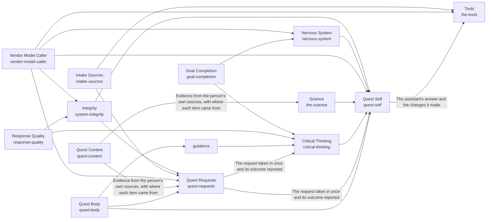

# Quest AI Runner

A Quest user's AI system continuously evolves to help the user continuously evolve towards their intents.

*ESOI records of this intent (evolvable structure that optimizes intent), generated from the CSV files beside this page by `esoi readmes`. Edit the CSV files, not this page.*

Opportunities: Other products that need an AI which works from a person's own goals and material could reuse this engine, so the grounding, the standard for delegated work and the scope fences are built once and shared.

## How the solutions fit together

Quest AI Runner turns what a Quest user asks into work that moves their intents, and Quest Self is the one assistant that does it. Quest Self asks Quest Consciousness who is asking and what they are growing toward, reads their account and their own material through Quest Body, reasons about the request through Intelligence and reaches what lies outside through World. Quest Consciousness takes each request in through Quest Requests, hands it to the representative that fits through Quest Representatives, asks a person only for what is theirs through Quest Decision Requests, learns from feedback through Feedback Learning and proposes what is most likely to work for their intents through Intent Evolution. Quest Body keeps the person's Quest data in Quest Context, changes it exactly as asked through Quest Change Executor and keeps what is said about an account true through Quest Account Truth. Intelligence plans each request through Mind, recalls what it needs through Subconscious, keeps the long view through Higher Mind with Guidance and Quest Intents, and holds the work to a measure through Critical Thinking with Goal Completion and Response Quality. World asks models through Model Plumbing with Model Tier Chooser and Vendor Model Caller, uses outside tools through Tools with Delegated Agent Sessions and File Editing, and answers from public research through Science. Nervous System watches every run, Intake Sources brings requests in from where people work and Integrity keeps every part a specified solution that is measured.

## Diagram

An arrow runs from the solution that provides to the solution that builds on it; its label is what the provider outputs.

## Solutions at a glance

| Solution | Handle | Entry call | Selected implementation | Metric |
|---|---|---|---|---|
| Integrity | `system-integrity` | `quest_ai_runner.run("system-integrity", ['examplevendor'])` | Apply the evolvable-structure library (`structure-library`) | Parts selected by measurement, Hub of hubs, Hub of hubs, Correct selection decisions over the evolve-by-metric cases, Intents whose solutions one paragraph and one diagram explain as the code builds them, Public surface conformance on fixture inputs, Example runnability on an empty environment, Configuration precedence and validation correctness, Command-line parsing, refusal and output correctness, Documentation coverage and voice conformance, Correct terminal helper verdicts within the wait a person accepts, Offline test collection, Secret detection and placeholder tolerance, Right solution missed without the tag |
| Intake Sources | `intake-sources` | `quest_ai_runner.run("intake-sources")` | MCP gateway bridge transport (`openclaw`) | Channel transport conformance to the gateway wire contract |
| Nervous System | `nervous-system` | `quest_ai_runner.run("nervous-system", 'delete the old backup folder')` | Digest-driven overseer (`overseer`) | Overseer digest evidence and signal correctness on labelled scenarios |
| Vendor Model Caller | `vendor-model-caller` | `quest_ai_runner.run("vendor-model-caller", ...)` | Prefix-routing multi-provider (`multi_provider`) | Provider routing, fallback, retry and cost correctness |
| Science | `the-science` | `quest_ai_runner.run("the-science", 'meditation and attention')` | Web research with the answer's support check (today) (`web_with_support_check`) | Supported and calibrated answers to world questions |
| Intelligence | `the-intelligence` | no entry declared | `composition` | none yet |
| World | `the-world` | no entry declared | `composition` | none yet |
| Critical Thinking | `critical-thinking` | `quest_ai_runner.run("critical-thinking", ...)` | Code-enforced before and after on deep runs only (today) (`deep_runs_only`) | Requests held to their ESOI metric by code |
| Goal Completion | `goal-completion` | `quest_ai_runner.run("goal-completion", ...)` | Production judges under a scripted provider (`qar_judges`) | Judge deterministic-half correctness with a scripted provider |
| Response Quality | `response-quality` | `quest_ai_runner.run("response-quality", 'See https://example.org/a for details.')` | Production guard engines under test (`qar_guards`) | Reply guard correctness over link, recipe and anticipation cases, Judge agreement with labelled reference replies |
| Higher Mind | `higher-mind` | no entry declared | none selected | none yet |
| Guidance | `guidance` | `quest_ai_runner.run("guidance", 'quest-id')` | Computed frame in the prompt (`frame-line`) | Intent-grounded pass rate, Two-sided long-term guidance |
| Tools | `the-tools` | `quest_ai_runner.run("the-tools", 'Send the launch note to the whole team')` | Coding agent, reach described in the prompt (today) (`coding_agent_prompt_reach`) | Combined world score |
| Quest Context | `quest-context` | `quest_ai_runner.run("quest-context", 'NOTES.md')` | Parallel multi-source composite (`composite`) | Retrieval recall of the right document over handbook questions, Update-offering correctness over synthetic quest channels, Pointer-resolution safety over offline cases |
| Quest Requests | `quest-requests` | `quest_ai_runner.run("quest-requests", 'team-1')` | Offline lifecycle harness (`qar_runner`) | Task lifecycle correctness over offline cases, Exactly-once mid-run delivery per run, and how fast it is seen, Answer pass rate gained per image described, Ways in that pass their own metric |
| Quest Self | `quest-self` | `quest_ai_runner.run("quest-self", 'What should I work on first this week?')` | quest-ai-runner library (`library`) | Judge pass rate over the chat quality cases, Whole-path turns right on a small mixed set, Quest answers that name the person's goal and circumstance and fit features to them, Day-with-Jarvis turns right end to end, Asks filed and deletes held before anything outward or irreversible happens, Replies that claim only what was done, Passing chat turns per dollar, Delegated tasks meeting their standard, Exact and consented changes, Data kept in scope, Engine reuse, Measured coverage, QAR overall score |
| Quest Body | `quest-body` | `quest_ai_runner.run("quest-body", 'quest-id')` | Quest HTTP client from the environment (`quest_client`) | Parity of Quest operations across access points |
| Quest Consciousness | `quest-consciousness` | no entry declared | `composition` | Quest Consciousness on Quest cases |

## Solutions from a library

- [Integrity](https://github.com/SpiritualData/ai-hub-of-hubs-structure/hubofhubs/the_self/README.md) (`system-integrity`): Keeps the hub generic: claims match evidence, records match code, and only failures that are hidden are reported. Adopted from the library `hub`.
- [Intake Sources](https://github.com/SpiritualData/ai-hub-of-hubs-structure/hubofhubs/the_body/README.md) (`intake-sources`): Declares where this system's requests come from (a chat, a task queue, a place where meeting action items are written) and reads the requests waiting at each, handing each over once. Adopted from the library `hub`.
- [Nervous System](https://github.com/SpiritualData/ai-hub-of-hubs-structure/hubofhubs/the_intelligence/README.md) (`nervous-system`): Watches a run and raises at most one small risk signal, with a severity and a reason, when a step cannot be undone or belongs to a person, and leaves ordinary work alone. Adopted from the library `hub`.
- [Vendor Model Caller](https://github.com/SpiritualData/ai-hub-of-hubs-structure/hubofhubs/the_world/model_plumbing/README.md) (`vendor-model-caller`): Plans, answers and lists models for one vendor, or for several through a router that steps to the next model when a provider fails. Adopted from the library `hub`.
- [Science](https://github.com/SpiritualData/ai-hub-of-hubs-structure/hubofhubs/the_world/README.md) (`the-science`): Looks up what public research says and returns observations a reader can cite. Adopted from the library `hub`.
- [Intelligence](https://github.com/SpiritualData/ai-hub-of-hubs-structure/esoi/README.md) (`the-intelligence`): How information is processed for one request: the long view is read, the request becomes a measurable goal, the Mind plans and writes the response from what the Subconscious and the World bring, and the result is checked for goal completion and response quality. Adopted from the library `hub`.
- [World](https://github.com/SpiritualData/ai-hub-of-hubs-structure/esoi/README.md) (`the-world`): Awareness of the outside and interaction with it: public science, the tools of the outside, the models the hub asks, and how current the hub's own research is. Adopted from the library `hub`.
- [Critical Thinking](https://github.com/SpiritualData/ai-hub-of-hubs-structure/hubofhubs/the_intelligence/README.md) (`critical-thinking`): Turns a request into a measurable target, and holds the result to it. Adopted from the library `hub`.
- [Goal Completion](https://github.com/SpiritualData/ai-hub-of-hubs-structure/hubofhubs/the_intelligence/critical_thinking/README.md) (`goal-completion`): Says whether the goal condition of a request or sub-goal was met, against the done-standard its metric names. Adopted from the library `hub`.
- [Response Quality](https://github.com/SpiritualData/ai-hub-of-hubs-structure/hubofhubs/the_intelligence/critical_thinking/README.md) (`response-quality`): Judges a response against a quality profile: a named set of criteria with weights and target values. Adopted from the library `hub`.
- [Higher Mind](https://github.com/SpiritualData/ai-hub-of-hubs-structure/hubofhubs/the_intelligence/README.md) (`higher-mind`): The long view across requests: Long-Term Memory retains and recalls what happened, Objectives holds the live hierarchy of intents and goals, and Guidance gives the Planner an infrequent longer-term nudge. Adopted from the library `hub`.
- [Guidance](https://github.com/SpiritualData/ai-hub-of-hubs-structure/hubofhubs/the_intelligence/higher_mind/README.md) (`guidance`): An infrequent, longer-term nudge to the Planner, drawn from the objectives and memory, and the context-specific criteria for what a good response is in this situation. Adopted from the library `hub`.
- [Tools](https://github.com/SpiritualData/ai-hub-of-hubs-structure/hubofhubs/the_world/README.md) (`the-tools`): What the AI can use or do outside the system, grouped by category. Adopted from the library `hub`.
- [Internal Context](https://github.com/SpiritualData/ai-hub-of-hubs-structure/hubofhubs/the_body/README.md) (`quest-context`): Declares where the system's data lives and which World tool reads it. Specializes the library `hub`.
- [Request Intake](https://github.com/SpiritualData/ai-hub-of-hubs-structure/hubofhubs/the_consciousness/README.md) (`quest-requests`): Takes in the requests people make from every source Body declares and attaches each to the person who made it, so the rest of the flow can ask for that person's Representative. Specializes the library `hub`.
- [The Self](https://github.com/SpiritualData/ai-hub-of-hubs-structure/esoi/README.md) (`quest-self`): Keeps the five kinds of part working as one whole: the Assembler builds them and reports the coverage, Integrity keeps the whole honest and generic and audits the run record, and Role Understanding says what each part is for. Specializes the library `hub`.
- [Body](https://github.com/SpiritualData/ai-hub-of-hubs-structure/esoi/README.md) (`quest-body`): The AI system's form and internal context. Specializes the library `hub`.
- [Consciousness](https://github.com/SpiritualData/ai-hub-of-hubs-structure/esoi/README.md) (`quest-consciousness`): The humans who interact with the system: AI Representatives act for a person, Prioritization turns the person's priorities into ESOI, Judgment Calls decide when to ask that person, and Feedback Learning applies the person's feedback to specs and metrics. Specializes the library `hub`.

## Problems and ideals

**Problems**

- Help That Does Not Know The Person (`QP2`): A general assistant answers from general knowledge.
- Unreliable Help With The App (`prob-app-help-unreliable`): Questions about how to use Quest, or what its AI can do for the person, are answered from guesses instead of the product's documentation and actual reach: the AI describes a capability it does not have, or says it cannot do something it can.
- Lost Or Unreported Tasks (`QP1`): Quest tasks attached to goals can be lost, run twice, or end without an outcome the person sees.
- Different Answers On Different Surfaces (`QP4`): The same request can get a different answer depending on the Quest surface it came from.
- Different Science Evidence In Two Chats (`prob-science-search-duplicates-research-chat`): One science question can get different evidence in Quest chat than in Quest's research chat.

**Ideals**

- Personally Grounded Help (`QI2`): Every answer and action rests on the person's own goals, material and preferences, and never on another person's.
- Self-Explaining App (`ideal-self-explaining-app`): Any question about how to use the app gets a correct answer from its own documentation, and the AI knows what it can do.
- Right Representative (`ideal-right-rep`): Each request is handled by the representative whose role and assigned quests fit it, and work spawned from a thread keeps that thread's representative unless the person chooses another.
- Dependable Delivery (`ideal-dependable-delivery`): What is handed to the system arrives once, in order, and is accounted for.
- Same Assistant Everywhere (`QI4`): A person gets the same assistant, with the same answer to the same request, on every Quest surface.
- Consistent Science Evidence (`ideal-science-through-one-search`): A science question gets the same evidence, weighed the same way, in Quest chat and in the research chat.

## Metrics and their leaders

- Provider routing, fallback, retry and cost correctness (`metric-call-a-model`): leader `multi_provider`, 56 of 56 cases
- Channel transport conformance to the gateway wire contract (`metric-talk-over-a-channel`): leader `openclaw_bridge`, 20 of 20 cases
- Overseer digest evidence and signal correctness on labelled scenarios (`metric-watch-a-run`): leader `digest_probe`, 16 of 16 cases
- Parts selected by measurement (`QME7`): leader `structure_library`, 13 of 17 cases
- Supported and calibrated answers to world questions (`metric-know-the-world`): leader `web_with_support_check`, 9 of 9 cases
- Hub of hubs (`metric-hub-of-hubs`): leader `registry_scan`, 244 of 271 cases
- Hub of hubs (`QME9`): leader `registry_scan`, 244 of 271 cases
- Correct selection decisions over the evolve-by-metric cases (`metric-metric-earns-its-run`): leader `structure_library`, 13 of 17 cases
- Intents whose solutions one paragraph and one diagram explain as the code builds them (`metric-solution-coherence`)
- Task lifecycle correctness over offline cases (`metric-run-queued-tasks`): leader `qar_runner`, 43 of 43 cases
- and 5 more: all 15 are in [metrics](#metrics) of the full record below

## Where to go next

- Sub-intent: [Quest Body](../quest_ai_runner/the_body/README.md) (Quest is the AI's body.)
- Sub-intent: [Quest Consciousness](../quest_ai_runner/the_consciousness/README.md) (Each Quest user grows with an AI aligned to them.)
- Sub-intent: [Intelligence](../quest_ai_runner/the_intelligence/README.md) (AI requests are handled in the best way possible, given all relevant information.)
- Sub-intent: [Quest Self](../quest_ai_runner/the_self/README.md) (Each Quest user meets one whole assistant.)
- Sub-intent: [World](../quest_ai_runner/the_world/README.md) (The AI system optimally learns and interacts with the world outside of it.)
- Repository: [top README](../README.md)
- Records beside the code: [quest_ai_runner](../quest_ai_runner/README.md), [evaluation/components/choose_a_model_tier/impls](../evaluation/components/choose_a_model_tier/impls/README.md), [evaluation/components/claim_reach/impls](../evaluation/components/claim_reach/impls/README.md), [evaluation/components/deep_run/impls](../evaluation/components/deep_run/impls/README.md), [evaluation/components/deep_runner/impls](../evaluation/components/deep_runner/impls/README.md), [evaluation/components/evolve_by_metric/impls](../evaluation/components/evolve_by_metric/impls/README.md), [evaluation/components/hand_off_a_goal/impls](../evaluation/components/hand_off_a_goal/impls/README.md), [evaluation/components/hub_of_hubs/impls](../evaluation/components/hub_of_hubs/impls/README.md), [evaluation/components/know_the_world/impls](../evaluation/components/know_the_world/impls/README.md), [evaluation/components/model_providers/impls](../evaluation/components/model_providers/impls/README.md), [evaluation/components/overseer_signals/impls](../evaluation/components/overseer_signals/impls/README.md), [evaluation/components/quest_ops/impls](../evaluation/components/quest_ops/impls/README.md), [evaluation/components/talk_over_a_channel/impls](../evaluation/components/talk_over_a_channel/impls/README.md), [evaluation/components/track_usage_and_cost/impls](../evaluation/components/track_usage_and_cost/impls/README.md), [evaluation/components/write_files/impls](../evaluation/components/write_files/impls/README.md), [evaluation/components/write_through_mcp/impls](../evaluation/components/write_through_mcp/impls/README.md)
- Records: [intent.csv](intent.csv), [solutions.csv](solutions.csv), [implementations.csv](implementations.csv), [metrics.csv](metrics.csv)
- Diagram page: [diagram.md](diagram.md)

---

## The full record

### Problems

- Help That Does Not Know The Person (`QP2`): A general assistant answers from general knowledge.
- Unreliable Help With The App (`prob-app-help-unreliable`): Questions about how to use Quest, or what its AI can do for the person, are answered from guesses instead of the product's documentation and actual reach: the AI describes a capability it does not have, or says it cannot do something it can.
- Lost Or Unreported Tasks (`QP1`): Quest tasks attached to goals can be lost, run twice, or end without an outcome the person sees.
- Different Answers On Different Surfaces (`QP4`): The same request can get a different answer depending on the Quest surface it came from.
- Different Science Evidence In Two Chats (`prob-science-search-duplicates-research-chat`): One science question can get different evidence in Quest chat than in Quest's research chat.

### Ideals

- Personally Grounded Help (`QI2`): Every answer and action rests on the person's own goals, material and preferences, and never on another person's.
- Self-Explaining App (`ideal-self-explaining-app`): Any question about how to use the app gets a correct answer from its own documentation, and the AI knows what it can do.
- Right Representative (`ideal-right-rep`): Each request is handled by the representative whose role and assigned quests fit it, and work spawned from a thread keeps that thread's representative unless the person chooses another.
- Dependable Delivery (`ideal-dependable-delivery`): What is handed to the system arrives once, in order, and is accounted for.
- Same Assistant Everywhere (`QI4`): A person gets the same assistant, with the same answer to the same request, on every Quest surface.
- Consistent Science Evidence (`ideal-science-through-one-search`): A science question gets the same evidence, weighed the same way, in Quest chat and in the research chat.

### Solutions

| Solution | Handle | Selected | Metric |
|---|---|---|---|
| Integrity | `system-integrity` | Apply the evolvable-structure library (`structure-library`) | Parts selected by measurement, Hub of hubs, Hub of hubs, Correct selection decisions over the evolve-by-metric cases, Intents whose solutions one paragraph and one diagram explain as the code builds them, Public surface conformance on fixture inputs, Example runnability on an empty environment, Configuration precedence and validation correctness, Command-line parsing, refusal and output correctness, Documentation coverage and voice conformance, Correct terminal helper verdicts within the wait a person accepts, Offline test collection, Secret detection and placeholder tolerance, Right solution missed without the tag |
| Intake Sources | `intake-sources` | MCP gateway bridge transport (`openclaw`) | Channel transport conformance to the gateway wire contract |
| Nervous System | `nervous-system` | Digest-driven overseer (`overseer`) | Overseer digest evidence and signal correctness on labelled scenarios |
| Vendor Model Caller | `vendor-model-caller` | Prefix-routing multi-provider (`multi_provider`) | Provider routing, fallback, retry and cost correctness |
| Science | `the-science` | Web research with the answer's support check (today) (`web_with_support_check`) | Supported and calibrated answers to world questions |
| Intelligence | `the-intelligence` | `composition` | none yet |
| World | `the-world` | `composition` | none yet |
| Critical Thinking | `critical-thinking` | Code-enforced before and after on deep runs only (today) (`deep_runs_only`) | Requests held to their ESOI metric by code |
| Goal Completion | `goal-completion` | Production judges under a scripted provider (`qar_judges`) | Judge deterministic-half correctness with a scripted provider |
| Response Quality | `response-quality` | Production guard engines under test (`qar_guards`) | Reply guard correctness over link, recipe and anticipation cases, Judge agreement with labelled reference replies |
| Higher Mind | `higher-mind` | none selected | none yet |
| Guidance | `guidance` | Computed frame in the prompt (`frame-line`) | Intent-grounded pass rate, Two-sided long-term guidance |
| Tools | `the-tools` | Coding agent, reach described in the prompt (today) (`coding_agent_prompt_reach`) | Combined world score |
| Quest Context | `quest-context` | Parallel multi-source composite (`composite`) | Retrieval recall of the right document over handbook questions, Update-offering correctness over synthetic quest channels, Pointer-resolution safety over offline cases |
| Quest Requests | `quest-requests` | Offline lifecycle harness (`qar_runner`) | Task lifecycle correctness over offline cases, Exactly-once mid-run delivery per run, and how fast it is seen, Answer pass rate gained per image described, Ways in that pass their own metric |
| Quest Self | `quest-self` | quest-ai-runner library (`library`) | Judge pass rate over the chat quality cases, Whole-path turns right on a small mixed set, Quest answers that name the person's goal and circumstance and fit features to them, Day-with-Jarvis turns right end to end, Asks filed and deletes held before anything outward or irreversible happens, Replies that claim only what was done, Passing chat turns per dollar, Delegated tasks meeting their standard, Exact and consented changes, Data kept in scope, Engine reuse, Measured coverage, QAR overall score |
| Quest Body | `quest-body` | Quest HTTP client from the environment (`quest_client`) | Parity of Quest operations across access points |
| Quest Consciousness | `quest-consciousness` | `composition` | Quest Consciousness on Quest cases |

### Implementations

| Implementation | Handle | Where | Sub-intent |
|---|---|---|---|
| Per-consumer worker | `quest-self:per-consumer-worker` |  |  |
| Agent framework with Quest glue | `quest-self:agent-framework-with-quest-glue` |  |  |
| Deep runner only | `quest-self:deep-runner-only` |  |  |
| Carried message stream per request (proposed) | `the-mind:append_only_stream` |  |  |
| Carried stream with compaction (proposed) | `the-mind:stream_with_compaction` |  |  |
| Small-model judge of every candidate (proposed) | `the-subconscious:goal_judge` |  |  |
| Score thresholds per source (proposed) | `the-subconscious:score_thresholds` |  |  |
| Thresholds with a judge on the borderline (proposed) | `the-subconscious:thresholds_then_judge` |  |  |
| Host research sources first, then the web (proposed) | `the-science:research_sources_first` |  |  |
| Findings weighed by a host's evidence-estimation service (proposed) | `the-science:evidence_weighted` |  |  |
| Read back what a change touched (proposed) | `quest-account-truth:read_after_write` |  |  |
| A live read behind every state claim (proposed) | `quest-account-truth:live_read_only` |  |  |
| Maintained view per quest only (proposed) | `quest-intents:per_quest_note` |  |  |
| Periodic reflection on the best tier (proposed) | `quest-intents:periodic_reflection` |  |  |
| Outcome precedents surfaced at admission (proposed) | `the-subconscious:outcome_precedents` |  |  |
| Overseer that asks questions of fact (proposed) | `nervous-system:fact_questions` |  |  |
| Every request measured by code (proposed) | `critical-thinking:every_request_measured` |  |  |
| Measured, proposed and answered (proposed) | `critical-thinking:measured_proposed_and_answered` |  |  |
| Per-risk response chosen by metric (proposed) | `nervous-system:per_risk_response` |  |  |
| One view per intent, cascading down (proposed) | `quest-intents:per_intent_cascade` |  |  |
| One view per representative across its assigned quests, placed in the hierarchy (proposed, recommended) | `quest-intents:per_rep_assigned_view` |  |  |
| Registry plus per-call ablation against the owner metric (proposed) | `model-plumbing:spec_registry_ablation` |  |  |
| quest-ai-runner library | `quest-self:library` | [quest_ai_runner/the_self/respond.py](../quest_ai_runner/the_self/respond.py) | [the_self](the_self/README.md) |
| Quest HTTP client from the environment | `quest-body:quest_client` | [quest_ai_runner/the_body/area_body.py](../quest_ai_runner/the_body/area_body.py) | [the_body](the_body/README.md) |
| Composition | `quest-consciousness:composition` | [quest_ai_runner/the_consciousness/flow.py](../quest_ai_runner/the_consciousness/flow.py) | [the_consciousness](the_consciousness/README.md) |
| Composition | `the-intelligence:composition` | [quest_ai_runner/the_intelligence/flow.py](../quest_ai_runner/the_intelligence/flow.py) | [the_intelligence](the_intelligence/README.md) |
| Composition | `the-world:composition` | [quest_ai_runner/the_world/flow.py](../quest_ai_runner/the_world/flow.py) | [the_world](the_world/README.md) |
| Live selection evaluation arm | `model-tier-chooser:qar_selection` | [evaluation/components/choose_a_model_tier/impls/qar_selection.py](../evaluation/components/choose_a_model_tier/impls/qar_selection.py) |  |
| Scripted ideal decisions, no model call (offline) | `the-tools:scripted_ideal` | [evaluation/components/claim_reach/impls/scripted_ideal.py](../evaluation/components/claim_reach/impls/scripted_ideal.py) |  |
| Rules only, no model (floor) | `the-tools:rules_only` | [evaluation/components/claim_reach/impls/rules_only.py](../evaluation/components/claim_reach/impls/rules_only.py) |  |
| Goal contract rules check | `delegated-agent-sessions:goal_contract` | [evaluation/components/deep_run/impls/goal_contract.py](../evaluation/components/deep_run/impls/goal_contract.py) |  |
| Subprocess runner scenarios | `delegated-agent-sessions:subprocess_runner` | [evaluation/components/deep_runner/impls/subprocess_runner.py](../evaluation/components/deep_runner/impls/subprocess_runner.py) |  |
| Agent-protocol runner scenarios | `delegated-agent-sessions:acp_runner` | [evaluation/components/deep_runner/impls/acp_runner.py](../evaluation/components/deep_runner/impls/acp_runner.py) |  |
| Evolvable-structure library decides (live) | `system-integrity:structure_library` | [evaluation/components/evolve_by_metric/impls/structure_library.py](../evaluation/components/evolve_by_metric/impls/structure_library.py) |  |
| Keep the selection as written (floor) | `system-integrity:keep_current` | [evaluation/components/evolve_by_metric/impls/keep_current.py](../evaluation/components/evolve_by_metric/impls/keep_current.py) |  |
| Creator keeps the goal, no model call (floor, proposed) | `quest-representatives:creator_keeps_it` | [evaluation/components/hand_off_a_goal/impls/creator_keeps_it.py](../evaluation/components/hand_off_a_goal/impls/creator_keeps_it.py) |  |
| Registry read together with the code (today) | `system-integrity:registry_scan` | [evaluation/components/hub_of_hubs/impls/registry_scan.py](../evaluation/components/hub_of_hubs/impls/registry_scan.py) |  |
| Memory only, no research (floor) | `the-science:memory_only` | [evaluation/components/know_the_world/impls/memory_only.py](../evaluation/components/know_the_world/impls/memory_only.py) |  |
| Single flat provider floor | `vendor-model-caller:single_provider` | [evaluation/components/model_providers/impls/single_provider.py](../evaluation/components/model_providers/impls/single_provider.py) |  |
| No-judgement digest probe | `nervous-system:digest_probe` | [evaluation/components/overseer_signals/impls/digest_probe.py](../evaluation/components/overseer_signals/impls/digest_probe.py) |  |
| Live overseer model arm | `nervous-system:live_model` | [evaluation/components/overseer_signals/impls/live_model.py](../evaluation/components/overseer_signals/impls/live_model.py) |  |
| Direct tool-call ablation | `quest-change-executor:direct_tool_call` | [evaluation/components/quest_ops/impls/direct_tool_call.py](../evaluation/components/quest_ops/impls/direct_tool_call.py) |  |
| Fake-gateway conformance arm | `intake-sources:openclaw_bridge` | [evaluation/components/talk_over_a_channel/impls/openclaw_bridge.py](../evaluation/components/talk_over_a_channel/impls/openclaw_bridge.py) |  |
| Live usage evaluation arm | `model-plumbing:qar_usage` | [evaluation/components/track_usage_and_cost/impls/qar_usage.py](../evaluation/components/track_usage_and_cost/impls/qar_usage.py) |  |
| Scratch-tree boundary check | `file-editing:bounded_writer` | [evaluation/components/write_files/impls/bounded_writer.py](../evaluation/components/write_files/impls/bounded_writer.py) |  |
| Fake-client allowlist check | `quest-change-executor:allowlist_writer` | [evaluation/components/write_through_mcp/impls/allowlist_writer.py](../evaluation/components/write_through_mcp/impls/allowlist_writer.py) |  |

### Metrics

- Provider routing, fallback, retry and cost correctness (`metric-call-a-model`): `esoi run model_providers --impl multi_provider`
- Channel transport conformance to the gateway wire contract (`metric-talk-over-a-channel`): `esoi run talk_over_a_channel --impl openclaw_bridge`
- Overseer digest evidence and signal correctness on labelled scenarios (`metric-watch-a-run`): `esoi run overseer_signals --impl live_model; esoi run overseer_signals --impl digest_probe`
- Parts selected by measurement (`QME7`): `esoi run evolve_by_metric --impl structure_library`
- Supported and calibrated answers to world questions (`metric-know-the-world`): `esoi run know_the_world --impl web_with_support_check`
- Hub of hubs (`metric-hub-of-hubs`): `esoi run hub_of_hubs --impl registry_scan`
- Hub of hubs (`QME9`): `esoi run hub_of_hubs --impl registry_scan`
- Correct selection decisions over the evolve-by-metric cases (`metric-metric-earns-its-run`): `esoi run evolve_by_metric --impl structure_library`
- Intents whose solutions one paragraph and one diagram explain as the code builds them (`metric-solution-coherence`): `python3 -m esoi.structure.structure_check.coherence --gate`
- Task lifecycle correctness over offline cases (`metric-run-queued-tasks`): `esoi run run_queued_tasks --impl qar_runner`
- Requests held to their ESOI metric by code (`metric-think-critically`): `esoi run think_critically --impl deep_runs_only`
- Retrieval recall of the right document over handbook questions (`metric-gather-evidence`): `esoi run retrieval --impl composite; esoi run retrieval_sources --impl files_adapter`
- Combined world score (`metric-claim-reach`): `esoi run claim_reach --impl scripted_ideal`
- Ways in that pass their own metric (`metric-take-in-the-world`): `none`
- Parity of Quest operations across access points (`metric-quest-operations-parity`): `none`
