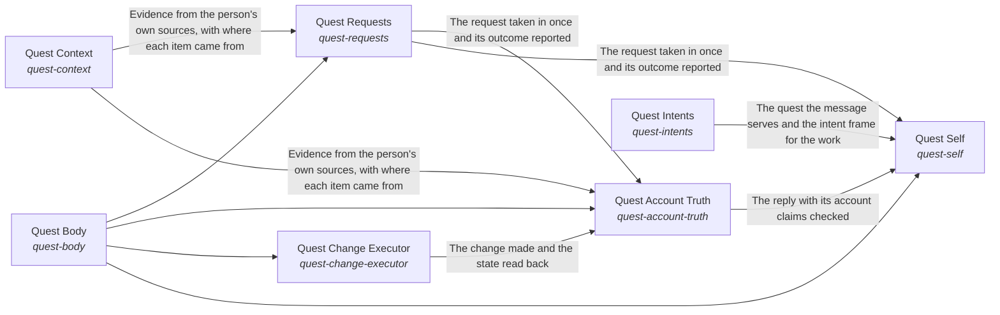

These are ESOI records rendered as a diagram (evolvable structure that optimizes intent). This page is generated from the solutions' outputs and the implementations' `uses_solution_ids` by `esoi diagram`; edit those records, not this page.

# Solution diagram: Grounded AI that advances people's goals

quest-ai-runner turns a person's request or queued task into grounded work in one flow, and the Grounded goal agent is that flow. It takes the request in through Request intake, says what the person is working toward through Higher mind and chooses the context the request needs through Context choice. It reasons step by step through Mind, acts on the account through Body and Quest account access, and answers questions beyond the person's own material through Science. It has every run watched through Nervous System and holds the work to the metric that serves it through Critical Thinking. It asks the model through the Tiered model provider layer and stays comparable by metric through Integrity. It recalls what a request needs through Subconscious. Subconscious recalls the cards that match a request through Hub card store. Tiered model provider layer accounts for every call through Cost estimation, daily budget and host load guard. Mind starts each step on the model tier it picks through Cost-ordered model tier selector with outage and allowance recovery. Nervous System has the model oversee a run through Tiered model provider layer. Queued-task runner claims, runs and reports a queued task, asking the model through Tiered model provider layer and working in the account through Quest account access. It writes each prompt as a registered spec with an owner and a metric through Justified model calls. Body reads and changes the quest through Context card persistence backend, Quest account access and Queued-task runner. Higher mind saves what it learned through Context card persistence backend. Request intake hears from a live channel through Live messaging channel transport. Body changes the quest as the person asks through Quest change executor and writes files inside one folder through Bounded reversible file writer. Body reads from the sources the person's work lives in through Multi-source evidence retriever and hands a new goal to the right owner through Goal assignee and doability judge. Body does heavy work through Bounded autonomous work runner, makes one named change on an outside tool server through Allowlisted operation writer and claims only the reach that World grants. Quest change executor reaches the account through Quest account access and decides through Tiered model provider layer. Goal assignee and doability judge asks the model whether a goal is doable through Tiered model provider layer. World reaches a person through Live messaging channel transport and judges through Tiered model provider layer.

An arrow runs from the solution that provides to the solution that builds on it; its label is what the provider outputs.

