These are ESOI records rendered as a diagram (evolvable structure that optimizes intent). This page is generated from the solutions' outputs and the implementations' `uses_solution_ids` by `esoi diagram`; edit those records, not this page.

# Solution diagram: Grounded AI that advances people's goals

quest-ai-runner turns a person's request or queued task into grounded work in one loop, and QS1 is that loop. QS1 takes a request in through talk-over-a-channel, operate-from-a-terminal, receive-input-mid-run and run-queued-tasks, hands it to route-a-message, and answers chat turns through answer-a-turn. It grounds the answer in the person's own material through select-context, gather-evidence, remember-conversations, recall-recent-context, resolve-references and cache-cards, with persist-cards and index-by-meaning keeping the cards, and it keeps the prompt in order through assemble-a-prompt and the model choice through call-a-model, choose-a-model-tier and track-usage-and-cost. It does the work through operate-a-quest, write-files, write-through-mcp and run-deep-work, watches it through watch-a-run and detect-a-stalled-run, settles narrow questions through judge-a-decision, stops unsafe replies through guard-a-reply, and brings a step only a person may take to that person through escalate-to-a-human. It shows what it is doing through show-progress, learns from corrections through guide-by-feedback and store-feedback, and replays what worked through replay-known-operations. It keeps itself measurable and open through evolve-by-metric, select-an-implementation, configure-a-lane, verify-offline, keep-secrets-out, behave-by-esoi and judge-esoi-behavior, and it is offered to others through expose-the-public-api, learn-by-example and explain-qar. The specification of the loop is spread over named areas. keep-a-working-stream is the mind, one goal-focused stream per request, and admit-to-the-mind is the subconscious that admits the person's own cards into it, with card-store holding them, bound-card-growth and repair-a-card-store keeping the store from inflating, choose-what-to-index choosing what deserves a card, label-context-cards and detect-stale-cards keeping them honest, and search-cards-and-specs searching cards and specifications together. know-the-world answers questions about the world through search-the-web. think-critically holds deep runs to their metric through iterate-by-spec, spec-selection, ground-in-intent, draft-a-metric and gate-an-autopilot-pass, and core-ml-tasks, answer-end-to-end and tag-solutions measure the classifiers, the whole turn and the reach of a change. act-as-the-body does the work and act-in-the-world claims only the reach it has, while use-open-source-hubs prefers a standard hub to a bespoke integration and access-quest-operations reaches Quest's operations. hold-the-long-view keeps the standing view of a representative across turns, select-a-rep picks the representative, hand-off-a-goal decides who owns a new goal, and guide-toward-the-long-term-goal keeps work aimed at the person's end, with persist-predictions saving what was learned. The person is kept informed through reply-in-steps, ask-on-block, narrate-a-turn, show-the-ais-work, explain-an-answer, describe-an-attachment and assist-a-terminal-session, and feed-context-sources adds what changed in a work item, while justify-model-calls accounts for every model call.

An arrow runs from the solution that provides to the solution that builds on it; its label is what the provider outputs.

```mermaid
flowchart LR
    s0["Grounded goal agent: the engine that...<br/>QS1"]
    s1["Cost-aware message router<br/>route-a-message"]
    s2["Grounded chat turn handler<br/>answer-a-turn"]
    s3["Quest change executor<br/>operate-a-quest"]
    s4["Multi-source evidence retriever<br/>gather-evidence"]
    s5["Bounded web research<br/>search-the-web"]
    s6["Tiered model provider layer<br/>call-a-model"]
    s7["Bounded autonomous work runner<br/>run-deep-work"]
    s8["Run liveness reviewer<br/>detect-a-stalled-run"]
    s9["Bounded reversible file writer<br/>write-files"]
    s10["Allowlisted operation writer<br/>write-through-mcp"]
    s11["Human decision escalation channel<br/>escalate-to-a-human"]
    s12["Mode-aware progress surfacing<br/>show-progress"]
    s13["Cross-conversation recall store<br/>remember-conversations"]
    s14["Context card selector<br/>select-context"]
    s15["Context card persistence backend<br/>persist-cards"]
    s16["Semantic vector index<br/>index-by-meaning"]
    s17["Feedback-to-guidance loop<br/>guide-by-feedback"]
    s18["Live messaging channel transport<br/>talk-over-a-channel"]
    s19["Learned-operation fast path<br/>replay-known-operations"]
    s20["Overseer: risk management that raises...<br/>watch-a-run"]
    s21["Source-change staleness detector<br/>detect-stale-cards"]
    s22["Budgeted prompt assembler<br/>assemble-a-prompt"]
    s23["Guarded model-verdict judge<br/>judge-a-decision"]
    s24["Reply safety and anticipation guards<br/>guard-a-reply"]
    s25["Incremental context-update feed<br/>feed-context-sources"]
    s26["Verbatim feedback ledger<br/>store-feedback"]
    s27["Scoped recent-context warm start<br/>recall-recent-context"]
    s28["Conversation-keyed mid-run input inbox<br/>receive-input-mid-run"]
    s29["Fail-safe card reference resolver<br/>resolve-references"]
    s30["Offline card cache and write outbox<br/>cache-cards"]
    s31["Standing-instruction behaviour layer<br/>behave-by-esoi"]
    s32["Behaviour-grading judge<br/>judge-esoi-behavior"]
    s33["Public package surface contract<br/>expose-the-public-api"]
    s34["Runnable example set<br/>learn-by-example"]
    s35["Queued-task runner lane<br/>run-queued-tasks"]
    s36["Layered lane configuration loader<br/>configure-a-lane"]
    s37["Non-interactive command-line surface<br/>operate-from-a-terminal"]
    s38["Cost-ordered model tier selector with...<br/>choose-a-model-tier"]
    s39["Cost estimation, daily budget and host...<br/>track-usage-and-cost"]
    s40["verify-offline<br/>verify-offline"]
    s41["Public-repository hygiene scanner<br/>keep-secrets-out"]
    s42["select-an-implementation<br/>select-an-implementation"]
    s43["Documentation coverage and voice check<br/>explain-qar"]
    s44["Scoped prediction store<br/>persist-predictions"]
    s45["Autopilot run-or-skip gate<br/>gate-an-autopilot-pass"]
    s46["Evolve by metric<br/>evolve-by-metric"]
    s47["Intent frame for quest-scoped prompts<br/>ground-in-intent"]
    s48["Specification slice before a task and...<br/>iterate-by-spec"]
    s49["Core ML tasks: quest classification and...<br/>core-ml-tasks"]
    s50["Select the intent specifications an...<br/>spec-selection"]
    s51["Card store repair<br/>repair-a-card-store"]
    s52["Index scope decision: which folders and...<br/>choose-what-to-index"]
    s53["Mind: one goal-focused working stream...<br/>keep-a-working-stream"]
    s54["Subconscious: the person's own...<br/>admit-to-the-mind"]
    s55["Science: evidence-weighted knowledge...<br/>know-the-world"]
    s56["World: doing things outside the host...<br/>act-in-the-world"]
    s57["Body: the host's data model as the...<br/>act-as-the-body"]
    s58["Higher mind: an AI representative's...<br/>hold-the-long-view"]
    s59["Critical thinking: the enforcer of ESOI...<br/>think-critically"]
    s60["Representative selection: which AI...<br/>select-a-rep"]
    s61["Whole-path answer check<br/>answer-end-to-end"]
    s62["Show the AI's work and next steps<br/>show-the-ais-work"]
    s1 -->|"A routing decision: one of answer, tool, deep, confirm or..."| s0
    s1 -->|"A routing decision: one of answer, tool, deep, confirm or..."| s49
    s1 -->|"A routing decision: one of answer, tool, deep, confirm or..."| s56
    s2 -->|"The reply text, the routing taken (inline or delegated)..."| s0
    s2 -->|"The reply text, the routing taken (inline or delegated)..."| s55
    s3 -->|"The resulting quest state and a reply that reports what was..."| s0
    s3 -->|"The resulting quest state and a reply that reports what was..."| s57
    s3 -->|"The resulting quest state and a reply that reports what was..."| s59
    s4 -->|"Observation values carrying text, a path or source label..."| s0
    s4 -->|"Observation values carrying text, a path or source label..."| s54
    s4 -->|"Observation values carrying text, a path or source label..."| s55
    s4 -->|"Observation values carrying text, a path or source label..."| s56
    s4 -->|"Observation values carrying text, a path or source label..."| s57
    s5 -->|"One compact observation of title, link and snippet per hit..."| s0
    s5 -->|"One compact observation of title, link and snippet per hit..."| s55
    s6 -->|"A raw decision dictionary for planning, answer text for..."| s0
    s6 -->|"A raw decision dictionary for planning, answer text for..."| s53
    s6 -->|"A raw decision dictionary for planning, answer text for..."| s56
    s6 -->|"A raw decision dictionary for planning, answer text for..."| s58
    s7 -->|"A result stating whether the goal was met, the output text..."| s0
    s7 -->|"A result stating whether the goal was met, the output text..."| s56
    s8 -->|"A verdict of stop or keep running with a one-sentence..."| s0
    s9 -->|"A write result stating success, whether the file was..."| s0
    s9 -->|"A write result stating success, whether the file was..."| s56
    s10 -->|"A write result with success, error and an audit detail of..."| s0
    s10 -->|"A write result with success, error and an audit detail of..."| s56
    s11 -->|"A decision identifier the caller reports back"| s0
    s11 -->|"A decision identifier the caller reports back"| s20
    s11 -->|"A decision identifier the caller reports back"| s56
    s11 -->|"A decision identifier the caller reports back"| s59
    s11 -->|"A decision identifier the caller reports back"| s60
    s12 -->|"None returned; surfaced events reach the consumer's stream..."| s0
    s12 -->|"None returned; surfaced events reach the consumer's stream..."| s62
    s13 -->|"A conversation context holding rendered text slices from..."| s0
    s13 -->|"A conversation context holding rendered text slices from..."| s58
    s14 -->|"An assembled context: rendered context view, card ids in..."| s0
    s14 -->|"An assembled context: rendered context view, card ids in..."| s54
    s14 -->|"An assembled context: rendered context view, card ids in..."| s56
    s14 -->|"An assembled context: rendered context view, card ids in..."| s58
    s15 -->|"Load-all returns a mapping of id to card, read returns a..."| s0
    s15 -->|"Load-all returns a mapping of id to card, read returns a..."| s51
    s15 -->|"Load-all returns a mapping of id to card, read returns a..."| s57
    s15 -->|"Load-all returns a mapping of id to card, read returns a..."| s58
    s16 -->|"Ranked hits with id, score, text and payload for search..."| s0
    s17 -->|"A list of guidance cards with bodies for the..."| s0
    s17 -->|"A list of guidance cards with bodies for the..."| s58
    s17 -->|"A list of guidance cards with bodies for the..."| s60
    s18 -->|"An inbound batch (messages with ids, chat references, text..."| s0
    s18 -->|"An inbound batch (messages with ids, chat references, text..."| s56
    s19 -->|"The reply text and exit reason of the run, with the tool..."| s0
    s19 -->|"The reply text and exit reason of the run, with the tool..."| s54
    s20 -->|"For a flagged case: the risk category, the response applied..."| s0
    s21 -->|"Whether the file is stale, and the stale card list for the..."| s0
    s22 -->|"The assembled prompt string for each assembly point"| s0
    s22 -->|"The assembled prompt string for each assembly point"| s53
    s23 -->|"A parsed verdict (signal, reach verdict, quest ranking or..."| s0
    s23 -->|"A parsed verdict (signal, reach verdict, quest ranking or..."| s20
    s23 -->|"A parsed verdict (signal, reach verdict, quest ranking or..."| s54
    s23 -->|"A parsed verdict (signal, reach verdict, quest ranking or..."| s60
    s24 -->|"Sanitised text with a verdict per link, extracted links and..."| s0
    s25 -->|"A bundle of context updates, each with an item id, its text..."| s0
    s26 -->|"Ledger items with status lines, the open and standing sets..."| s0
    s26 -->|"Ledger items with status lines, the open and standing sets..."| s58
    s27 -->|"Recent card records merged across scopes, narrower scope..."| s0
    s27 -->|"Recent card records merged across scopes, narrower scope..."| s58
    s28 -->|"Drain returns and removes the pending messages in arrival..."| s0
    s29 -->|"Rendered text for the pointer, possibly marked abridged, or..."| s0
    s30 -->|"The stored listing with its update time, or none, and the..."| s0
    s31 -->|"A reply, then a pass or fail verdict with a one-line reason..."| s0
    s31 -->|"A reply, then a pass or fail verdict with a one-line reason..."| s59
    s32 -->|"A verdict of pass or fail with a one-line reason"| s0
    s33 -->|"A configured client or runner config, results of bridged..."| s0
    s34 -->|"A running lane or a built runner configuration, and help or..."| s0
    s35 -->|"A reported status on each task (with result text or..."| s0
    s35 -->|"A reported status on each task (with result text or..."| s59
    s35 -->|"A reported status on each task (with result text or..."| s60
    s36 -->|"A populated runner configuration object, or a..."| s0
    s37 -->|"Text on standard output and error and an integer exit code..."| s0
    s38 -->|"A starting model and ladder, a concrete model id for a tier..."| s0
    s38 -->|"A starting model and ladder, a concrete model id for a tier..."| s20
    s39 -->|"A price per million input tokens, a bootstrap cost estimate..."| s0
    s40 --> s0
    s41 -->|"A list of findings with a pattern name, a location and a..."| s0
    s42 --> s0
    s43 -->|"Pass or fail per case, naming the broken link, missing..."| s0
    s44 -->|"The saved patterns, the unexpired predictions, a..."| s0
    s44 -->|"The saved patterns, the unexpired predictions, a..."| s54
    s44 -->|"The saved patterns, the unexpired predictions, a..."| s58
    s45 -->|"For each quest, either a skip with a reason or passage..."| s0
    s46 -->|"Checked records, recorded metric results and the selected..."| s0
    s47 -->|"Frame text, an anchor (intent, solution, implementation..."| s58
    s47 -->|"Frame text, an anchor (intent, solution, implementation..."| s59
    s48 -->|"A slice for the brief; per record served: the last run that..."| s59
    s50 -->|"A SpecSelection: ids best first then linked ids, the..."| s58
    s50 -->|"A SpecSelection: ids best first then linked ids, the..."| s59
    s52 -->|"A FolderGate: the set of corpus-relative folders no card..."| s51
    s53 -->|"Each step's view of the request (a carried message list or..."| s57
    s54 -->|"The admitted items with a one-line reason each, and the..."| s53
    s58 -->|"For a request the representative handles: its standing view..."| s54
    s58 -->|"For a request the representative handles: its standing view..."| s60
    s60 -->|"The chosen representative (or none for the plain..."| s58
    s61 -->|"The reply, the writes that landed, the web queries made and..."| s56
```

