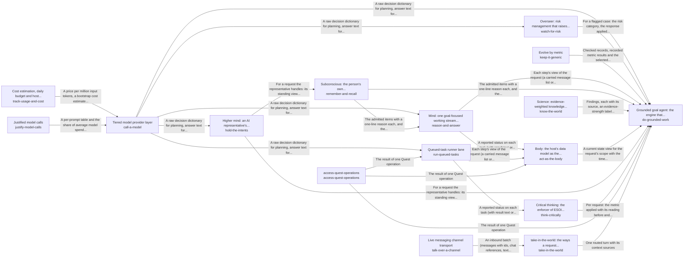

These are ESOI records rendered as a diagram (evolvable structure that optimizes intent). This page is generated from the solutions' outputs and the implementations' `uses_solution_ids` by `esoi diagram`; edit those records, not this page.

# Solution diagram: Grounded AI that advances people's goals

quest-ai-runner turns a person's request or queued task into grounded work in one loop, and do-grounded-work is that loop. It asks the model through call-a-model, works in the person's Quest account through access-quest-operations and takes in requests through take-in-the-world. It reasons step by step through reason-and-answer, recalls what a request needs through remember-and-recall and acts on the account through act-as-the-body. It holds its work to the metric that serves it through think-critically, has every run watched through watch-for-risk and keeps the long view across turns through hold-the-intents. It stays comparable by metric through keep-it-generic and answers questions about the world through know-the-world. remember-and-recall recalls the cards that match a request through card-store. call-a-model accounts for every call through justify-model-calls and track-usage-and-cost. reason-and-answer sends the prompt of each step to the model through call-a-model. watch-for-risk has the model oversee a run through call-a-model. run-queued-tasks claims, runs and reports a queued task, asking the model through call-a-model and working in the account through access-quest-operations. act-as-the-body reads and changes the quest through persist-cards, access-quest-operations and run-queued-tasks. hold-the-intents saves what it learned through persist-cards. take-in-the-world hears from a live channel through talk-over-a-channel.

An arrow runs from the solution that provides to the solution that builds on it; its label is what the provider outputs.

