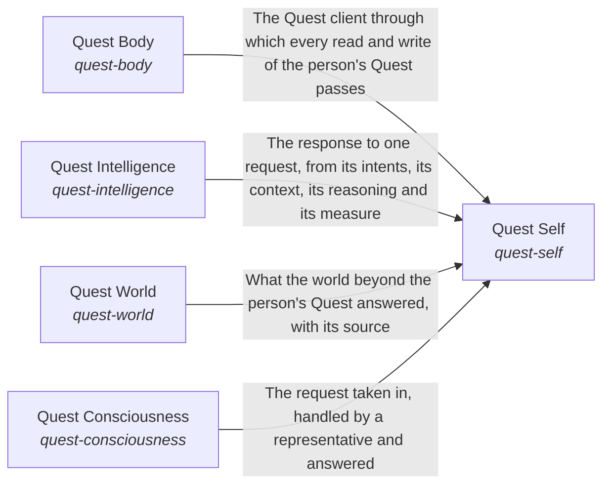

These are ESOI records rendered as a diagram (evolvable structure that optimizes intent). This page is generated from the solutions' outputs and the implementations' `uses_solution_ids` by `esoi diagram`; edit those records, not this page.

# Solution diagram: Quest AI Runner

Quest AI Runner turns what a Quest user asks into work that moves their intents, and Quest Self is the one assistant that does it. Quest Self first learns from Quest Consciousness who is asking and what they are growing toward. It then reads the account and the person's own material through Quest Body. It hands each request to Intelligence, which understands it against what the person is working toward. When the request needs more than the person's own material, Quest Self reaches the outside through World.

An arrow runs from the solution that provides to the solution that builds on it; its label is what the provider outputs.

