These are ESOI records rendered as a diagram (evolvable structure that optimizes intent). This page is generated from the solutions' outputs and the implementations' `uses_solution_ids` by `esoi diagram`; edit those records, not this page.

# Solution diagram: Grounded AI that advances people's goals

quest-ai-runner turns a person's request or queued task into grounded work in one loop, and do-grounded-work is that loop: do-grounded-work asks the model through call-a-model, remembers through remember-and-recall, keeps the cards in card-store, takes requests in through take-in-the-world, reasons step by step through reason-and-answer, acts through act-as-the-body, holds its work to the metric that serves it through think-critically and works in the person's Quest account through access-quest-operations. The other areas of the loop are know-the-world, watch-for-risk, hold-the-intents and keep-it-generic. take-in-the-world receives a request from talk-over-a-channel, operate-from-a-terminal, assist-a-terminal-session or the package that expose-the-public-api offers. It also lets receive-input-mid-run reach a run that is already working, describes attachments through describe-an-attachment, adds what changed in a work item through feed-context-sources, and hands each request to route-a-message. learn-by-example shows how to use the package through expose-the-public-api. explain-qar documents the package through expose-the-public-api. remember-and-recall recalls the cards that match a request through card-store. select-context ranks stored cards, files and conversations, resolves their references through resolve-references and searches cards and specification records together through search-cards-and-specs. card-store keeps the cards through persist-cards, serves the last known listing through cache-cards while a backend is down, finds them by meaning through index-by-meaning, labels them through label-context-cards, reports stale ones through detect-stale-cards, holds their growth in check through bound-card-growth and shrinks an inflated store through repair-a-card-store. repair-a-card-store rewrites the stored cards through persist-cards and asks choose-what-to-index which sources deserve cards. reason-and-answer rebuilds each step's prompt through assemble-a-prompt, calls call-a-model at the tier choose-a-model-tier picks, answers chat turns through answer-a-turn, reuses requests that worked before through replay-known-operations, classifies inputs through core-ml-tasks, proves a message is handled end to end through answer-end-to-end, and keeps the person informed through reply-in-steps and show-the-ais-work. answer-a-turn, answer-end-to-end, core-ml-tasks, route-a-message, describe-an-attachment and assist-a-terminal-session each ask the model through call-a-model. claim-reach, hand-off-a-goal, operate-a-quest and run-queued-tasks each ask the model through call-a-model. operate-a-quest and run-queued-tasks work in the Quest account through access-quest-operations. ground-in-intent reads the frame of an intent through access-quest-operations. gate-an-autopilot-pass reads each quest's settings through access-quest-operations. draft-a-metric reads the metric card through access-quest-operations and asks the model through call-a-model. call-a-model accounts for every call through justify-model-calls and track-usage-and-cost. reply-in-steps sends the lines of narrate-a-turn and the prose of explain-an-answer, and files the one ask a block only a person can lift needs. show-the-ais-work lays out the steps that show-progress streams. know-the-world answers questions about the world from search-the-web results it checks for support, answering the way answer-a-turn does. think-critically holds deep runs to their metric through iterate-by-spec on the records spec-selection picks, settles narrow questions through judge-a-decision, stops unsafe replies through guard-a-reply, ties work to its purpose through ground-in-intent, tells a stuck run from a slow one through detect-a-stalled-run, drafts a missing metric through draft-a-metric, and keeps background work inside its hours and budget through gate-an-autopilot-pass. act-as-the-body does the work and reports it truthfully. It reads the quest through operate-a-quest, gather-evidence and persist-cards, and claims only the reach that claim-reach grants. It writes files through write-files and reaches Quest's operations through access-quest-operations. It runs queued requests through run-queued-tasks and decides who owns a new goal through hand-off-a-goal. claim-reach hands real work to run-deep-work, write-through-mcp, talk-over-a-channel or gather-evidence. watch-for-risk oversees a run and brings a step only a person may take to that person through escalate-to-a-human. hold-the-intents keeps the long view across turns. It carries what was said and found through remember-conversations and recall-recent-context. It keeps and applies a person's corrections through store-feedback and guide-by-feedback. It saves what was learned through persist-predictions and persist-cards. It keeps work aimed at the person's end through guide-toward-the-long-term-goal, and picks the representative a request runs as through select-a-rep. select-a-rep sends the queued work of that representative through run-queued-tasks. keep-it-generic keeps every part specified as a solution with measured alternatives. It picks the arm that runs through select-an-implementation and finds what a change touches through tag-solutions. It measures whether the assistant acts by ESOI through behave-by-esoi and judge-esoi-behavior. It wires the selected arms per lane through configure-a-lane. It keeps the test suite and the public code trustworthy through verify-offline and keep-secrets-out, and scores how much of QAR's wiring is configuration through @hub-of-hubs/score-hub-connections.

An arrow runs from the solution that provides to the solution that builds on it; its label is what the provider outputs.

```mermaid
flowchart LR
    s0["Grounded goal agent: the engine that...<br/>do-grounded-work"]
    s1["Cost-aware message router<br/>route-a-message"]
    s2["Grounded chat turn handler<br/>answer-a-turn"]
    s3["Quest change executor<br/>operate-a-quest"]
    s4["Multi-source evidence retriever<br/>gather-evidence"]
    s5["Bounded web research<br/>search-the-web"]
    s6["Tiered model provider layer<br/>call-a-model"]
    s7["Bounded autonomous work runner<br/>run-deep-work"]
    s8["Run liveness reviewer<br/>detect-a-stalled-run"]
    s9["Bounded reversible file writer<br/>write-files"]
    s10["Allowlisted operation writer<br/>write-through-mcp"]
    s11["Human decision escalation channel<br/>escalate-to-a-human"]
    s12["Mode-aware progress surfacing<br/>show-progress"]
    s13["Cross-conversation recall store<br/>remember-conversations"]
    s14["Context card selector<br/>select-context"]
    s15["Context card persistence backend<br/>persist-cards"]
    s16["Semantic vector index<br/>index-by-meaning"]
    s17["Feedback-to-guidance loop<br/>guide-by-feedback"]
    s18["Live messaging channel transport<br/>talk-over-a-channel"]
    s19["Learned-operation fast path<br/>replay-known-operations"]
    s20["Overseer: risk management that raises...<br/>watch-for-risk"]
    s21["Source-change staleness detector<br/>detect-stale-cards"]
    s22["Budgeted prompt assembler<br/>assemble-a-prompt"]
    s23["Guarded model-verdict judge<br/>judge-a-decision"]
    s24["Reply safety and anticipation guards<br/>guard-a-reply"]
    s25["Incremental context-update feed<br/>feed-context-sources"]
    s26["Verbatim feedback ledger<br/>store-feedback"]
    s27["Scoped recent-context warm start<br/>recall-recent-context"]
    s28["Conversation-keyed mid-run input inbox<br/>receive-input-mid-run"]
    s29["Fail-safe card reference resolver<br/>resolve-references"]
    s30["Offline card cache and write outbox<br/>cache-cards"]
    s31["Standing-instruction behaviour layer<br/>behave-by-esoi"]
    s32["Behaviour-grading judge<br/>judge-esoi-behavior"]
    s33["Public package surface contract<br/>expose-the-public-api"]
    s34["Runnable example set<br/>learn-by-example"]
    s35["Queued-task runner lane<br/>run-queued-tasks"]
    s36["Layered lane configuration loader<br/>configure-a-lane"]
    s37["Non-interactive command-line surface<br/>operate-from-a-terminal"]
    s38["Cost-ordered model tier selector with...<br/>choose-a-model-tier"]
    s39["Cost estimation, daily budget and host...<br/>track-usage-and-cost"]
    s40["verify-offline<br/>verify-offline"]
    s41["Public-repository hygiene scanner<br/>keep-secrets-out"]
    s42["select-an-implementation<br/>select-an-implementation"]
    s43["Documentation coverage and voice check<br/>explain-qar"]
    s44["Scoped prediction store<br/>persist-predictions"]
    s45["Autopilot run-or-skip gate<br/>gate-an-autopilot-pass"]
    s46["Evolve by metric<br/>keep-it-generic"]
    s47["Intent frame for quest-scoped prompts<br/>ground-in-intent"]
    s48["Specification slice before a task and...<br/>iterate-by-spec"]
    s49["Core ML tasks: quest classification and...<br/>core-ml-tasks"]
    s50["Select the intent specifications an...<br/>spec-selection"]
    s51["Card store growth prevention<br/>bound-card-growth"]
    s52["Card store repair<br/>repair-a-card-store"]
    s53["Unified card and specification search<br/>search-cards-and-specs"]
    s54["Problem-linked tags that identify...<br/>tag-solutions"]
    s55["Index scope decision: which folders and...<br/>choose-what-to-index"]
    s56["Mind: one goal-focused working stream...<br/>reason-and-answer"]
    s57["Subconscious: the person's own...<br/>remember-and-recall"]
    s58["Science: evidence-weighted knowledge...<br/>know-the-world"]
    s59["World: doing things outside the host...<br/>claim-reach"]
    s60["Body: the host's data model as the...<br/>act-as-the-body"]
    s61["Higher mind: an AI representative's...<br/>hold-the-intents"]
    s62["Critical thinking: the enforcer of ESOI...<br/>think-critically"]
    s63["Representative selection: which AI...<br/>select-a-rep"]
    s64["First-beat narration<br/>narrate-a-turn"]
    s65["How-I-got-this explanation<br/>explain-an-answer"]
    s66["Image description for grounding<br/>describe-an-attachment"]
    s67["Goal assignee and doability judge<br/>hand-off-a-goal"]
    s68["Metric drafting for a task<br/>draft-a-metric"]
    s69["Card categories and metadata<br/>label-context-cards"]
    s70["Terminal helper calls<br/>assist-a-terminal-session"]
    s71["Justified model calls<br/>justify-model-calls"]
    s72["Whole-path answer check<br/>answer-end-to-end"]
    s73["Guidance toward the long-term goal<br/>guide-toward-the-long-term-goal"]
    s74["access-quest-operations<br/>access-quest-operations"]
    s75["QAR card repository as the hub card...<br/>card-store"]
    s76["Show the AI's work and next steps<br/>show-the-ais-work"]
    s77["Reply in steps when the goal is not met...<br/>reply-in-steps"]
    s78["take-in-the-world: the ways a request...<br/>take-in-the-world"]
    s1 -->|"A routing decision: one of answer, tool, deep, confirm or..."| s49
    s1 -->|"A routing decision: one of answer, tool, deep, confirm or..."| s59
    s1 -->|"A routing decision: one of answer, tool, deep, confirm or..."| s78
    s2 -->|"The reply text, the routing taken (inline or delegated)..."| s56
    s2 -->|"The reply text, the routing taken (inline or delegated)..."| s58
    s3 -->|"The resulting quest state and a reply that reports what was..."| s60
    s3 -->|"The resulting quest state and a reply that reports what was..."| s62
    s4 -->|"Observation values carrying text, a path or source label..."| s58
    s4 -->|"Observation values carrying text, a path or source label..."| s59
    s4 -->|"Observation values carrying text, a path or source label..."| s60
    s5 -->|"One compact observation of title, link and snippet per hit..."| s58
    s6 -->|"A raw decision dictionary for planning, answer text for..."| s0
    s6 -->|"A raw decision dictionary for planning, answer text for..."| s1
    s6 -->|"A raw decision dictionary for planning, answer text for..."| s2
    s6 -->|"A raw decision dictionary for planning, answer text for..."| s3
    s6 -->|"A raw decision dictionary for planning, answer text for..."| s35
    s6 -->|"A raw decision dictionary for planning, answer text for..."| s49
    s6 -->|"A raw decision dictionary for planning, answer text for..."| s56
    s6 -->|"A raw decision dictionary for planning, answer text for..."| s59
    s6 -->|"A raw decision dictionary for planning, answer text for..."| s61
    s6 -->|"A raw decision dictionary for planning, answer text for..."| s66
    s6 -->|"A raw decision dictionary for planning, answer text for..."| s67
    s6 -->|"A raw decision dictionary for planning, answer text for..."| s68
    s6 -->|"A raw decision dictionary for planning, answer text for..."| s70
    s6 -->|"A raw decision dictionary for planning, answer text for..."| s72
    s7 -->|"A result stating whether the goal was met, the output text..."| s59
    s8 -->|"A verdict of stop or keep running with a one-sentence..."| s62
    s9 -->|"A write result stating success, whether the file was..."| s59
    s9 -->|"A write result stating success, whether the file was..."| s60
    s10 -->|"A write result with success, error and an audit detail of..."| s59
    s11 -->|"A decision identifier the caller reports back"| s20
    s11 -->|"A decision identifier the caller reports back"| s59
    s11 -->|"A decision identifier the caller reports back"| s62
    s11 -->|"A decision identifier the caller reports back"| s63
    s12 -->|"None returned; surfaced events reach the consumer's stream..."| s76
    s13 -->|"A conversation context holding rendered text slices from..."| s61
    s14 -->|"An assembled context: rendered context view, card ids in..."| s57
    s14 -->|"An assembled context: rendered context view, card ids in..."| s59
    s14 -->|"An assembled context: rendered context view, card ids in..."| s61
    s15 -->|"Load-all returns a mapping of id to card, read returns a..."| s52
    s15 -->|"Load-all returns a mapping of id to card, read returns a..."| s60
    s15 -->|"Load-all returns a mapping of id to card, read returns a..."| s61
    s15 -->|"Load-all returns a mapping of id to card, read returns a..."| s75
    s16 -->|"Ranked hits with id, score, text and payload for search..."| s75
    s17 -->|"A list of guidance cards with bodies for the..."| s61
    s17 -->|"A list of guidance cards with bodies for the..."| s63
    s18 -->|"An inbound batch (messages with ids, chat references, text..."| s59
    s18 -->|"An inbound batch (messages with ids, chat references, text..."| s78
    s19 -->|"The reply text and exit reason of the run, with the tool..."| s56
    s19 -->|"The reply text and exit reason of the run, with the tool..."| s57
    s21 -->|"Whether the file is stale, and the stale card list for the..."| s75
    s22 -->|"The assembled prompt string for each assembly point"| s56
    s23 -->|"A parsed verdict (signal, reach verdict, quest ranking or..."| s20
    s23 -->|"A parsed verdict (signal, reach verdict, quest ranking or..."| s57
    s23 -->|"A parsed verdict (signal, reach verdict, quest ranking or..."| s62
    s23 -->|"A parsed verdict (signal, reach verdict, quest ranking or..."| s63
    s24 -->|"Sanitised text with a verdict per link, extracted links and..."| s62
    s25 -->|"A bundle of context updates, each with an item id, its text..."| s78
    s26 -->|"Ledger items with status lines, the open and standing sets..."| s61
    s27 -->|"Recent card records merged across scopes, narrower scope..."| s61
    s28 -->|"Drain returns and removes the pending messages in arrival..."| s78
    s29 -->|"Rendered text for the pointer, possibly marked abridged, or..."| s14
    s30 -->|"The stored listing with its update time, or none, and the..."| s75
    s31 -->|"A reply, then a pass or fail verdict with a one-line reason..."| s46
    s31 -->|"A reply, then a pass or fail verdict with a one-line reason..."| s62
    s32 -->|"A verdict of pass or fail with a one-line reason"| s46
    s33 -->|"A configured client or runner config, results of bridged..."| s34
    s33 -->|"A configured client or runner config, results of bridged..."| s43
    s33 -->|"A configured client or runner config, results of bridged..."| s78
    s35 -->|"A reported status on each task (with result text or..."| s60
    s35 -->|"A reported status on each task (with result text or..."| s62
    s35 -->|"A reported status on each task (with result text or..."| s63
    s36 -->|"A populated runner configuration object, or a..."| s46
    s37 -->|"Text on standard output and error and an integer exit code..."| s78
    s38 -->|"A starting model and ladder, a concrete model id for a tier..."| s20
    s38 -->|"A starting model and ladder, a concrete model id for a tier..."| s56
    s39 -->|"A price per million input tokens, a bootstrap cost estimate..."| s6
    s40 -->|"A report of every test that cannot start or pass offline..."| s46
    s41 -->|"A list of findings with a pattern name, a location and a..."| s46
    s42 -->|"The implementation that serves a solution, chosen by name..."| s46
    s44 -->|"The saved patterns, the unexpired predictions, a..."| s57
    s44 -->|"The saved patterns, the unexpired predictions, a..."| s61
    s45 -->|"For each quest, either a skip with a reason or passage..."| s62
    s47 -->|"Frame text, an anchor (intent, solution, implementation..."| s61
    s47 -->|"Frame text, an anchor (intent, solution, implementation..."| s62
    s48 -->|"A slice for the brief; per record served: the last run that..."| s62
    s49 -->|"A class or a ranked list with a score for each, and the..."| s56
    s50 -->|"A SpecSelection: ids best first then linked ids, the..."| s61
    s50 -->|"A SpecSelection: ids best first then linked ids, the..."| s62
    s51 -->|"Cards written only under an id made of their origin; a..."| s75
    s52 -->|"A plan (tidy-state/last-plan.json for the startup tidy), a..."| s75
    s53 -->|"One assembled context: ranked items, each with its kind..."| s14
    s54 -->|"The solution's tags column; for a planned change, the..."| s46
    s55 -->|"A FolderGate: the set of corpus-relative folders no card..."| s52
    s56 -->|"Each step's view of the request (a carried message list or..."| s0
    s56 -->|"Each step's view of the request (a carried message list or..."| s60
    s57 -->|"The admitted items with a one-line reason each, and the..."| s0
    s57 -->|"The admitted items with a one-line reason each, and the..."| s56
    s59 -->|"A reach verdict for the request (inside, outside, in the..."| s60
    s60 -->|"A current state view for the request's scope with the time..."| s0
    s61 -->|"For a request the representative handles: its standing view..."| s57
    s61 -->|"For a request the representative handles: its standing view..."| s63
    s62 -->|"Per request: the metric applied with its reading before and..."| s0
    s63 -->|"The chosen representative (or none for the plain..."| s61
    s64 -->|"The text or verdict the call returns"| s77
    s65 -->|"The text or verdict the call returns"| s77
    s66 -->|"The text or verdict the call returns"| s78
    s67 -->|"The text or verdict the call returns"| s60
    s68 -->|"The text or verdict the call returns"| s62
    s69 -->|"The text or verdict the call returns"| s75
    s70 -->|"The text or verdict the call returns"| s78
    s71 -->|"A per-prompt table and the share of average model spend..."| s6
    s72 -->|"The reply, the writes that landed, the web queries made and..."| s56
    s72 -->|"The reply, the writes that landed, the web queries made and..."| s59
    s73 -->|"The reply, with or without one short pointer"| s61
    s74 -->|"The result of one Quest operation"| s0
    s74 -->|"The result of one Quest operation"| s3
    s74 -->|"The result of one Quest operation"| s35
    s74 -->|"The result of one Quest operation"| s45
    s74 -->|"The result of one Quest operation"| s47
    s74 -->|"The result of one Quest operation"| s60
    s74 -->|"The result of one Quest operation"| s68
    s75 -->|"Hub Card objects"| s0
    s75 -->|"Hub Card objects"| s57
    s76 -->|"The elements a viewer is shown: a live line, a summary line..."| s56
    s77 -->|"Send or skip with a reason, and the interim event payload"| s56
    s78 -->|"One routed turn with its context sources"| s0
```

