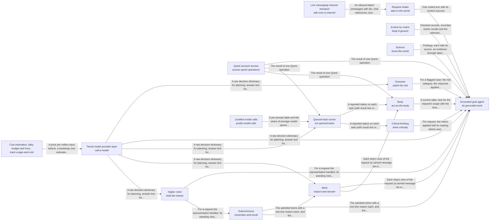

These are ESOI records rendered as a diagram (evolvable structure that optimizes intent). This page is generated from the solutions' outputs and the implementations' `uses_solution_ids` by `esoi diagram`; edit those records, not this page.

# Solution diagram: Grounded AI that advances people's goals

quest-ai-runner turns a person's request or queued task into grounded work in one loop, and the Grounded goal agent is that loop. It asks the model through the Tiered model provider layer, works in the person's Quest account through Quest account access and takes in requests through Request intake. It reasons step by step through Mind, recalls what a request needs through Subconscious and acts on the account through Body. It holds its work to the metric that serves it through Critical thinking, has every run watched through Overseer and keeps the long view across turns through Higher mind. It stays comparable by metric through Evolve by metric and answers questions beyond the person's own material through Science. Subconscious recalls the cards that match a request through Hub card store. Tiered model provider layer accounts for every call through Cost estimation, daily budget and host load guard. Mind sends the prompt of each step to the model through Tiered model provider layer. Overseer has the model oversee a run through Tiered model provider layer. Queued-task runner claims, runs and reports a queued task, asking the model through Tiered model provider layer and working in the account through Quest account access. It writes each prompt as a registered spec with an owner and a metric through Justified model calls. Body reads and changes the quest through Context card persistence backend, Quest account access and Queued-task runner. Higher mind saves what it learned through Context card persistence backend. Request intake hears from a live channel through Live messaging channel transport.

An arrow runs from the solution that provides to the solution that builds on it; its label is what the provider outputs.

