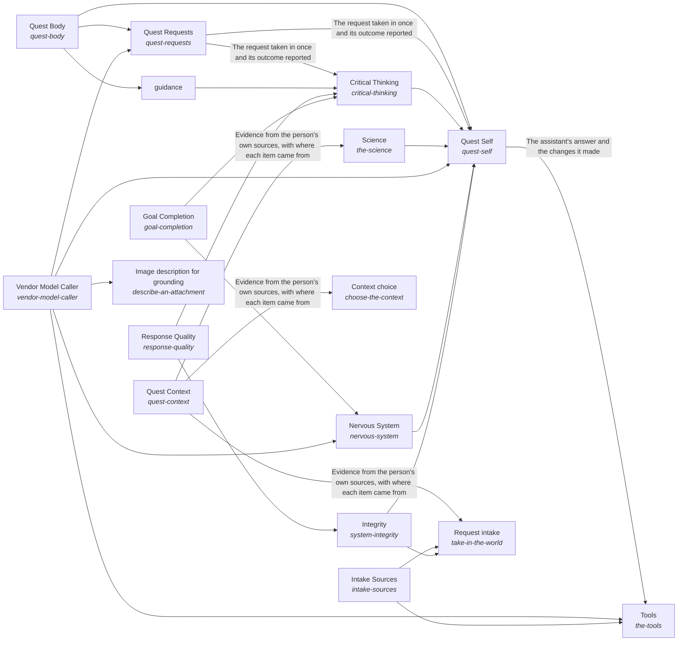

These are ESOI records rendered as a diagram (evolvable structure that optimizes intent). This page is generated from the solutions' outputs and the implementations' `uses_solution_ids` by `esoi diagram`; edit those records, not this page.

# Solution diagram: Quest AI Runner

Quest AI Runner turns what a Quest user asks into work that moves their intents, and Quest Self is the one assistant that does it. Quest Self asks Quest Consciousness who is asking and what they are growing toward, reads their account and their own material through Quest Body, reasons about the request through Intelligence and reaches what lies outside through World. Quest Consciousness takes each request in through Quest Requests, hands it to the representative that fits through Quest Representatives, asks a person only for what is theirs through Quest Decision Requests, learns from feedback through Feedback Learning and proposes what is most likely to work for their intents through Intent Evolution. Quest Body keeps the person's Quest data in Quest Context, changes it exactly as asked through Quest Change Executor and keeps what is said about an account true through Quest Account Truth. Intelligence plans each request through Mind, recalls what it needs through Subconscious, keeps the long view through Higher Mind with Guidance and Quest Intents, and holds the work to a measure through Critical Thinking with Goal Completion and Response Quality. World asks models through Model Plumbing with Model Tier Chooser and Vendor Model Caller, uses outside tools through Tools with Delegated Agent Sessions and File Editing, and answers from public research through Science. Nervous System watches every run, Intake Sources brings requests in from where people work and Integrity keeps every part a specified solution that is measured.

An arrow runs from the solution that provides to the solution that builds on it; its label is what the provider outputs.

