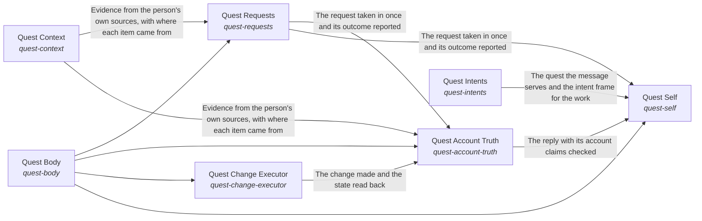

# quest_ai_runner

*ESOI records kept beside the code in `quest_ai_runner`, generated from the CSV files in this folder by `esoi readmes`. Edit the CSV files, not this page.*

Goals keep moving between a person's sessions, because the work they delegated gets done to the standard they wrote, and every answer and action rests on the person's own goals, material and preferences, and never on another person's.

These are the solutions of [Grounded AI that advances people's goals](../esoi/README.md).

## How the solutions fit together

quest-ai-runner turns a person's request or queued task into grounded work in one flow, and the Grounded goal agent is that flow. It takes the request in through Request intake, says what the person is working toward through Higher mind and chooses the context the request needs through Context choice. It reasons step by step through Mind, acts on the account through Body and Quest account access, and answers questions beyond the person's own material through Science. It has every run watched through Nervous System and holds the work to the metric that serves it through Critical Thinking. It asks the model through the Tiered model provider layer and stays comparable by metric through Integrity. It recalls what a request needs through Subconscious. Subconscious recalls the cards that match a request through Hub card store. Tiered model provider layer accounts for every call through Cost estimation, daily budget and host load guard. Mind starts each step on the model tier it picks through Cost-ordered model tier selector with outage and allowance recovery. Nervous System has the model oversee a run through Tiered model provider layer. Queued-task runner claims, runs and reports a queued task, asking the model through Tiered model provider layer and working in the account through Quest account access. It writes each prompt as a registered spec with an owner and a metric through Justified model calls. Body reads and changes the quest through Context card persistence backend, Quest account access and Queued-task runner. Higher mind saves what it learned through Context card persistence backend. Request intake hears from a live channel through Live messaging channel transport. Body changes the quest as the person asks through Quest change executor and writes files inside one folder through Bounded reversible file writer. Body reads from the sources the person's work lives in through Multi-source evidence retriever and hands a new goal to the right owner through Goal assignee and doability judge. Body does heavy work through Bounded autonomous work runner, makes one named change on an outside tool server through Allowlisted operation writer and claims only the reach that World grants. Quest change executor reaches the account through Quest account access and decides through Tiered model provider layer. Goal assignee and doability judge asks the model whether a goal is doable through Tiered model provider layer. World reaches a person through Live messaging channel transport and judges through Tiered model provider layer.

## Overview diagram

An arrow runs from the solution that provides to the solution that builds on it; its label is what the provider outputs.

## Quest Context (`quest-context`)

Give every request the person's own Quest material and nobody else's.

- Entry call: no entry declared
- Selected implementation: Parallel multi-source composite (`composite`)
- Metric: Retrieval recall of the right document over handbook questions, Update-offering correctness over synthetic quest channels, Pointer-resolution safety over offline cases
- Implemented by: [`evaluation/components/feed_context_sources/impls/update_engine.py`](../evaluation/components/feed_context_sources/impls/update_engine.py), [`evaluation/components/resolve_references/impls/card_resolvers.py`](../evaluation/components/resolve_references/impls/card_resolvers.py), [`quest_ai_runner/the_body/configuration/__init__.py`](the_body/configuration/__init__.py), [`quest_ai_runner/the_body/configuration/acp_deep_runner_config.py`](the_body/configuration/acp_deep_runner_config.py), [`quest_ai_runner/the_body/configuration/card_store_settings.py`](the_body/configuration/card_store_settings.py), [`quest_ai_runner/the_body/configuration/cli_config.py`](the_body/configuration/cli_config.py), [`quest_ai_runner/the_body/configuration/config.py`](the_body/configuration/config.py), [`quest_ai_runner/the_body/configuration/config_assembler.py`](the_body/configuration/config_assembler.py) and 119 more

## Quest Requests (`quest-requests`)

Take every request made in Quest in once, through the same AI, and report its outcome to the person.

- Entry call: no entry declared
- Selected implementation: Offline lifecycle harness (`qar_runner`)
- Metric: Task lifecycle correctness over offline cases, Exactly-once mid-run delivery per run, and how fast it is seen, Answer pass rate gained per image described, Ways in that pass their own metric
- Implemented by: [`quest_ai_runner/the_body/area_body.py`](the_body/area_body.py), [`quest_ai_runner/the_body/configuration/__init__.py`](the_body/configuration/__init__.py), [`quest_ai_runner/the_body/configuration/acp_deep_runner_config.py`](the_body/configuration/acp_deep_runner_config.py), [`quest_ai_runner/the_body/configuration/card_store_settings.py`](the_body/configuration/card_store_settings.py), [`quest_ai_runner/the_body/configuration/cli_config.py`](the_body/configuration/cli_config.py), [`quest_ai_runner/the_body/configuration/config.py`](the_body/configuration/config.py), [`quest_ai_runner/the_body/configuration/config_assembler.py`](the_body/configuration/config_assembler.py), [`quest_ai_runner/the_body/configuration/config_context_index.py`](the_body/configuration/config_context_index.py) and 161 more

## Diagram

An arrow runs from the solution that provides to the solution that builds on it; its label is what the provider outputs.

## Metrics

- Task lifecycle correctness over offline cases (`metric-run-queued-tasks`): leader `qar_runner`, 43 of 43 cases
- Requests held to their ESOI metric by code (`metric-think-critically`): leader `deep_runs_only`, 4 of 10 cases
- Retrieval recall of the right document over handbook questions (`metric-gather-evidence`): leader `composite`, 19 of 21 cases
- Combined world score (`metric-claim-reach`): leader `scripted_ideal`, 12 of 12 cases
- Ways in that pass their own metric (`metric-take-in-the-world`)

## Problems

- Help That Does Not Know The Person (`QP2`): A general assistant answers from general knowledge.
- Unreliable Help With The App (`prob-app-help-unreliable`): Questions about how to use Quest, or what its AI can do for the person, are answered from guesses instead of the product's documentation and actual reach: the AI describes a capability it does not have, or says it cannot do something it can.
- Lost Or Unreported Tasks (`QP1`): Quest tasks attached to goals can be lost, run twice, or end without an outcome the person sees.
- Different Answers On Different Surfaces (`QP4`): The same request can get a different answer depending on the Quest surface it came from.

## Ideals

- Personally Grounded Help (`QI2`): Every answer and action rests on the person's own goals, material and preferences, and never on another person's.
- Self-Explaining App (`ideal-self-explaining-app`): Any question about how to use the app gets a correct answer from its own documentation, and the AI knows what it can do.
- Right Representative (`ideal-right-rep`): Each request is handled by the representative whose role and assigned quests fit it, and work spawned from a thread keeps that thread's representative unless the person chooses another.
- Dependable Delivery (`ideal-dependable-delivery`): What is handed to the system arrives once, in order, and is accounted for.
- Same Assistant Everywhere (`QI4`): A person gets the same assistant, with the same answer to the same request, on every Quest surface.

## Where to go next

- Intent: [Grounded AI that advances people's goals](../esoi/README.md)
- Down: [quest_ai_runner/the_body](the_body/README.md)
- Down: [quest_ai_runner/the_consciousness](the_consciousness/README.md)
- Down: [quest_ai_runner/the_intelligence](the_intelligence/README.md)
- Down: [quest_ai_runner/the_self](the_self/README.md)
- Down: [quest_ai_runner/the_world/model_plumbing/model_tier_chooser](the_world/model_plumbing/model_tier_chooser/README.md)
- Down: [quest_ai_runner/the_world/model_plumbing/spend](the_world/model_plumbing/spend/README.md)
- Down: [quest_ai_runner/the_world/model_plumbing/vendor_model_caller](the_world/model_plumbing/vendor_model_caller/README.md)
- Down: [quest_ai_runner/the_world/tools/connected_system_operations](the_world/tools/connected_system_operations/README.md)
- Down: [quest_ai_runner/the_world/tools/delegated_agent_sessions](the_world/tools/delegated_agent_sessions/README.md)
- Down: [quest_ai_runner/the_world/tools/file_editing](the_world/tools/file_editing/README.md)
- Down: [quest_ai_runner/the_world/tools/file_reading](the_world/tools/file_reading/README.md)
- Down: [quest_ai_runner/the_world/tools/web_search](the_world/tools/web_search/README.md)
- Repository: [top README](../README.md)
