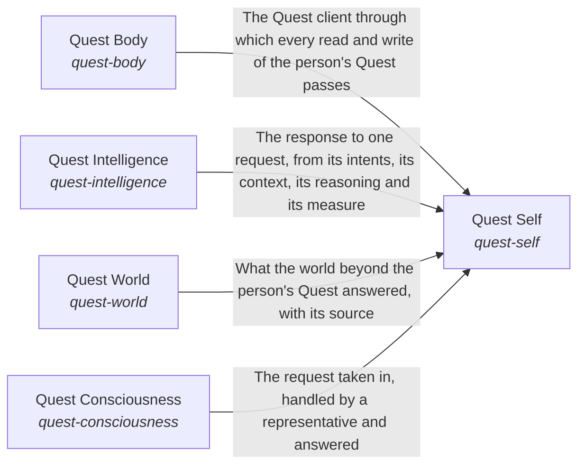

# quest_ai_runner

Breadcrumb: [Top](../esoi/README.md) > quest_ai_runner

Part of [Quest AI Runner](../esoi/README.md)

## Quest Self (`quest-self`)

Make each Quest user meet one whole assistant whose parts agree, so that a part passing its own test cannot hide a failure that the person finds out about.

- Out of scope: How each part does its job: the hub's The Self owns the general flow and its metric.
- Delegates to: quest-intelligence, quest-world, quest-body, quest-consciousness
- Entry call: `quest_ai_runner.run("quest-self", 'What should I work on first this week?')`
- Selected implementation: quest-ai-runner library (`library`)
- Metric: Judge pass rate over the chat quality cases, Whole-path turns right on a small mixed set, Quest answers that name the person's goal and circumstance and fit features to them, Day-with-Jarvis turns right end to end, Asks filed and deletes held before anything outward or irreversible happens, Replies that claim only what was done, Passing chat turns per dollar, Delegated tasks meeting their standard, Exact and consented changes, Data kept in scope, Engine reuse, Measured coverage, QAR overall score
- Implemented by: [`evaluation/components/act_as_the_body/__init__.py`](../evaluation/components/act_as_the_body/__init__.py), [`evaluation/components/act_as_the_body/broken/__init__.py`](../evaluation/components/act_as_the_body/broken/__init__.py), [`evaluation/components/act_as_the_body/broken/blind_replay.py`](../evaluation/components/act_as_the_body/broken/blind_replay.py), [`evaluation/components/act_as_the_body/cases.json`](../evaluation/components/act_as_the_body/cases.json), [`evaluation/components/act_as_the_body/impls/__init__.py`](../evaluation/components/act_as_the_body/impls/__init__.py), [`evaluation/components/act_as_the_body/impls/card_and_reads.py`](../evaluation/components/act_as_the_body/impls/card_and_reads.py), [`evaluation/components/act_as_the_body/interface.py`](../evaluation/components/act_as_the_body/interface.py), [`evaluation/components/act_as_the_body/score.py`](../evaluation/components/act_as_the_body/score.py) and 1127 more

## Quest Body (`quest-body`)

Give the assistant one declared place where a person's Quest data lives and where requests come from.

- Out of scope: Which context a request needs and how a change is made: Quest Context and Quest Change Executor own those.
- Delegates to: quest-context, quest-change-executor, the-science
- Entry call: `quest_ai_runner.run("quest-body", 'quest-id')`
- Selected implementation: Quest HTTP client from the environment (`quest_client`)
- Metric: Parity of Quest operations across access points
- Implemented by: [`quest_ai_runner/the_body/area_body.py`](the_body/area_body.py), [`quest_ai_runner/the_body/internal_context/quest/__init__.py`](the_body/internal_context/quest/__init__.py), [`quest_ai_runner/the_body/internal_context/quest/cached_db_adapter.py`](the_body/internal_context/quest/cached_db_adapter.py), [`quest_ai_runner/the_body/internal_context/quest/interface.py`](the_body/internal_context/quest/interface.py), [`quest_ai_runner/the_body/internal_context/quest/quest_retrieval_adapter.py`](the_body/internal_context/quest/quest_retrieval_adapter.py), [`quest_ai_runner/the_body/internal_context/quest/spec_records.py`](the_body/internal_context/quest/spec_records.py)

## Quest Intelligence (`quest-intelligence`)

Let every request be answered for what the person is working toward.

- Out of scope: How each member does its job, and the order a whole request meets them, which the_self/respond.py owns.
- Delegates to: quest-intents, the-subconscious, the-mind, nervous-system, critical-thinking, quest-autopilot, proactivity
- Entry call: `quest_ai_runner.run("quest-intelligence", {'request': 'what is the latest Rust version?'})`
- Selected implementation: `composition`
- Metric: Quest Intelligence on Quest cases
- Implemented by: [`quest_ai_runner/the_intelligence/flow.py`](the_intelligence/flow.py), [`quest_ai_runner/the_intelligence/interface.py`](the_intelligence/interface.py)

## Quest World (`quest-world`)

Let the assistant learn what lies outside a person's Quest and act on it through one measured path.

- Out of scope: How each member does its job, and web search and the freshness of the hub's research, which the hub's World owns.
- Delegates to: model-plumbing, the-science, the-tools
- Entry call: `quest_ai_runner.run("quest-world", 'latest Rust version')`
- Selected implementation: `composition`
- Metric: Quest World on Quest cases
- Implemented by: [`quest_ai_runner/the_world/flow.py`](the_world/flow.py), [`quest_ai_runner/the_world/interface.py`](the_world/interface.py)

## Quest Consciousness (`quest-consciousness`)

Let each Quest user grow with an AI aligned to them.

- Out of scope: How each of those does its job.
- Delegates to: quest-requests, quest-representatives, quest-decision-requests, intent-evolution, feedback-learning
- Entry call: `quest_ai_runner.run("quest-consciousness", 'team-1')`
- Selected implementation: `composition`
- Metric: Quest Consciousness on Quest cases
- Implemented by: [`quest_ai_runner/the_consciousness/flow.py`](the_consciousness/flow.py), [`quest_ai_runner/the_consciousness/interface.py`](the_consciousness/interface.py)

## One level below

- [Quest Body](the_body/README.md) (sub-intent): Quest is the AI's body.
- [Quest Consciousness](the_consciousness/README.md) (sub-intent): The AI acts for each person the way that person would want.
- [Intelligence](the_intelligence/README.md) (sub-intent): Each request is understood against what the person is working toward.
- [Quest Self](the_self/README.md) (sub-intent): Each Quest user meets one whole assistant.
- [World](the_world/README.md) (sub-intent): What lies beyond a person's Quest reaches the AI through one measured path.
- [Feedback Learning](the_consciousness/feedback_learning/README.md) (solution with implementations)
- [Write Through MCP](the_world/tools/connected_system_operations/README.md) (solution with implementations): Carry out one named change on an external tool server, and only when an explicit allowlist permits that operation.
- [Place On A Quest](the_intelligence/higher_mind/objectives/place_on_a_quest/README.md) (solution with implementations): Say which of the person's quests a message, goal, note or task belongs to, or none, the same way on every surface that picks one.

## Diagram

An arrow runs from the solution that provides to the solution that builds on it; its label is what the provider outputs.

## Implementations

| Implementation | Handle | Purpose | Code | Selected |
|---|---|---|---|---|
| Per-consumer worker | `quest-self:per-consumer-worker` | Each product writes its own worker and chat backend around a model vendor's API. | no code yet |  |
| Agent framework with Quest glue | `quest-self:agent-framework-with-quest-glue` | Build the engine from a general framework (LangGraph, CrewAI, an agent SDK) and add Quest grounding, escalation and the executor as glue. | no code yet |  |
| Deep runner only | `quest-self:deep-runner-only` | Hand every task straight to a coding agent such as Claude Code with the person's material available, with no routing or answering loop in front. | no code yet |  |
| quest-ai-runner library | `quest-self:library` | A domain-free Python library: a bounded plan, gather, re-plan, answer loop that escalates to a deep runner when real work is needed (the core), a task executor that polls Quest, claims, runs, escalates and reports (the runner), and reference adapters for retrieval, model providers, cards, vectors, web research and deep runners, all wired by one configuration per lane and each swappable part chosen by metric. | [`quest_ai_runner/the_self/respond.py`](the_self/respond.py) | selected |
| Quest HTTP client from the environment | `quest-body:quest_client` | Builds the Quest client from QUEST_BASE_URL (or QUEST_API_URL), QUEST_API_KEY and, when set, QUEST_TEAM_ID, so the runner works in the account those name. | [`quest_ai_runner/the_body/area_body.py`](the_body/area_body.py) | selected |
| Composition | `quest-consciousness:composition` | One Quest user's alignment: each line is handed to the member that owns it. | [`quest_ai_runner/the_consciousness/flow.py`](the_consciousness/flow.py) | selected |
| Composition | `quest-intelligence:composition` | A request read against the person's intents, its context chosen, thought through and held to a measure. | [`quest_ai_runner/the_intelligence/flow.py`](the_intelligence/flow.py) | selected |
| Composition | `quest-world:composition` | Research and reach: the outside world answered from public research, and a request placed inside or outside the readable sources. | [`quest_ai_runner/the_world/flow.py`](the_world/flow.py) | selected |
| QAR as shipped, live on the subscription (today) | `quest-self:qar_live` | The orchestrator built the way production builds it, with the claude CLI backend on the cheapest tier, the real tool catalogue and the real send command, over the placeholder account. | [`quest_ai_runner/the_intelligence/mind/orchestrator.py`](the_intelligence/mind/orchestrator.py) |  |
| Scripted ideal planner (offline) | `quest-self:reference_script` | The same orchestrator and tool catalogue with a planner that replays each case's ideal decisions and reply. | no code yet |  |
| Rules only, no model (floor) | `quest-self:rules_only` | No orchestrator: a few message shapes become a note, a goal or a queued task, everything else gets a fixed non-answer, and the terminal prints the fixed Queued line. | no code yet |  |
| One turn of the orchestrator over the model | `quest-self:orchestrator_turn` | The loop plans, gathers, re-plans and answers one message over the model seat, with no cards behind it, and returns the reply, how the loop ended and what ran. | [`quest_ai_runner/the_intelligence/mind/area_mind.py`](the_intelligence/mind/area_mind.py) |  |
| The shipped path as one call | `quest-self:shipped_path` | Answers a message with one turn of the loop over the model and returns the turn whole, which is the path the end-to-end metric measures. | [`quest_ai_runner/the_intelligence/mind/area_mind.py`](the_intelligence/mind/area_mind.py) |  |

## Metrics

- Task lifecycle correctness over offline cases (`metric-run-queued-tasks`): leader `qar_runner`, 43 of 43 cases
- Requests held to their ESOI metric by code (`metric-think-critically`): leader `every_request_measured`, 7 of 12 cases
- Retrieval recall of the right document over handbook questions (`metric-gather-evidence`): leader `composite`, 19 of 21 cases
- Combined world score (`metric-claim-reach`): leader `scripted_ideal`, 12 of 12 cases
- Ways in that pass their own metric (`metric-take-in-the-world`)
- Parity of Quest operations across access points (`metric-quest-operations-parity`)

## Problems

- Different Science Evidence In Two Chats (`prob-science-search-duplicates-research-chat`): One science question can get different evidence in Quest chat than in Quest's research chat.
- Different Answers On Different Surfaces (`QP4`): The same request can get a different answer depending on the Quest surface it came from.
- Parts Pass While The Assistant Fails (`prob-assistant-not-jarvis-from-the-users-seat`): Each part of QAR can pass its own test while the assistant, as a person meets it across a day, forgets what it knows, acts unasked, claims work it did not do, or answers a vague request with a generic plan, and the person is the one who finds out.

## Ideals

- Consistent Science Evidence (`ideal-science-through-one-search`): A science question gets the same evidence, weighed the same way, in Quest chat and in the research chat.
- Same Assistant Everywhere (`QI4`): A person gets the same assistant, with the same answer to the same request, on every Quest surface.
- Capable From The User's Seat (`ideal-jarvis-from-the-users-seat`): The assistant is judged as the person meets it across a day: one capable assistant that gets real work done in the person's own quests, asks before it does anything outward or hard to undo, and says only what it did.
- Present And Prompt (`ideal-jarvis-j01-always-there-and-fast`): The assistant answers whenever the person asks, and quickly enough that asking it is easier than doing the thing alone.

## Where to go next

- Intent: [Quest AI Runner](../esoi/README.md)
- Down: [quest_ai_runner/the_body/configuration](the_body/configuration/README.md)
- Down: [quest_ai_runner/the_consciousness/feedback_learning](the_consciousness/feedback_learning/README.md)
- Down: [quest_ai_runner/the_consciousness/intent_evolution](the_consciousness/intent_evolution/README.md)
- Down: [quest_ai_runner/the_consciousness/prioritization](the_consciousness/prioritization/README.md)
- Down: [quest_ai_runner/the_consciousness/representatives](the_consciousness/representatives/README.md)
- Down: [quest_ai_runner/the_intelligence/nervous_system](the_intelligence/nervous_system/README.md)
- Down: [quest_ai_runner/the_intelligence/proactivity](the_intelligence/proactivity/README.md)
- Down: [quest_ai_runner/the_body/internal_context/card_store](the_body/internal_context/card_store/README.md)
- Down: [quest_ai_runner/the_intelligence/critical_thinking/esoi_application](the_intelligence/critical_thinking/esoi_application/README.md)
- Down: [quest_ai_runner/the_intelligence/mind/planner](the_intelligence/mind/planner/README.md)
- Down: [quest_ai_runner/the_intelligence/mind/response_writer](the_intelligence/mind/response_writer/README.md)
- Down: [quest_ai_runner/the_intelligence/subconscious/cards_from_files](the_intelligence/subconscious/cards_from_files/README.md)
- Down: [quest_ai_runner/the_intelligence/subconscious/intuition](the_intelligence/subconscious/intuition/README.md)
- Down: [quest_ai_runner/the_world/model_plumbing/model_tier_chooser](the_world/model_plumbing/model_tier_chooser/README.md)
- Down: [quest_ai_runner/the_world/model_plumbing/vendor_model_caller](the_world/model_plumbing/vendor_model_caller/README.md)
- Down: [quest_ai_runner/the_world/tools/connected_system_operations](the_world/tools/connected_system_operations/README.md)
- Down: [quest_ai_runner/the_world/tools/delegated_agent_sessions](the_world/tools/delegated_agent_sessions/README.md)
- Down: [quest_ai_runner/the_world/tools/file_editing](the_world/tools/file_editing/README.md)
- Down: [quest_ai_runner/the_world/tools/web_search](the_world/tools/web_search/README.md)
- Down: [quest_ai_runner/the_intelligence/higher_mind/objectives/place_on_a_quest](the_intelligence/higher_mind/objectives/place_on_a_quest/README.md)
- Repository: [top README](../README.md)

*Generated from the CSV files in this folder by `esoi readmes`. Edit the CSV files, not this page.*
