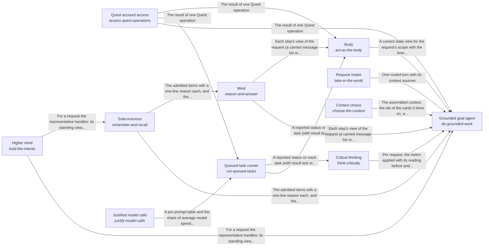

# quest_ai_runner

*ESOI records kept beside the code in `quest_ai_runner`, generated from the CSV files in this folder by `esoi readmes`. Edit the CSV files, not this page.*

## Grounded goal agent (`do-grounded-work`)

Keeps a person's or team's goals moving by answering from their own material, carrying out requested changes, and running queued work to a written standard.

- Entry call: `quest_ai_runner.run("do-grounded-work", 'What should I work on first this week?')`
- Selected implementation: `library`
- Metric: QAR overall score, Passing chat turns per dollar, Delegated tasks meeting their standard, Exact and consented changes, Data kept in scope, Engine reuse, Measured coverage
- Implemented by: [`evaluation/components/act_as_the_body/__init__.py`](../evaluation/components/act_as_the_body/__init__.py), [`evaluation/components/act_as_the_body/broken/__init__.py`](../evaluation/components/act_as_the_body/broken/__init__.py), [`evaluation/components/act_as_the_body/broken/blind_replay.py`](../evaluation/components/act_as_the_body/broken/blind_replay.py), [`evaluation/components/act_as_the_body/cases.json`](../evaluation/components/act_as_the_body/cases.json), [`evaluation/components/act_as_the_body/impls/__init__.py`](../evaluation/components/act_as_the_body/impls/__init__.py), [`evaluation/components/act_as_the_body/impls/card_and_reads.py`](../evaluation/components/act_as_the_body/impls/card_and_reads.py), [`evaluation/components/act_as_the_body/interface.py`](../evaluation/components/act_as_the_body/interface.py), [`evaluation/components/act_as_the_body/score.py`](../evaluation/components/act_as_the_body/score.py) and 936 more

## Queued-task runner (`run-queued-tasks`)

Takes a person's queued requests to a reported outcome, so they run on time without anyone having to start them by hand.

- Entry call: `quest_ai_runner.run("run-queued-tasks", 'team-1')`
- Selected implementation: `qar_runner`
- Metric: Task lifecycle correctness over offline cases
- Implemented by: [`quest_ai_runner/act_as_the_body/__init__.py`](act_as_the_body/__init__.py), [`quest_ai_runner/area_act_as_the_body.py`](area_act_as_the_body.py), [`quest_ai_runner/runner/__init__.py`](runner/__init__.py), [`quest_ai_runner/runner/action_catalog.py`](runner/action_catalog.py), [`quest_ai_runner/runner/auto_followup.py`](runner/auto_followup.py), [`quest_ai_runner/runner/channel_runner.py`](runner/channel_runner.py), [`quest_ai_runner/runner/channel_session.py`](runner/channel_session.py), [`quest_ai_runner/runner/config_wiring.py`](runner/config_wiring.py) and 33 more

## Mind (`reason-and-answer`)

Keeps every step of a person's request acting on everything the request has established so far, at the cost of the fast tier.

- Entry call: `quest_ai_runner.run("reason-and-answer", ...)`
- Selected implementation: `rebuilt_per_step`
- Metric: Step continuity at cost over multi-step requests
- Implemented by: [`quest_ai_runner/area_reason_and_answer.py`](area_reason_and_answer.py), [`quest_ai_runner/core/auxiliary_prompts.py`](core/auxiliary_prompts.py), [`quest_ai_runner/core/context_doctrine.py`](core/context_doctrine.py), [`quest_ai_runner/core/orchestrator_planning.py`](core/orchestrator_planning.py), [`quest_ai_runner/core/planner_cascade.py`](core/planner_cascade.py), [`quest_ai_runner/core/planner_context.py`](core/planner_context.py), [`quest_ai_runner/core/planner_doctrine.py`](core/planner_doctrine.py), [`quest_ai_runner/core/planner_prompt.py`](core/planner_prompt.py) and 6 more

## Body (`act-as-the-body`)

Lets a person trust what the AI says about their own account and about what it changed in it.

- Entry call: `quest_ai_runner.run("act-as-the-body", 'NOTES.md')`
- Selected implementation: `card_and_reads`
- Metric: Account-state consistency across scripted sessions
- Implemented by: [`quest_ai_runner/act_as_the_body/__init__.py`](act_as_the_body/__init__.py), [`quest_ai_runner/area_act_as_the_body.py`](area_act_as_the_body.py), [`quest_ai_runner/core/orchestrator.py`](core/orchestrator.py), [`quest_ai_runner/core/orchestrator_answering.py`](core/orchestrator_answering.py), [`quest_ai_runner/core/orchestrator_capabilities.py`](core/orchestrator_capabilities.py), [`quest_ai_runner/core/orchestrator_cards.py`](core/orchestrator_cards.py), [`quest_ai_runner/core/orchestrator_constants.py`](core/orchestrator_constants.py), [`quest_ai_runner/core/orchestrator_decide_tool.py`](core/orchestrator_decide_tool.py) and 22 more

## Higher mind (`hold-the-intents`)

Gives each AI representative a broad, high-level context across the quests it is assigned, so every request it handles starts from what that whole set and its intents have already settled.

- Entry call: `quest_ai_runner.run("hold-the-intents", ...)`
- Selected implementation: `separate_stores`
- Metric: Representative long-view carry-through across assigned quests, with nothing outside its branch
- Implemented by: [`quest_ai_runner/core/auxiliary_prompts.py`](core/auxiliary_prompts.py), [`quest_ai_runner/core/context_doctrine.py`](core/context_doctrine.py), [`quest_ai_runner/core/planner_cascade.py`](core/planner_cascade.py), [`quest_ai_runner/core/planner_context.py`](core/planner_context.py), [`quest_ai_runner/core/planner_doctrine.py`](core/planner_doctrine.py), [`quest_ai_runner/core/planner_prompt.py`](core/planner_prompt.py), [`quest_ai_runner/core/prompt_layers.py`](core/prompt_layers.py), [`quest_ai_runner/core/prompt_specs.py`](core/prompt_specs.py) and 6 more

## Critical thinking (`think-critically`)

Makes sure everything the system does applies the relevant ESOI metric and leaves it improved, or at least not worse.

- Entry call: `quest_ai_runner.run("think-critically", ...)`
- Selected implementation: `deep_runs_only`
- Metric: Requests held to their ESOI metric by code
- Implemented by: [`evaluation/components/act_as_the_body/__init__.py`](../evaluation/components/act_as_the_body/__init__.py), [`evaluation/components/act_as_the_body/broken/__init__.py`](../evaluation/components/act_as_the_body/broken/__init__.py), [`evaluation/components/act_as_the_body/broken/blind_replay.py`](../evaluation/components/act_as_the_body/broken/blind_replay.py), [`evaluation/components/act_as_the_body/cases.json`](../evaluation/components/act_as_the_body/cases.json), [`evaluation/components/act_as_the_body/impls/__init__.py`](../evaluation/components/act_as_the_body/impls/__init__.py), [`evaluation/components/act_as_the_body/impls/card_and_reads.py`](../evaluation/components/act_as_the_body/impls/card_and_reads.py), [`evaluation/components/act_as_the_body/interface.py`](../evaluation/components/act_as_the_body/interface.py), [`evaluation/components/act_as_the_body/score.py`](../evaluation/components/act_as_the_body/score.py) and 929 more

## Quest account access (`access-quest-operations`)

Let the runner work in the person's own Quest account, so every read and change goes through one client.

- Entry call: `quest_ai_runner.run("access-quest-operations", 'quest-id')`
- Selected implementation: `quest_client`
- Metric: Parity of Quest operations across access points
- Implemented by: [`quest_ai_runner/act_as_the_body/__init__.py`](act_as_the_body/__init__.py), [`quest_ai_runner/area_act_as_the_body.py`](area_act_as_the_body.py)

## Request intake (`take-in-the-world`)

Let a person or a program reach the runner from wherever they work and be understood the same way.

- Entry call: `quest_ai_runner.run("take-in-the-world", 'Save a note that the launch moves to Friday.')`
- Selected implementation: `ways_in`
- Metric: Ways in that pass their own metric
- Implemented by: [`quest_ai_runner/area_take_in_the_world.py`](area_take_in_the_world.py), [`quest_ai_runner/take_in_the_world/__init__.py`](take_in_the_world/__init__.py)

## Context choice (`choose-the-context`)

Gives the planner the right material at little cost, so a run starts grounded in the person's own knowledge without re-discovering it.

- Entry call: `quest_ai_runner.run("choose-the-context", 'What should I work on first this week?')`
- Selected implementation: `per_lane_assembly`
- Metric: Context handed to the planner
- Implemented by: [`quest_ai_runner/select_context/area.py`](select_context/area.py)

## Diagram

An arrow runs from the solution that provides to the solution that builds on it; its label is what the provider outputs.

## Implementations

| Implementation | Handle | Code | Selected |
|---|---|---|---|
| quest-ai-runner library | `do-grounded-work:library` | [`quest_ai_runner/goal_agent.py`](goal_agent.py) | selected |
| Prefix-routing multi-provider | `call-a-model:multi_provider` | [`quest_ai_runner/providers.py`](providers.py) | selected |
| Digest-driven overseer | `watch-for-risk:overseer` | [`quest_ai_runner/watch_for_risk/area.py`](watch_for_risk/area.py) | selected |
| Offline lifecycle harness | `run-queued-tasks:qar_runner` | [`quest_ai_runner/area_act_as_the_body.py`](area_act_as_the_body.py) | selected |
| Static price table lookup | `track-usage-and-cost:pricing` | [`quest_ai_runner/pricing.py`](pricing.py) |  |
| Persisted daily token tracker | `track-usage-and-cost:usage` | [`quest_ai_runner/usage.py`](usage.py) |  |
| Hysteresis resource guard | `track-usage-and-cost:resources` | [`quest_ai_runner/resources.py`](resources.py) |  |
| Apply the evolvable-structure library | `keep-it-generic:structure-library` | [`quest_ai_runner/keep_it_generic/area.py`](keep_it_generic/area.py) | selected |
| Rebuilt prompt per step with a referenced context (today) | `reason-and-answer:rebuilt_per_step` | [`quest_ai_runner/area_reason_and_answer.py`](area_reason_and_answer.py) | selected |
| Web research with the answer's support check (today) | `know-the-world:web_with_support_check` | [`quest_ai_runner/know_the_world/area.py`](know_the_world/area.py) | selected |
| Managed quest card plus optional live reads (today) | `act-as-the-body:card_and_reads` | [`quest_ai_runner/area_act_as_the_body.py`](area_act_as_the_body.py) | selected |
| Separate stores read at the start of a request (today) | `hold-the-intents:separate_stores` | [`quest_ai_runner/hold_the_intents/area.py`](hold_the_intents/area.py) | selected |
| Code-enforced before and after on deep runs only (today) | `think-critically:deep_runs_only` | [`quest_ai_runner/think_critically/area.py`](think_critically/area.py) | selected |
| Channels, terminal and package as ways in | `take-in-the-world:ways_in` | [`quest_ai_runner/area_take_in_the_world.py`](area_take_in_the_world.py) | selected |
| Quest HTTP client from the environment | `access-quest-operations:quest_client` | [`quest_ai_runner/area_act_as_the_body.py`](area_act_as_the_body.py) | selected |
| Per-lane assembly of the context members (today) | `choose-the-context:per_lane_assembly` | [`quest_ai_runner/select_context/area.py`](select_context/area.py) | selected |

## Metrics

- Passing chat turns per dollar (`QME1`): leader `reference_replies`, 331 of 331 cases
- Delegated tasks meeting their standard (`QME2`)
- Exact and consented changes (`QME3`)
- Data kept in scope (`QME4`)
- Engine reuse (`QME5`)
- Measured coverage (`QME6`)
- QAR overall score (`metric-qar-overall`): leader `qar_overall.broken.latest_row_any_age:build`, 0 of 9 cases
- Task lifecycle correctness over offline cases (`metric-run-queued-tasks`): leader `qar_runner`, 43 of 43 cases
- Step continuity at cost over multi-step requests (`metric-keep-a-working-stream`): leader `rebuilt_full_context`, 14 of 14 cases
- Account-state consistency across scripted sessions (`metric-act-as-the-body`): leader `card_and_reads`, 8 of 9 cases
- Representative long-view carry-through across assigned quests, with nothing outside its branch (`metric-hold-the-long-view`): leader `separate_stores`, 13 of 15 cases
- Requests held to their ESOI metric by code (`metric-think-critically`): leader `deep_runs_only`, 4 of 10 cases
- Parity of Quest operations across access points (`metric-quest-operations-parity`)
- Ways in that pass their own metric (`metric-take-in-the-world`)
- Context handed to the planner (`metric-choose-the-context`): leader `per_lane_assembly`, 2 of 2 cases

## Problems

- `QP1`: People can attach AI tasks to their goals in Quest and schedule them, but nothing runs them: Quest queues the work and has no worker.
- `QP2`: A general assistant answers from general knowledge.
- `QP3`: An AI that may act on someone's behalf tends to one of two failures: it asks permission for everything, so nothing moves without a person, or it takes steps that only a person should decide...
- `QP4`: Grounding, routing, deep work, escalation, a task executor, cost control: each product or team that wants AI help writes these again, privately, and the copies drift apart.
- `prob-step-loses-the-request`: Within one request, each planning step is a separate model call rebuilt from parts, not a continuation of the step before.
- `prob-account-state-contradicts`: What the AI says about the person's own account (which quests exist, what changed, whether a change ran) is re-derived each turn from whatever slice it read, and a change it made is not read back, so...
- `prob-long-view-scattered`: What is known across requests (what a quest has decided, declined and learned, what the person corrected, where the work is heading) is kept in several stores with their own keys, budgets and...
- `prob-app-help-unreliable`: Questions about how to use the app itself (how to do something, what a feature is for) should be answered from the product's own documentation, but that path is untested, the AI sometimes says it...
- `prob-no-environment-tasks-untested`: Most people have no external environment connected, so their delegated tasks can use only the app's own operations, its documentation, a review of their own data and web search, and that path has not...
- `prob-experiments-not-proposed`: Advice and plans are given as one answer, not as the option most likely to work for this person with a metric to check it, and when the better option is unknown the AI does not propose or find an...
- `prob-metric-enforced-on-deep-runs-only`: The before-and-after reading of the relevant ESOI metric is enforced by code only on deep runs.
- `prob-long-view-scope-not-hierarchical`: A representative's high-level view legitimately spans its assigned quests and the intents above them, but the library's fence compares flat tag sets: an item is visible to a turn only when their tags...
- `prob-quest-feature-why-unexplained`: People ask Quest AI why a Quest feature works as it does (why creating a quest asks many questions, what a daily reflection is for) and get a description of the feature, or a generic answer, instead...
- `prob-goal-condition-restated-not-evidence`: A run can be judged against its goal condition by a reply that restates the condition as if it were met, so the done-standard is satisfied in words and no evidence shows the work was done.
- `prob-partial-coverage-reported-as-complete`: A goal that covers a set (every entry, all records) can be reported as done after only part of the set was processed, because the reply reads well and does not admit the gap.
- `prob-long-run-silent-until-the-end`: A long run shows nothing of itself until it ends, so the person cannot tell whether it is working, stuck or finished, and cannot steer it.
- `prob-two-access-points-to-quest-diverge`: Quest's operations can be reached in the same process as Quest and over its HTTP API, and two access points to the same operations can drift apart, so the same request may behave or return...
- `prob-harness-dear-and-slow-on-the-subscription`: Running a coding-agent harness on the Claude Code subscription for each step of a request is costly in tokens and slow to start, while a cheap fast model alone lacks the context discipline and...

## Ideals

- Self-advancing goals (`QI1`): Goals keep moving between a person's sessions, because the work they delegated gets done to the standard they wrote.
- Personally grounded help (`QI2`): Every answer and action rests on the person's own goals, material and preferences, and never on another person's.
- Trusted autonomy (`QI3`): The AI acts first on what it may decide and brings the person exactly the decisions that are theirs.
- One shared engine (`QI4`): One domain-free engine serves every consumer, every lane and both chat and scheduled work, and differs only in configuration.
- Grounded Reply (`ideal-grounded-reply`): A reply says only what the person's own account and its sources support, and says what it found.
- Remembered Work (`ideal-remembered-work`): Work already worked out once is not worked out again, and what was learned is kept.
- Reliable Verdict (`ideal-reliable-verdict`): A narrow judgment changes a turn only when it is usable.
- Checked Improvement per Run (`ideal-checked-improvement`): Every run leaves, on the record it served, what it measured, what it moved and what it changed in the record and why, so improvement is checked per run instead of hoped for.
- Continuous Mind (`ideal-continuous-mind`): Every step of a request acts with everything the request has established so far: what the person said, refused and corrected, what the request was resolved to mean, and what earlier steps found.
- Known Reach (`ideal-known-reach`): The AI says it can do only what it can, says it cannot only after checking, and claims an outside act only with the receipt of the act.
- Consistent Account State (`ideal-consistent-account-state`): What the AI says about the person's own account is true of the account when it says it, every time in a session.
- Standing Perspective (`ideal-standing-perspective`): Each quest carries one view across requests of what was decided, declined, learned and where it is heading, and every request on it starts from that view.
- Questions Only Where Theirs (`ideal-asks-only-what-is-theirs`): The person is asked only what is theirs to decide, and a question they waved off is not asked again.
- Self-Explaining App (`ideal-self-explaining-app`): Any question about how to use the app gets a correct answer from its own documentation, and the AI knows what it can do.
- Most-Likely Path (`ideal-most-likely-path`): Every recommendation is the option most likely to move the person's own metric toward their intent, and what is not known becomes an experiment.
- Hierarchy-Contained Scope (`ideal-hierarchy-contained-scope`): What a representative learns reaches its own assigned quests and the intents above them, and never another representative's quests, a sibling intent or another person.
- Right Representative (`ideal-right-rep`): Each request is handled by the representative whose role and assigned quests fit it, and work spawned from a thread keeps that thread's representative unless the person chooses another.
- Explained Feature Purpose (`ideal-quest-feature-why-explained`): When a person asks why a Quest feature works as it does, the answer gives the reason the feature exists and how it serves their goal, not only what it is.
- Evidenced Completion (`ideal-done-standard-evidenced`): Work is reported as done only when evidence shows its written done-standard was met, and the evidence is not a restatement of the standard.
- Stated Coverage (`ideal-coverage-met-or-gap-stated`): When a goal covers a set (every entry, all records), either the whole set was processed or the report states exactly how much was and what remains.
- Visible Progress (`ideal-incremental-output-while-working`): While work is running, the person can see that it is still working and what it has done so far, at a level they choose.
- Shared Quest Operations (`ideal-one-implementation-two-access-points`): Quest's operations are implemented once, and each way of reaching them (in the same process as Quest, or over its HTTP API) gives the same results.
- Lean Context Harness (`ideal-cheap-fast-harness-with-ideal-context`): The harness that runs Quest AI's steps is as capable as a coding agent but costs and takes about what the fast tier does, because every step sees exactly the context its goal needs.

## Where to go next

- Intent: [Grounded AI that advances people's goals](../esoi/README.md)
- Down: [quest_ai_runner/adapters](adapters/README.md)
- Down: [quest_ai_runner/core](core/README.md)
- Down: [quest_ai_runner/runner](runner/README.md)
- Repository: [top README](../README.md)
