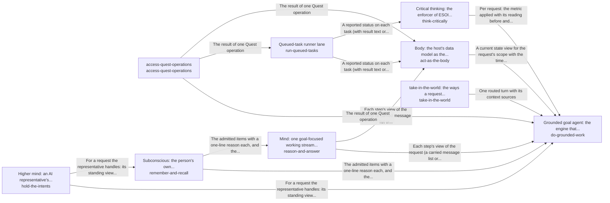

# quest_ai_runner

*ESOI records kept beside the code in `quest_ai_runner`, generated from the CSV files in this folder by `esoi readmes`. Edit the CSV files, not this page.*

## Grounded goal agent: the engine that answers and works on a person's goals from their own material, and the executor that runs their queued AI tasks (`do-grounded-work`)

Keeps a person's or team's goals moving by answering from their own material, carrying out requested changes, and running queued work to a written standard.

- Entry call: `quest_ai_runner.run("do-grounded-work", 'What should I work on first this week?')`
- Selected implementation: `library`
- Metric: QAR overall: do-grounded-work's sub-metrics weighted by its ideals, with floor and ceiling, Passing chat turns per dollar, Delegated tasks meeting their standard, Exact and consented changes, Data kept in scope, Engine reuse, Measured coverage
- Implemented by: [`evaluation/components/act_as_the_body/__init__.py`](../evaluation/components/act_as_the_body/__init__.py), [`evaluation/components/act_as_the_body/broken/__init__.py`](../evaluation/components/act_as_the_body/broken/__init__.py), [`evaluation/components/act_as_the_body/broken/blind_replay.py`](../evaluation/components/act_as_the_body/broken/blind_replay.py), [`evaluation/components/act_as_the_body/cases.json`](../evaluation/components/act_as_the_body/cases.json), [`evaluation/components/act_as_the_body/impls/__init__.py`](../evaluation/components/act_as_the_body/impls/__init__.py), [`evaluation/components/act_as_the_body/impls/card_and_reads.py`](../evaluation/components/act_as_the_body/impls/card_and_reads.py), [`evaluation/components/act_as_the_body/interface.py`](../evaluation/components/act_as_the_body/interface.py), [`evaluation/components/act_as_the_body/score.py`](../evaluation/components/act_as_the_body/score.py) and 907 more

## Queued-task runner lane (`run-queued-tasks`)

Takes a person's queued requests to a reported outcome, so they run on time without anyone having to start them by hand.

- Entry call: `quest_ai_runner.run("run-queued-tasks", 'team-1')`
- Selected implementation: `qar_runner`
- Metric: Task lifecycle correctness over offline cases
- Implemented by: [`quest_ai_runner/area_act_as_the_body.py`](area_act_as_the_body.py), [`quest_ai_runner/runner/__init__.py`](runner/__init__.py), [`quest_ai_runner/runner/action_catalog.py`](runner/action_catalog.py), [`quest_ai_runner/runner/auto_followup.py`](runner/auto_followup.py), [`quest_ai_runner/runner/channel_runner.py`](runner/channel_runner.py), [`quest_ai_runner/runner/channel_session.py`](runner/channel_session.py), [`quest_ai_runner/runner/config_wiring.py`](runner/config_wiring.py), [`quest_ai_runner/runner/executor.py`](runner/executor.py) and 31 more

## Mind: one goal-focused working stream per request (`reason-and-answer`)

Keeps every step of a person's request acting on everything the request has established so far, at the cost of the fast tier.

- Entry call: `quest_ai_runner.run("reason-and-answer", ...)`
- Selected implementation: `rebuilt_per_step`
- Metric: Step continuity at cost over multi-step requests
- Implemented by: [`quest_ai_runner/area_reason_and_answer.py`](area_reason_and_answer.py), [`quest_ai_runner/core/auxiliary_prompts.py`](core/auxiliary_prompts.py), [`quest_ai_runner/core/context_doctrine.py`](core/context_doctrine.py), [`quest_ai_runner/core/orchestrator_planning.py`](core/orchestrator_planning.py), [`quest_ai_runner/core/planner_cascade.py`](core/planner_cascade.py), [`quest_ai_runner/core/planner_context.py`](core/planner_context.py), [`quest_ai_runner/core/planner_doctrine.py`](core/planner_doctrine.py), [`quest_ai_runner/core/planner_prompt.py`](core/planner_prompt.py) and 6 more

## Body: the host's data model as the agent's own consistent state (`act-as-the-body`)

Lets a person trust what the AI says about their own account and about what it changed in it.

- Entry call: `quest_ai_runner.run("act-as-the-body", 'NOTES.md')`
- Selected implementation: `card_and_reads`
- Metric: Account-state consistency across scripted sessions
- Implemented by: [`quest_ai_runner/area_act_as_the_body.py`](area_act_as_the_body.py), [`quest_ai_runner/core/orchestrator.py`](core/orchestrator.py), [`quest_ai_runner/core/orchestrator_answering.py`](core/orchestrator_answering.py), [`quest_ai_runner/core/orchestrator_capabilities.py`](core/orchestrator_capabilities.py), [`quest_ai_runner/core/orchestrator_cards.py`](core/orchestrator_cards.py), [`quest_ai_runner/core/orchestrator_constants.py`](core/orchestrator_constants.py), [`quest_ai_runner/core/orchestrator_decide_tool.py`](core/orchestrator_decide_tool.py), [`quest_ai_runner/core/orchestrator_decisions.py`](core/orchestrator_decisions.py) and 22 more

## Higher mind: an AI representative's standing view across its assigned quests, placed in the intent hierarchy (`hold-the-intents`)

Gives each AI representative a broad, high-level context across the quests it is assigned, so every request it handles starts from what that whole set and its intents have already settled.

- Entry call: `quest_ai_runner.run("hold-the-intents", ...)`
- Selected implementation: `separate_stores`
- Metric: Representative long-view carry-through across assigned quests, with nothing outside its branch
- Implemented by: [`quest_ai_runner/area_hold_the_intents.py`](area_hold_the_intents.py), [`quest_ai_runner/core/auxiliary_prompts.py`](core/auxiliary_prompts.py), [`quest_ai_runner/core/context_doctrine.py`](core/context_doctrine.py), [`quest_ai_runner/core/planner_cascade.py`](core/planner_cascade.py), [`quest_ai_runner/core/planner_context.py`](core/planner_context.py), [`quest_ai_runner/core/planner_doctrine.py`](core/planner_doctrine.py), [`quest_ai_runner/core/planner_prompt.py`](core/planner_prompt.py), [`quest_ai_runner/core/prompt_layers.py`](core/prompt_layers.py) and 5 more

## Critical thinking: the enforcer of ESOI metrics on every request (`think-critically`)

Makes sure everything the system does applies the relevant ESOI metric and leaves it improved, or at least not worse.

- Entry call: `quest_ai_runner.run("think-critically", ...)`
- Selected implementation: `deep_runs_only`
- Metric: Requests held to their ESOI metric by code
- Implemented by: [`evaluation/components/act_as_the_body/__init__.py`](../evaluation/components/act_as_the_body/__init__.py), [`evaluation/components/act_as_the_body/broken/__init__.py`](../evaluation/components/act_as_the_body/broken/__init__.py), [`evaluation/components/act_as_the_body/broken/blind_replay.py`](../evaluation/components/act_as_the_body/broken/blind_replay.py), [`evaluation/components/act_as_the_body/cases.json`](../evaluation/components/act_as_the_body/cases.json), [`evaluation/components/act_as_the_body/impls/__init__.py`](../evaluation/components/act_as_the_body/impls/__init__.py), [`evaluation/components/act_as_the_body/impls/card_and_reads.py`](../evaluation/components/act_as_the_body/impls/card_and_reads.py), [`evaluation/components/act_as_the_body/interface.py`](../evaluation/components/act_as_the_body/interface.py), [`evaluation/components/act_as_the_body/score.py`](../evaluation/components/act_as_the_body/score.py) and 899 more

## access-quest-operations (`access-quest-operations`)

access-quest-operations

- Entry call: `quest_ai_runner.run("access-quest-operations", 'quest-id')`
- Selected implementation: `quest_client`
- Metric: none yet
- Implemented by: [`quest_ai_runner/area_act_as_the_body.py`](area_act_as_the_body.py)

## take-in-the-world: the ways a request reaches QAR (`take-in-the-world`)

Let a person or a program reach the runner from wherever they work and be understood the same way.

- Entry call: `quest_ai_runner.run("take-in-the-world", 'Save a note that the launch moves to Friday.')`
- Selected implementation: `ways_in`
- Metric: Ways in that pass their own metric
- Implemented by: [`quest_ai_runner/area_take_in_the_world.py`](area_take_in_the_world.py)

## Diagram

An arrow runs from the solution that provides to the solution that builds on it; its label is what the provider outputs.

## Implementations

| Implementation | Name | Code | Selected |
|---|---|---|---|
| `do-grounded-work:library` | quest-ai-runner library | [`quest_ai_runner/goal_agent.py`](goal_agent.py) | selected |
| `call-a-model:multi_provider` | Prefix-routing multi-provider | [`quest_ai_runner/providers.py`](providers.py) | selected |
| `watch-for-risk:overseer` | Digest-driven overseer | [`quest_ai_runner/area_watch_for_risk.py`](area_watch_for_risk.py) | selected |
| `run-queued-tasks:qar_runner` | Offline lifecycle harness | [`quest_ai_runner/area_act_as_the_body.py`](area_act_as_the_body.py) | selected |
| `track-usage-and-cost:pricing` | Static price table lookup | [`quest_ai_runner/pricing.py`](pricing.py) |  |
| `track-usage-and-cost:usage` | Persisted daily token tracker | [`quest_ai_runner/usage.py`](usage.py) |  |
| `track-usage-and-cost:resources` | Hysteresis resource guard | [`quest_ai_runner/resources.py`](resources.py) |  |
| `keep-it-generic:structure-library` | Apply the evolvable-structure library | [`quest_ai_runner/keep_it_generic/area.py`](keep_it_generic/area.py) | selected |
| `reason-and-answer:rebuilt_per_step` | Rebuilt prompt per step with a referenced context (today) | [`quest_ai_runner/area_reason_and_answer.py`](area_reason_and_answer.py) | selected |
| `know-the-world:web_with_support_check` | Web research with the answer's support check (today) | [`quest_ai_runner/area_know_the_world.py`](area_know_the_world.py) | selected |
| `act-as-the-body:card_and_reads` | Managed quest card plus optional live reads (today) | [`quest_ai_runner/area_act_as_the_body.py`](area_act_as_the_body.py) | selected |
| `hold-the-intents:separate_stores` | Separate stores read at the start of a request (today) | [`quest_ai_runner/area_hold_the_intents.py`](area_hold_the_intents.py) | selected |
| `think-critically:deep_runs_only` | Code-enforced before and after on deep runs only (today) | [`quest_ai_runner/area_think_critically.py`](area_think_critically.py) | selected |
| `take-in-the-world:ways_in` | Channels, terminal and package as ways in | [`quest_ai_runner/area_take_in_the_world.py`](area_take_in_the_world.py) | selected |
| `access-quest-operations:quest_client` | Quest HTTP client from the environment | [`quest_ai_runner/area_act_as_the_body.py`](area_act_as_the_body.py) | selected |

## Metrics

- `QME1`, Passing chat turns per dollar: leader `reference_replies`, 331 of 331 cases
- `QME2`, Delegated tasks meeting their standard
- `QME3`, Exact and consented changes
- `QME4`, Data kept in scope
- `QME5`, Engine reuse
- `QME6`, Measured coverage
- `metric-qar-overall`, QAR overall: do-grounded-work's sub-metrics weighted by its ideals, with floor and ceiling: leader `qar_overall.broken.latest_row_any_age:build`, 0 of 9 cases
- `metric-run-queued-tasks`, Task lifecycle correctness over offline cases: leader `qar_runner`, 43 of 43 cases
- `metric-keep-a-working-stream`, Step continuity at cost over multi-step requests: leader `rebuilt_full_context`, 14 of 14 cases
- `metric-act-as-the-body`, Account-state consistency across scripted sessions: leader `card_and_reads`, 8 of 9 cases
- `metric-hold-the-long-view`, Representative long-view carry-through across assigned quests, with nothing outside its branch: leader `separate_stores`, 13 of 15 cases
- `metric-think-critically`, Requests held to their ESOI metric by code: leader `deep_runs_only`, 4 of 10 cases
- `metric-quest-operations-parity`, 
- `metric-take-in-the-world`, Ways in that pass their own metric

## Problems

- `QP1`: People can attach AI tasks to their goals in Quest and schedule them, but nothing runs them: Quest queues the work and has no worker.
- `QP2`: A general assistant answers from general knowledge.
- `QP3`: An AI that may act on someone's behalf tends to one of two failures: it asks permission for everything, so nothing moves without a person, or it takes steps that only a person should decide...
- `QP4`: Grounding, routing, deep work, escalation, a task executor, cost control: each product or team that wants AI help writes these again, privately, and the copies drift apart.
- `prob-step-loses-the-request`: Within one request, each planning step is a separate model call rebuilt from parts, not a continuation of the step before.
- `prob-account-state-contradicts`: What the AI says about the person's own account (which quests exist, what changed, whether a change ran) is re-derived each turn from whatever slice it read, and a change it made is not read back, so...
- `prob-long-view-scattered`: What is known across requests (what a quest has decided, declined and learned, what the person corrected, where the work is heading) is kept in several stores with their own keys, budgets and...
- `prob-app-help-unreliable`: Questions about how to use the app itself (how to do something, what a feature is for) should be answered from the product's own documentation, but that path is untested, the AI sometimes says it...
- `prob-no-environment-tasks-untested`: Most people have no external environment connected, so their delegated tasks can use only the app's own operations, its documentation, a review of their own data and web search, and that path has not...
- `prob-experiments-not-proposed`: Advice and plans are given as one answer, not as the option most likely to work for this person with a metric to check it, and when the better option is unknown the AI does not propose or find an...
- `prob-metric-enforced-on-deep-runs-only`: The before-and-after reading of the relevant ESOI metric is enforced by code only on deep runs.
- `prob-long-view-scope-not-hierarchical`: A representative's high-level view legitimately spans its assigned quests and the intents above them, but the library's fence compares flat tag sets: an item is visible to a turn only when their tags...
- `prob-quest-feature-why-unexplained`
- `prob-goal-condition-restated-not-evidence`
- `prob-partial-coverage-reported-as-complete`
- `prob-long-run-silent-until-the-end`
- `prob-two-access-points-to-quest-diverge`
- `prob-harness-dear-and-slow-on-the-subscription`

## Ideals

- `QI1`: Goals keep moving between a person's sessions, because the work they delegated gets done to the standard they wrote.
- `QI2`: Every answer and action rests on the person's own goals, material and preferences, and never on another person's.
- `QI3`: The AI acts first on what it may decide and brings the person exactly the decisions that are theirs.
- `QI4`: One domain-free engine serves every consumer, every lane and both chat and scheduled work, and differs only in configuration.
- `ideal-grounded-reply`: A reply says only what the person's own account and its sources support, and says what it found.
- `ideal-remembered-work`: Work already worked out once is not worked out again, and what was learned is kept.
- `ideal-reliable-verdict`: A narrow judgment changes a turn only when it is usable.
- `ideal-checked-improvement`: Every run leaves, on the record it served, what it measured, what it moved and what it changed in the record and why, so improvement is checked per run instead of hoped for.
- `ideal-continuous-mind`: Every step of a request acts with everything the request has established so far: what the person said, refused and corrected, what the request was resolved to mean, and what earlier steps found.
- `ideal-known-reach`: The AI says it can do only what it can, says it cannot only after checking, and claims an outside act only with the receipt of the act.
- `ideal-consistent-account-state`: What the AI says about the person's own account is true of the account when it says it, every time in a session.
- `ideal-standing-perspective`: Each quest carries one view across requests of what was decided, declined, learned and where it is heading, and every request on it starts from that view.
- `ideal-asks-only-what-is-theirs`: The person is asked only what is theirs to decide, and a question they waved off is not asked again.
- `ideal-self-explaining-app`: Any question about how to use the app gets a correct answer from its own documentation, and the AI knows what it can do.
- `ideal-most-likely-path`: Every recommendation is the option most likely to move the person's own metric toward their intent, and what is not known becomes an experiment.
- `ideal-hierarchy-contained-scope`: What a representative learns reaches its own assigned quests and the intents above them, and never another representative's quests, a sibling intent or another person.
- `ideal-right-rep`: Each request is handled by the representative whose role and assigned quests fit it, and work spawned from a thread keeps that thread's representative unless the person chooses another.
- `ideal-quest-feature-why-explained`
- `ideal-done-standard-evidenced`
- `ideal-coverage-met-or-gap-stated`
- `ideal-incremental-output-while-working`
- `ideal-one-implementation-two-access-points`
- `ideal-cheap-fast-harness-with-ideal-context`

## Where to go next

- Intent: [Grounded AI that advances people's goals](../esoi/README.md)
- Down: [quest_ai_runner/adapters](adapters/README.md)
- Down: [quest_ai_runner/core](core/README.md)
- Down: [quest_ai_runner/runner](runner/README.md)
- Repository: [top README](../README.md)
