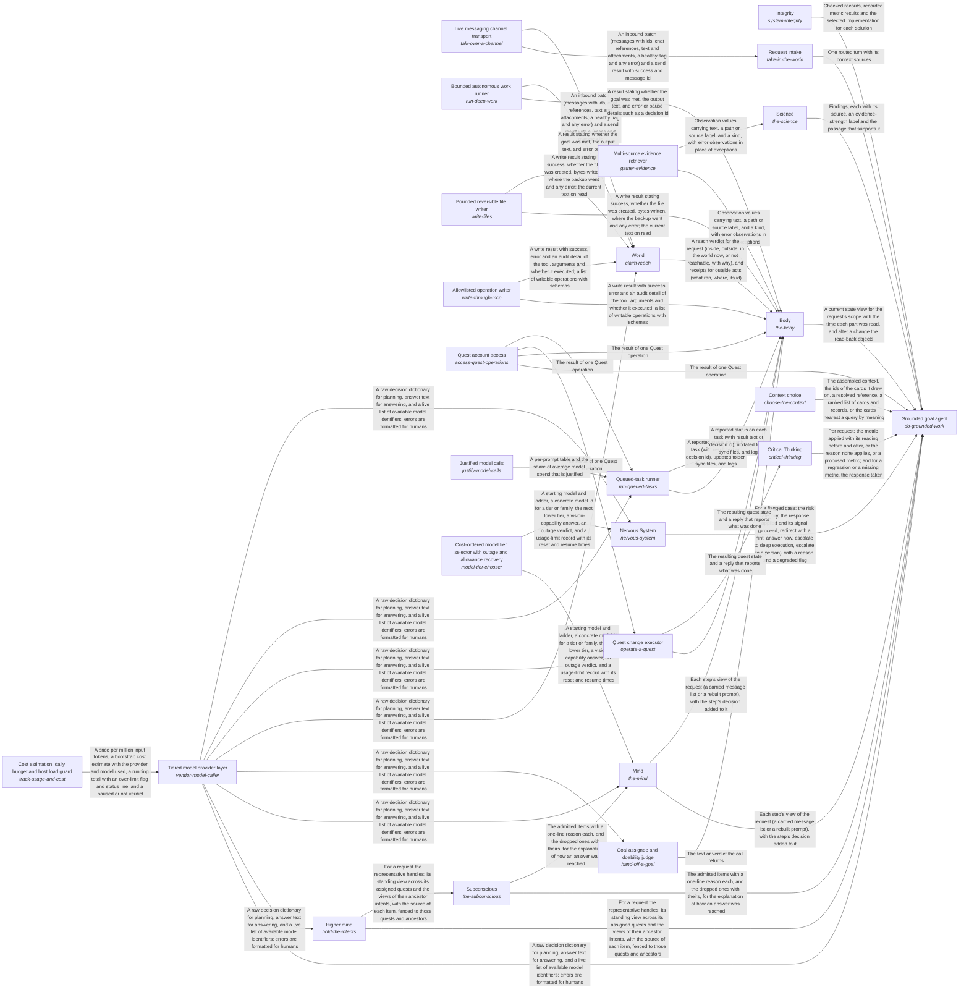
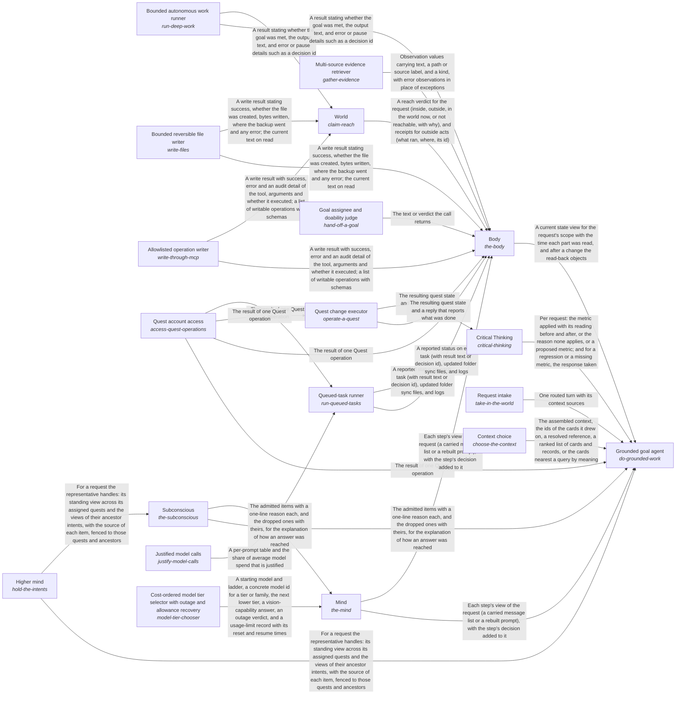

# quest_ai_runner

*ESOI records kept beside the code in `quest_ai_runner`, generated from the CSV files in this folder by `esoi readmes`. Edit the CSV files, not this page.*

Goals keep moving between a person's sessions, because the work they delegated gets done to the standard they wrote, and every answer and action rests on the person's own goals, material and preferences, and never on another person's.

These are the solutions of [Grounded AI that advances people's goals](../esoi/README.md).

## How the solutions fit together

quest-ai-runner turns a person's request or queued task into grounded work in one loop, and the Grounded goal agent is that loop. It asks the model through the Tiered model provider layer, works in the person's Quest account through Quest account access and takes in requests through Request intake. It reasons step by step through Mind, recalls what a request needs through Subconscious and acts on the account through Body. It holds its work to the metric that serves it through Critical Thinking, has every run watched through Nervous System and keeps the long view across turns through Higher mind. It stays comparable by metric through Integrity, answers questions beyond the person's own material through Science and chooses what a planner reads through Context choice. Subconscious recalls the cards that match a request through Hub card store. Tiered model provider layer accounts for every call through Cost estimation, daily budget and host load guard. Mind starts each step on the model tier it picks through Cost-ordered model tier selector with outage and allowance recovery. Nervous System has the model oversee a run through Tiered model provider layer. Queued-task runner claims, runs and reports a queued task, asking the model through Tiered model provider layer and working in the account through Quest account access. It writes each prompt as a registered spec with an owner and a metric through Justified model calls. Body reads and changes the quest through Context card persistence backend, Quest account access and Queued-task runner. Higher mind saves what it learned through Context card persistence backend. Request intake hears from a live channel through Live messaging channel transport.

## Overview diagram

An arrow runs from the solution that provides to the solution that builds on it; its label is what the provider outputs.

## Queued-task runner (`run-queued-tasks`)

Takes a person's queued requests to a reported outcome, so they run on time without anyone having to start them by hand.

- Entry call: `quest_ai_runner.run("run-queued-tasks", 'team-1')`
- Selected implementation: Offline lifecycle harness (`qar_runner`)
- Metric: Task lifecycle correctness over offline cases
- Implemented by: [`quest_ai_runner/the_body/area_body.py`](the_body/area_body.py), [`quest_ai_runner/the_body/configuration/__init__.py`](the_body/configuration/__init__.py), [`quest_ai_runner/the_body/configuration/acp_deep_runner_config.py`](the_body/configuration/acp_deep_runner_config.py), [`quest_ai_runner/the_body/configuration/card_store_settings.py`](the_body/configuration/card_store_settings.py), [`quest_ai_runner/the_body/configuration/cli_config.py`](the_body/configuration/cli_config.py), [`quest_ai_runner/the_body/configuration/config.py`](the_body/configuration/config.py), [`quest_ai_runner/the_body/configuration/config_assembler.py`](the_body/configuration/config_assembler.py), [`quest_ai_runner/the_body/configuration/config_context_index.py`](the_body/configuration/config_context_index.py) and 110 more

## Critical Thinking (`critical-thinking`)

Makes sure everything the system does applies the relevant ESOI metric and leaves it improved, or at least not worse.

- Entry call: `quest_ai_runner.run("critical-thinking", ...)`
- Selected implementation: Code-enforced before and after on deep runs only (today) (`deep_runs_only`)
- Metric: Requests held to their ESOI metric by code
- Implemented by: [`evaluation/components/act_as_the_body/__init__.py`](../evaluation/components/act_as_the_body/__init__.py), [`evaluation/components/act_as_the_body/broken/__init__.py`](../evaluation/components/act_as_the_body/broken/__init__.py), [`evaluation/components/act_as_the_body/broken/blind_replay.py`](../evaluation/components/act_as_the_body/broken/blind_replay.py), [`evaluation/components/act_as_the_body/cases.json`](../evaluation/components/act_as_the_body/cases.json), [`evaluation/components/act_as_the_body/impls/__init__.py`](../evaluation/components/act_as_the_body/impls/__init__.py), [`evaluation/components/act_as_the_body/impls/card_and_reads.py`](../evaluation/components/act_as_the_body/impls/card_and_reads.py), [`evaluation/components/act_as_the_body/interface.py`](../evaluation/components/act_as_the_body/interface.py), [`evaluation/components/act_as_the_body/score.py`](../evaluation/components/act_as_the_body/score.py) and 929 more

## Multi-source evidence retriever (`gather-evidence`)

Gives a planner the material it needs to ground a decision or answer, drawn from the sources a person's work already lives in.

- Entry call: `quest_ai_runner.run("gather-evidence", 'NOTES.md')`
- Selected implementation: Parallel multi-source composite (`composite`)
- Metric: Retrieval recall of the right document over handbook questions
- Implemented by: [`quest_ai_runner/the_body/configuration/__init__.py`](the_body/configuration/__init__.py), [`quest_ai_runner/the_body/configuration/acp_deep_runner_config.py`](the_body/configuration/acp_deep_runner_config.py), [`quest_ai_runner/the_body/configuration/card_store_settings.py`](the_body/configuration/card_store_settings.py), [`quest_ai_runner/the_body/configuration/cli_config.py`](the_body/configuration/cli_config.py), [`quest_ai_runner/the_body/configuration/config.py`](the_body/configuration/config.py), [`quest_ai_runner/the_body/configuration/config_assembler.py`](the_body/configuration/config_assembler.py), [`quest_ai_runner/the_body/configuration/config_context_index.py`](the_body/configuration/config_context_index.py), [`quest_ai_runner/the_body/configuration/config_core_settings.py`](the_body/configuration/config_core_settings.py) and 55 more

## Diagram

An arrow runs from the solution that provides to the solution that builds on it; its label is what the provider outputs.

## Metrics

- Task lifecycle correctness over offline cases (`metric-run-queued-tasks`): leader `qar_runner`, 43 of 43 cases
- Requests held to their ESOI metric by code (`metric-think-critically`): leader `deep_runs_only`, 4 of 10 cases
- Retrieval recall of the right document over handbook questions (`metric-gather-evidence`): leader `composite`, 19 of 21 cases

## Problems

- A general assistant answers from general knowledge. (`QP2`)
- Questions about how to use the app itself (how to do something, what a feature is for) should be answered from the product's own documentation, but that path is untested, the AI sometimes says it cannot do what it can, and many team members do not know what the AI can do for them. (`prob-app-help-unreliable`)
- Most people have no external environment connected, so their delegated tasks can use only the app's own operations, its documentation, a review of their own data and web search, and that path has not been tested end to end. (`prob-no-environment-tasks-untested`)
- Advice and plans are given as one answer, not as the option most likely to work for this person with a metric to check it, and when the better option is unknown the AI does not propose or find an experiment that would settle it, though the app has an Experiments feature built for that. (`prob-experiments-not-proposed`)
- The before-and-after reading of the relevant ESOI metric is enforced by code only on deep runs. (`prob-metric-enforced-on-deep-runs-only`)
- People ask Quest AI why a Quest feature works as it does (why creating a quest asks many questions, what a daily reflection is for) and get a description of the feature, or a generic answer, instead of the reason it exists and how it helps their own goal. (`prob-quest-feature-why-unexplained`)
- A run can be judged against its goal condition by a reply that restates the condition as if it were met, so the done-standard is satisfied in words and no evidence shows the work was done. (`prob-goal-condition-restated-not-evidence`)
- A goal that covers a set (every entry, all records) can be reported as done after only part of the set was processed, because the reply reads well and does not admit the gap. (`prob-partial-coverage-reported-as-complete`)
- A long run shows nothing of itself until it ends, so the person cannot tell whether it is working, stuck or finished, and cannot steer it. (`prob-long-run-silent-until-the-end`)
- Running a coding-agent harness on the Claude Code subscription for each step of a request is costly in tokens and slow to start, while a cheap fast model alone lacks the context discipline and reliability of a long coding-agent session. (`prob-harness-dear-and-slow-on-the-subscription`)
- A request to change a quest leads to changes nobody asked for, to only part of what was asked, or to the same change made twice. (`prob-unrequested-or-partial-changes`)
- A planner decides or answers without the material that sits in the sources a person's work lives in, because each source is read its own way and one that fails stops the rest. (`prob-evidence-spread-across-sources`)

## Ideals

- Personally grounded help (`QI2`): Every answer and action rests on the person's own goals, material and preferences, and never on another person's.
- Grounded Reply (`ideal-grounded-reply`): A reply says only what the person's own account and its sources support, and says what it found.
- Reliable Verdict (`ideal-reliable-verdict`): A narrow judgment changes a turn only when it is usable.
- Checked Improvement per Run (`ideal-checked-improvement`): Every run leaves, on the record it served, what it measured, what it moved and what it changed in the record and why, so improvement is checked per run instead of hoped for.
- Continuous Mind (`ideal-continuous-mind`): Every step of a request acts with everything the request has established so far: what the person said, refused and corrected, what the request was resolved to mean, and what earlier steps found.
- Known Reach (`ideal-known-reach`): The AI says it can do only what it can, says it cannot only after checking, and claims an outside act only with the receipt of the act.
- Self-Explaining App (`ideal-self-explaining-app`): Any question about how to use the app gets a correct answer from its own documentation, and the AI knows what it can do.
- Most-Likely Path (`ideal-most-likely-path`): Every recommendation is the option most likely to move the person's own metric toward their intent, and what is not known becomes an experiment.
- Right Representative (`ideal-right-rep`): Each request is handled by the representative whose role and assigned quests fit it, and work spawned from a thread keeps that thread's representative unless the person chooses another.
- Explained Feature Purpose (`ideal-quest-feature-why-explained`): When a person asks why a Quest feature works as it does, the answer gives the reason the feature exists and how it serves their goal, not only what it is.
- Evidenced Completion (`ideal-done-standard-evidenced`): Work is reported as done only when evidence shows its written done-standard was met, and the evidence is not a restatement of the standard.
- Stated Coverage (`ideal-coverage-met-or-gap-stated`): When a goal covers a set (every entry, all records), either the whole set was processed or the report states exactly how much was and what remains.
- Visible Progress (`ideal-incremental-output-while-working`): While work is running, the person can see that it is still working and what it has done so far, at a level they choose.
- Lean Context Harness (`ideal-cheap-fast-harness-with-ideal-context`): The harness that runs Quest AI's steps is as capable as a coding agent but costs and takes about what the fast tier does, because every step sees exactly the context its goal needs.

## Where to go next

- Intent: [Grounded AI that advances people's goals](../esoi/README.md)
- Down: [quest_ai_runner/the_body](the_body/README.md)
- Down: [quest_ai_runner/the_consciousness](the_consciousness/README.md)
- Down: [quest_ai_runner/the_intelligence](the_intelligence/README.md)
- Down: [quest_ai_runner/the_self](the_self/README.md)
- Down: [quest_ai_runner/the_world/model_plumbing/model_tier_chooser](the_world/model_plumbing/model_tier_chooser/README.md)
- Down: [quest_ai_runner/the_world/model_plumbing/spend](the_world/model_plumbing/spend/README.md)
- Down: [quest_ai_runner/the_world/model_plumbing/vendor_model_caller](the_world/model_plumbing/vendor_model_caller/README.md)
- Down: [quest_ai_runner/the_world/tools/connected_system_operations](the_world/tools/connected_system_operations/README.md)
- Down: [quest_ai_runner/the_world/tools/delegated_agent_sessions](the_world/tools/delegated_agent_sessions/README.md)
- Down: [quest_ai_runner/the_world/tools/file_editing](the_world/tools/file_editing/README.md)
- Down: [quest_ai_runner/the_world/tools/file_reading](the_world/tools/file_reading/README.md)
- Down: [quest_ai_runner/the_world/tools/web_search](the_world/tools/web_search/README.md)
- Repository: [top README](../README.md)
