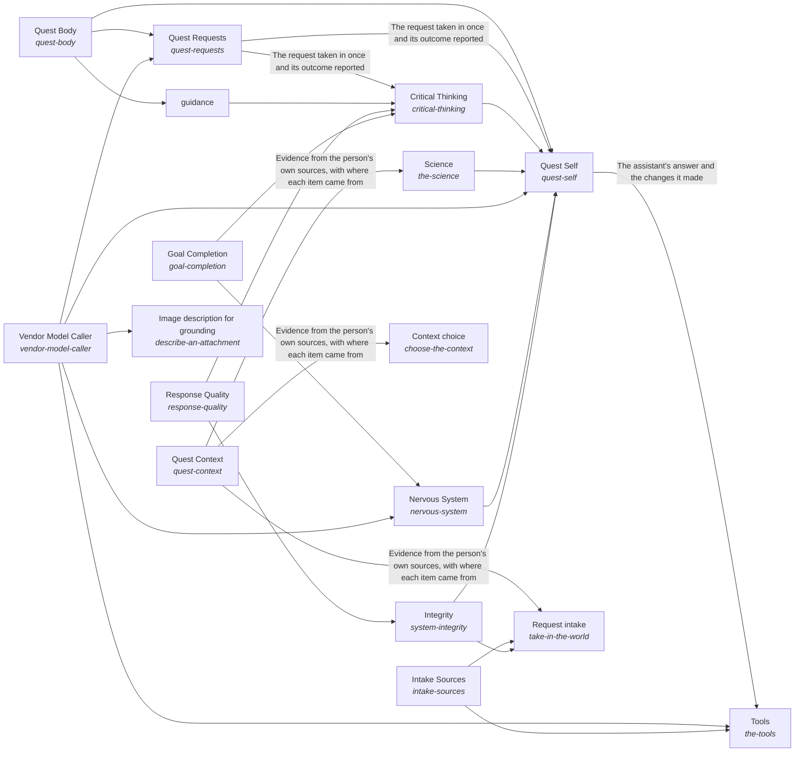
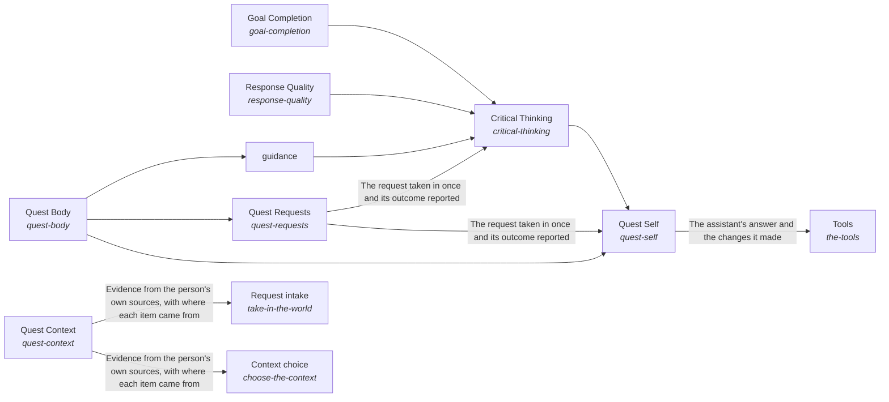

# quest_ai_runner

*ESOI records kept beside the code in `quest_ai_runner`, generated from the CSV files in this folder by `esoi readmes`. Edit the CSV files, not this page.*

A Quest user's AI system continuously evolves to help the user continuously evolve towards their intents.

These are the solutions of [Quest AI Runner](../esoi/README.md).

## How the solutions fit together

Quest AI Runner turns what a Quest user asks into work that moves their intents, and Quest Self is the one assistant that does it. Quest Self asks Quest Consciousness who is asking and what they are growing toward, reads their account and their own material through Quest Body, reasons about the request through Intelligence and reaches what lies outside through World. Quest Consciousness takes each request in through Quest Requests, hands it to the representative that fits through Quest Representatives, asks a person only for what is theirs through Quest Decision Requests, learns from feedback through Feedback Learning and proposes what is most likely to work for their intents through Intent Evolution. Quest Body keeps the person's Quest data in Quest Context, changes it exactly as asked through Quest Change Executor and keeps what is said about an account true through Quest Account Truth. Intelligence plans each request through Mind, recalls what it needs through Subconscious, keeps the long view through Higher Mind with Guidance and Quest Intents, and holds the work to a measure through Critical Thinking with Goal Completion and Response Quality. World asks models through Model Plumbing with Model Tier Chooser and Vendor Model Caller, uses outside tools through Tools with Delegated Agent Sessions and File Editing, and answers from public research through Science. Nervous System watches every run, Intake Sources brings requests in from where people work and Integrity keeps every part a specified solution that is measured.

## Overview diagram

An arrow runs from the solution that provides to the solution that builds on it; its label is what the provider outputs.

## Intelligence (`the-intelligence`)

- Entry call: no entry declared
- Selected implementation: `composition`
- Metric: none yet
- Implemented by: [`quest_ai_runner/the_intelligence/flow.py`](the_intelligence/flow.py)

## World (`the-world`)

- Entry call: no entry declared
- Selected implementation: `composition`
- Metric: none yet
- Implemented by: [`quest_ai_runner/the_world/flow.py`](the_world/flow.py)

## Critical Thinking (`critical-thinking`)

- Entry call: `quest_ai_runner.run("critical-thinking", ...)`
- Selected implementation: Code-enforced before and after on deep runs only (today) (`deep_runs_only`)
- Metric: Requests held to their ESOI metric by code
- Implemented by: [`evaluation/components/act_as_the_body/__init__.py`](../evaluation/components/act_as_the_body/__init__.py), [`evaluation/components/act_as_the_body/broken/__init__.py`](../evaluation/components/act_as_the_body/broken/__init__.py), [`evaluation/components/act_as_the_body/broken/blind_replay.py`](../evaluation/components/act_as_the_body/broken/blind_replay.py), [`evaluation/components/act_as_the_body/cases.json`](../evaluation/components/act_as_the_body/cases.json), [`evaluation/components/act_as_the_body/impls/__init__.py`](../evaluation/components/act_as_the_body/impls/__init__.py), [`evaluation/components/act_as_the_body/impls/card_and_reads.py`](../evaluation/components/act_as_the_body/impls/card_and_reads.py), [`evaluation/components/act_as_the_body/interface.py`](../evaluation/components/act_as_the_body/interface.py), [`evaluation/components/act_as_the_body/score.py`](../evaluation/components/act_as_the_body/score.py) and 922 more

## Goal Completion (`goal-completion`)

- Entry call: `quest_ai_runner.run("goal-completion", ...)`
- Selected implementation: Production judges under a scripted provider (`qar_judges`)
- Metric: Judge deterministic-half correctness with a scripted provider
- Implemented by: [`evaluation/components/judge_live_decisions/impls/live_judges.py`](../evaluation/components/judge_live_decisions/impls/live_judges.py), [`evaluation/components/judge_live_decisions/impls/no_call_floor.py`](../evaluation/components/judge_live_decisions/impls/no_call_floor.py), [`quest_ai_runner/the_consciousness/judgment_calls/__init__.py`](the_consciousness/judgment_calls/__init__.py), [`quest_ai_runner/the_consciousness/judgment_calls/ask_policy.py`](the_consciousness/judgment_calls/ask_policy.py), [`quest_ai_runner/the_consciousness/judgment_calls/executor_pauses.py`](the_consciousness/judgment_calls/executor_pauses.py), [`quest_ai_runner/the_consciousness/judgment_calls/interface.py`](the_consciousness/judgment_calls/interface.py), [`quest_ai_runner/the_intelligence/critical_thinking/__init__.py`](the_intelligence/critical_thinking/__init__.py), [`quest_ai_runner/the_intelligence/critical_thinking/area.py`](the_intelligence/critical_thinking/area.py) and 65 more

## Response Quality (`response-quality`)

- Entry call: `quest_ai_runner.run("response-quality", 'See https://example.org/a for details.')`
- Selected implementation: Production guard engines under test (`qar_guards`)
- Metric: Reply guard correctness over link, recipe and anticipation cases, Judge agreement with labelled reference replies
- Implemented by: [`evaluation/components/esoi_judge/impls/model_judge.py`](../evaluation/components/esoi_judge/impls/model_judge.py), [`evaluation/components/esoi_judge/impls/regex_only.py`](../evaluation/components/esoi_judge/impls/regex_only.py), [`quest_ai_runner/prompts/evolvable_structure.md`](prompts/evolvable_structure.md), [`quest_ai_runner/the_intelligence/critical_thinking/__init__.py`](the_intelligence/critical_thinking/__init__.py), [`quest_ai_runner/the_intelligence/critical_thinking/area.py`](the_intelligence/critical_thinking/area.py), [`quest_ai_runner/the_intelligence/critical_thinking/goal_iteration.py`](the_intelligence/critical_thinking/goal_iteration.py), [`quest_ai_runner/the_intelligence/critical_thinking/interface.py`](the_intelligence/critical_thinking/interface.py), [`quest_ai_runner/the_intelligence/critical_thinking/response_quality/__init__.py`](the_intelligence/critical_thinking/response_quality/__init__.py) and 50 more

## Higher Mind (`higher-mind`)

- Entry call: no entry declared
- Selected implementation: none selected
- Metric: none yet

## Guidance (`guidance`)

- Entry call: `quest_ai_runner.run("guidance", 'quest-id')`
- Selected implementation: Computed frame in the prompt (`frame-line`)
- Metric: Intent-grounded pass rate
- Implemented by: [`quest_ai_runner/the_body/hands/quest_operations/tools_quest_intents.py`](the_body/hands/quest_operations/tools_quest_intents.py), [`quest_ai_runner/the_body/internal_context/quest/client/quest_client_intents.py`](the_body/internal_context/quest/client/quest_client_intents.py), [`quest_ai_runner/the_intelligence/critical_thinking/__init__.py`](the_intelligence/critical_thinking/__init__.py), [`quest_ai_runner/the_intelligence/critical_thinking/area.py`](the_intelligence/critical_thinking/area.py), [`quest_ai_runner/the_intelligence/critical_thinking/esoi_application/__init__.py`](the_intelligence/critical_thinking/esoi_application/__init__.py), [`quest_ai_runner/the_intelligence/critical_thinking/esoi_application/autopilot_esoi.py`](the_intelligence/critical_thinking/esoi_application/autopilot_esoi.py), [`quest_ai_runner/the_intelligence/critical_thinking/esoi_application/interface.py`](the_intelligence/critical_thinking/esoi_application/interface.py), [`quest_ai_runner/the_intelligence/critical_thinking/esoi_application/repo_specs.py`](the_intelligence/critical_thinking/esoi_application/repo_specs.py) and 67 more

## Tools (`the-tools`)

- Entry call: `quest_ai_runner.run("the-tools", 'Send the launch note to the whole team')`
- Selected implementation: Coding agent, reach described in the prompt (today) (`coding_agent_prompt_reach`)
- Metric: Combined world score
- Implemented by: [`evaluation/components/act_as_the_body/__init__.py`](../evaluation/components/act_as_the_body/__init__.py), [`evaluation/components/act_as_the_body/broken/__init__.py`](../evaluation/components/act_as_the_body/broken/__init__.py), [`evaluation/components/act_as_the_body/broken/blind_replay.py`](../evaluation/components/act_as_the_body/broken/blind_replay.py), [`evaluation/components/act_as_the_body/cases.json`](../evaluation/components/act_as_the_body/cases.json), [`evaluation/components/act_as_the_body/impls/__init__.py`](../evaluation/components/act_as_the_body/impls/__init__.py), [`evaluation/components/act_as_the_body/impls/card_and_reads.py`](../evaluation/components/act_as_the_body/impls/card_and_reads.py), [`evaluation/components/act_as_the_body/interface.py`](../evaluation/components/act_as_the_body/interface.py), [`evaluation/components/act_as_the_body/score.py`](../evaluation/components/act_as_the_body/score.py) and 923 more

## Quest Context (`quest-context`)

Give every request the person's own Quest material and nobody else's.

- Entry call: `quest_ai_runner.run("quest-context", 'NOTES.md')`
- Selected implementation: Parallel multi-source composite (`composite`)
- Metric: Retrieval recall of the right document over handbook questions, Pointer-resolution safety over offline cases
- Implemented by: [`evaluation/components/resolve_references/impls/card_resolvers.py`](../evaluation/components/resolve_references/impls/card_resolvers.py), [`quest_ai_runner/the_body/configuration/__init__.py`](the_body/configuration/__init__.py), [`quest_ai_runner/the_body/configuration/acp_deep_runner_config.py`](the_body/configuration/acp_deep_runner_config.py), [`quest_ai_runner/the_body/configuration/card_store_settings.py`](the_body/configuration/card_store_settings.py), [`quest_ai_runner/the_body/configuration/cli_config.py`](the_body/configuration/cli_config.py), [`quest_ai_runner/the_body/configuration/config.py`](the_body/configuration/config.py), [`quest_ai_runner/the_body/configuration/config_assembler.py`](the_body/configuration/config_assembler.py), [`quest_ai_runner/the_body/configuration/config_context_index.py`](the_body/configuration/config_context_index.py) and 118 more

## Quest Requests (`quest-requests`)

Take every request made in Quest in once, through the same AI, and report its outcome to the person.

- Entry call: `quest_ai_runner.run("quest-requests", 'team-1')`
- Selected implementation: Offline lifecycle harness (`qar_runner`)
- Metric: Task lifecycle correctness over offline cases
- Implemented by: [`quest_ai_runner/the_body/area_body.py`](the_body/area_body.py), [`quest_ai_runner/the_body/configuration/__init__.py`](the_body/configuration/__init__.py), [`quest_ai_runner/the_body/configuration/acp_deep_runner_config.py`](the_body/configuration/acp_deep_runner_config.py), [`quest_ai_runner/the_body/configuration/card_store_settings.py`](the_body/configuration/card_store_settings.py), [`quest_ai_runner/the_body/configuration/cli_config.py`](the_body/configuration/cli_config.py), [`quest_ai_runner/the_body/configuration/config.py`](the_body/configuration/config.py), [`quest_ai_runner/the_body/configuration/config_assembler.py`](the_body/configuration/config_assembler.py), [`quest_ai_runner/the_body/configuration/config_context_index.py`](the_body/configuration/config_context_index.py) and 162 more

## Quest Self (`quest-self`)

Make each Quest user meet one whole assistant whose parts agree, so that a part passing its own test cannot hide a failure that the person finds out about.

- Entry call: `quest_ai_runner.run("quest-self", 'What should I work on first this week?')`
- Selected implementation: quest-ai-runner library (`library`)
- Metric: Judge pass rate over the chat quality cases, Whole-path turns right on a small mixed set, Quest answers that name the person's goal and circumstance and fit features to them, Day-with-Jarvis turns right end to end, Asks filed and deletes held before anything outward or irreversible happens, Replies that claim only what was done, Passing chat turns per dollar, Delegated tasks meeting their standard, Exact and consented changes, Data kept in scope, Engine reuse, Measured coverage, QAR overall score
- Implemented by: [`evaluation/components/act_as_the_body/__init__.py`](../evaluation/components/act_as_the_body/__init__.py), [`evaluation/components/act_as_the_body/broken/__init__.py`](../evaluation/components/act_as_the_body/broken/__init__.py), [`evaluation/components/act_as_the_body/broken/blind_replay.py`](../evaluation/components/act_as_the_body/broken/blind_replay.py), [`evaluation/components/act_as_the_body/cases.json`](../evaluation/components/act_as_the_body/cases.json), [`evaluation/components/act_as_the_body/impls/__init__.py`](../evaluation/components/act_as_the_body/impls/__init__.py), [`evaluation/components/act_as_the_body/impls/card_and_reads.py`](../evaluation/components/act_as_the_body/impls/card_and_reads.py), [`evaluation/components/act_as_the_body/interface.py`](../evaluation/components/act_as_the_body/interface.py), [`evaluation/components/act_as_the_body/score.py`](../evaluation/components/act_as_the_body/score.py) and 1030 more

## Quest Body (`quest-body`)

Give the assistant one declared place where a person's Quest data lives and where requests come from.

- Entry call: `quest_ai_runner.run("quest-body", 'quest-id')`
- Selected implementation: Quest HTTP client from the environment (`quest_client`)
- Metric: Parity of Quest operations across access points
- Implemented by: [`quest_ai_runner/the_body/area_body.py`](the_body/area_body.py), [`quest_ai_runner/the_body/internal_context/quest/__init__.py`](the_body/internal_context/quest/__init__.py), [`quest_ai_runner/the_body/internal_context/quest/cached_db_adapter.py`](the_body/internal_context/quest/cached_db_adapter.py), [`quest_ai_runner/the_body/internal_context/quest/interface.py`](the_body/internal_context/quest/interface.py), [`quest_ai_runner/the_body/internal_context/quest/quest_retrieval_adapter.py`](the_body/internal_context/quest/quest_retrieval_adapter.py)

## Quest Consciousness (`quest-consciousness`)

Let each Quest user grow with an AI aligned to them.

- Entry call: no entry declared
- Selected implementation: `composition`
- Metric: Quest Consciousness on Quest cases
- Implemented by: [`quest_ai_runner/the_consciousness/flow.py`](the_consciousness/flow.py)

## Conversation-keyed mid-run input inbox (`receive-input-mid-run`)

Lets a person change direction, pause or stop an assistant while it works, and be heard at its next decision.

- Entry call: `quest_ai_runner.run("receive-input-mid-run", 'conversation-1')`
- Selected implementation: In-memory thread-safe inbox (`in_memory`)
- Metric: Exactly-once mid-run delivery per run, and how fast it is seen
- Implemented by: [`quest_ai_runner/the_intelligence/mind/__init__.py`](the_intelligence/mind/__init__.py), [`quest_ai_runner/the_intelligence/mind/area_mind.py`](the_intelligence/mind/area_mind.py), [`quest_ai_runner/the_intelligence/mind/delegation/__init__.py`](the_intelligence/mind/delegation/__init__.py), [`quest_ai_runner/the_intelligence/mind/delegation/auto_followup.py`](the_intelligence/mind/delegation/auto_followup.py), [`quest_ai_runner/the_intelligence/mind/delegation/current_rep.py`](the_intelligence/mind/delegation/current_rep.py), [`quest_ai_runner/the_intelligence/mind/delegation/executor_followup.py`](the_intelligence/mind/delegation/executor_followup.py), [`quest_ai_runner/the_intelligence/mind/delegation/goal_runner.py`](the_intelligence/mind/delegation/goal_runner.py), [`quest_ai_runner/the_intelligence/mind/delegation/goal_runner_contract.py`](the_intelligence/mind/delegation/goal_runner_contract.py) and 20 more

## Image description for grounding (`describe-an-attachment`)

Gives a person the text a vision model writes for an image a person attached at a cost and delay that its metric accepts.

- Entry call: `quest_ai_runner.run("describe-an-attachment", ...)`
- Selected implementation: One vision-model call per image (today) (`vision_description`)
- Metric: Answer pass rate gained per image described
- Implemented by: [`quest_ai_runner/the_intelligence/mind/__init__.py`](the_intelligence/mind/__init__.py), [`quest_ai_runner/the_intelligence/mind/area_mind.py`](the_intelligence/mind/area_mind.py), [`quest_ai_runner/the_intelligence/mind/context_intake/__init__.py`](the_intelligence/mind/context_intake/__init__.py), [`quest_ai_runner/the_intelligence/mind/context_intake/attachments.py`](the_intelligence/mind/context_intake/attachments.py), [`quest_ai_runner/the_intelligence/mind/context_intake/context_doctrine.py`](the_intelligence/mind/context_intake/context_doctrine.py), [`quest_ai_runner/the_intelligence/mind/context_intake/orchestrator_events.py`](the_intelligence/mind/context_intake/orchestrator_events.py), [`quest_ai_runner/the_intelligence/mind/context_intake/orchestrator_reads.py`](the_intelligence/mind/context_intake/orchestrator_reads.py), [`quest_ai_runner/the_intelligence/mind/context_intake/orchestrator_run.py`](the_intelligence/mind/context_intake/orchestrator_run.py) and 10 more

## Request intake (`take-in-the-world`)

Let a person or a program reach the runner from wherever they work and be understood the same way.

- Entry call: `quest_ai_runner.run("take-in-the-world", 'Save a note that the launch moves to Friday.')`
- Selected implementation: Channels, terminal and package as ways in (`ways_in`)
- Metric: Ways in that pass their own metric
- Implemented by: [`quest_ai_runner/the_consciousness/ways_in.py`](the_consciousness/ways_in.py)

## Semantic vector index (`index-by-meaning`)

Helps a person or a run find the card or note they need by meaning, including when they ask in different words.

- Entry call: `quest_ai_runner.run("index-by-meaning", 'rust release')`
- Selected implementation: Qdrant-backed vector store (`qdrant`)
- Metric: Semantic recall and query latency on the synthetic handbook
- Implemented by: [`quest_ai_runner/the_body/internal_context/__init__.py`](the_body/internal_context/__init__.py), [`quest_ai_runner/the_body/internal_context/adapters_values.py`](the_body/internal_context/adapters_values.py), [`quest_ai_runner/the_body/internal_context/card_store/__init__.py`](the_body/internal_context/card_store/__init__.py), [`quest_ai_runner/the_body/internal_context/card_store/card_cache_file.py`](the_body/internal_context/card_store/card_cache_file.py), [`quest_ai_runner/the_body/internal_context/card_store/card_limit_report.py`](the_body/internal_context/card_store/card_limit_report.py), [`quest_ai_runner/the_body/internal_context/card_store/card_store_fence.py`](the_body/internal_context/card_store/card_store_fence.py), [`quest_ai_runner/the_body/internal_context/card_store/card_store_merge.py`](the_body/internal_context/card_store/card_store_merge.py), [`quest_ai_runner/the_body/internal_context/card_store/card_store_migrate.py`](the_body/internal_context/card_store/card_store_migrate.py) and 15 more

## Context choice (`choose-the-context`)

Gives the planner the right material at little cost, so a run starts grounded in the person's own knowledge without re-discovering it.

- Entry call: `quest_ai_runner.run("choose-the-context", 'What should I work on first this week?')`
- Selected implementation: Per-lane assembly of the context members (today) (`per_lane_assembly`)
- Metric: Context handed to the planner
- Implemented by: [`quest_ai_runner/the_body/area_body.py`](the_body/area_body.py), [`quest_ai_runner/the_body/hands/__init__.py`](the_body/hands/__init__.py), [`quest_ai_runner/the_body/interface.py`](the_body/interface.py), [`quest_ai_runner/the_intelligence/higher_mind/__init__.py`](the_intelligence/higher_mind/__init__.py), [`quest_ai_runner/the_intelligence/subconscious/__init__.py`](the_intelligence/subconscious/__init__.py), [`quest_ai_runner/the_intelligence/subconscious/area_context_retriever.py`](the_intelligence/subconscious/area_context_retriever.py), [`quest_ai_runner/the_intelligence/subconscious/interface.py`](the_intelligence/subconscious/interface.py), [`quest_ai_runner/the_self/integrity/__init__.py`](the_self/integrity/__init__.py) and 2 more

## Intent specification selection (`spec-selection`)

Choose, from an ESOI specification index, the few records a new request concerns and their linked records, so the work starts from the intent that applies.

- Entry call: `esoi spec index --out FILE`
- Selected implementation: Lexical vector gated (`lexical-vector-gated`)
- Metric: Specification selection pass rate
- Implemented by: [`quest_ai_runner/the_intelligence/critical_thinking/__init__.py`](the_intelligence/critical_thinking/__init__.py), [`quest_ai_runner/the_intelligence/critical_thinking/area.py`](the_intelligence/critical_thinking/area.py), [`quest_ai_runner/the_intelligence/critical_thinking/esoi_application/__init__.py`](the_intelligence/critical_thinking/esoi_application/__init__.py), [`quest_ai_runner/the_intelligence/critical_thinking/esoi_application/autopilot_esoi.py`](the_intelligence/critical_thinking/esoi_application/autopilot_esoi.py), [`quest_ai_runner/the_intelligence/critical_thinking/esoi_application/interface.py`](the_intelligence/critical_thinking/esoi_application/interface.py), [`quest_ai_runner/the_intelligence/critical_thinking/esoi_application/repo_specs.py`](the_intelligence/critical_thinking/esoi_application/repo_specs.py), [`quest_ai_runner/the_intelligence/critical_thinking/esoi_application/spec_selection.py`](the_intelligence/critical_thinking/esoi_application/spec_selection.py), [`quest_ai_runner/the_intelligence/critical_thinking/esoi_application/tools_repo_specs.py`](the_intelligence/critical_thinking/esoi_application/tools_repo_specs.py) and 2 more

## Unified card and specification search (`search-cards-and-specs`)

Help each run see the cards and specification records it concerns in one ranked set, and see when no solution covers its request yet.

- Entry call: no entry declared
- Selected implementation: Cards, solutions and problems ranked; intents, ideals and metrics reached through links (`solutions_and_problems_with_links`)
- Metric: Mixed card and specification selection, with both existing selection metrics held
- Implemented by: [`quest_ai_runner/the_intelligence/subconscious/context_retriever/__init__.py`](the_intelligence/subconscious/context_retriever/__init__.py), [`quest_ai_runner/the_intelligence/subconscious/context_retriever/bm25_content_store.py`](the_intelligence/subconscious/context_retriever/bm25_content_store.py), [`quest_ai_runner/the_intelligence/subconscious/context_retriever/card_filter.py`](the_intelligence/subconscious/context_retriever/card_filter.py), [`quest_ai_runner/the_intelligence/subconscious/context_retriever/card_learning.py`](the_intelligence/subconscious/context_retriever/card_learning.py), [`quest_ai_runner/the_intelligence/subconscious/context_retriever/card_scoped_learning.py`](the_intelligence/subconscious/context_retriever/card_scoped_learning.py), [`quest_ai_runner/the_intelligence/subconscious/context_retriever/card_views.py`](the_intelligence/subconscious/context_retriever/card_views.py), [`quest_ai_runner/the_intelligence/subconscious/context_retriever/claude_conversations_adapter.py`](the_intelligence/subconscious/context_retriever/claude_conversations_adapter.py), [`quest_ai_runner/the_intelligence/subconscious/context_retriever/context_store_assembly.py`](the_intelligence/subconscious/context_retriever/context_store_assembly.py) and 9 more

## Diagram

An arrow runs from the solution that provides to the solution that builds on it; its label is what the provider outputs.

## Implementations

| Implementation | Handle | Code | Selected |
|---|---|---|---|
| quest-ai-runner library | `quest-self:library` | [`quest_ai_runner/the_self/respond.py`](the_self/respond.py) | selected |
| Quest HTTP client from the environment | `quest-body:quest_client` | [`quest_ai_runner/the_body/area_body.py`](the_body/area_body.py) | selected |
| Composition | `quest-consciousness:composition` | [`quest_ai_runner/the_consciousness/flow.py`](the_consciousness/flow.py) | selected |
| Composition | `the-intelligence:composition` | [`quest_ai_runner/the_intelligence/flow.py`](the_intelligence/flow.py) | selected |
| Composition | `the-world:composition` | [`quest_ai_runner/the_world/flow.py`](the_world/flow.py) | selected |

## Metrics

- Task lifecycle correctness over offline cases (`metric-run-queued-tasks`): leader `qar_runner`, 43 of 43 cases
- Requests held to their ESOI metric by code (`metric-think-critically`): leader `deep_runs_only`, 4 of 10 cases
- Retrieval recall of the right document over handbook questions (`metric-gather-evidence`): leader `composite`, 19 of 21 cases
- Combined world score (`metric-claim-reach`): leader `scripted_ideal`, 12 of 12 cases
- Ways in that pass their own metric (`metric-take-in-the-world`)
- Parity of Quest operations across access points (`metric-quest-operations-parity`)

## Problems

- Help That Does Not Know The Person (`QP2`): A general assistant answers from general knowledge.
- Unreliable Help With The App (`prob-app-help-unreliable`): Questions about how to use Quest, or what its AI can do for the person, are answered from guesses instead of the product's documentation and actual reach: the AI describes a capability it does not have, or says it cannot do something it can.
- Lost Or Unreported Tasks (`QP1`): Quest tasks attached to goals can be lost, run twice, or end without an outcome the person sees.
- Different Answers On Different Surfaces (`QP4`): The same request can get a different answer depending on the Quest surface it came from.
- Different Science Evidence In Two Chats (`prob-science-search-duplicates-research-chat`): One science question can get different evidence in Quest chat than in Quest's research chat.

## Ideals

- Personally Grounded Help (`QI2`): Every answer and action rests on the person's own goals, material and preferences, and never on another person's.
- Self-Explaining App (`ideal-self-explaining-app`): Any question about how to use the app gets a correct answer from its own documentation, and the AI knows what it can do.
- Right Representative (`ideal-right-rep`): Each request is handled by the representative whose role and assigned quests fit it, and work spawned from a thread keeps that thread's representative unless the person chooses another.
- Dependable Delivery (`ideal-dependable-delivery`): What is handed to the system arrives once, in order, and is accounted for.
- Same Assistant Everywhere (`QI4`): A person gets the same assistant, with the same answer to the same request, on every Quest surface.
- Consistent Science Evidence (`ideal-science-through-one-search`): A science question gets the same evidence, weighed the same way, in Quest chat and in the research chat.

## Where to go next

- Intent: [Quest AI Runner](../esoi/README.md)
- Down: [quest_ai_runner/the_body/configuration](the_body/configuration/README.md)
- Down: [quest_ai_runner/the_body/host](the_body/host/README.md)
- Down: [quest_ai_runner/the_consciousness/representatives](the_consciousness/representatives/README.md)
- Down: [quest_ai_runner/the_body/internal_context/quest](the_body/internal_context/quest/README.md)
- Down: [quest_ai_runner/the_intelligence/critical_thinking/esoi_application](the_intelligence/critical_thinking/esoi_application/README.md)
- Down: [quest_ai_runner/the_intelligence/mind/response_writer](the_intelligence/mind/response_writer/README.md)
- Down: [quest_ai_runner/the_intelligence/subconscious/cards_from_files](the_intelligence/subconscious/cards_from_files/README.md)
- Down: [quest_ai_runner/the_world/model_plumbing/model_tier_chooser](the_world/model_plumbing/model_tier_chooser/README.md)
- Down: [quest_ai_runner/the_world/model_plumbing/spend](the_world/model_plumbing/spend/README.md)
- Down: [quest_ai_runner/the_world/model_plumbing/vendor_model_caller](the_world/model_plumbing/vendor_model_caller/README.md)
- Down: [quest_ai_runner/the_world/tools/connected_system_operations](the_world/tools/connected_system_operations/README.md)
- Down: [quest_ai_runner/the_world/tools/delegated_agent_sessions](the_world/tools/delegated_agent_sessions/README.md)
- Down: [quest_ai_runner/the_world/tools/file_editing](the_world/tools/file_editing/README.md)
- Down: [quest_ai_runner/the_world/tools/file_reading](the_world/tools/file_reading/README.md)
- Down: [quest_ai_runner/the_world/tools/web_search](the_world/tools/web_search/README.md)
- Repository: [top README](../README.md)
