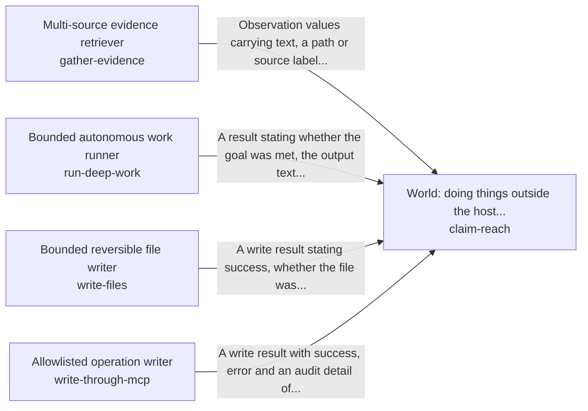

# Acting in the person's account as the AI's own body

What the AI says about a person's account is the account as it is now, and what it changed in the account is read back after the change, so the person can trust both.

*ESOI records of this intent (evolvable structure that optimizes intent), generated from the CSV files beside this page by `esoi readmes`. Edit the CSV files, not this page.*

This sub-intent arises as the implementation `act-as-the-body:card_and_reads` of its parent intent [`quest-ai-runner`](../../esoi/README.md). Opportunities: The Quest account is the AI's own consistent state, which opens questions beyond the parent solution: how the AI states what it can reach (inside the host, outside it, in the world now, or not reachable) and is held to that claim, how heavy work is handed to a deep runner within a fixed turn and cost bound and its result checked, how a file change is kept bounded to one folder and reversible, how one named change on an outside tool server is made only when an allowlist permits it, and who a new goal belongs to and whether an AI representative can take it over.

## How the solutions fit together

act-as-the-body keeps what the AI says about a person's account true to the account and to what it changed in it. It changes the quest as the person asks through operate-a-quest and writes files inside one folder through write-files. It reads from the sources the person's work lives in through gather-evidence, and hands a new goal to the right owner through hand-off-a-goal. It claims only the reach that claim-reach grants. claim-reach hands heavy work to run-deep-work, one named change on an outside tool server to write-through-mcp, and the reading it needs to gather-evidence.

## Diagram

An arrow runs from the solution that provides to the solution that builds on it; its label is what the provider outputs.

## Solutions at a glance

| Solution | Entry call | Selected implementation | Metric |
|---|---|---|---|
| `operate-a-quest` | `quest_ai_runner.run("operate-a-quest", 'Add a goal to ship the launch note by Friday')` | `qar_orchestrator` | Final quest state against the request over the quest operation cases |
| `gather-evidence` | `quest_ai_runner.run("gather-evidence", 'NOTES.md')` | `composite` | Retrieval recall of the right document over handbook questions |
| `run-deep-work` | no entry declared | `subprocess` | Outcome reporting correctness across deep runners |
| `write-files` | `quest_ai_runner.run("write-files", 'NOTES.md')` | `files` | Write boundary and reversibility over the scratch-tree cases |
| `write-through-mcp` | no entry declared | `mcp` | Allowlist enforcement and exactly-once execution |
| `claim-reach` | `quest_ai_runner.run("claim-reach", 'Send the launch note to the whole team')` | `coding_agent_prompt_reach` | Combined world score: goals met, honest reach and receipts, cost, time, context efficiency and safety |
| `hand-off-a-goal` | `quest_ai_runner.run("hand-off-a-goal", ...)` | `model_judge` | Hand-offs a person keeps per unit of cost and time |

## Problems and ideals

**Problems**

- `prob-unrequested-or-partial-changes`: A request to change a quest leads to changes nobody asked for, to only part of what was asked, or to the same change made twice.
- `prob-reach-claims-unfounded`: The AI states what it can and cannot do outside the host's own data without a source of truth for it: it describes a capability that does not exist, reports a setting as blocking when the setting was...
- `prob-work-not-planned-backwards-from-done`
- `prob-new-goal-lands-on-the-wrong-owner`: A new goal is given to the wrong owner, or to an AI representative that cannot do it, so it sits undone or is done badly while the person believes it is handled.
- `prob-evidence-spread-across-sources`: A planner decides or answers without the material that sits in the sources a person's work lives in, because each source is read its own way and one that fails stops the rest.

**Ideals**

- `ideal-plan-from-the-done-standard`

## Metrics and their leaders

- `metric-operate-a-quest`, Final quest state against the request over the quest operation cases: leader `orchestrator_pre_route`, 22 of 22 cases
- `metric-gather-evidence`, Retrieval recall of the right document over handbook questions: leader `composite`, 19 of 21 cases
- `metric-run-deep-work`, Outcome reporting correctness across deep runners: leader `acp_runner`, 11 of 11 cases
- `metric-write-files`, Write boundary and reversibility over the scratch-tree cases: leader `bounded_writer`, 20 of 20 cases
- `metric-write-through-mcp`, Allowlist enforcement and exactly-once execution: leader `allowlist_writer`, 15 of 15 cases
- `metric-claim-reach`, Combined world score: goals met, honest reach and receipts, cost, time, context efficiency and safety: leader `scripted_ideal`, 12 of 12 cases
- `metric-hand-off-a-goal`, Hand-offs a person keeps per unit of cost and time: leader `model_judge`, 17 of 18 cases
- `metric-goal-met-by-evidence-and-coverage`, : leader `goal_contract`, 53 of 53 cases
- `metric-harness-context-subagents-recursion-ranked`, : leader `acp_runner`, 11 of 11 cases

## Where to go next

- Parent intent: [Grounded AI that advances people's goals](../../esoi/README.md)
- Repository: [top README](../../README.md)
- Records: [intent.csv](intent.csv), [problems.csv](problems.csv), [ideals.csv](ideals.csv), [solutions.csv](solutions.csv), [implementations.csv](implementations.csv), [metrics.csv](metrics.csv)
- Diagram page: [diagram.md](diagram.md)

---

## The full record

### Problems

- `prob-unrequested-or-partial-changes`: A request to change a quest leads to changes nobody asked for, to only part of what was asked, or to the same change made twice.
- `prob-reach-claims-unfounded`: The AI states what it can and cannot do outside the host's own data without a source of truth for it: it describes a capability that does not exist, reports a setting as blocking when the setting was never read, or says outside work has started when nothing ran. It also says it cannot do something it can.
- `prob-work-not-planned-backwards-from-done`: 
- `prob-new-goal-lands-on-the-wrong-owner`: A new goal is given to the wrong owner, or to an AI representative that cannot do it, so it sits undone or is done badly while the person believes it is handled.
- `prob-evidence-spread-across-sources`: A planner decides or answers without the material that sits in the sources a person's work lives in, because each source is read its own way and one that fails stops the rest.

### Ideals

- `ideal-plan-from-the-done-standard`, : 

### Solutions

| Solution | Name | Selected | Metric |
|---|---|---|---|
| `operate-a-quest` | Quest change executor | qar_orchestrator | Final quest state against the request over the quest operation cases |
| `gather-evidence` | Multi-source evidence retriever | composite | Retrieval recall of the right document over handbook questions |
| `run-deep-work` | Bounded autonomous work runner | subprocess | Outcome reporting correctness across deep runners |
| `write-files` | Bounded reversible file writer | files | Write boundary and reversibility over the scratch-tree cases |
| `write-through-mcp` | Allowlisted operation writer | mcp | Allowlist enforcement and exactly-once execution |
| `claim-reach` | World: doing things outside the host through the best harness, with declared reach and receipts | coding_agent_prompt_reach | Combined world score: goals met, honest reach and receipts, cost, time, context efficiency and safety |
| `hand-off-a-goal` | Goal assignee and doability judge | model_judge | Hand-offs a person keeps per unit of cost and time |

### Implementations

| Implementation | Name | Where | Sub-intent |
|---|---|---|---|
| `operate-a-quest:qar_orchestrator` | Planner-only orchestration | [quest_ai_runner/area_act_as_the_body.py](../area_act_as_the_body.py) |  |
| `operate-a-quest:direct_tool_call` | Direct tool-call ablation | [evaluation/components/quest_ops/impls/direct_tool_call.py](../../evaluation/components/quest_ops/impls/direct_tool_call.py) |  |
| `gather-evidence:files` | Local file tree reader | [quest_ai_runner/adapters/files_adapter.py](../adapters/files_adapter.py) |  |
| `gather-evidence:cached_db` | Cached live-database reader | [quest_ai_runner/adapters/cached_db_adapter.py](../adapters/cached_db_adapter.py) |  |
| `gather-evidence:composite` | Parallel multi-source composite | [quest_ai_runner/adapters/composite_retrieval_adapter.py](../adapters/composite_retrieval_adapter.py) |  |
| `gather-evidence:mcp` | MCP server reader | [quest_ai_runner/adapters/mcp_retrieval_adapter.py](../adapters/mcp_retrieval_adapter.py) |  |
| `gather-evidence:remote_files_adapter` | Remote file server reader | [quest_ai_runner/adapters/remote_files_adapter.py](../adapters/remote_files_adapter.py) |  |
| `gather-evidence:notion` | Notion database reader | [quest_ai_runner/adapters/notion_adapter.py](../adapters/notion_adapter.py) |  |
| `gather-evidence:google_drive` | Drive document reader | [quest_ai_runner/adapters/google_drive_adapter.py](../adapters/google_drive_adapter.py) |  |
| `gather-evidence:google_chat` | Chat conversation reader | [quest_ai_runner/adapters/google_chat_adapter.py](../adapters/google_chat_adapter.py) |  |
| `gather-evidence:quest` | Quest API context reader | [quest_ai_runner/adapters/quest_retrieval_adapter.py](../adapters/quest_retrieval_adapter.py) |  |
| `run-deep-work:subprocess` | Subprocess goal runner | [quest_ai_runner/core/goal_runner.py](../core/goal_runner.py) |  |
| `run-deep-work:acp` | Agent-protocol deep runner | [quest_ai_runner/adapters/acp_deep_runner.py](../adapters/acp_deep_runner.py) |  |
| `run-deep-work:fast_edit` | One-call fast file editor | [quest_ai_runner/config_resolvers.py](../config_resolvers.py) |  |
| `run-deep-work:mcp_write` | One-call MCP operation runner | [quest_ai_runner/config_resolvers.py](../config_resolvers.py) |  |
| `run-deep-work:subprocess_runner` | Subprocess runner scenarios | [evaluation/components/deep_runner/impls/subprocess_runner.py](../../evaluation/components/deep_runner/impls/subprocess_runner.py) |  |
| `run-deep-work:acp_runner` | Agent-protocol runner scenarios | [evaluation/components/deep_runner/impls/acp_runner.py](../../evaluation/components/deep_runner/impls/acp_runner.py) |  |
| `run-deep-work:goal_contract` | Goal contract rules check | [evaluation/components/deep_run/impls/goal_contract.py](../../evaluation/components/deep_run/impls/goal_contract.py) |  |
| `write-files:files` | Contained backed-up writer | [quest_ai_runner/adapters/files_writer.py](../adapters/files_writer.py) |  |
| `write-files:bounded_writer` | Scratch-tree boundary check | [evaluation/components/write_files/impls/bounded_writer.py](../../evaluation/components/write_files/impls/bounded_writer.py) |  |
| `write-through-mcp:mcp` | MCP operation writer | [quest_ai_runner/adapters/mcp_write_adapter.py](../adapters/mcp_write_adapter.py) |  |
| `write-through-mcp:allowlist_writer` | Fake-client allowlist check | [evaluation/components/write_through_mcp/impls/allowlist_writer.py](../../evaluation/components/write_through_mcp/impls/allowlist_writer.py) |  |
| `run-deep-work:stream_json` | Persistent stream-json runner | [quest_ai_runner/core/goal_runner_stream.py](../core/goal_runner_stream.py) |  |
| `claim-reach:coding_agent_prompt_reach` | Coding agent, reach described in the prompt (today) | [quest_ai_runner/area_act_as_the_body.py](../area_act_as_the_body.py) |  |
| `claim-reach:coding_agent_reach_judge` | Coding agent with the host reach summary and reach judge (built, off by default) | [quest_ai_runner/core/reach_judge.py](../core/reach_judge.py) |  |
| `claim-reach:coding_agent_declared_inventory` | Coding agent with one declared inventory and receipts (proposed) |  |  |
| `claim-reach:best_open_source_harness` | Best open-source agent harness by the combined metric, with declared inventory (proposed) |  |  |
| `hand-off-a-goal:model_judge` | Two small model verdicts when a goal is created (today) | [quest_ai_runner/area_act_as_the_body.py](../area_act_as_the_body.py) |  |
| `hand-off-a-goal:creator_keeps_it` | Creator keeps the goal, no model call (floor, proposed) | [evaluation/components/hand_off_a_goal/impls/creator_keeps_it.py](../../evaluation/components/hand_off_a_goal/impls/creator_keeps_it.py) |  |
| `claim-reach:scripted_ideal` |  | [evaluation/components/act_in_the_world/impls/scripted_ideal.py](../../evaluation/components/act_in_the_world/impls/scripted_ideal.py) |  |
| `claim-reach:rules_only` |  | [evaluation/components/act_in_the_world/impls/rules_only.py](../../evaluation/components/act_in_the_world/impls/rules_only.py) |  |
| `run-deep-work:lean_guarded` | Lean guarded launch of the deep worker | [quest_ai_runner/core/deep_launch.py](../core/deep_launch.py) |  |

### Metrics

- `metric-operate-a-quest`, Final quest state against the request over the quest operation cases: `esoi run quest_ops --impl qar_orchestrator`
- `metric-gather-evidence`, Retrieval recall of the right document over handbook questions: `esoi run retrieval --impl composite; esoi run retrieval_sources --impl files_adapter`
- `metric-run-deep-work`, Outcome reporting correctness across deep runners: `esoi run deep_runner --impl subprocess_runner; esoi run deep_run --impl goal_contract`
- `metric-write-files`, Write boundary and reversibility over the scratch-tree cases: `esoi run write_files --impl bounded_writer`
- `metric-write-through-mcp`, Allowlist enforcement and exactly-once execution: `esoi run write_through_mcp --impl allowlist_writer`
- `metric-claim-reach`, Combined world score: goals met, honest reach and receipts, cost, time, context efficiency and safety: `esoi run act_in_the_world --impl scripted_ideal`
- `metric-hand-off-a-goal`, Hand-offs a person keeps per unit of cost and time: `esoi run hand_off_a_goal --impl model_judge`
- `metric-goal-met-by-evidence-and-coverage`, : `esoi run deep_run --impl goal_contract`
- `metric-harness-context-subagents-recursion-ranked`, : `esoi run deep_runner --impl subprocess_runner`
