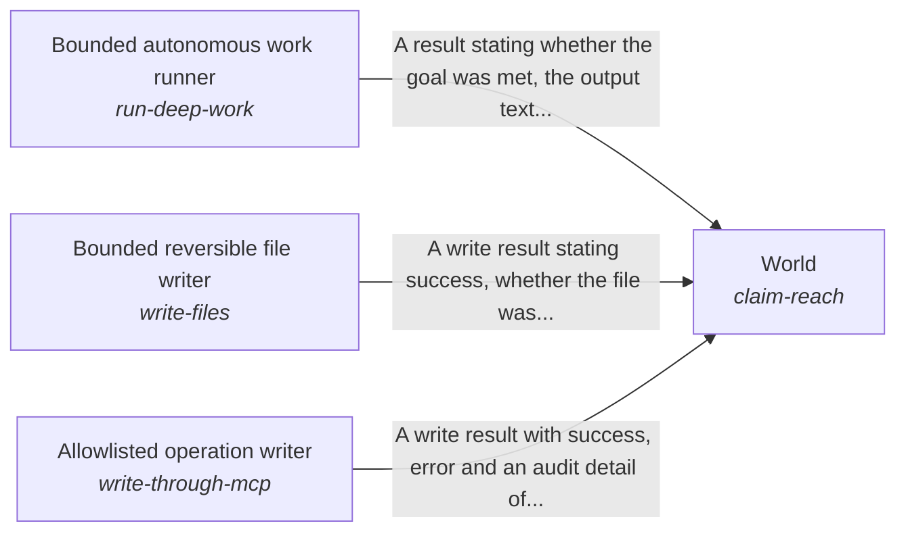

These are ESOI records rendered as a diagram (evolvable structure that optimizes intent). This page is generated from the solutions' outputs and the implementations' `uses_solution_ids` by `esoi diagram`; edit those records, not this page.

# Solution diagram: Acting in the person's account as the AI's own body

Body keeps what the AI says about a person's account true to the account and to what it changed in it. It changes the quest as the person asks through Quest change executor and writes files inside one folder through Bounded reversible file writer. It reads from the sources the person's work lives in through Multi-source evidence retriever, and hands a new goal to the right owner through Goal assignee and doability judge. It claims only the reach that World grants. Heavy work is the job of Bounded autonomous work runner. One named change on an outside tool server is the job of Allowlisted operation writer.

An arrow runs from the solution that provides to the solution that builds on it; its label is what the provider outputs.

