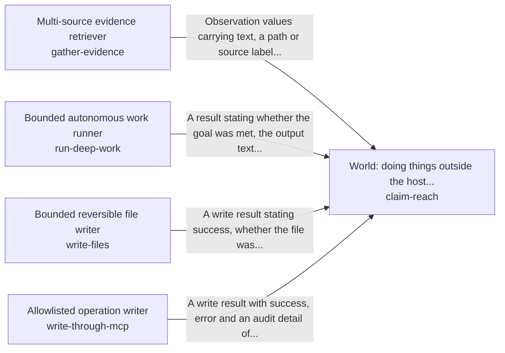

These are ESOI records rendered as a diagram (evolvable structure that optimizes intent). This page is generated from the solutions' outputs and the implementations' `uses_solution_ids` by `esoi diagram`; edit those records, not this page.

# Solution diagram: Acting in the person's account as the AI's own body

act-as-the-body keeps what the AI says about a person's account true to the account and to what it changed in it. It changes the quest as the person asks through operate-a-quest and writes files inside one folder through write-files. It reads from the sources the person's work lives in through gather-evidence, and hands a new goal to the right owner through hand-off-a-goal. It claims only the reach that claim-reach grants. claim-reach hands heavy work to run-deep-work, one named change on an outside tool server to write-through-mcp, and the reading it needs to gather-evidence.

An arrow runs from the solution that provides to the solution that builds on it; its label is what the provider outputs.

