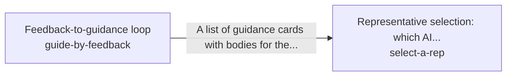

# Holding the intents across quests

Each AI representative starts every request from the standing view of the quests it is assigned and the intents above them, so a correction is made once and a thread is never restated.

*ESOI records of this intent (evolvable structure that optimizes intent), generated from the CSV files beside this page by `esoi readmes`. Edit the CSV files, not this page.*

This sub-intent arises as the implementation `hold-the-intents:separate_stores` of its parent intent [`quest-ai-runner`](../../esoi/README.md). Opportunities: A representative works across many quests, so the standing view it needs is wider than any one request: past conversations, recent context, the guidance learned from corrections, the ledger of what was asked, the predictions made and the person's long-term goal. That opens questions the parent solution does not ask: how a correction is kept in the person's own words and tracked until it is followed, how a view is held per quest, per intent and per representative without crossing scopes, how a reply is aimed at the person's end without hijacking a simple question, and which representative a request runs as, the same way in chat, tasks and background work.

## How the solutions fit together

hold-the-intents keeps the long view across turns. It carries what was said and found through remember-conversations and recall-recent-context. It keeps and applies a person's corrections through store-feedback and guide-by-feedback. It saves what was learned through persist-predictions and persist-cards. It keeps work aimed at the person's end through guide-toward-the-long-term-goal, and picks the representative a request runs as through select-a-rep. select-a-rep sends the queued work of that representative through run-queued-tasks.

## Diagram

An arrow runs from the solution that provides to the solution that builds on it; its label is what the provider outputs.

## Solutions at a glance

| Solution | Entry call | Selected implementation | Metric |
|---|---|---|---|
| `remember-conversations` | `quest_ai_runner.run("remember-conversations", ...)` | `session_file` | Past-conversation recall and isolation over synthetic cases |
| `guide-by-feedback` | `quest_ai_runner.run("guide-by-feedback", 'What should I work on first this week?')` | `universal` | Repeat-correction recall and precision over feedback sequences |
| `store-feedback` | `quest_ai_runner.run("store-feedback", 'quest-id')` | `ledger` | Correction carry-through over the feedback-loop cases |
| `recall-recent-context` | `quest_ai_runner.run("recall-recent-context", 'quest-id')` | `file` | Warm-start accuracy with no cross-work-item leakage |
| `persist-predictions` | `quest_ai_runner.run("persist-predictions", 'quest-id')` | `file` | Prediction store contract pass rate |
| `select-a-rep` | `quest_ai_runner.run("select-a-rep", {'assignee_rep_id': 'rep-1'})` | `persona_resolver_precedence` | Representative choice accuracy and thread consistency |
| `guide-toward-the-long-term-goal` | `quest_ai_runner.run("guide-toward-the-long-term-goal", 'What should I work on first this week?')` | `guided_v2` | Two-sided long-term guidance: grounded nudges at the right level, restraint elsewhere |

## Problems and ideals

**Problems**

- `prob-corrections-repeat`: People give the same correction again and again because the AI does not keep what they said, or keeps it but does not apply it where it bears.
- `prob-private-data-crosses-scope`: Data from one user, team or quest reaches another one's prompt or store, through retrieval, caches, conversation recall, shared stores or the sources fed to the AI.
- `prob-wrong-or-inconsistent-rep`: Which AI representative handles a message, a queued task or an autopilot pass is decided in three places by three rules (the host's chat classifier among a quest's assigned representatives, the task...
- `prob-long-term-goal-goes-quiet`: The AI answers the request in front of it and lets the person's long-term goal go quiet, so each small task is done without the end in sight; the opposite fix, a plug for the goal in every reply...

**Ideals**

- `ideal-lasting-correction`, Lasting Correction: A correction given once is kept as said and applied wherever it bears.
- `ideal-contained-scope`, Contained Scope: Data stays inside the user, team and quest it belongs to, on every read and write path.
- `ideal-moves-me-forward`, Moves Me Forward Without Nagging: From the call: every reply answers what was asked first and, at a natural moment, keeps the person's next milestone in view, at the intent level they are working at.

## Metrics and their leaders

- `metric-remember-conversations`, Past-conversation recall and isolation over synthetic cases: leader `session_files`, 9 of 10 cases
- `metric-guide-by-feedback`, Repeat-correction recall and precision over feedback sequences: leader `ledger_guidance`, 12 of 16 cases
- `metric-store-feedback`, Correction carry-through over the feedback-loop cases: leader `ledger_guidance`, 12 of 16 cases
- `metric-recall-recent-context`, Warm-start accuracy with no cross-work-item leakage: leader `file_store_filter`, 9 of 10 cases
- `metric-persist-predictions`, Prediction store contract pass rate: leader `file_store`, 12 of 12 cases
- `metric-select-a-rep`, Representative choice accuracy and thread consistency: leader `persona_resolver_precedence`, 14 of 16 cases
- `metric-guide-toward-the-long-term-goal`, Two-sided long-term guidance: grounded nudges at the right level, restraint elsewhere: leader `guided_v2`, 9 of 10 cases

## Where to go next

- Parent intent: [Grounded AI that advances people's goals](../../esoi/README.md)
- Repository: [top README](../../README.md)
- Records: [intent.csv](intent.csv), [problems.csv](problems.csv), [ideals.csv](ideals.csv), [solutions.csv](solutions.csv), [implementations.csv](implementations.csv), [metrics.csv](metrics.csv)
- Diagram page: [diagram.md](diagram.md)

---

## The full record

### Problems

- `prob-corrections-repeat`: People give the same correction again and again because the AI does not keep what they said, or keeps it but does not apply it where it bears.
- `prob-private-data-crosses-scope`: Data from one user, team or quest reaches another one's prompt or store, through retrieval, caches, conversation recall, shared stores or the sources fed to the AI.
- `prob-wrong-or-inconsistent-rep`: Which AI representative handles a message, a queued task or an autopilot pass is decided in three places by three rules (the host's chat classifier among a quest's assigned representatives, the task runner's precedence of assignment field, explicit ask and domain cards, and the autopilot roster by day), with no shared definition of the right representative, no labelled measure of how often it is right, and no rule that work spawned from a thread keeps that thread's representative. A quest can have several representatives, each with its own higher mind, so a wrong choice also grounds the request in the wrong view.
- `prob-long-term-goal-goes-quiet`: The AI answers the request in front of it and lets the person's long-term goal go quiet, so each small task is done without the end in sight; the opposite fix, a plug for the goal in every reply, nags, hijacks a simple question or lands on a person who is in a hurry or upset.

### Ideals

- `ideal-lasting-correction`, Lasting Correction: A correction given once is kept as said and applied wherever it bears.
- `ideal-contained-scope`, Contained Scope: Data stays inside the user, team and quest it belongs to, on every read and write path.
- `ideal-moves-me-forward`, Moves Me Forward Without Nagging: From the call: every reply answers what was asked first and, at a natural moment, keeps the person's next milestone in view, at the intent level they are working at.

### Solutions

| Solution | Name | Selected | Metric |
|---|---|---|---|
| `remember-conversations` | Cross-conversation recall store | session_file | Past-conversation recall and isolation over synthetic cases |
| `guide-by-feedback` | Feedback-to-guidance loop | universal | Repeat-correction recall and precision over feedback sequences |
| `store-feedback` | Verbatim feedback ledger | ledger | Correction carry-through over the feedback-loop cases |
| `recall-recent-context` | Scoped recent-context warm start | file | Warm-start accuracy with no cross-work-item leakage |
| `persist-predictions` | Scoped prediction store | file | Prediction store contract pass rate |
| `select-a-rep` | Representative selection: which AI representative handles a request, and whose higher mind grounds it | persona_resolver_precedence | Representative choice accuracy and thread consistency |
| `guide-toward-the-long-term-goal` | Guidance toward the long-term goal | guided_v2 | Two-sided long-term guidance: grounded nudges at the right level, restraint elsewhere |

### Implementations

| Implementation | Name | Where | Sub-intent |
|---|---|---|---|
| `remember-conversations:session_file` | Local session-file conversation store | [quest_ai_runner/adapters/session_file_conversation_store.py](../adapters/session_file_conversation_store.py) |  |
| `guide-by-feedback:universal` | Universal guidance provider | [quest_ai_runner/adapters/guidance_card_manager.py](../adapters/guidance_card_manager.py) |  |
| `guide-by-feedback:ledger_guidance` | Live ledger and provider arm | [evaluation/components/feedback_loop/impls/ledger_guidance.py](../../evaluation/components/feedback_loop/impls/ledger_guidance.py) |  |
| `guide-by-feedback:no_memory` | No-feedback floor | [evaluation/components/feedback_loop/impls/no_memory.py](../../evaluation/components/feedback_loop/impls/no_memory.py) |  |
| `guide-by-feedback:dump_all` | Show-everything baseline | [evaluation/components/feedback_loop/impls/dump_all.py](../../evaluation/components/feedback_loop/impls/dump_all.py) |  |
| `store-feedback:ledger` | File-backed feedback ledger | [quest_ai_runner/hold_the_intents/feedback_ledger.py](feedback_ledger.py) |  |
| `store-feedback:ledger_guidance` | Ledger plus guidance bridge, end to end | [evaluation/components/feedback_loop/impls/ledger_guidance.py](../../evaluation/components/feedback_loop/impls/ledger_guidance.py) |  |
| `store-feedback:no_memory` | No-memory floor | [evaluation/components/feedback_loop/impls/no_memory.py](../../evaluation/components/feedback_loop/impls/no_memory.py) |  |
| `store-feedback:dump_all` | Remember-everything baseline | [evaluation/components/feedback_loop/impls/dump_all.py](../../evaluation/components/feedback_loop/impls/dump_all.py) |  |
| `recall-recent-context:file` | Lexical-gated scoped file store | [quest_ai_runner/core/recent_context.py](../core/recent_context.py) |  |
| `persist-predictions:file` | Atomic file prediction store | [quest_ai_runner/core/anticipation_store.py](../core/anticipation_store.py) |  |
| `persist-predictions:memory_store` | In-memory reference store | [evaluation/components/persist_predictions/impls/memory_store.py](../../evaluation/components/persist_predictions/impls/memory_store.py) |  |
| `select-a-rep:persona_resolver_precedence` | Persona resolver precedence for queued tasks (today) | [quest_ai_runner/runner/personas.py](../runner/personas.py) |  |
| `select-a-rep:host_assigned_classifier` | Host chat classifier among assigned representatives (today, in the host) |  |  |
| `select-a-rep:thread_holds_its_rep` | A thread keeps its representative (proposed) |  |  |
| `select-a-rep:fit_by_role_and_quests` | Fit by role, assigned quests and intent branch (proposed) |  |  |
| `select-a-rep:ask_the_person` | Ask the person on an equal fit (proposed) |  |  |
| `guide-toward-the-long-term-goal:reply_voice` | Reply voice before the long-term guidance section (prior) |  |  |
| `guide-toward-the-long-term-goal:guided` | Reply voice plus a long-term guidance directive (proposed) |  |  |
| `guide-toward-the-long-term-goal:no_nudge` | Plain answer only (floor) |  |  |
| `guide-toward-the-long-term-goal:guided_v2` | Long-term guidance section in the reply voice | [quest_ai_runner/core/auxiliary_prompts.py](../core/auxiliary_prompts.py) |  |

### Metrics

- `metric-remember-conversations`, Past-conversation recall and isolation over synthetic cases: `esoi run conversation_recall --impl session_files`
- `metric-guide-by-feedback`, Repeat-correction recall and precision over feedback sequences: `esoi run feedback_loop --impl ledger_guidance`
- `metric-store-feedback`, Correction carry-through over the feedback-loop cases: `esoi run feedback_loop --impl ledger_guidance`
- `metric-recall-recent-context`, Warm-start accuracy with no cross-work-item leakage: `esoi run recent_context --impl file_store_filter`
- `metric-persist-predictions`, Prediction store contract pass rate: `esoi run persist_predictions --impl file_store`
- `metric-select-a-rep`, Representative choice accuracy and thread consistency: `esoi run select_a_rep --impl persona_resolver_precedence`
- `metric-guide-toward-the-long-term-goal`, Two-sided long-term guidance: grounded nudges at the right level, restraint elsewhere: `esoi run proactive_guidance --impl guided_v2`
