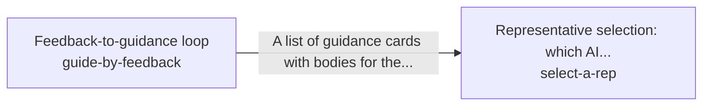

These are ESOI records rendered as a diagram (evolvable structure that optimizes intent). This page is generated from the solutions' outputs and the implementations' `uses_solution_ids` by `esoi diagram`; edit those records, not this page.

# Solution diagram: Holding the intents across quests

hold-the-intents keeps the long view across turns. It carries what was said and found through remember-conversations and recall-recent-context. It keeps and applies a person's corrections through store-feedback and guide-by-feedback. It saves what was learned through persist-predictions and persist-cards. It keeps work aimed at the person's end through guide-toward-the-long-term-goal, and picks the representative a request runs as through select-a-rep. select-a-rep sends the queued work of that representative through run-queued-tasks.

An arrow runs from the solution that provides to the solution that builds on it; its label is what the provider outputs.

