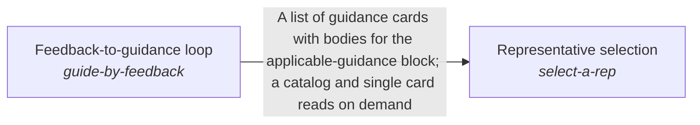

These are ESOI records rendered as a diagram (evolvable structure that optimizes intent). This page is generated from the solutions' outputs and the implementations' `uses_solution_ids` by `esoi diagram`; edit those records, not this page.

# Solution diagram: Holding the intents across quests

Higher mind keeps the long view across turns. It carries what was said and found through Cross-conversation recall store and Scoped recent-context warm start. It keeps and applies a person's corrections through Verbatim feedback ledger and Feedback-to-guidance loop. It saves what was learned through Scoped prediction store and Context card persistence backend. It keeps work aimed at the person's end through Guidance toward the long-term goal, and picks the representative a request runs as through Representative selection. Representative selection sends the queued work of that representative through Queued-task runner.

An arrow runs from the solution that provides to the solution that builds on it; its label is what the provider outputs.

