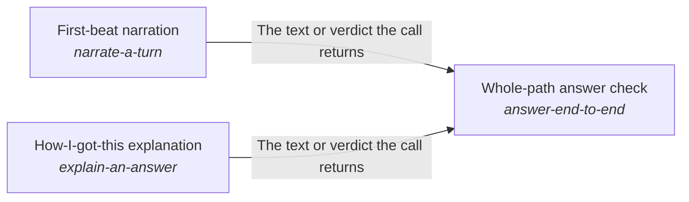

# Reasoning and answering each step of a request

Every step of a person's request acts on everything the request has established so far, so a reply rests on the work done for it and the person can follow that work, at the cost of the fast tier.

*ESOI records of this intent (evolvable structure that optimizes intent), generated from the CSV files beside this page by `esoi readmes`. Edit the CSV files, not this page.*

This sub-intent arises as the implementation `reason-and-answer:rebuilt_per_step` of its parent intent [`quest-ai-runner`](../../esoi/README.md). Opportunities: The loop's prompt can be rebuilt for each step from a template, cached head and context layers, the newest observations in full and older ones in one line, so a step's input stays small while the final answer still sees everything. That opens questions the parent solution does not ask: how much of the earlier steps a planner must see to keep continuity (from the second step the selected arm replaces the transcript with a short note that refers to step one, and its continuity is unmeasured), how a person is kept informed while a turn works (a first line, interim replies, the trail of what was done) without paying a model call for every line, and how a request that worked before skips the loop by replaying its known steps.

## How the solutions fit together

Mind lets one step of a request build on the steps before it, and its rebuilt_per_step arm is made of the parts of one step. Budgeted prompt assembler writes the prompt a step sends within a size budget. Cost-ordered model tier selector with outage and allowance recovery picks the model tier a step starts on. Grounded chat turn handler turns the step's decision into the reply to a chat message. First-beat narration writes the first line a person reads while the turn works. How-I-got-this explanation writes, when the person asks for it, how the answer was reached, once the answer is out. Learned-operation fast path answers a request that worked before by replaying its known steps. Core ML tasks classifies the message a step is about. Whole-path answer check proves that a message is handled right across the whole path, with the first line that First-beat narration writes in it. It also proves the account of how the answer was reached, which How-I-got-this explanation writes on request. Reply in steps when the goal is not met yet decides when a turn that is not finished sends an interim message and what that message holds. Show the AI's work and next steps lays out the trail of the work a turn did. Mode-aware progress surfacing streams each event at the level the person wants.

## Diagram

An arrow runs from the solution that provides to the solution that builds on it; its label is what the provider outputs.

## Solutions at a glance

| Solution | Handle | Entry call | Selected implementation | Metric |
|---|---|---|---|---|
| Grounded chat turn handler | `answer-a-turn` | `quest_ai_runner.run("answer-a-turn", 'What should I work on first this week?')` | `orchestrator_turn` | Judge pass rate over the chat quality cases |
| Mode-aware progress surfacing | `show-progress` | no entry declared | `stream` | Surfaced-event policy by mode, Progress shown while the work runs |
| Learned-operation fast path | `replay-known-operations` | `quest_ai_runner.run("replay-known-operations", 'Add a note that the launch moves to Friday')` | `stored_recipes` | Fast-path hit rate and parity with the planner-only path |
| Budgeted prompt assembler | `assemble-a-prompt` | `quest_ai_runner.run("assemble-a-prompt", 'What should I work on first this week?')` | `planner_prompt` | Prompt size against budget and duplicated-block count |
| Cost-ordered model tier selector with outage and allowance recovery | `choose-a-model-tier` | `quest_ai_runner.run("choose-a-model-tier", {'available': ['anthropic']})` | `model_registry` | Model tier selection and limit-recognition correctness |
| Core ML tasks | `core-ml-tasks` | `quest_ai_runner.run("core-ml-tasks", 'Save a note that the launch moves to Friday.')` | `router_labels` | Accuracy of core ML tasks over labelled cases |
| First-beat narration | `narrate-a-turn` | no entry declared | `model_beat` | Supported first beats within the time and cost the turn allows |
| How-I-got-this explanation | `explain-an-answer` | no entry declared | `model_explanation` | Faithful explanations per unit of cost and time |
| Whole-path answer check | `answer-end-to-end` | `quest_ai_runner.run("answer-end-to-end", 'What should I work on first this week?')` | `shipped_path` | Whole-path turns right on a small mixed set, Day-with-Jarvis turns right end to end, Asks filed and deletes held before anything outward or irreversible happens, Replies that claim only what was done, Quest answers that name the person's goal and circumstance and fit features to them |
| Show the AI's work and next steps | `show-the-ais-work` | `quest_ai_runner.run("show-the-ais-work")` | `trail` | What is shown of the AI's work is true, the same for everyone, and earns its place |
| Reply in steps when the goal is not met yet | `reply-in-steps` | `quest_ai_runner.run("reply-in-steps")` | `gated` | Interim messages and asks that are true, not repeated and only where a person is needed |

## Problems and ideals

**Problems**

- `prob-prompt-overflow-and-duplication`: Prompts grow past what the model window or the budget allows, or repeat the same block, so calls fail, cost more than expected, or bury the relevant part under noise.
- `prob-progress-unreadable`: A person waiting on background work cannot tell what is happening, or is flooded with every internal step and cannot find the one thing that needs them.
- `prob-vendor-outage-halts-work`: One model vendor's outage, quota or price change stops all AI work, and moving to another vendor means code changes.
- `prob-core-ml-tasks-unspecified`: Quest relies on a few core machine-learning tasks in many places: classifying a quest or an input (which quest, which kind of ask, which route) and recommending (which goal, step or quest comes next).
- `prob-quest-answer-not-tied-to-my-goal`: Asked how Quest could help, or whether a feature is worth it, Quest AI answers with a list of everything Quest has, or with a generic description, instead of the few features that fit this person's...
- `prob-assistant-not-jarvis-from-the-users-seat`: Each part of QAR can pass its own test while the assistant, as a person meets it across a day, forgets what it knows, acts unasked, claims work it did not do, or answers a vague request with a...
- `prob-unmet-turn-leaves-person-guessing`: A turn that cannot finish yet ends with a bare answer, or with text that only looks like a question, so the person cannot tell whether work continues, why, or what only they can do.
- `prob-answer-reasoning-unseen`: A person cannot tell how an answer was reached, so they cannot see whether it rests on their own account or on general knowledge, and have to check each line themselves.
- `prob-known-operation-planned-again`: A request that worked before is planned again from nothing every time, paying for every search and step again although the steps are already known.

**Ideals**

- Bounded Prompt (`ideal-bounded-prompt`): Every prompt stays within a budget derived from the model window and the cost per call, with nothing repeated.
- Legible Progress (`ideal-legible-progress`): The person sees what they need and no more, for the mode they are in.
- Measured Core ML (`ideal-measured-core-ml`): Every classification and recommendation Quest depends on has a defined input and output, a held-out labelled case set, and a recorded comparison of its alternatives.
- Goal-Fitted Answer (`ideal-quest-answer-fits-my-goal`): When a person asks what Quest can do for them, the answer picks the few features that fit their own goal and circumstance and says why each helps, instead of listing everything.
- Capable From The User's Seat (`ideal-jarvis-from-the-users-seat`): The assistant is judged as the person meets it across a day: one capable assistant that gets real work done in the person's own quests, asks before it does anything outward or hard to undo, and says...
- Present And Prompt (`ideal-jarvis-j01-always-there-and-fast`): The assistant answers whenever the person asks, and quickly enough that asking it is easier than doing the thing alone.
- Known Context (`ideal-jarvis-j02-knows-my-context`): The assistant already knows the person's own quests, goals and what they have said, and uses it without being told again.
- Well-Timed Nudges (`ideal-jarvis-j03-nudges-at-the-right-moment`): The assistant speaks up on its own when something needs the person, at a moment that helps, and stays quiet when it does not.
- Asked-First Action (`ideal-jarvis-j04-does-things-and-asks-first`): The assistant carries out what the person asked in their own account, and for anything that leaves Quest or cannot be undone it files a request for approval and does nothing until the person says yes.
- Conditional Multi-Step Work (`ideal-jarvis-j05-multi-step-with-conditions`): A request with several parts, an order or a condition is carried out as stated: each step in turn, a later step only if the earlier result meets the condition.
- and 10 more: all 20 are in [ideals](#ideals) of the full record below

## Metrics and their leaders

- Judge pass rate over the chat quality cases (`metric-answer-a-turn`): leader `reference_replies`, 331 of 331 cases
- Surfaced-event policy by mode (`metric-show-progress`): leader `progress_sinks`, 14 of 14 cases
- Fast-path hit rate and parity with the planner-only path (`metric-replay-known-operations`): leader `planner_only_offline`, 30 of 30 cases
- Prompt size against budget and duplicated-block count (`metric-assemble-a-prompt`): leader `live`, 28 of 29 cases
- Model tier selection and limit-recognition correctness (`metric-choose-a-model-tier`): leader `qar_selection`, 42 of 42 cases
- Accuracy of core ML tasks over labelled cases (`metric-core-ml-tasks`): leader `labelled_rows`, 3 of 11 cases
- Supported first beats within the time and cost the turn allows (`metric-narrate-a-turn`): leader `model_beat`, 12 of 13 cases
- Faithful explanations per unit of cost and time (`metric-explain-an-answer`): leader `model_explanation`, 9 of 10 cases
- Whole-path turns right on a small mixed set (`metric-answer-end-to-end`): leader `reference_script`, 13 of 13 cases
- Quest answers that name the person's goal and circumstance and fit features to them (`metric-quest-answer-tied-to-goal-and-circumstance`): leader `reference_script`, 13 of 13 cases
- and 7 more: all 17 are in [metrics](#metrics) of the full record below

## Where to go next

- Parent intent: [Grounded AI that advances people's goals](../../esoi/README.md)
- Repository: [top README](../../README.md)
- Records: [intent.csv](intent.csv), [problems.csv](problems.csv), [ideals.csv](ideals.csv), [solutions.csv](solutions.csv), [implementations.csv](implementations.csv), [metrics.csv](metrics.csv)
- Diagram page: [diagram.md](diagram.md)

---

## The full record

### Problems

- `prob-prompt-overflow-and-duplication`: Prompts grow past what the model window or the budget allows, or repeat the same block, so calls fail, cost more than expected, or bury the relevant part under noise.
- `prob-progress-unreadable`: A person waiting on background work cannot tell what is happening, or is flooded with every internal step and cannot find the one thing that needs them.
- `prob-vendor-outage-halts-work`: One model vendor's outage, quota or price change stops all AI work, and moving to another vendor means code changes.
- `prob-core-ml-tasks-unspecified`: Quest relies on a few core machine-learning tasks in many places: classifying a quest or an input (which quest, which kind of ask, which route) and recommending (which goal, step or quest comes next). Each has had alternative implementations, but QAR's records do not name them as one solution, so no alternative is compared on a metric.
- `prob-quest-answer-not-tied-to-my-goal`: Asked how Quest could help, or whether a feature is worth it, Quest AI answers with a list of everything Quest has, or with a generic description, instead of the few features that fit this person's goal and circumstance, or it assumes a circumstance the person never gave.
- `prob-assistant-not-jarvis-from-the-users-seat`: Each part of QAR can pass its own test while the assistant, as a person meets it across a day, forgets what it knows, acts unasked, claims work it did not do, or answers a vague request with a generic plan, and the person is the one who finds out.
- `prob-unmet-turn-leaves-person-guessing`: A turn that cannot finish yet ends with a bare answer, or with text that only looks like a question, so the person cannot tell whether work continues, why, or what only they can do.
- `prob-answer-reasoning-unseen`: A person cannot tell how an answer was reached, so they cannot see whether it rests on their own account or on general knowledge, and have to check each line themselves.
- `prob-known-operation-planned-again`: A request that worked before is planned again from nothing every time, paying for every search and step again although the steps are already known.

### Ideals

- Bounded Prompt (`ideal-bounded-prompt`): Every prompt stays within a budget derived from the model window and the cost per call, with nothing repeated.
- Legible Progress (`ideal-legible-progress`): The person sees what they need and no more, for the mode they are in.
- Measured Core ML (`ideal-measured-core-ml`): Every classification and recommendation Quest depends on has a defined input and output, a held-out labelled case set, and a recorded comparison of its alternatives.
- Goal-Fitted Answer (`ideal-quest-answer-fits-my-goal`): When a person asks what Quest can do for them, the answer picks the few features that fit their own goal and circumstance and says why each helps, instead of listing everything.
- Capable From The User's Seat (`ideal-jarvis-from-the-users-seat`): The assistant is judged as the person meets it across a day: one capable assistant that gets real work done in the person's own quests, asks before it does anything outward or hard to undo, and says only what it did.
- Present And Prompt (`ideal-jarvis-j01-always-there-and-fast`): The assistant answers whenever the person asks, and quickly enough that asking it is easier than doing the thing alone.
- Known Context (`ideal-jarvis-j02-knows-my-context`): The assistant already knows the person's own quests, goals and what they have said, and uses it without being told again.
- Well-Timed Nudges (`ideal-jarvis-j03-nudges-at-the-right-moment`): The assistant speaks up on its own when something needs the person, at a moment that helps, and stays quiet when it does not.
- Asked-First Action (`ideal-jarvis-j04-does-things-and-asks-first`): The assistant carries out what the person asked in their own account, and for anything that leaves Quest or cannot be undone it files a request for approval and does nothing until the person says yes.
- Conditional Multi-Step Work (`ideal-jarvis-j05-multi-step-with-conditions`): A request with several parts, an order or a condition is carried out as stated: each step in turn, a later step only if the earlier result meets the condition.
- Noticed Background Work (`ideal-jarvis-j06-background-work-with-notice`): Long work is handed to the background with a short reply at once, and the person is told when it is done or needs them.
- Honest Limits (`ideal-jarvis-j07-honest-about-limits-and-actions`): The assistant says plainly what it cannot do and what it did and did not do: nothing described as sent, scheduled or paid that was not.
- Pointed Questions (`ideal-jarvis-j08-good-questions-when-vague`): When a request is vague or lacks facts only the person holds, the assistant asks one or two specific questions that build on what it already knows, and does not guess or hand over a generic plan.
- Continuous Assistant (`ideal-jarvis-j09-same-assistant-across-sessions`): The person deals with the same assistant from one session to the next, which remembers what was said and decided before.
- Steady Adjustable Personality (`ideal-jarvis-j10-stable-adjustable-personality`): The assistant keeps one recognisable manner from day to day, and the person can change it, for example to be briefer.
- Fitting Team Treatment (`ideal-jarvis-j11-treats-my-team-appropriately`): In a shared chat the assistant treats each person according to their place in the team, and what it shows or does for one person stays within what that person may see and change.
- Improving Over Time (`ideal-jarvis-j12-gets-better-over-time`): A correction the person makes lasts, so the same mistake is not made twice, and the assistant serves them better the longer they use it.
- Cheap Dependable Day (`ideal-jarvis-j13-cheap-and-reliable-all-day`): An ordinary day of use costs little and does not break: spend is known and bounded, and a failed call does not end the day.
- Accurate Brief Answers (`ideal-jarvis-j14-accurate-brief-personal-quest-answers`): Answers about Quest and about the person's own quests are correct from the documentation and the account, short, and put in terms of the person's own goal.
- Never Left Guessing (`ideal-never-left-guessing`): The person always knows whether work continues, why, and what only they can do.

### Solutions

| Solution | Handle | Selected | Metric |
|---|---|---|---|
| Grounded chat turn handler | `answer-a-turn` | orchestrator_turn | Judge pass rate over the chat quality cases |
| Mode-aware progress surfacing | `show-progress` | stream | Surfaced-event policy by mode, Progress shown while the work runs |
| Learned-operation fast path | `replay-known-operations` | stored_recipes | Fast-path hit rate and parity with the planner-only path |
| Budgeted prompt assembler | `assemble-a-prompt` | planner_prompt | Prompt size against budget and duplicated-block count |
| Cost-ordered model tier selector with outage and allowance recovery | `choose-a-model-tier` | model_registry | Model tier selection and limit-recognition correctness |
| Core ML tasks | `core-ml-tasks` | router_labels | Accuracy of core ML tasks over labelled cases |
| First-beat narration | `narrate-a-turn` | model_beat | Supported first beats within the time and cost the turn allows |
| How-I-got-this explanation | `explain-an-answer` | model_explanation | Faithful explanations per unit of cost and time |
| Whole-path answer check | `answer-end-to-end` | shipped_path | Whole-path turns right on a small mixed set, Day-with-Jarvis turns right end to end, Asks filed and deletes held before anything outward or irreversible happens, Replies that claim only what was done, Quest answers that name the person's goal and circumstance and fit features to them |
| Show the AI's work and next steps | `show-the-ais-work` | trail | What is shown of the AI's work is true, the same for everyone, and earns its place |
| Reply in steps when the goal is not met yet | `reply-in-steps` | gated | Interim messages and asks that are true, not repeated and only where a person is needed |

### Implementations

| Implementation | Handle | Where | Sub-intent |
|---|---|---|---|
| Live chat on a disposable world | `answer-a-turn:dev_quest_chat` | [evaluation/components/chat_quality/impls/dev_quest_chat.py](../../evaluation/components/chat_quality/impls/dev_quest_chat.py) |  |
| Offline metric validity check | `answer-a-turn:reference_replies` | [evaluation/components/chat_quality/impls/reference_replies.py](../../evaluation/components/chat_quality/impls/reference_replies.py) |  |
| Stream, milestone and fan-out sinks | `show-progress:stream` | [quest_ai_runner/core/adapters_sinks.py](../core/adapters_sinks.py) |  |
| Sink policy cases | `show-progress:progress_sinks` | [evaluation/components/show_progress/impls/progress_sinks.py](../../evaluation/components/show_progress/impls/progress_sinks.py) |  |
| Live recipe replay arm | `replay-known-operations:recipe_replay` | [evaluation/components/recipe_fast_path/impls/recipe_replay.py](../../evaluation/components/recipe_fast_path/impls/recipe_replay.py) |  |
| Live planner-only baseline | `replay-known-operations:planner_only` | [evaluation/components/recipe_fast_path/impls/planner_only.py](../../evaluation/components/recipe_fast_path/impls/planner_only.py) |  |
| Offline recipe replay arm | `replay-known-operations:recipe_replay_offline` | [evaluation/components/recipe_fast_path/impls/recipe_replay_offline.py](../../evaluation/components/recipe_fast_path/impls/recipe_replay_offline.py) |  |
| Offline planner-only baseline | `replay-known-operations:planner_only_offline` | [evaluation/components/recipe_fast_path/impls/planner_only_offline.py](../../evaluation/components/recipe_fast_path/impls/planner_only_offline.py) |  |
| Live assembly-point driver | `assemble-a-prompt:live` | [evaluation/components/prompt_size/impls/live.py](../../evaluation/components/prompt_size/impls/live.py) |  |
| Difficulty-to-rung starter | `choose-a-model-tier:deep_model_selection` | [quest_ai_runner/core/deep_model_selection.py](../core/deep_model_selection.py) |  |
| Live tier registry | `choose-a-model-tier:model_registry` | [quest_ai_runner/core/model_registry.py](../core/model_registry.py) |  |
| Subscription allowance limit detector | `choose-a-model-tier:usage_limit` | [quest_ai_runner/core/usage_limit.py](../core/usage_limit.py) |  |
| Live selection evaluation arm | `choose-a-model-tier:qar_selection` | [evaluation/components/choose_a_model_tier/impls/qar_selection.py](../../evaluation/components/choose_a_model_tier/impls/qar_selection.py) |  |
| Milestone sink | `show-progress:milestone` | [quest_ai_runner/core/adapters_sinks.py](../core/adapters_sinks.py) |  |
| Classify through the message router alternatives | `core-ml-tasks:message-route-family` | evaluation/components/classification/impls |  |
| Route with the registry of examples, by model tier | `core-ml-tasks:registry-conditioned-routing` |  |  |
| Shared quest ranker | `core-ml-tasks:shared-quest-ranker` |  |  |
| Rank quests by words and meaning, with evidence | `core-ml-tasks:hybrid-candidate-ranker` |  |  |
| Match a goal to an area of life by vector similarity | `core-ml-tasks:category-vector-match` |  |  |
| Place quests under top intents with the model | `core-ml-tasks:intent-placement-llm` |  |  |
| Recommend top intents with the model | `core-ml-tasks:intent-suggestion-llm` |  |  |
| Recommend where backlog goals go in the next period | `core-ml-tasks:period-placement-llm` |  |  |
| One cheap model call per turn writes the beat (today) | `narrate-a-turn:model_beat` | [quest_ai_runner/core/orchestrator_turn.py](../core/orchestrator_turn.py) |  |
| Fixed status line, no model call (floor, proposed) | `narrate-a-turn:no_beat` |  |  |
| One model call writes the explanation from the trace (today) | `explain-an-answer:model_explanation` | [quest_ai_runner/core/orchestrator_judges.py](../core/orchestrator_judges.py) |  |
| Template over the trace, no model call (floor, proposed) | `explain-an-answer:trace_template` |  |  |
| QAR as shipped, live on the subscription (today) | `answer-end-to-end:qar_live` | [quest_ai_runner/core/orchestrator.py](../core/orchestrator.py) |  |
| Scripted ideal planner (offline) | `answer-end-to-end:reference_script` |  |  |
| Rules only, no model (floor) | `answer-end-to-end:rules_only` |  |  |
| Measured only on labelled rows | `core-ml-tasks:labelled_rows` | [evaluation/components/core_ml_tasks/impls/labelled_rows.py](../../evaluation/components/core_ml_tasks/impls/labelled_rows.py) |  |
| No task mapped to a measure | `core-ml-tasks:none_mapped` | [evaluation/components/core_ml_tasks/impls/none_mapped.py](../../evaluation/components/core_ml_tasks/impls/none_mapped.py) |  |
| Planner prompt with only the rules that apply to the turn | `assemble-a-prompt:situational` | [evaluation/components/prompt_size/impls/situational.py](../../evaluation/components/prompt_size/impls/situational.py) |  |
| Nothing shown (the status quo before the Trail) | `show-the-ais-work:no_trace` | [evaluation/components/work_trace_experience/impls/no_trace.py](../../evaluation/components/work_trace_experience/impls/no_trace.py) |  |
| A plain list of every step | `show-the-ais-work:plain_list` | [evaluation/components/work_trace_experience/impls/plain_list.py](../../evaluation/components/work_trace_experience/impls/plain_list.py) |  |
| The Trail (live line, one summary line, expandable groups) | `show-the-ais-work:trail` | [quest_ai_runner/core/work_trace.py](../core/work_trace.py) |  |
| Behaviour before the build (no interim for an unmet attempt) | `reply-in-steps:today` | [evaluation/components/interim_reply/impls/today.py](../../evaluation/components/interim_reply/impls/today.py) |  |
| An interim on every unmet attempt (spam baseline) | `reply-in-steps:every_attempt` | [evaluation/components/interim_reply/impls/every_attempt.py](../../evaluation/components/interim_reply/impls/every_attempt.py) |  |
| The structural gate of core/interim_policy.py | `reply-in-steps:gated` | [quest_ai_runner/core/interim_policy.py](../core/interim_policy.py) |  |
| The terminal draws the Trail from the hub's renderers | `show-the-ais-work:terminal_trail` | [quest_ai_runner/textual_ui_trail.py](../textual_ui_trail.py) |  |
| The planner prompt written by the real loop | `assemble-a-prompt:planner_prompt` | [quest_ai_runner/area_reason_and_answer.py](../area_reason_and_answer.py) |  |
| One turn of the orchestrator over the model | `answer-a-turn:orchestrator_turn` | [quest_ai_runner/area_reason_and_answer.py](../area_reason_and_answer.py) |  |
| The shipped path as one call | `answer-end-to-end:shipped_path` | [quest_ai_runner/area_reason_and_answer.py](../area_reason_and_answer.py) |  |
| The recipe store of the loop | `replay-known-operations:stored_recipes` | [quest_ai_runner/area_reason_and_answer.py](../area_reason_and_answer.py) |  |
| The route as the classification label | `core-ml-tasks:router_labels` | [quest_ai_runner/area_reason_and_answer.py](../area_reason_and_answer.py) |  |

### Metrics

- Judge pass rate over the chat quality cases (`metric-answer-a-turn`): `esoi run chat_quality --impl dev_quest_chat`
- Surfaced-event policy by mode (`metric-show-progress`): `esoi run show_progress --impl progress_sinks`
- Fast-path hit rate and parity with the planner-only path (`metric-replay-known-operations`): `esoi run recipe_fast_path --impl recipe_replay_offline`
- Prompt size against budget and duplicated-block count (`metric-assemble-a-prompt`): `esoi run prompt_size --impl live`
- Model tier selection and limit-recognition correctness (`metric-choose-a-model-tier`): `esoi run choose_a_model_tier --impl qar_selection`
- Accuracy of core ML tasks over labelled cases (`metric-core-ml-tasks`): `esoi run core_ml_tasks --impl labelled_rows; esoi run classification --impl qar_planner`
- Supported first beats within the time and cost the turn allows (`metric-narrate-a-turn`): `esoi run narrate_a_turn --impl model_beat`
- Faithful explanations per unit of cost and time (`metric-explain-an-answer`): `esoi run explain_an_answer --impl model_explanation`
- Whole-path turns right on a small mixed set (`metric-answer-end-to-end`): `esoi run end_to_end --impl qar_live --sample 3 --max-calls 60`
- Quest answers that name the person's goal and circumstance and fit features to them (`metric-quest-answer-tied-to-goal-and-circumstance`): `esoi run end_to_end --impl qar_live`
- Day-with-Jarvis turns right end to end (`metric-jarvis-ness`): `esoi run end_to_end --impl qar_live`
- Asks filed and deletes held before anything outward or irreversible happens (`metric-jarvis-floor-consent`): `esoi run end_to_end --impl qar_live`
- Replies that claim only what was done (`metric-jarvis-floor-honesty`): `esoi run end_to_end --impl qar_live`
- Progress shown while the work runs (`metric-incremental-output-and-still-working`): `esoi run show_progress --impl progress_sinks`
- What is shown of the AI's work is true, the same for everyone, and earns its place (`metric-work-trace-experience`): `esoi run work_trace_experience --impl trail`
- Interim messages and asks that are true, not repeated and only where a person is needed (`metric-interim-reply-truthful-and-useful`): `esoi run interim_reply --impl gated`
- The terminal shows the AI's work with the hub's rules and words, and keeps no copy (`metric-terminal-uses-hub-renderers`): `python3 -m pytest tests/test_terminal_trail.py tests/test_terminal_uses_hub_renderers.py`
