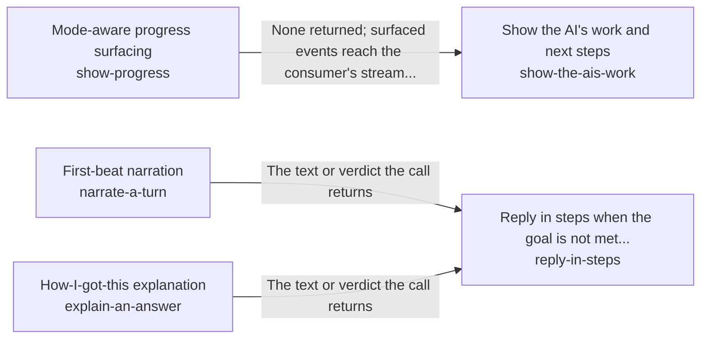

# Reasoning and answering each step of a request

Every step of a person's request acts on everything the request has established so far, so a reply rests on the work done for it and the person can follow that work, at the cost of the fast tier.

*ESOI records of this intent (evolvable structure that optimizes intent), generated from the CSV files beside this page by `esoi readmes`. Edit the CSV files, not this page.*

This sub-intent arises as the implementation `reason-and-answer:rebuilt_per_step` of its parent intent [`quest-ai-runner`](../../esoi/README.md). Opportunities: The loop's prompt can be rebuilt for each step from a template, cached head and context layers, the newest observations in full and older ones in one line, so a step's input stays small while the final answer still sees everything. That opens questions the parent solution does not ask: how much of the earlier steps a planner must see to keep continuity (from the second step the selected arm replaces the transcript with a short note that refers to step one, and its continuity is unmeasured), how a person is kept informed while a turn works (a first line, interim replies, the trail of what was done) without paying a model call for every line, and how a request that worked before skips the loop by replaying its known steps.

## How the solutions fit together

reason-and-answer lets one step of a request build on the steps before it, and its rebuilt_per_step arm is made of the parts of one step. assemble-a-prompt writes the prompt a step sends within a size budget. choose-a-model-tier picks the model tier a step starts on. answer-a-turn turns the step's decision into the reply to a chat message. replay-known-operations answers a request that worked before by replaying its known steps. core-ml-tasks classifies the message a step is about. answer-end-to-end proves that a message is handled right across the whole path. reply-in-steps tells the person why more work is needed through narrate-a-turn for the first line, and explains how an answer was reached through explain-an-answer once it is out. show-the-ais-work lays out the trail of the work through show-progress, which streams each event at the level the person wants.

## Diagram

An arrow runs from the solution that provides to the solution that builds on it; its label is what the provider outputs.

## Solutions at a glance

| Solution | Entry call | Selected implementation | Metric |
|---|---|---|---|
| `answer-a-turn` | `quest_ai_runner.run("answer-a-turn", 'What should I work on first this week?')` | `orchestrator_turn` | Judge pass rate over the chat quality cases |
| `show-progress` | no entry declared | `stream` | Surfaced-event policy by mode |
| `replay-known-operations` | `quest_ai_runner.run("replay-known-operations", 'Add a note that the launch moves to Friday')` | `stored_recipes` | Fast-path hit rate and parity with the planner-only path |
| `assemble-a-prompt` | `quest_ai_runner.run("assemble-a-prompt", 'What should I work on first this week?')` | `planner_prompt` | Prompt size against budget and duplicated-block count |
| `choose-a-model-tier` | `quest_ai_runner.run("choose-a-model-tier", {'available': ['anthropic']})` | `model_registry` | Model tier selection and limit-recognition correctness |
| `core-ml-tasks` | `quest_ai_runner.run("core-ml-tasks", 'Save a note that the launch moves to Friday.')` | `router_labels` | Accuracy of core ML tasks over labelled cases |
| `narrate-a-turn` | no entry declared | `model_beat` | Supported first beats within the time and cost the turn allows |
| `explain-an-answer` | no entry declared | `model_explanation` | Faithful explanations per unit of cost and time |
| `answer-end-to-end` | `quest_ai_runner.run("answer-end-to-end", 'What should I work on first this week?')` | `shipped_path` | Whole-path turns right on a small mixed set |
| `show-the-ais-work` | `quest_ai_runner.run("show-the-ais-work")` | `trail` | What is shown of the AI's work is true, the same for everyone, and earns its place |
| `reply-in-steps` | `quest_ai_runner.run("reply-in-steps")` | `gated` | Interim messages and asks that are true, not repeated and only where a person is needed |

## Problems and ideals

**Problems**

- `prob-prompt-overflow-and-duplication`: Prompts grow past what the model window or the budget allows, or repeat the same block, so calls fail, cost more than expected, or bury the relevant part under noise.
- `prob-progress-unreadable`: A person waiting on background work cannot tell what is happening, or is flooded with every internal step and cannot find the one thing that needs them.
- `prob-vendor-outage-halts-work`: One model vendor's outage, quota or price change stops all AI work, and moving to another vendor means code changes.
- `prob-core-ml-tasks-unspecified`: Quest relies on a few core machine-learning tasks in many places: classifying a quest or an input (which quest, which kind of ask, which route) and recommending (which goal, step or quest comes next).
- `prob-quest-answer-not-tied-to-my-goal`
- `prob-assistant-not-jarvis-from-the-users-seat`
- `prob-unmet-turn-leaves-person-guessing`: A turn that cannot finish yet ends with a bare answer, or with text that only looks like a question, so the person cannot tell whether work continues, why, or what only they can do.
- `prob-answer-reasoning-unseen`: A person cannot tell how an answer was reached, so they cannot see whether it rests on their own account or on general knowledge, and have to check each line themselves.
- `prob-known-operation-planned-again`: A request that worked before is planned again from nothing every time, paying for every search and step again although the steps are already known.

**Ideals**

- `ideal-bounded-prompt`, Bounded Prompt: Every prompt stays within a budget derived from the model window and the cost per call, with nothing repeated.
- `ideal-legible-progress`, Legible Progress: The person sees what they need and no more, for the mode they are in.
- `ideal-measured-core-ml`, Measured Core ML: Every classification and recommendation Quest depends on has a defined input and output, a held-out labelled case set, and a recorded comparison of its alternatives.
- `ideal-quest-answer-fits-my-goal`
- `ideal-jarvis-from-the-users-seat`
- `ideal-jarvis-j01-always-there-and-fast`
- `ideal-jarvis-j02-knows-my-context`
- `ideal-jarvis-j03-nudges-at-the-right-moment`
- `ideal-jarvis-j04-does-things-and-asks-first`
- `ideal-jarvis-j05-multi-step-with-conditions`
- and 10 more: all 20 are in [ideals](#ideals) of the full record below

## Metrics and their leaders

- `metric-answer-a-turn`, Judge pass rate over the chat quality cases: leader `reference_replies`, 331 of 331 cases
- `metric-show-progress`, Surfaced-event policy by mode: leader `progress_sinks`, 14 of 14 cases
- `metric-replay-known-operations`, Fast-path hit rate and parity with the planner-only path: leader `planner_only_offline`, 30 of 30 cases
- `metric-assemble-a-prompt`, Prompt size against budget and duplicated-block count: leader `live`, 28 of 29 cases
- `metric-choose-a-model-tier`, Model tier selection and limit-recognition correctness: leader `qar_selection`, 42 of 42 cases
- `metric-core-ml-tasks`, Accuracy of core ML tasks over labelled cases: leader `labelled_rows`, 3 of 11 cases
- `metric-narrate-a-turn`, Supported first beats within the time and cost the turn allows: leader `model_beat`, 12 of 13 cases
- `metric-explain-an-answer`, Faithful explanations per unit of cost and time: leader `model_explanation`, 9 of 10 cases
- `metric-answer-end-to-end`, Whole-path turns right on a small mixed set: leader `reference_script`, 13 of 13 cases
- `metric-quest-answer-tied-to-goal-and-circumstance`, : leader `reference_script`, 13 of 13 cases
- and 7 more: all 17 are in [metrics](#metrics) of the full record below

## Where to go next

- Parent intent: [Grounded AI that advances people's goals](../../esoi/README.md)
- Repository: [top README](../../README.md)
- Records: [intent.csv](intent.csv), [problems.csv](problems.csv), [ideals.csv](ideals.csv), [solutions.csv](solutions.csv), [implementations.csv](implementations.csv), [metrics.csv](metrics.csv)
- Diagram page: [diagram.md](diagram.md)

---

## The full record

### Problems

- `prob-prompt-overflow-and-duplication`: Prompts grow past what the model window or the budget allows, or repeat the same block, so calls fail, cost more than expected, or bury the relevant part under noise.
- `prob-progress-unreadable`: A person waiting on background work cannot tell what is happening, or is flooded with every internal step and cannot find the one thing that needs them.
- `prob-vendor-outage-halts-work`: One model vendor's outage, quota or price change stops all AI work, and moving to another vendor means code changes.
- `prob-core-ml-tasks-unspecified`: Quest relies on a few core machine-learning tasks in many places: classifying a quest or an input (which quest, which kind of ask, which route) and recommending (which goal, step or quest comes next). Each has had alternative implementations, but QAR's records do not name them as one solution, so no alternative is compared on a metric.
- `prob-quest-answer-not-tied-to-my-goal`: 
- `prob-assistant-not-jarvis-from-the-users-seat`: 
- `prob-unmet-turn-leaves-person-guessing`: A turn that cannot finish yet ends with a bare answer, or with text that only looks like a question, so the person cannot tell whether work continues, why, or what only they can do.
- `prob-answer-reasoning-unseen`: A person cannot tell how an answer was reached, so they cannot see whether it rests on their own account or on general knowledge, and have to check each line themselves.
- `prob-known-operation-planned-again`: A request that worked before is planned again from nothing every time, paying for every search and step again although the steps are already known.

### Ideals

- `ideal-bounded-prompt`, Bounded Prompt: Every prompt stays within a budget derived from the model window and the cost per call, with nothing repeated.
- `ideal-legible-progress`, Legible Progress: The person sees what they need and no more, for the mode they are in.
- `ideal-measured-core-ml`, Measured Core ML: Every classification and recommendation Quest depends on has a defined input and output, a held-out labelled case set, and a recorded comparison of its alternatives.
- `ideal-quest-answer-fits-my-goal`, : 
- `ideal-jarvis-from-the-users-seat`, : 
- `ideal-jarvis-j01-always-there-and-fast`, : 
- `ideal-jarvis-j02-knows-my-context`, : 
- `ideal-jarvis-j03-nudges-at-the-right-moment`, : 
- `ideal-jarvis-j04-does-things-and-asks-first`, : 
- `ideal-jarvis-j05-multi-step-with-conditions`, : 
- `ideal-jarvis-j06-background-work-with-notice`, : 
- `ideal-jarvis-j07-honest-about-limits-and-actions`, : 
- `ideal-jarvis-j08-good-questions-when-vague`, : 
- `ideal-jarvis-j09-same-assistant-across-sessions`, : 
- `ideal-jarvis-j10-stable-adjustable-personality`, : 
- `ideal-jarvis-j11-treats-my-team-appropriately`, : 
- `ideal-jarvis-j12-gets-better-over-time`, : 
- `ideal-jarvis-j13-cheap-and-reliable-all-day`, : 
- `ideal-jarvis-j14-accurate-brief-personal-quest-answers`, : 
- `ideal-never-left-guessing`, Never Left Guessing: The person always knows whether work continues, why, and what only they can do.

### Solutions

| Solution | Name | Selected | Metric |
|---|---|---|---|
| `answer-a-turn` | Grounded chat turn handler | orchestrator_turn | Judge pass rate over the chat quality cases |
| `show-progress` | Mode-aware progress surfacing | stream | Surfaced-event policy by mode |
| `replay-known-operations` | Learned-operation fast path | stored_recipes | Fast-path hit rate and parity with the planner-only path |
| `assemble-a-prompt` | Budgeted prompt assembler | planner_prompt | Prompt size against budget and duplicated-block count |
| `choose-a-model-tier` | Cost-ordered model tier selector with outage and allowance recovery | model_registry | Model tier selection and limit-recognition correctness |
| `core-ml-tasks` | Core ML tasks: quest classification and recommendation | router_labels | Accuracy of core ML tasks over labelled cases |
| `narrate-a-turn` | First-beat narration | model_beat | Supported first beats within the time and cost the turn allows |
| `explain-an-answer` | How-I-got-this explanation | model_explanation | Faithful explanations per unit of cost and time |
| `answer-end-to-end` | Whole-path answer check | shipped_path | Whole-path turns right on a small mixed set |
| `show-the-ais-work` | Show the AI's work and next steps | trail | What is shown of the AI's work is true, the same for everyone, and earns its place |
| `reply-in-steps` | Reply in steps when the goal is not met yet | gated | Interim messages and asks that are true, not repeated and only where a person is needed |

### Implementations

| Implementation | Name | Where | Sub-intent |
|---|---|---|---|
| `answer-a-turn:dev_quest_chat` | Live chat on a disposable world | [evaluation/components/chat_quality/impls/dev_quest_chat.py](../../evaluation/components/chat_quality/impls/dev_quest_chat.py) |  |
| `answer-a-turn:reference_replies` | Offline metric validity check | [evaluation/components/chat_quality/impls/reference_replies.py](../../evaluation/components/chat_quality/impls/reference_replies.py) |  |
| `show-progress:stream` | Stream, milestone and fan-out sinks | [quest_ai_runner/core/adapters_sinks.py](../core/adapters_sinks.py) |  |
| `show-progress:progress_sinks` | Sink policy cases | [evaluation/components/show_progress/impls/progress_sinks.py](../../evaluation/components/show_progress/impls/progress_sinks.py) |  |
| `replay-known-operations:recipe_replay` | Live recipe replay arm | [evaluation/components/recipe_fast_path/impls/recipe_replay.py](../../evaluation/components/recipe_fast_path/impls/recipe_replay.py) |  |
| `replay-known-operations:planner_only` | Live planner-only baseline | [evaluation/components/recipe_fast_path/impls/planner_only.py](../../evaluation/components/recipe_fast_path/impls/planner_only.py) |  |
| `replay-known-operations:recipe_replay_offline` | Offline recipe replay arm | [evaluation/components/recipe_fast_path/impls/recipe_replay_offline.py](../../evaluation/components/recipe_fast_path/impls/recipe_replay_offline.py) |  |
| `replay-known-operations:planner_only_offline` | Offline planner-only baseline | [evaluation/components/recipe_fast_path/impls/planner_only_offline.py](../../evaluation/components/recipe_fast_path/impls/planner_only_offline.py) |  |
| `assemble-a-prompt:live` | Live assembly-point driver | [evaluation/components/prompt_size/impls/live.py](../../evaluation/components/prompt_size/impls/live.py) |  |
| `choose-a-model-tier:deep_model_selection` | Difficulty-to-rung starter | [quest_ai_runner/core/deep_model_selection.py](../core/deep_model_selection.py) |  |
| `choose-a-model-tier:model_registry` | Live tier registry | [quest_ai_runner/core/model_registry.py](../core/model_registry.py) |  |
| `choose-a-model-tier:usage_limit` | Subscription allowance limit detector | [quest_ai_runner/core/usage_limit.py](../core/usage_limit.py) |  |
| `choose-a-model-tier:qar_selection` | Live selection evaluation arm | [evaluation/components/choose_a_model_tier/impls/qar_selection.py](../../evaluation/components/choose_a_model_tier/impls/qar_selection.py) |  |
| `show-progress:milestone` | Milestone sink | [quest_ai_runner/core/adapters_sinks.py](../core/adapters_sinks.py) |  |
| `core-ml-tasks:message-route-family` | Classify through the message router alternatives | evaluation/components/classification/impls |  |
| `core-ml-tasks:registry-conditioned-routing` | Route with the registry of examples, by model tier |  |  |
| `core-ml-tasks:shared-quest-ranker` | Pick the quest with the shared ranker (embeddings lead, the model picks by number) |  |  |
| `core-ml-tasks:hybrid-candidate-ranker` | Rank quests by words and meaning, with evidence |  |  |
| `core-ml-tasks:category-vector-match` | Match a goal to an area of life by vector similarity |  |  |
| `core-ml-tasks:intent-placement-llm` | Place quests under top intents with the model |  |  |
| `core-ml-tasks:intent-suggestion-llm` | Recommend top intents with the model |  |  |
| `core-ml-tasks:period-placement-llm` | Recommend where backlog goals go in the next period |  |  |
| `narrate-a-turn:model_beat` | One cheap model call per turn writes the beat (today) | [quest_ai_runner/core/orchestrator_turn.py](../core/orchestrator_turn.py) |  |
| `narrate-a-turn:no_beat` | Fixed status line, no model call (floor, proposed) |  |  |
| `explain-an-answer:model_explanation` | One model call writes the explanation from the trace (today) | [quest_ai_runner/core/orchestrator_judges.py](../core/orchestrator_judges.py) |  |
| `explain-an-answer:trace_template` | Template over the trace, no model call (floor, proposed) |  |  |
| `answer-end-to-end:qar_live` | QAR as shipped, live on the subscription (today) | [quest_ai_runner/core/orchestrator.py](../core/orchestrator.py) |  |
| `answer-end-to-end:reference_script` | Scripted ideal planner (offline) |  |  |
| `answer-end-to-end:rules_only` | Rules only, no model (floor) |  |  |
| `core-ml-tasks:labelled_rows` |  | [evaluation/components/core_ml_tasks/impls/labelled_rows.py](../../evaluation/components/core_ml_tasks/impls/labelled_rows.py) |  |
| `core-ml-tasks:none_mapped` |  | [evaluation/components/core_ml_tasks/impls/none_mapped.py](../../evaluation/components/core_ml_tasks/impls/none_mapped.py) |  |
| `assemble-a-prompt:situational` |  | [evaluation/components/prompt_size/impls/situational.py](../../evaluation/components/prompt_size/impls/situational.py) |  |
| `show-the-ais-work:no_trace` | Nothing shown (the status quo before the Trail) | [evaluation/components/work_trace_experience/impls/no_trace.py](../../evaluation/components/work_trace_experience/impls/no_trace.py) |  |
| `show-the-ais-work:plain_list` | A plain list of every step | [evaluation/components/work_trace_experience/impls/plain_list.py](../../evaluation/components/work_trace_experience/impls/plain_list.py) |  |
| `show-the-ais-work:trail` | The Trail: live line, one summary line, expandable groups | [quest_ai_runner/core/work_trace.py](../core/work_trace.py) |  |
| `reply-in-steps:today` | Behaviour before the build: no interim for an unmet attempt | [evaluation/components/interim_reply/impls/today.py](../../evaluation/components/interim_reply/impls/today.py) |  |
| `reply-in-steps:every_attempt` | An interim on every unmet attempt (spam baseline) | [evaluation/components/interim_reply/impls/every_attempt.py](../../evaluation/components/interim_reply/impls/every_attempt.py) |  |
| `reply-in-steps:gated` | The structural gate of core/interim_policy.py | [quest_ai_runner/core/interim_policy.py](../core/interim_policy.py) |  |
| `show-the-ais-work:terminal_trail` | The terminal draws the Trail from the hub's renderers | [quest_ai_runner/textual_ui_trail.py](../textual_ui_trail.py) |  |
| `assemble-a-prompt:planner_prompt` | The planner prompt written by the real loop | [quest_ai_runner/area_reason_and_answer.py](../area_reason_and_answer.py) |  |
| `answer-a-turn:orchestrator_turn` | One turn of the orchestrator over the model | [quest_ai_runner/area_reason_and_answer.py](../area_reason_and_answer.py) |  |
| `answer-end-to-end:shipped_path` | The shipped path as one call | [quest_ai_runner/area_reason_and_answer.py](../area_reason_and_answer.py) |  |
| `replay-known-operations:stored_recipes` | The recipe store of the loop | [quest_ai_runner/area_reason_and_answer.py](../area_reason_and_answer.py) |  |
| `core-ml-tasks:router_labels` | The route as the classification label | [quest_ai_runner/area_reason_and_answer.py](../area_reason_and_answer.py) |  |

### Metrics

- `metric-answer-a-turn`, Judge pass rate over the chat quality cases: `esoi run chat_quality --impl dev_quest_chat`
- `metric-show-progress`, Surfaced-event policy by mode: `esoi run show_progress --impl progress_sinks`
- `metric-replay-known-operations`, Fast-path hit rate and parity with the planner-only path: `esoi run recipe_fast_path --impl recipe_replay_offline`
- `metric-assemble-a-prompt`, Prompt size against budget and duplicated-block count: `esoi run prompt_size --impl live`
- `metric-choose-a-model-tier`, Model tier selection and limit-recognition correctness: `esoi run choose_a_model_tier --impl qar_selection`
- `metric-core-ml-tasks`, Accuracy of core ML tasks over labelled cases: `esoi run core_ml_tasks --impl labelled_rows; esoi run classification --impl qar_planner`
- `metric-narrate-a-turn`, Supported first beats within the time and cost the turn allows: `esoi run narrate_a_turn --impl model_beat`
- `metric-explain-an-answer`, Faithful explanations per unit of cost and time: `esoi run explain_an_answer --impl model_explanation`
- `metric-answer-end-to-end`, Whole-path turns right on a small mixed set: `esoi run end_to_end --impl qar_live --sample 3 --max-calls 60`
- `metric-quest-answer-tied-to-goal-and-circumstance`, : `esoi run end_to_end --impl qar_live`
- `metric-jarvis-ness`, : `esoi run end_to_end --impl qar_live`
- `metric-jarvis-floor-consent`, : `esoi run end_to_end --impl qar_live`
- `metric-jarvis-floor-honesty`, : `esoi run end_to_end --impl qar_live`
- `metric-incremental-output-and-still-working`, : `esoi run show_progress --impl progress_sinks`
- `metric-work-trace-experience`, What is shown of the AI's work is true, the same for everyone, and earns its place: `esoi run work_trace_experience --impl trail`
- `metric-interim-reply-truthful-and-useful`, Interim messages and asks that are true, not repeated and only where a person is needed: `esoi run interim_reply --impl gated`
- `metric-terminal-uses-hub-renderers`, The terminal shows the AI's work with the hub's rules and words, and keeps no copy: `python3 -m pytest tests/test_terminal_trail.py tests/test_terminal_uses_hub_renderers.py`
