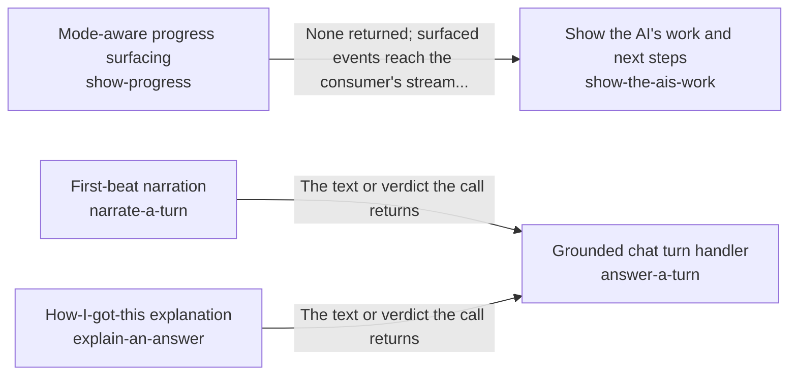

These are ESOI records rendered as a diagram (evolvable structure that optimizes intent). This page is generated from the solutions' outputs and the implementations' `uses_solution_ids` by `esoi diagram`; edit those records, not this page.

# Solution diagram: Reasoning and answering each step of a request

reason-and-answer lets one step of a request build on the steps before it, and its rebuilt_per_step arm is made of the parts of one step. assemble-a-prompt writes the prompt a step sends within a size budget. choose-a-model-tier picks the model tier a step starts on. answer-a-turn turns the step's decision into the reply to a chat message, opening with a first line from narrate-a-turn and, when the person asks for it, closing with explain-an-answer once the answer is out. replay-known-operations answers a request that worked before by replaying its known steps. core-ml-tasks classifies the message a step is about. answer-end-to-end proves that a message is handled right across the whole path. reply-in-steps decides when a turn that is not finished sends an interim message and what that message holds. show-the-ais-work lays out the trail of the work through show-progress, which streams each event at the level the person wants.

An arrow runs from the solution that provides to the solution that builds on it; its label is what the provider outputs.

