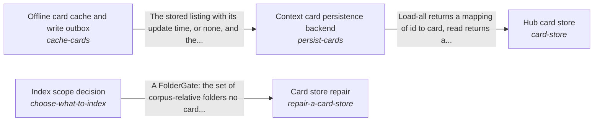

# Remembering and recalling the person's own knowledge

A request recalls the part of the person's own knowledge its goal needs, from cards that are current with their sources, found by meaning and proportionate in size, and never from anyone else's.

*ESOI records of this intent (evolvable structure that optimizes intent), generated from the CSV files beside this page by `esoi readmes`. Edit the CSV files, not this page.*

This sub-intent arises as the implementation `remember-and-recall:recency_window` of its parent intent [`quest-ai-runner`](../../esoi/README.md). Opportunities: The cards a person's work leaves behind are copies of what lives elsewhere, so the store itself raises questions the parent solution does not ask: when a card has drifted from its source file, how an assistant keeps serving the last known listing while a backend is down and replays the writes that failed, how a store is kept proportionate to its sources instead of inflating with copies from a backups folder, which folders a corpus may index at all, and how a card is found by meaning when the person asks in other words. Each has alternatives that can be measured against each other.

## How the solutions fit together

Subconscious recalls the cards that match a request through Hub card store. Hub card store keeps the cards through Context card persistence backend, and Context card persistence backend serves the last known listing while a backend is down with Offline card cache and write outbox. Card store repair decides which sources deserve a card by asking Index scope decision before it rewrites anything. The remaining parts of the area do not use one another in code, so they are grouped here by purpose, the care of a card store that stays current, proportionate and findable. Source-change staleness detector reports the cards that have drifted from their source file. Card store growth prevention keeps a store proportionate to its sources. Card categories and metadata gives each card its labels. QAR topic cards for a folder proposes the topic cards a lane indexes.

## Diagram

An arrow runs from the solution that provides to the solution that builds on it; its label is what the provider outputs.

## Solutions at a glance

| Solution | Handle | Entry call | Selected implementation | Metric |
|---|---|---|---|---|
| Context card persistence backend | `persist-cards` | `quest_ai_runner.run("persist-cards", 'card-1')` | Hosted card API repository (`quest_api`) | Card repository conformance across backends |
| Source-change staleness detector | `detect-stale-cards` | no entry declared | Content-hash fingerprint check (`store_sha256`) | Staleness detection precision and recall over mutation cases |
| Offline card cache and write outbox | `cache-cards` | no entry declared | Durable file cache (`file`) | Outage resilience of the card repository |
| Card store growth prevention | `bound-card-growth` | no entry declared | Bootstrap guards against re-import (`bootstrap_guards`) | Cards per source-file group after repeated passes, for the guards that prevent growth |
| Card store repair | `repair-a-card-store` | no entry declared | Repository tidy (`repository_tidy`) | Cards per source-file group and duplicate share after a repair of an inflated store |
| Index scope decision | `choose-what-to-index` | no entry declared | Risk-gated folder review (`risk_gate`) | Copies kept out with real material kept in, by review availability |
| Card categories and metadata | `label-context-cards` | no entry declared | Fast-tier model writes metadata and categories (today) (`fast_model_labels`) | Retrieval hits and category precision per unit of cost |
| Hub card store | `card-store` | `quest_ai_runner.run("card-store", 'rust release')` | Quest backend card API from the environment (`quest-api-cards`) | none yet |
| QAR topic cards for a folder | `cards-from-files` | `quest_ai_runner.run("cards-from-files", {'root': '.', 'files': [], 'existing': {}})` | QAR topic bootstrap (`qar_topic_bootstrap`) | Cards per source-file group after repeated passes, for the guards that prevent growth |

## Problems and ideals

**Problems**

- Context cards drift from the sources they describe: a file changes or disappears and the card still says the old thing, and when a card backend is unreachable the AI loses its cards or silently drops... (`prob-context-drifts-from-its-source`)
- The card or passage that would answer a question exists, but it is worded differently from the question, so keyword search does not surface it and the answer is built without it. (`prob-relevant-card-not-found`)
- A card store grows far past the distinct content of its corpus. (`prob-card-store-inflates`)
- A corpus's walk and its card sources read folders that are not its knowledge, and the worst of them look harmless by file count. (`prob-index-walks-into-copies`)

**Ideals**

- Current Knowledge (`ideal-current-knowledge`): What the AI reads still matches the source it came from, and outages are loud but harmless.
- Findable Knowledge (`ideal-findable-knowledge`): The knowledge that bears on a question is found whatever words it uses.
- Proportionate Card Store (`ideal-proportionate-store`): A store holds one card per distinct topic of its corpus, so its size follows the corpus's distinct content and never grows by re-importing what it already has.
- Proportionate Index Scope (`ideal-proportionate-index-scope`): The system itself decides, proportionately and without a person, whether a large or high-risk folder is worth looking into: a cheap call per folder, never per file, and it fails closed only where the...

## Metrics and their leaders

- Card repository conformance across backends (`metric-persist-cards`): leader `filesystem`, 14 of 14 cases
- Staleness detection precision and recall over mutation cases (`metric-detect-stale-cards`): leader `store_sha256`, 5 of 6 cases
- Outage resilience of the card repository (`metric-cache-cards`): leader `file_cache`, 12 of 12 cases
- Cards per source-file group after repeated passes, for the guards that prevent growth (`metric-bound-card-growth`): leader `bootstrap_guards`, 12 of 12 cases
- Cards per source-file group and duplicate share after a repair of an inflated store (`metric-repair-a-card-store`): leader `bootstrap_guards`, 12 of 12 cases
- Copies kept out with real material kept in, by review availability (`metric-choose-what-to-index`): leader `risk_gate`, 16 of 16 cases
- Retrieval hits and category precision per unit of cost (`metric-label-context-cards`): leader `fast_model_labels_fast`, 10 of 11 cases

## Where to go next

- Parent intent: [Grounded AI that advances people's goals](../../esoi/README.md)
- Repository: [top README](../../README.md)
- Records: [intent.csv](intent.csv), [problems.csv](problems.csv), [ideals.csv](ideals.csv), [solutions.csv](solutions.csv), [implementations.csv](implementations.csv), [metrics.csv](metrics.csv)
- Diagram page: [diagram.md](diagram.md)

---

## The full record

### Problems

- Context cards drift from the sources they describe: a file changes or disappears and the card still says the old thing, and when a card backend is unreachable the AI loses its cards or silently drops writes. (`prob-context-drifts-from-its-source`)
- The card or passage that would answer a question exists, but it is worded differently from the question, so keyword search does not surface it and the answer is built without it. (`prob-relevant-card-not-found`)
- A card store grows far past the distinct content of its corpus. (`prob-card-store-inflates`)
- A corpus's walk and its card sources read folders that are not its knowledge, and the worst of them look harmless by file count. (`prob-index-walks-into-copies`)

### Ideals

- Current Knowledge (`ideal-current-knowledge`): What the AI reads still matches the source it came from, and outages are loud but harmless.
- Findable Knowledge (`ideal-findable-knowledge`): The knowledge that bears on a question is found whatever words it uses.
- Proportionate Card Store (`ideal-proportionate-store`): A store holds one card per distinct topic of its corpus, so its size follows the corpus's distinct content and never grows by re-importing what it already has.
- Proportionate Index Scope (`ideal-proportionate-index-scope`): The system itself decides, proportionately and without a person, whether a large or high-risk folder is worth looking into: a cheap call per folder, never per file, and it fails closed only where the risk is real.

### Solutions

| Solution | Handle | Selected | Metric |
|---|---|---|---|
| Context card persistence backend | `persist-cards` | Hosted card API repository (`quest_api`) | Card repository conformance across backends |
| Source-change staleness detector | `detect-stale-cards` | Content-hash fingerprint check (`store_sha256`) | Staleness detection precision and recall over mutation cases |
| Offline card cache and write outbox | `cache-cards` | Durable file cache (`file`) | Outage resilience of the card repository |
| Card store growth prevention | `bound-card-growth` | Bootstrap guards against re-import (`bootstrap_guards`) | Cards per source-file group after repeated passes, for the guards that prevent growth |
| Card store repair | `repair-a-card-store` | Repository tidy (`repository_tidy`) | Cards per source-file group and duplicate share after a repair of an inflated store |
| Index scope decision | `choose-what-to-index` | Risk-gated folder review (`risk_gate`) | Copies kept out with real material kept in, by review availability |
| Card categories and metadata | `label-context-cards` | Fast-tier model writes metadata and categories (today) (`fast_model_labels`) | Retrieval hits and category precision per unit of cost |
| Hub card store | `card-store` | Quest backend card API from the environment (`quest-api-cards`) | none yet |
| QAR topic cards for a folder | `cards-from-files` | QAR topic bootstrap (`qar_topic_bootstrap`) | Cards per source-file group after repeated passes, for the guards that prevent growth |

### Implementations

| Implementation | Handle | Where | Sub-intent |
|---|---|---|---|
| Atomic JSON file repository | `persist-cards:filesystem` | [quest_ai_runner/config_assembler.py](../config_assembler.py) |  |
| Vector database repository | `persist-cards:qdrant` | [quest_ai_runner/remember_and_recall/qdrant_card_repository.py](qdrant_card_repository.py) |  |
| Hosted card API repository | `persist-cards:quest_api` | [quest_ai_runner/adapters/quest_api_card_repository.py](../adapters/quest_api_card_repository.py) |  |
| Content-hash fingerprint check | `detect-stale-cards:store_sha256` | [evaluation/components/staleness/impls/store_sha256.py](../../evaluation/components/staleness/impls/store_sha256.py) |  |
| Timestamp-and-size baseline | `detect-stale-cards:mtime_size` | [evaluation/components/staleness/impls/mtime_size.py](../../evaluation/components/staleness/impls/mtime_size.py) |  |
| Card repository with a cache seam and a null cache | `cache-cards:null` | [quest_ai_runner/adapters/quest_api_card_repository.py](../adapters/quest_api_card_repository.py) |  |
| Durable file cache | `cache-cards:file` | [quest_ai_runner/remember_and_recall/card_cache_file.py](card_cache_file.py) |  |
| No-op cache (shipped default of the seam) | `cache-cards:null_cache` | [evaluation/components/cache_cards/impls/null_cache.py](../../evaluation/components/cache_cards/impls/null_cache.py) |  |
| In-process memory cache | `cache-cards:memory_cache` | [evaluation/components/cache_cards/impls/memory_cache.py](../../evaluation/components/cache_cards/impls/memory_cache.py) |  |
| Durable file cache under outage scenarios | `cache-cards:file_cache` | [evaluation/components/cache_cards/impls/file_cache.py](../../evaluation/components/cache_cards/impls/file_cache.py) |  |
| Card quarantine tool | `repair-a-card-store:quarantine_tool` | [evaluation/components/card_growth/impls/quarantine_tool.py](../../evaluation/components/card_growth/impls/quarantine_tool.py) |  |
| Copy mode with no guard | `bound-card-growth:no_cleanup` | [evaluation/components/card_growth/impls/no_cleanup.py](../../evaluation/components/card_growth/impls/no_cleanup.py) |  |
| Bootstrap guards against re-import | `bound-card-growth:bootstrap_guards` | [evaluation/components/card_growth/impls/bootstrap_guards.py](../../evaluation/components/card_growth/impls/bootstrap_guards.py) |  |
| Risk-gated folder review | `choose-what-to-index:risk_gate` | [evaluation/components/choose_what_to_index/impls/risk_gate.py](../../evaluation/components/choose_what_to_index/impls/risk_gate.py) |  |
| Model-judged folder review before the gate | `choose-what-to-index:review_only` | [evaluation/components/choose_what_to_index/impls/review_only.py](../../evaluation/components/choose_what_to_index/impls/review_only.py) |  |
| Index everything (broken baseline) | `choose-what-to-index:index_everything` | [evaluation/components/choose_what_to_index/broken/index_everything.py](../../evaluation/components/choose_what_to_index/broken/index_everything.py) |  |
| Repository tidy | `repair-a-card-store:repository_tidy` | [quest_ai_runner/adapters/card_store_tidy.py](../adapters/card_store_tidy.py) |  |
| Tidy at open of a local folder | `repair-a-card-store:local_folder_tidy` | [quest_ai_runner/adapters/context_store_heal.py](../adapters/context_store_heal.py) |  |
| Store as copy mode leaves it | `repair-a-card-store:no_cleanup` | [evaluation/components/card_growth/impls/no_cleanup.py](../../evaluation/components/card_growth/impls/no_cleanup.py) |  |
| Fast-tier model writes metadata and categories (today) | `label-context-cards:fast_model_labels` | [quest_ai_runner/remember_and_recall/card_metadata_generator.py](card_metadata_generator.py) |  |
| Path and title rules, no model call (floor, proposed) | `label-context-cards:path_rules` | [evaluation/components/label_context_cards/impls/path_rules.py](../../evaluation/components/label_context_cards/impls/path_rules.py) |  |
| QAR card repository | `card-store:qar-card-repository` | [quest_ai_runner/remember_and_recall/hub_card_store.py](hub_card_store.py) |  |
| Quest backend card API from the environment | `card-store:quest-api-cards` | [quest_ai_runner/remember_and_recall/hub_card_store.py](hub_card_store.py) |  |
| QAR topic bootstrap | `cards-from-files:qar_topic_bootstrap` | [quest_ai_runner/remember_and_recall/qar_topic_bootstrap.py](qar_topic_bootstrap.py) |  |

### Metrics

- Card repository conformance across backends (`metric-persist-cards`): `esoi run persist_cards --impl quest_api`
- Staleness detection precision and recall over mutation cases (`metric-detect-stale-cards`): `esoi run staleness --impl store_sha256`
- Outage resilience of the card repository (`metric-cache-cards`): `esoi run cache_cards --impl file_cache`
- Cards per source-file group after repeated passes, for the guards that prevent growth (`metric-bound-card-growth`): `esoi run card_growth --impl bootstrap_guards; esoi run card_store_growth --impl live_store; esoi run card_growth --impl no_cleanup`
- Cards per source-file group and duplicate share after a repair of an inflated store (`metric-repair-a-card-store`): `esoi run card_growth --impl repository_tidy; esoi run card_growth --impl quarantine_tool; esoi run card_growth --impl no_cleanup`
- Copies kept out with real material kept in, by review availability (`metric-choose-what-to-index`): `esoi run choose_what_to_index --impl risk_gate; esoi run choose_what_to_index --impl review_only`
- Retrieval hits and category precision per unit of cost (`metric-label-context-cards`): `esoi run label_context_cards --impl fast_model_labels`
