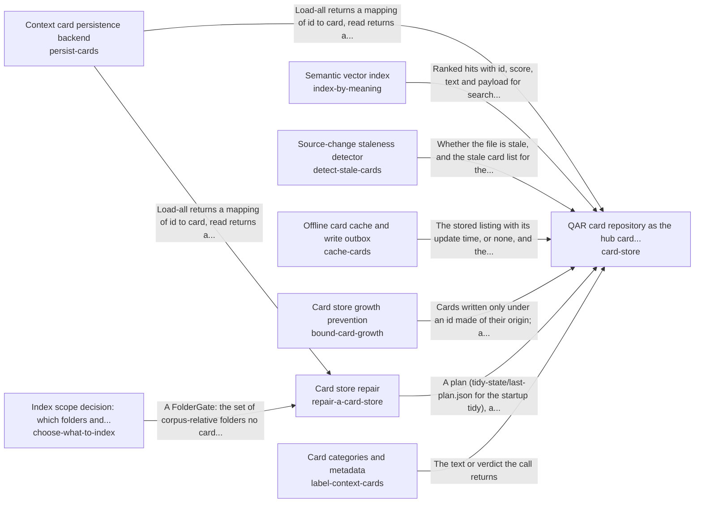

These are ESOI records rendered as a diagram (evolvable structure that optimizes intent). This page is generated from the solutions' outputs and the implementations' `uses_solution_ids` by `esoi diagram`; edit those records, not this page.

# Solution diagram: Remembering and recalling the person's own knowledge

remember-and-recall recalls the cards that match a request through card-store. card-store keeps the cards through persist-cards, serves the last known listing through cache-cards while a backend is down, finds them by meaning through index-by-meaning, labels them through label-context-cards, reports stale ones through detect-stale-cards, holds their growth in check through bound-card-growth and shrinks an inflated store through repair-a-card-store. repair-a-card-store rewrites the stored cards through persist-cards and asks choose-what-to-index which sources deserve cards.

An arrow runs from the solution that provides to the solution that builds on it; its label is what the provider outputs.

