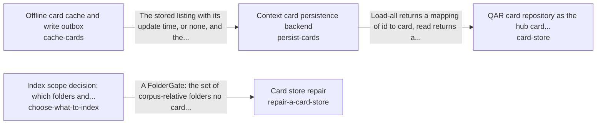

These are ESOI records rendered as a diagram (evolvable structure that optimizes intent). This page is generated from the solutions' outputs and the implementations' `uses_solution_ids` by `esoi diagram`; edit those records, not this page.

# Solution diagram: Remembering and recalling the person's own knowledge

remember-and-recall recalls the cards that match a request through card-store. card-store keeps the cards through persist-cards, and persist-cards serves the last known listing while a backend is down with cache-cards. repair-a-card-store decides which sources deserve a card by asking choose-what-to-index before it rewrites anything. The remaining parts of the area do not use one another in code, so they are grouped here by purpose, the care of a card store that stays current, proportionate and findable. detect-stale-cards reports the cards that have drifted from their source file. bound-card-growth keeps a store proportionate to its sources. label-context-cards gives each card its labels. cards-from-files proposes the topic cards a lane indexes.

An arrow runs from the solution that provides to the solution that builds on it; its label is what the provider outputs.

