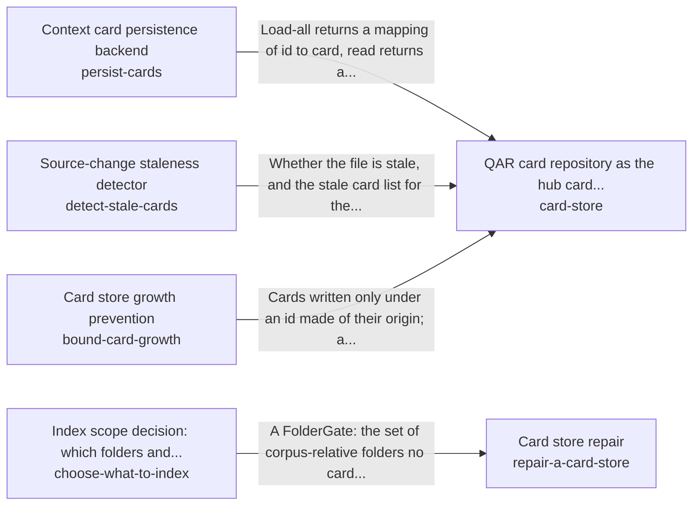

These are ESOI records rendered as a diagram (evolvable structure that optimizes intent). This page is generated from the solutions' outputs and the implementations' `uses_solution_ids` by `esoi diagram`; edit those records, not this page.

# Solution diagram: Remembering and recalling the person's own knowledge

remember-and-recall recalls the cards that match a request through card-store. card-store keeps the cards through persist-cards, reports stale ones through detect-stale-cards and holds their growth in check through bound-card-growth. The area serves the last known listing while a backend is down with cache-cards. Cards are found by meaning with index-by-meaning. Each card gets its labels from label-context-cards. An inflated store is shrunk with repair-a-card-store. repair-a-card-store decides which sources deserve a card by asking choose-what-to-index before it rewrites anything.

An arrow runs from the solution that provides to the solution that builds on it; its label is what the provider outputs.

