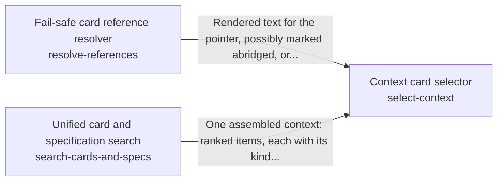

# Selecting the context a planner reads

The material a planner reads before it plans, whether a card, a file, a conversation or a specification record, is the material the request concerns, however the request is worded.

*ESOI records of this intent (evolvable structure that optimizes intent), generated from the CSV files beside this page by `esoi readmes`. Edit the CSV files, not this page.*

This sub-intent arises as the implementation `remember-and-recall:score_thresholds` of its parent intent [`quest-ai-runner`](../../esoi/README.md). Opportunities: Which material a planner reads is a retrieval problem with its own alternatives and its own public evidence, which the parent solution does not weigh: lexical, vector and hybrid rankers over a person's cards, files and conversations, a ranker per representative, references that must resolve to current text without failing a turn, and one ranking that holds the cards and the specification records of a repository together so a run also sees when no solution covers its request. Public benchmarks of similar rankers are shown beside the measurements made here.

## How the solutions fit together

select-context chooses the cards, files and conversations a planner reads before it plans, so the right material is found however a request is worded. It follows the pointer of a card to the person's current notes and files through resolve-references, and it searches the cards and the specification records of a repository in one ranking through search-cards-and-specs.

## Diagram

An arrow runs from the solution that provides to the solution that builds on it; its label is what the provider outputs.

## Solutions at a glance

| Solution | Entry call | Selected implementation | Metric |
|---|---|---|---|
| `select-context` | no entry declared | `hybrid` | Context selection ranking accuracy and card-quality outcome |
| `resolve-references` | no entry declared | `note` | Pointer-resolution safety over offline cases |
| `search-cards-and-specs` | no entry declared | `solutions_and_problems_with_links` | Mixed card and specification selection, with both existing selection metrics held |

## Problems and ideals

**Problems**

- `prob-context-rediscovered-each-run`: An agent asked to answer or work from a person's own material has to find the relevant part of it first.
- `prob-two-searches-for-one-context`: A run's context comes from two retrieval pipelines that repeat the same stages separately: context card selection (keyword IDF, vector search, weighted reciprocal-rank fusion, then a cheap-model...

**Ideals**

- `ideal-compounding-context`, Compounding Context: What one run found is kept as a card that later runs reuse, so every run starts grounded in the person's material at little cost, reads only what is current, and can name where each piece came from.
- `ideal-one-ranked-context`, One Ranked Context: A run's context comes from one search over everything it may be grounded in, with one ranking and one budget, and every result says what kind of thing it is and where it lives.

## Metrics and their leaders

- `metric-select-context`, Context selection ranking accuracy and card-quality outcome: leader `hybrid_union`, 45 of 63 cases
- `metric-resolve-references`, Pointer-resolution safety over offline cases: leader `card_resolvers`, 16 of 16 cases
- `metric-search-cards-and-specs`, Mixed card and specification selection, with both existing selection metrics held: leader `solutions_and_problems_with_links`, 14 of 17 cases

## Where to go next

- Parent intent: [Grounded AI that advances people's goals](../../esoi/README.md)
- Repository: [top README](../../README.md)
- Records: [intent.csv](intent.csv), [problems.csv](problems.csv), [ideals.csv](ideals.csv), [solutions.csv](solutions.csv), [implementations.csv](implementations.csv), [metrics.csv](metrics.csv)
- Diagram page: [diagram.md](diagram.md)

---

## The full record

### Problems

- `prob-context-rediscovered-each-run`: An agent asked to answer or work from a person's own material has to find the relevant part of it first. With nothing kept between runs it re-discovers the same files and facts on every run (the planner asks what to read, retrieval searches, the loop re-plans), which costs tokens and latency, can miss what an earlier run already found, and leaves no record of where an answer came from.
- `prob-two-searches-for-one-context`: A run's context comes from two retrieval pipelines that repeat the same stages separately: context card selection (keyword IDF, vector search, weighted reciprocal-rank fusion, then a cheap-model filter and consolidation) and ESOI record selection (field-weighted TF-IDF, an optional vector search, reciprocal-rank fusion, then a gated cheap-model choice). They keep separate indexes, budgets and output shapes, and only the card result is put into a run's context: ESOI records reach a run only through tools it has to think to call, or as a lexical-only slice for a deep goal, so the problem, ideal and metric a run serves are often not in view.

### Ideals

- `ideal-compounding-context`, Compounding Context: What one run found is kept as a card that later runs reuse, so every run starts grounded in the person's material at little cost, reads only what is current, and can name where each piece came from.
- `ideal-one-ranked-context`, One Ranked Context: A run's context comes from one search over everything it may be grounded in, with one ranking and one budget, and every result says what kind of thing it is and where it lives.

### Solutions

| Solution | Name | Selected | Metric |
|---|---|---|---|
| `select-context` | Context card selector | hybrid | Context selection ranking accuracy and card-quality outcome |
| `resolve-references` | Fail-safe card reference resolver | note | Pointer-resolution safety over offline cases |
| `search-cards-and-specs` | Unified card and specification search | solutions_and_problems_with_links | Mixed card and specification selection, with both existing selection metrics held |

### Implementations

| Implementation | Name | Where | Sub-intent |
|---|---|---|---|
| `select-context:idf_docstrings` | Field-weighted keyword arm | [evaluation/components/context_selection/impls/idf_docstrings.py](../../evaluation/components/context_selection/impls/idf_docstrings.py) |  |
| `select-context:idf_paths_only` | Docstring ablation of the keyword arm | [evaluation/components/context_selection/impls/idf_paths_only.py](../../evaluation/components/context_selection/impls/idf_paths_only.py) |  |
| `select-context:blind_grep` | Blind text-search floor | [evaluation/components/context_selection/impls/blind_grep.py](../../evaluation/components/context_selection/impls/blind_grep.py) |  |
| `select-context:vector_bge_small` | Plain cosine semantic baseline | [evaluation/components/context_selection/impls/vector_bge_small.py](../../evaluation/components/context_selection/impls/vector_bge_small.py) |  |
| `select-context:hybrid_union` | Keyword plus vector fusion (measured live class) | [evaluation/components/context_selection/impls/hybrid_union.py](../../evaluation/components/context_selection/impls/hybrid_union.py) |  |
| `select-context:file` | Card-file keyword store | [quest_ai_runner/adapters/file_context_store.py](../adapters/file_context_store.py) |  |
| `select-context:vector` | Semantic card retrieval | [quest_ai_runner/select_context/vector_context_assembler.py](vector_context_assembler.py) |  |
| `select-context:hybrid` | Parallel keyword and vector fusion | [quest_ai_runner/select_context/hybrid_context_assembler.py](hybrid_context_assembler.py) |  |
| `select-context:bm25` | Exact-content BM25 arm | [quest_ai_runner/select_context/bm25_content_store.py](bm25_content_store.py) |  |
| `select-context:rep` | Per-agent preference wrapper | [quest_ai_runner/select_context/rep_context_assembler.py](rep_context_assembler.py) |  |
| `select-context:composite` | Ordered assembler composition | [quest_ai_runner/config_assembler.py](../config_assembler.py) |  |
| `select-context:seeded_keyword_store` | Seeded keyword card-quality arm | [evaluation/components/card_quality/impls/seeded_keyword_store.py](../../evaluation/components/card_quality/impls/seeded_keyword_store.py) |  |
| `select-context:seeded_keyword_open` | Open-gate ablation of the card-quality arm | [evaluation/components/card_quality/impls/seeded_keyword_open.py](../../evaluation/components/card_quality/impls/seeded_keyword_open.py) |  |
| `select-context:live_updater_hybrid` | Live learner plus hybrid store arm | [evaluation/components/card_quality/impls/live_updater_hybrid.py](../../evaluation/components/card_quality/impls/live_updater_hybrid.py) |  |
| `select-context:idf_hint` | Offline warm-hint builder | [evaluation/components/claude_code_ab/impls/idf_hint.py](../../evaluation/components/claude_code_ab/impls/idf_hint.py) |  |
| `select-context:cold_claude` | Agent without hint | [evaluation/components/claude_code_ab/impls/cold_claude.py](../../evaluation/components/claude_code_ab/impls/cold_claude.py) |  |
| `select-context:warm_claude` | Agent with hint | [evaluation/components/claude_code_ab/impls/warm_claude.py](../../evaluation/components/claude_code_ab/impls/warm_claude.py) |  |
| `resolve-references:note` | Registry of built-in and host resolvers | [quest_ai_runner/config_assembler.py](../config_assembler.py) |  |
| `resolve-references:card_resolvers` | Production registry under scripted host resolvers | [evaluation/components/resolve_references/impls/card_resolvers.py](../../evaluation/components/resolve_references/impls/card_resolvers.py) |  |
| `search-cards-and-specs:two_pipelines` | Two pipelines side by side (today) | [quest_ai_runner/core/unified_search.py](../core/unified_search.py) |  |
| `search-cards-and-specs:every_record_a_view` | Every record kind ranked beside cards (planned) |  |  |
| `search-cards-and-specs:solutions_and_problems_with_links` | Cards, solutions and problems ranked; intents, ideals and metrics reached through links | [quest_ai_runner/core/unified_search.py](../core/unified_search.py) |  |

### Metrics

- `metric-select-context`, Context selection ranking accuracy and card-quality outcome: `esoi run context_selection --impl hybrid_union; esoi run card_quality --impl seeded_keyword_store; esoi run claude_code_ab --impl idf_hint`
- `metric-resolve-references`, Pointer-resolution safety over offline cases: `esoi run resolve_references --impl card_resolvers`
- `metric-search-cards-and-specs`, Mixed card and specification selection, with both existing selection metrics held: `esoi run context_and_specs --impl solutions_and_problems_with_links; esoi run spec_selection --impl solutions_and_problems_with_links; esoi run context_selection --impl solutions_and_problems_with_links`
