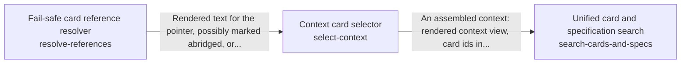

These are ESOI records rendered as a diagram (evolvable structure that optimizes intent). This page is generated from the solutions' outputs and the implementations' `uses_solution_ids` by `esoi diagram`; edit those records, not this page.

# Solution diagram: Selecting the context a planner reads

select-context chooses the cards, files and conversations a planner reads before it plans, so the right material is found however a request is worded. It follows the pointer of a card to the person's current notes and files through resolve-references. search-cards-and-specs ranks the cards of a run together with the specification records of a repository in one list, taking the cards from select-context.

An arrow runs from the solution that provides to the solution that builds on it; its label is what the provider outputs.

