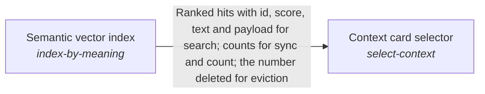

These are ESOI records rendered as a diagram (evolvable structure that optimizes intent). This page is generated from the solutions' outputs and the implementations' `uses_solution_ids` by `esoi diagram`; edit those records, not this page.

# Solution diagram: Selecting the context a planner reads

Context card selector chooses the cards, files and conversations a planner reads before it plans, so the right material is found however a request is worded. This area arises from the per_lane_assembly arm of Context choice, which takes Context card selector, Fail-safe card reference resolver, Unified card and specification search and Semantic vector index as typed seats, and the lane's configuration chooses which assembler runs. The Semantic vector index finds a card by what it means, not by its words. Fail-safe card reference resolver follows the pointer of a card to the person's current notes and files. Unified card and specification search ranks the cards of a run together with the specification records of a repository in one list.

An arrow runs from the solution that provides to the solution that builds on it; its label is what the provider outputs.

