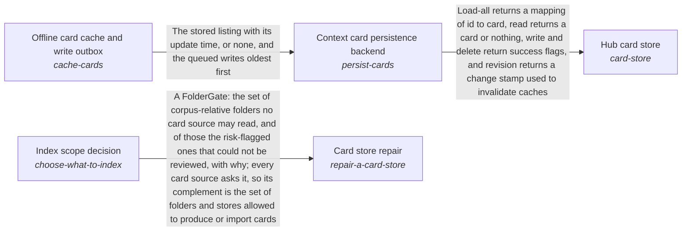

These are ESOI records rendered as a diagram (evolvable structure that optimizes intent). This page is generated from the solutions' outputs and the implementations' `uses_solution_ids` by `esoi diagram`; edit those records, not this page.

# Solution diagram: Subconscious

Subconscious recalls the cards that match a request through Hub card store. Hub card store keeps the cards through Context card persistence backend, and Context card persistence backend serves the last known listing while a backend is down with Offline card cache and write outbox. Card store repair decides which sources deserve a card by asking Index scope decision before it rewrites anything. The remaining parts of the area do not use one another in code, so they are grouped here by purpose, the care of a card store that stays current, proportionate and findable. Source-change staleness detector reports the cards that have drifted from their source file. Card store growth prevention keeps a store proportionate to its sources. Card categories and metadata gives each card its labels. QAR topic cards for a folder proposes the topic cards a lane indexes.

An arrow runs from the solution that provides to the solution that builds on it; its label is what the provider outputs.

