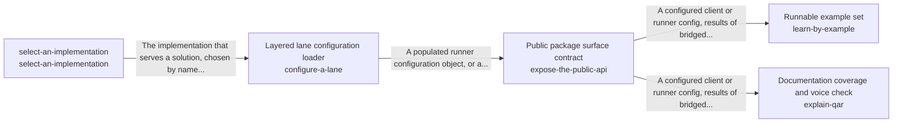

# Taking in requests from anywhere

A person or a program reaches the runner from wherever they work, by a message, a terminal, a live channel or the package itself, and is understood the same way.

*ESOI records of this intent (evolvable structure that optimizes intent), generated from the CSV files beside this page by `esoi readmes`. Edit the CSV files, not this page.*

This sub-intent arises as the implementation `take-in-the-world:ways_in` of its parent intent [`quest-ai-runner`](../../esoi/README.md). Opportunities: A runner is reached from many places and each has its own failure and cost, which the parent solution measures one by one and none together: a short chat message must not pay for a long run, an image has to be described before it can ground an answer, input that arrives while a run works must be heard at the next decision, a terminal session needs helper calls that cost a fraction of a cent, and a developer needs a package that installs and runs on an empty environment, learned from documents and examples that are kept true.

## How the solutions fit together

take-in-the-world lets a person or a program reach the runner from wherever they work and be understood the same way, and ways_in is its arm. route-a-message matches each message to the handling it needs, from a direct answer to a long run. describe-an-attachment turns an image the person attached into text that can ground the answer. feed-context-sources brings what changed in a work item since the last turn. receive-input-mid-run lets a person change direction or stop a run that is already working. operate-from-a-terminal runs the tools from the command line with predictable output and exit codes. assist-a-terminal-session makes the small model calls a terminal session needs. expose-the-public-api gives a program a stable package to import and configure. It hands over load_config, the front door that builds the lane's one configuration through configure-a-lane. explain-qar documents the package through expose-the-public-api so that a newcomer can learn it from complete documents. learn-by-example shows how to use the package through expose-the-public-api in small examples that run on an empty environment. configure-a-lane gives whoever runs a lane one configuration, built from its file and its environment in a fixed order, so every lane is set up the same way. It turns each selection the file or the environment names into the arm that runs through select-an-implementation.

## Diagram

An arrow runs from the solution that provides to the solution that builds on it; its label is what the provider outputs.

## Solutions at a glance

| Solution | Entry call | Selected implementation | Metric |
|---|---|---|---|
| `route-a-message` | `quest_ai_runner.run("route-a-message", 'Save a note that the launch moves to Friday.')` | `planner_route` | Routing correctness over the classification cases |
| `feed-context-sources` | `quest_ai_runner.run("feed-context-sources", {'quest_id': 'quest-id'})` | `quest_channels` | Update-offering correctness over synthetic quest channels |
| `receive-input-mid-run` | `quest_ai_runner.run("receive-input-mid-run", 'conversation-1')` | `in_memory` | Exactly-once mid-run delivery per run, and how fast it is seen |
| `expose-the-public-api` | `quest_ai_runner.run("expose-the-public-api", 'run')` | `package_front_doors` | Public surface conformance on fixture inputs |
| `learn-by-example` | no entry declared | `live_examples` | Example runnability on an empty environment |
| `configure-a-lane` | no entry declared | `qar_config` | Configuration precedence and validation correctness |
| `operate-from-a-terminal` | `quest_ai_runner.run("operate-from-a-terminal", ['--help'])` | `cli_commands` | Command-line parsing, refusal and output correctness |
| `explain-qar` | no entry declared | `shipped_docs` | Documentation coverage and voice conformance |
| `describe-an-attachment` | `quest_ai_runner.run("describe-an-attachment", ...)` | `vision_description` | Answer pass rate gained per image described |
| `assist-a-terminal-session` | `quest_ai_runner.run("assist-a-terminal-session", ...)` | `fast_model_helpers` | Correct terminal helper verdicts within the wait a person accepts |
| `select-an-implementation` | no entry declared | `live_resolver` | none yet |

## Problems and ideals

**Problems**

- `prob-reply-misses-the-account`: Replies state things that are not in the person's own account, or miss facts that are, because the AI answers from general knowledge, from the wrong slice of data, or invents a link or claim that no...
- `prob-follow-up-loses-thread`: A follow-up such as "and the other one?", or a message sent while the AI is still working, is treated as a fresh start, so the person has to restate what they just said.
- `prob-integration-is-trial-and-error`: A developer embedding the library cannot tell which names are stable, how to configure a lane, whether the examples still run, or where to look, so integration is trial and error.
- `prob-harness-weaker-than-a-coding-agent`: The same request is handled less capably through the chat than as a task sent to a coding agent: the chat's own loop is a partial agent harness, so it fails, stops early or asks again where the...

**Ideals**

- `ideal-unbroken-thread`, Unbroken Thread: A conversation carries what the person just said, wherever in time it appears.
- `ideal-trustworthy-interface`, Trustworthy Interface: What the documents say is true of the code, and a newcomer can start from them.

## Metrics and their leaders

- `metric-route-a-message`, Routing correctness over the classification cases: leader `single_prompt`, 52 of 54 cases
- `metric-feed-context-sources`, Update-offering correctness over synthetic quest channels: leader `quest_channels`, 20 of 20 cases
- `metric-receive-input-mid-run`, Exactly-once mid-run delivery per run, and how fast it is seen: leader `in_memory`, 13 of 13 cases
- `metric-expose-the-public-api`, Public surface conformance on fixture inputs: leader `live_surface`, 101 of 101 cases
- `metric-learn-by-example`, Example runnability on an empty environment: leader `live_examples`, 29 of 37 cases
- `metric-configure-a-lane`, Configuration precedence and validation correctness: leader `qar_config`, 36 of 36 cases
- `metric-operate-from-a-terminal`, Command-line parsing, refusal and output correctness: leader `cli_commands`, 42 of 42 cases
- `metric-explain-qar`, Documentation coverage and voice conformance: leader `shipped_docs`, 466 of 469 cases
- `metric-describe-an-attachment`, Answer pass rate gained per image described: leader `skip_images`, 2 of 10 cases
- `metric-assist-a-terminal-session`, Correct terminal helper verdicts within the wait a person accepts: leader `fast_model_helpers`, 30 of 32 cases
- and 1 more: all 11 are in [metrics](#metrics) of the full record below

## Where to go next

- Parent intent: [Grounded AI that advances people's goals](../../esoi/README.md)
- Repository: [top README](../../README.md)
- Records: [intent.csv](intent.csv), [problems.csv](problems.csv), [ideals.csv](ideals.csv), [solutions.csv](solutions.csv), [implementations.csv](implementations.csv), [metrics.csv](metrics.csv)
- Diagram page: [diagram.md](diagram.md)

---

## The full record

### Problems

- `prob-reply-misses-the-account`: Replies state things that are not in the person's own account, or miss facts that are, because the AI answers from general knowledge, from the wrong slice of data, or invents a link or claim that no source supports.
- `prob-follow-up-loses-thread`: A follow-up such as "and the other one?", or a message sent while the AI is still working, is treated as a fresh start, so the person has to restate what they just said.
- `prob-integration-is-trial-and-error`: A developer embedding the library cannot tell which names are stable, how to configure a lane, whether the examples still run, or where to look, so integration is trial and error.
- `prob-harness-weaker-than-a-coding-agent`: The same request is handled less capably through the chat than as a task sent to a coding agent: the chat's own loop is a partial agent harness, so it fails, stops early or asks again where the coding agent completes the work, while sending every request to the coding agent pays its slow, token-heavy context search each time.

### Ideals

- `ideal-unbroken-thread`, Unbroken Thread: A conversation carries what the person just said, wherever in time it appears.
- `ideal-trustworthy-interface`, Trustworthy Interface: What the documents say is true of the code, and a newcomer can start from them.

### Solutions

| Solution | Name | Selected | Metric |
|---|---|---|---|
| `route-a-message` | Cost-aware message router | planner_route | Routing correctness over the classification cases |
| `feed-context-sources` | Incremental context-update feed | quest_channels | Update-offering correctness over synthetic quest channels |
| `receive-input-mid-run` | Conversation-keyed mid-run input inbox | in_memory | Exactly-once mid-run delivery per run, and how fast it is seen |
| `expose-the-public-api` | Public package surface contract | package_front_doors | Public surface conformance on fixture inputs |
| `learn-by-example` | Runnable example set | live_examples | Example runnability on an empty environment |
| `configure-a-lane` | Layered lane configuration loader | qar_config | Configuration precedence and validation correctness |
| `operate-from-a-terminal` | Non-interactive command-line surface | cli_commands | Command-line parsing, refusal and output correctness |
| `explain-qar` | Documentation coverage and voice check | shipped_docs | Documentation coverage and voice conformance |
| `describe-an-attachment` | Image description for grounding | vision_description | Answer pass rate gained per image described |
| `assist-a-terminal-session` | Terminal helper calls | fast_model_helpers | Correct terminal helper verdicts within the wait a person accepts |
| `select-an-implementation` |  | live_resolver | none yet |

### Implementations

| Implementation | Name | Where | Sub-intent |
|---|---|---|---|
| `route-a-message:qar_planner` | Full planner decision | [evaluation/components/classification/impls/qar_planner.py](../../evaluation/components/classification/impls/qar_planner.py) |  |
| `route-a-message:keyword_rules` | Keyword rules floor | [evaluation/components/classification/impls/keyword_rules.py](../../evaluation/components/classification/impls/keyword_rules.py) |  |
| `feed-context-sources:base` | Source interface with shared channel flags | [quest_ai_runner/runner/context_sources_base.py](../runner/context_sources_base.py) |  |
| `feed-context-sources:update_engine` | Live engine over fake quest channels | [evaluation/components/feed_context_sources/impls/update_engine.py](../../evaluation/components/feed_context_sources/impls/update_engine.py) |  |
| `receive-input-mid-run:in_memory` | In-memory thread-safe inbox | [quest_ai_runner/core/inbox.py](../core/inbox.py) |  |
| `expose-the-public-api:__init__` | Package root with front doors | [quest_ai_runner/__init__.py](../__init__.py) |  |
| `expose-the-public-api:async_bridge` | Long-lived background loop bridge | [quest_ai_runner/take_in_the_world/async_bridge.py](async_bridge.py) |  |
| `expose-the-public-api:live_surface` | Live package-surface driver | [evaluation/components/expose_the_public_api/impls/live_surface.py](../../evaluation/components/expose_the_public_api/impls/live_surface.py) |  |
| `learn-by-example:minimal_lane` | Minimal lane example | [examples/minimal_lane.py](../../examples/minimal_lane.py) |  |
| `learn-by-example:custom_consumer` | Custom consumer configuration example | [examples/custom_consumer.py](../../examples/custom_consumer.py) |  |
| `learn-by-example:live_examples` | Example check harness | [evaluation/components/learn_by_example/impls/live_examples.py](../../evaluation/components/learn_by_example/impls/live_examples.py) |  |
| `configure-a-lane:config` | Configuration dataclass and file entry point | [quest_ai_runner/config.py](../config.py) |  |
| `configure-a-lane:config_file` | Strict TOML file loader | [quest_ai_runner/config_file.py](../config_file.py) |  |
| `configure-a-lane:config_environment` | Environment and env-file layering | [quest_ai_runner/config_environment.py](../config_environment.py) |  |
| `configure-a-lane:config_core_settings` | Environment-backed tuning settings | [quest_ai_runner/config_core_settings.py](../config_core_settings.py) |  |
| `configure-a-lane:runtime_settings` | Injected core settings holder | [quest_ai_runner/core/runtime_settings.py](../core/runtime_settings.py) |  |
| `configure-a-lane:qar_config` | Layered configuration evaluation arm | [evaluation/components/configure_a_lane/impls/qar_config.py](../../evaluation/components/configure_a_lane/impls/qar_config.py) |  |
| `operate-from-a-terminal:cli` | Command dispatcher | [quest_ai_runner/cli.py](../cli.py) |  |
| `operate-from-a-terminal:cli_parser` | Declarative argument tree | [quest_ai_runner/cli_parser.py](../cli_parser.py) |  |
| `operate-from-a-terminal:cli_quest` | Quest API subcommands | [quest_ai_runner/cli_quest.py](../cli_quest.py) |  |
| `operate-from-a-terminal:store_cli` | Card-store maintenance commands | [quest_ai_runner/store_cli.py](../store_cli.py) |  |
| `operate-from-a-terminal:__main__` | Tool catalog shell entry | [quest_ai_runner/tools/__main__.py](../tools/__main__.py) |  |
| `operate-from-a-terminal:qar_main` | Real-entry-point evaluation arm | [evaluation/components/operate_from_a_terminal/impls/qar_main.py](../../evaluation/components/operate_from_a_terminal/impls/qar_main.py) |  |
| `explain-qar:README.md` | Documentation index | [docs/README.md](../../docs/README.md) |  |
| `explain-qar:shipped_docs` | Shipped-documents evaluation arm | [evaluation/components/explain_qar/impls/shipped_docs.py](../../evaluation/components/explain_qar/impls/shipped_docs.py) |  |
| `describe-an-attachment:vision_description` | One vision-model call per image (today) | [quest_ai_runner/core/attachments.py](../core/attachments.py) |  |
| `describe-an-attachment:skip_images` | No description, the image is named only (floor, proposed) |  |  |
| `assist-a-terminal-session:fast_model_helpers` | Fast-tier model calls in the terminal (today) | [quest_ai_runner/cli_config.py](../cli_config.py) |  |
| `assist-a-terminal-session:rules_only` | Rules only, no model call (floor, proposed) |  |  |
| `route-a-message:planner_route` | The loop planner decides the route | [quest_ai_runner/message_routing.py](../message_routing.py) |  |
| `feed-context-sources:quest_channels` | The update engine over its built-in channels | [quest_ai_runner/runner/context_updates.py](../runner/context_updates.py) |  |
| `operate-from-a-terminal:cli_commands` | The command dispatcher run in process | [quest_ai_runner/area_take_in_the_world.py](../area_take_in_the_world.py) |  |
| `expose-the-public-api:package_front_doors` | The names in the package __all__ | [quest_ai_runner/area_take_in_the_world.py](../area_take_in_the_world.py) |  |
| `select-an-implementation:resolve` |  | [quest_ai_runner/core/resolve.py](../core/resolve.py) |  |
| `select-an-implementation:live_resolver` |  | [evaluation/components/select_an_implementation/impls/live_resolver.py](../../evaluation/components/select_an_implementation/impls/live_resolver.py) |  |

### Metrics

- `metric-route-a-message`, Routing correctness over the classification cases: `esoi run classification --impl qar_planner`
- `metric-feed-context-sources`, Update-offering correctness over synthetic quest channels: `esoi run feed_context_sources --impl update_engine`
- `metric-receive-input-mid-run`, Exactly-once mid-run delivery per run, and how fast it is seen: `esoi run receive_input_mid_run --impl in_memory`
- `metric-expose-the-public-api`, Public surface conformance on fixture inputs: `esoi run expose_the_public_api --impl live_surface`
- `metric-learn-by-example`, Example runnability on an empty environment: `esoi run learn_by_example --impl live_examples`
- `metric-configure-a-lane`, Configuration precedence and validation correctness: `esoi run configure_a_lane --impl qar_config`
- `metric-operate-from-a-terminal`, Command-line parsing, refusal and output correctness: `esoi run operate_from_a_terminal --impl qar_main`
- `metric-explain-qar`, Documentation coverage and voice conformance: `esoi run explain_qar --impl shipped_docs`
- `metric-describe-an-attachment`, Answer pass rate gained per image described: `esoi run describe_an_attachment --impl vision_description`
- `metric-assist-a-terminal-session`, Correct terminal helper verdicts within the wait a person accepts: `esoi run assist_a_terminal_session --impl fast_model_helpers_live; esoi run assist_a_terminal_session --impl fast_model_helpers`
- `metric-select-an-implementation`, : `esoi run select_an_implementation --impl live_resolver`
