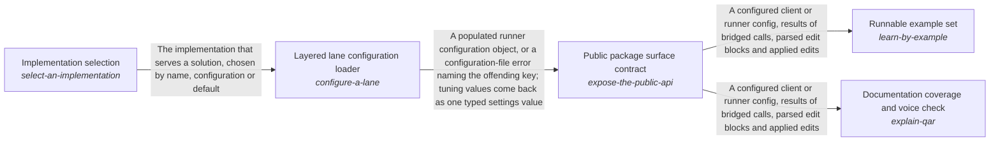

These are ESOI records rendered as a diagram (evolvable structure that optimizes intent). This page is generated from the solutions' outputs and the implementations' `uses_solution_ids` by `esoi diagram`; edit those records, not this page.

# Solution diagram: Taking in requests from anywhere

Request intake lets a person or a program reach the runner from wherever they work and be understood the same way, and ways_in is its arm. Cost-aware message router matches each message to the handling it needs, from a direct answer to a long run. Image description for grounding turns an image the person attached into text that can ground the answer. Incremental context-update feed brings what changed in a work item since the last turn. Conversation-keyed mid-run input inbox lets a person change direction or stop a run that is already working. Non-interactive command-line surface runs the tools from the command line with predictable output and exit codes. Terminal helper calls makes the small model calls a terminal session needs. Public package surface contract gives a program a stable package to import and configure. It hands over load_config, the front door that builds the lane's one configuration through Layered lane configuration loader. Documentation coverage and voice check documents the package through Public package surface contract so that a newcomer can learn it from complete documents. Runnable example set shows how to use the package through Public package surface contract in small examples that run on an empty environment. Layered lane configuration loader gives whoever runs a lane one configuration, built from its file and its environment in a fixed order, so every lane is set up the same way. It turns each selection the file or the environment names into the arm that runs through Implementation selection.

An arrow runs from the solution that provides to the solution that builds on it; its label is what the provider outputs.

