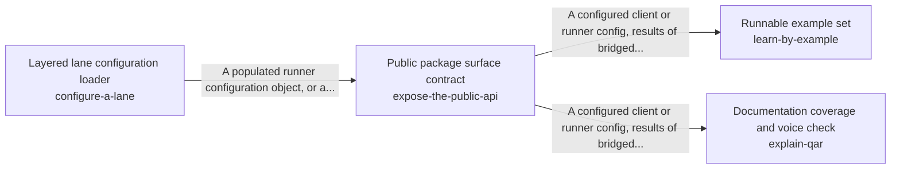

These are ESOI records rendered as a diagram (evolvable structure that optimizes intent). This page is generated from the solutions' outputs and the implementations' `uses_solution_ids` by `esoi diagram`; edit those records, not this page.

# Solution diagram: Taking in requests from anywhere

take-in-the-world lets a person or a program reach the runner from wherever they work and be understood the same way, and ways_in is its arm. route-a-message matches each message to the handling it needs, from a direct answer to a long run. describe-an-attachment turns an image the person attached into text that can ground the answer. feed-context-sources brings what changed in a work item since the last turn. receive-input-mid-run lets a person change direction or stop a run that is already working. operate-from-a-terminal runs the tools from the command line with predictable output and exit codes. assist-a-terminal-session makes the small model calls a terminal session needs. expose-the-public-api gives a program a stable package to import and configure. It hands over load_config, the front door that builds the lane's one configuration through configure-a-lane. explain-qar documents the package through expose-the-public-api so that a newcomer can learn it from complete documents. learn-by-example shows how to use the package through expose-the-public-api in small examples that run on an empty environment. configure-a-lane gives whoever runs a lane one configuration, built from its file and its environment in a fixed order, so every lane is set up the same way.

An arrow runs from the solution that provides to the solution that builds on it; its label is what the provider outputs.

