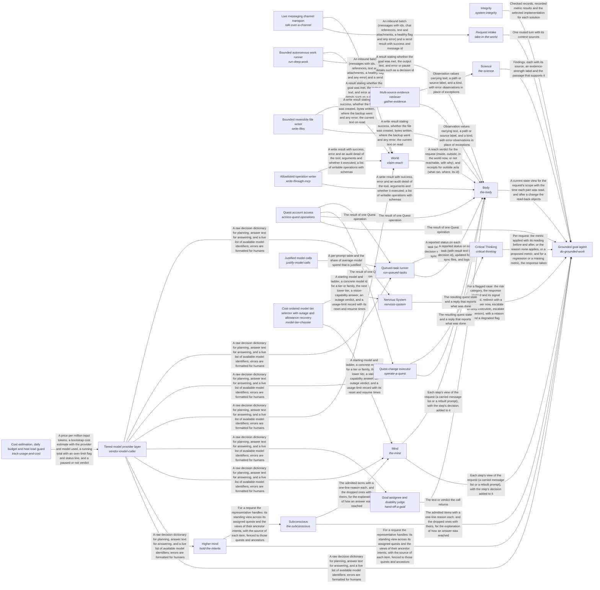
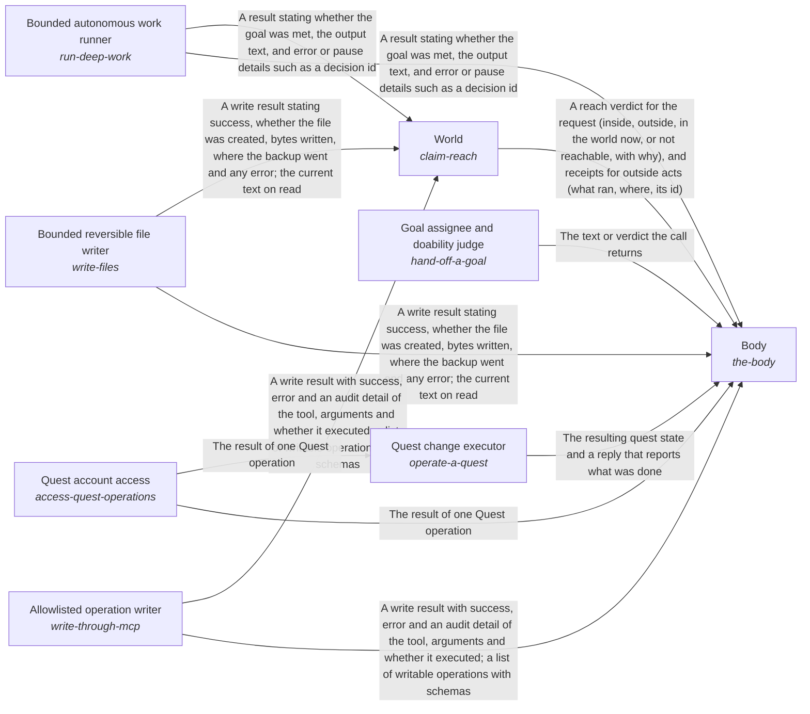

# the_body

*ESOI records kept beside the code in `quest_ai_runner/the_body`, generated from the CSV files in this folder by `esoi readmes`. Edit the CSV files, not this page.*

Goals keep moving between a person's sessions, because the work they delegated gets done to the standard they wrote, and every answer and action rests on the person's own goals, material and preferences, and never on another person's.

These are the solutions of [Grounded AI that advances people's goals](../../esoi/README.md).

## How the solutions fit together

quest-ai-runner turns a person's request or queued task into grounded work in one flow, and the Grounded goal agent is that flow. It takes the request in through Request intake, says what the person is working toward through Higher mind and chooses the context the request needs through Context choice. It reasons step by step through Mind, acts on the account through Body and Quest account access, and answers questions beyond the person's own material through Science. It has every run watched through Nervous System and holds the work to the metric that serves it through Critical Thinking. It asks the model through the Tiered model provider layer and stays comparable by metric through Integrity. It recalls what a request needs through Subconscious. Subconscious recalls the cards that match a request through Hub card store. Tiered model provider layer accounts for every call through Cost estimation, daily budget and host load guard. Mind starts each step on the model tier it picks through Cost-ordered model tier selector with outage and allowance recovery. Nervous System has the model oversee a run through Tiered model provider layer. Queued-task runner claims, runs and reports a queued task, asking the model through Tiered model provider layer and working in the account through Quest account access. It writes each prompt as a registered spec with an owner and a metric through Justified model calls. Body reads and changes the quest through Context card persistence backend, Quest account access and Queued-task runner. Higher mind saves what it learned through Context card persistence backend. Request intake hears from a live channel through Live messaging channel transport. Body changes the quest as the person asks through Quest change executor and writes files inside one folder through Bounded reversible file writer. Body reads from the sources the person's work lives in through Multi-source evidence retriever and hands a new goal to the right owner through Goal assignee and doability judge. Body does heavy work through Bounded autonomous work runner, makes one named change on an outside tool server through Allowlisted operation writer and claims only the reach that World grants. Quest change executor reaches the account through Quest account access and decides through Tiered model provider layer. Goal assignee and doability judge asks the model whether a goal is doable through Tiered model provider layer. World reaches a person through Live messaging channel transport and judges through Tiered model provider layer.

## Overview diagram

An arrow runs from the solution that provides to the solution that builds on it; its label is what the provider outputs.

## Quest change executor (`operate-a-quest`)

Keeps a person's quest (goals, habits, outcomes, notes and experiments) current as they ask, from a single edit to a multi-step change.

- Entry call: `quest_ai_runner.run("operate-a-quest", 'Add a goal to ship the launch note by Friday')`
- Selected implementation: Planner-only orchestration (`qar_orchestrator`)
- Metric: Final quest state against the request over the quest operation cases
- Implemented by: [`evaluation/components/quest_ops/impls/direct_tool_call.py`](../../evaluation/components/quest_ops/impls/direct_tool_call.py), [`quest_ai_runner/the_body/area_body.py`](area_body.py), [`quest_ai_runner/the_body/hands/quest_operations/__init__.py`](hands/quest_operations/__init__.py), [`quest_ai_runner/the_body/hands/quest_operations/action_catalog.py`](hands/quest_operations/action_catalog.py), [`quest_ai_runner/the_body/hands/quest_operations/interface.py`](hands/quest_operations/interface.py), [`quest_ai_runner/the_body/hands/quest_operations/requested_action.py`](hands/quest_operations/requested_action.py), [`quest_ai_runner/the_body/hands/quest_operations/run_operations.py`](hands/quest_operations/run_operations.py), [`quest_ai_runner/the_body/hands/quest_operations/tools_quest_experiments.py`](hands/quest_operations/tools_quest_experiments.py) and 27 more

## Bounded autonomous work runner (`run-deep-work`)

Lets a person hand off open-ended or heavy work and get back a checked result within a fixed turn and cost bound.

- Entry call: no entry declared
- Selected implementation: Subprocess goal runner (`subprocess`)
- Metric: Outcome reporting correctness across deep runners, Goal loop outcomes against the done-standard, Deep worker launch settings ranked by cost per goal met
- Implemented by: [`evaluation/components/deep_run/impls/goal_contract.py`](../../evaluation/components/deep_run/impls/goal_contract.py), [`evaluation/components/deep_runner/impls/acp_runner.py`](../../evaluation/components/deep_runner/impls/acp_runner.py), [`evaluation/components/deep_runner/impls/subprocess_runner.py`](../../evaluation/components/deep_runner/impls/subprocess_runner.py), [`quest_ai_runner/the_body/configuration/__init__.py`](configuration/__init__.py), [`quest_ai_runner/the_body/configuration/acp_deep_runner_config.py`](configuration/acp_deep_runner_config.py), [`quest_ai_runner/the_body/configuration/card_store_settings.py`](configuration/card_store_settings.py), [`quest_ai_runner/the_body/configuration/cli_config.py`](configuration/cli_config.py), [`quest_ai_runner/the_body/configuration/config.py`](configuration/config.py) and 66 more

## Bounded reversible file writer (`write-files`)

Help an automated agent make the file changes a person asked for, inside one folder, without an unrecoverable mistake.

- Entry call: `quest_ai_runner.run("write-files", 'NOTES.md')`
- Selected implementation: Contained backed-up writer (`files`)
- Metric: Write boundary and reversibility over the scratch-tree cases
- Implemented by: [`evaluation/components/write_files/impls/bounded_writer.py`](../../evaluation/components/write_files/impls/bounded_writer.py), [`quest_ai_runner/the_body/configuration/__init__.py`](configuration/__init__.py), [`quest_ai_runner/the_body/configuration/acp_deep_runner_config.py`](configuration/acp_deep_runner_config.py), [`quest_ai_runner/the_body/configuration/card_store_settings.py`](configuration/card_store_settings.py), [`quest_ai_runner/the_body/configuration/cli_config.py`](configuration/cli_config.py), [`quest_ai_runner/the_body/configuration/config.py`](configuration/config.py), [`quest_ai_runner/the_body/configuration/config_assembler.py`](configuration/config_assembler.py), [`quest_ai_runner/the_body/configuration/config_context_index.py`](configuration/config_context_index.py) and 58 more

## Allowlisted operation writer (`write-through-mcp`)

Carry out one named change on an external tool server, and only when an explicit allowlist permits that operation.

- Entry call: no entry declared
- Selected implementation: MCP operation writer (`mcp`)
- Metric: Allowlist enforcement and exactly-once execution
- Implemented by: [`evaluation/components/write_through_mcp/impls/allowlist_writer.py`](../../evaluation/components/write_through_mcp/impls/allowlist_writer.py), [`quest_ai_runner/the_body/configuration/__init__.py`](configuration/__init__.py), [`quest_ai_runner/the_body/configuration/acp_deep_runner_config.py`](configuration/acp_deep_runner_config.py), [`quest_ai_runner/the_body/configuration/card_store_settings.py`](configuration/card_store_settings.py), [`quest_ai_runner/the_body/configuration/cli_config.py`](configuration/cli_config.py), [`quest_ai_runner/the_body/configuration/config.py`](configuration/config.py), [`quest_ai_runner/the_body/configuration/config_assembler.py`](configuration/config_assembler.py), [`quest_ai_runner/the_body/configuration/config_context_index.py`](configuration/config_context_index.py) and 58 more

## World (`claim-reach`)

Gets real work done in the world for people, at the best balance of results, cost and safety, and lets them trust what the AI says it can do and did.

- Entry call: `quest_ai_runner.run("claim-reach", 'Send the launch note to the whole team')`
- Selected implementation: Coding agent, reach described in the prompt (today) (`coding_agent_prompt_reach`)
- Metric: Combined world score
- Implemented by: [`evaluation/components/act_as_the_body/__init__.py`](../../evaluation/components/act_as_the_body/__init__.py), [`evaluation/components/act_as_the_body/broken/__init__.py`](../../evaluation/components/act_as_the_body/broken/__init__.py), [`evaluation/components/act_as_the_body/broken/blind_replay.py`](../../evaluation/components/act_as_the_body/broken/blind_replay.py), [`evaluation/components/act_as_the_body/cases.json`](../../evaluation/components/act_as_the_body/cases.json), [`evaluation/components/act_as_the_body/impls/__init__.py`](../../evaluation/components/act_as_the_body/impls/__init__.py), [`evaluation/components/act_as_the_body/impls/card_and_reads.py`](../../evaluation/components/act_as_the_body/impls/card_and_reads.py), [`evaluation/components/act_as_the_body/interface.py`](../../evaluation/components/act_as_the_body/interface.py), [`evaluation/components/act_as_the_body/score.py`](../../evaluation/components/act_as_the_body/score.py) and 931 more

## Goal assignee and doability judge (`hand-off-a-goal`)

Gives a person the verdicts on who a new goal belongs to and whether an AI representative can take it over at a cost and delay that its metric accepts.

- Entry call: `quest_ai_runner.run("hand-off-a-goal", ...)`
- Selected implementation: Two small model verdicts when a goal is created (today) (`model_judge`)
- Metric: Hand-offs a person keeps per unit of cost and time
- Implemented by: [`evaluation/components/hand_off_a_goal/impls/creator_keeps_it.py`](../../evaluation/components/hand_off_a_goal/impls/creator_keeps_it.py), [`quest_ai_runner/the_body/area_body.py`](area_body.py), [`quest_ai_runner/the_body/internal_context/quest/__init__.py`](internal_context/quest/__init__.py), [`quest_ai_runner/the_body/internal_context/quest/cached_db_adapter.py`](internal_context/quest/cached_db_adapter.py), [`quest_ai_runner/the_body/internal_context/quest/interface.py`](internal_context/quest/interface.py), [`quest_ai_runner/the_body/internal_context/quest/quest_retrieval_adapter.py`](internal_context/quest/quest_retrieval_adapter.py), [`quest_ai_runner/the_intelligence/critical_thinking/esoi_application/__init__.py`](../the_intelligence/critical_thinking/esoi_application/__init__.py), [`quest_ai_runner/the_intelligence/critical_thinking/esoi_application/autopilot_esoi.py`](../the_intelligence/critical_thinking/esoi_application/autopilot_esoi.py) and 35 more

## Body (`the-body`)

Lets a person trust what the AI says about their own account and about what it changed in it.

- Entry call: `quest_ai_runner.run("the-body", '')`
- Selected implementation: Managed quest card plus optional live reads (today) (`card_and_reads`)
- Metric: Account-state consistency across scripted sessions
- Implemented by: [`quest_ai_runner/the_body/area_body.py`](area_body.py), [`quest_ai_runner/the_body/internal_context/quest/__init__.py`](internal_context/quest/__init__.py), [`quest_ai_runner/the_body/internal_context/quest/cached_db_adapter.py`](internal_context/quest/cached_db_adapter.py), [`quest_ai_runner/the_body/internal_context/quest/interface.py`](internal_context/quest/interface.py), [`quest_ai_runner/the_body/internal_context/quest/quest_retrieval_adapter.py`](internal_context/quest/quest_retrieval_adapter.py), [`quest_ai_runner/the_intelligence/critical_thinking/goal_completion/__init__.py`](../the_intelligence/critical_thinking/goal_completion/__init__.py), [`quest_ai_runner/the_intelligence/critical_thinking/goal_completion/interface.py`](../the_intelligence/critical_thinking/goal_completion/interface.py), [`quest_ai_runner/the_intelligence/critical_thinking/goal_completion/orchestrator_judges.py`](../the_intelligence/critical_thinking/goal_completion/orchestrator_judges.py) and 82 more

## Quest account access (`access-quest-operations`)

Let the runner work in the person's own Quest account, so every read and change goes through one client.

- Entry call: `quest_ai_runner.run("access-quest-operations", 'quest-id')`
- Selected implementation: Quest HTTP client from the environment (`quest_client`)
- Metric: Parity of Quest operations across access points
- Implemented by: [`quest_ai_runner/the_body/area_body.py`](area_body.py), [`quest_ai_runner/the_body/internal_context/quest/__init__.py`](internal_context/quest/__init__.py), [`quest_ai_runner/the_body/internal_context/quest/cached_db_adapter.py`](internal_context/quest/cached_db_adapter.py), [`quest_ai_runner/the_body/internal_context/quest/interface.py`](internal_context/quest/interface.py), [`quest_ai_runner/the_body/internal_context/quest/quest_retrieval_adapter.py`](internal_context/quest/quest_retrieval_adapter.py)

## Diagram

An arrow runs from the solution that provides to the solution that builds on it; its label is what the provider outputs.

## Implementations

| Implementation | Handle | Code | Selected |
|---|---|---|---|
| Subprocess goal runner | `run-deep-work:subprocess` | [`quest_ai_runner/the_intelligence/mind/delegation/goal_runner.py`](../the_intelligence/mind/delegation/goal_runner.py) | selected |
| Coding agent with the host reach summary and reach judge (built, off by default) | `claim-reach:coding_agent_reach_judge` | [`quest_ai_runner/the_intelligence/mind/planner/reach_judge.py`](../the_intelligence/mind/planner/reach_judge.py) |  |
| Coding agent with one declared inventory and receipts (proposed) | `claim-reach:coding_agent_declared_inventory` | no code yet |  |
| Best open-source agent harness by the combined metric, with declared inventory (proposed) | `claim-reach:best_open_source_harness` | no code yet |  |
| Offline lifecycle harness | `run-queued-tasks:qar_runner` | [`quest_ai_runner/the_body/area_body.py`](area_body.py) | selected |
| Managed quest card plus optional live reads (today) | `the-body:card_and_reads` | [`quest_ai_runner/the_body/area_body.py`](area_body.py) | selected |
| Quest HTTP client from the environment | `access-quest-operations:quest_client` | [`quest_ai_runner/the_body/area_body.py`](area_body.py) | selected |
| Planner-only orchestration | `operate-a-quest:qar_orchestrator` | [`quest_ai_runner/the_body/area_body.py`](area_body.py) | selected |
| Coding agent, reach described in the prompt (today) | `claim-reach:coding_agent_prompt_reach` | [`quest_ai_runner/the_body/area_body.py`](area_body.py) | selected |
| Two small model verdicts when a goal is created (today) | `hand-off-a-goal:model_judge` | [`quest_ai_runner/the_body/area_body.py`](area_body.py) | selected |

## Metrics

- Final quest state against the request over the quest operation cases (`metric-operate-a-quest`): leader `orchestrator_pre_route`, 22 of 22 cases
- Outcome reporting correctness across deep runners (`metric-run-deep-work`): leader `acp_runner`, 11 of 11 cases
- Write boundary and reversibility over the scratch-tree cases (`metric-write-files`): leader `bounded_writer`, 20 of 20 cases
- Allowlist enforcement and exactly-once execution (`metric-write-through-mcp`): leader `allowlist_writer`, 15 of 15 cases
- Combined world score (`metric-claim-reach`): leader `scripted_ideal`, 12 of 12 cases
- Hand-offs a person keeps per unit of cost and time (`metric-hand-off-a-goal`): leader `model_judge`, 17 of 18 cases
- Goal loop outcomes against the done-standard (`metric-goal-met-by-evidence-and-coverage`): leader `goal_contract`, 53 of 53 cases
- Deep worker launch settings ranked by cost per goal met (`metric-harness-context-subagents-recursion-ranked`): leader `acp_runner`, 11 of 11 cases
- Account-state consistency across scripted sessions (`metric-act-as-the-body`): leader `card_and_reads`, 8 of 9 cases
- Parity of Quest operations across access points (`metric-quest-operations-parity`)

## Problems

- Contradictory Account State (`prob-account-state-contradicts`): What the AI says about the person's own account (which quests exist, what changed, whether a change ran) is re-derived each turn from whatever slice it read, and a change it made is not read back, so within one session it can report the same state two ways, repeat a change it already made, or propose again what it said was done.

## Ideals

- Consistent Account State (`ideal-consistent-account-state`): What the AI says about the person's own account is true of the account when it says it, every time in a session.

## Where to go next

- Up: [quest_ai_runner](../README.md)
- Intent: [Grounded AI that advances people's goals](../../esoi/README.md)
- Down: [quest_ai_runner/the_body/configuration](configuration/README.md)
- Down: [quest_ai_runner/the_body/host](host/README.md)
- Down: [quest_ai_runner/the_body/internal_context/quest](internal_context/quest/README.md)
- Repository: [top README](../../README.md)
