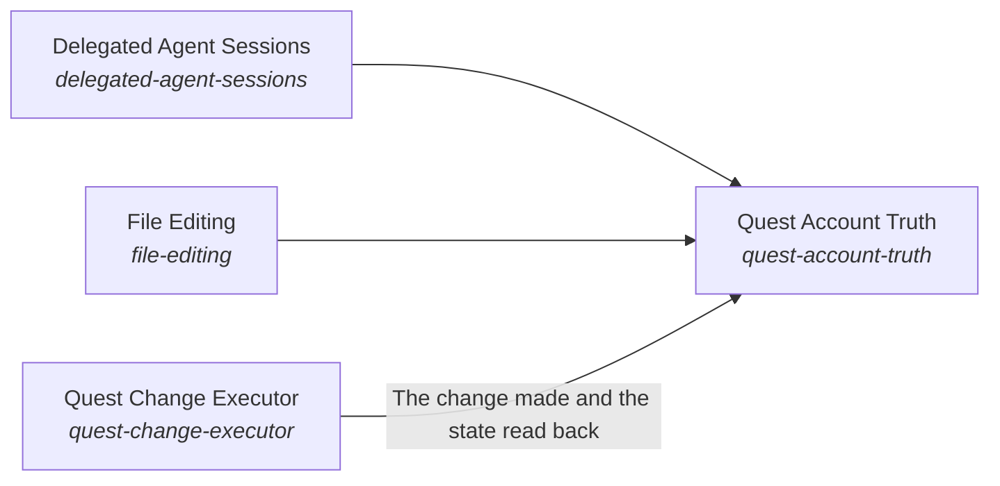

# Quest Body

Quest is the AI's body.

*ESOI records of this intent (evolvable structure that optimizes intent), generated from the CSV files beside this page by `esoi readmes`. Edit the CSV files, not this page.*

This sub-intent arises as the implementation `quest-body:quest_client` of its parent intent [`quest-ai-runner`](../../esoi/README.md). Opportunities: A person's Quest data and the tools around it change for reasons of their own, so the one declared place where that data lives lets every other part stay unaware of how Quest stores it.

## How the solutions fit together

Quest Body is the form of the assistant and the Quest data that belongs to the person. Quest Body reads and writes Quest only through one client and declares the research search the host offers. Quest Context gathers what the person's own quests, notes, decisions and teammates say, and keeps it inside the person's scope. Quest Change Executor changes a quest exactly as the person asked, through Delegated Agent Sessions and File Editing when the work is more than one step. Quest Account Truth makes what the assistant says about an account the account as it is now.

## Diagram

An arrow runs from the solution that provides to the solution that builds on it; its label is what the provider outputs.

## Solutions at a glance

| Solution | Handle | Entry call | Selected implementation | Metric |
|---|---|---|---|---|
| Delegated Agent Sessions | `delegated-agent-sessions` | `quest_ai_runner.run("delegated-agent-sessions", ...)` | Subprocess goal runner (`subprocess`) | Outcome reporting correctness across deep runners, Goal loop outcomes against the done-standard, Deep worker launch settings ranked by cost per goal met, Stop-or-continue verdict accuracy with false stops counted apart |
| File Editing | `file-editing` | `quest_ai_runner.run("file-editing", 'NOTES.md')` | Contained backed-up writer (`files`) | Write boundary and reversibility over the scratch-tree cases |
| Quest Account Truth | `quest-account-truth` | `quest_ai_runner.run("quest-account-truth", '')` | Managed quest card plus optional live reads (today) (`card_and_reads`) | Account-state consistency across scripted sessions |
| Quest Change Executor | `quest-change-executor` | `quest_ai_runner.run("quest-change-executor", 'Add a goal to ship the launch note by Friday')` | Planner-only orchestration (`qar_orchestrator`) | Final quest state against the request over the quest operation cases, Allowlist enforcement and exactly-once execution |

## Solutions from a library

- [Delegated Agent Sessions](https://github.com/SpiritualData/ai-hub-of-hubs-structure/hubofhubs/the_world/tools/README.md) (`delegated-agent-sessions`): Hands open-ended work to an agent that runs in its own session and reports back. Adopted from the library `hub`.
- [File Editing](https://github.com/SpiritualData/ai-hub-of-hubs-structure/hubofhubs/the_world/tools/README.md) (`file-editing`): Changes a file by instruction and reports what changed. Adopted from the library `hub`.
- [Response Quality](https://github.com/SpiritualData/ai-hub-of-hubs-structure/hubofhubs/the_intelligence/critical_thinking/README.md) (`quest-account-truth`): Judges a response against a quality profile: a named set of criteria with weights and target values. Specializes the library `hub`.
- [Connected System Operations](https://github.com/SpiritualData/ai-hub-of-hubs-structure/hubofhubs/the_world/tools/README.md) (`quest-change-executor`): Calls an operation of a connected system, such as a write through an MCP server. Specializes the library `hub`.

## Problems and ideals

**Problems**

- Contradictory Account State (`prob-account-state-contradicts`): What the AI says about the person's own account (which quests exist, what changed, whether a change ran) is re-derived each turn from whatever slice it read, and a change it made is not read back, so within one session it can report the same state two ways, repeat a change it already made, or propose again what it said was done.
- Unrequested Or Partial Changes (`prob-unrequested-or-partial-changes`): A request to change a quest leads to changes that were not asked for, to only part of what was asked, or to the same change made twice.

**Ideals**

- Consistent Account State (`ideal-consistent-account-state`): What the AI says about the person's own account is true of the account when it says it, every time in a session.
- Exact Change (`ideal-exact-change`): The final state matches the request: everything asked, nothing else, once.

## Metrics and their leaders

- Final quest state against the request over the quest operation cases (`metric-operate-a-quest`): leader `orchestrator_pre_route`, 22 of 22 cases
- Outcome reporting correctness across deep runners (`metric-run-deep-work`): leader `acp_runner`, 11 of 11 cases
- Write boundary and reversibility over the scratch-tree cases (`metric-write-files`): leader `bounded_writer`, 20 of 20 cases
- Allowlist enforcement and exactly-once execution (`metric-write-through-mcp`): leader `allowlist_writer`, 15 of 15 cases
- Hand-offs a person keeps per unit of cost and time (`metric-hand-off-a-goal`): leader `model_judge`, 17 of 18 cases
- Goal loop outcomes against the done-standard (`metric-goal-met-by-evidence-and-coverage`): leader `goal_contract`, 53 of 53 cases
- Deep worker launch settings ranked by cost per goal met (`metric-harness-context-subagents-recursion-ranked`): leader `acp_runner`, 11 of 11 cases
- Account-state consistency across scripted sessions (`metric-act-as-the-body`): leader `card_and_reads`, 8 of 9 cases

## Where to go next

- Sub-intent: [Quest Account Truth](internal_context/README.md) (What the AI says about a person's account is the account as it is now.)
- Parent intent: [Quest AI Runner](../../esoi/README.md)
- Repository: [top README](../../README.md)
- Records beside the code: [quest_ai_runner/the_body/configuration](configuration/README.md), [quest_ai_runner/the_body/host](host/README.md)
- Records: [intent.csv](intent.csv), [problems.csv](problems.csv), [ideals.csv](ideals.csv), [solutions.csv](solutions.csv), [implementations.csv](implementations.csv), [metrics.csv](metrics.csv)
- Diagram page: [diagram.md](diagram.md)

---

## The full record

### Problems

- Contradictory Account State (`prob-account-state-contradicts`): What the AI says about the person's own account (which quests exist, what changed, whether a change ran) is re-derived each turn from whatever slice it read, and a change it made is not read back, so within one session it can report the same state two ways, repeat a change it already made, or propose again what it said was done.
- Unrequested Or Partial Changes (`prob-unrequested-or-partial-changes`): A request to change a quest leads to changes that were not asked for, to only part of what was asked, or to the same change made twice.

### Ideals

- Consistent Account State (`ideal-consistent-account-state`): What the AI says about the person's own account is true of the account when it says it, every time in a session.
- Exact Change (`ideal-exact-change`): The final state matches the request: everything asked, nothing else, once.

### Solutions

| Solution | Handle | Selected | Metric |
|---|---|---|---|
| Delegated Agent Sessions | `delegated-agent-sessions` | Subprocess goal runner (`subprocess`) | Outcome reporting correctness across deep runners, Goal loop outcomes against the done-standard, Deep worker launch settings ranked by cost per goal met, Stop-or-continue verdict accuracy with false stops counted apart |
| File Editing | `file-editing` | Contained backed-up writer (`files`) | Write boundary and reversibility over the scratch-tree cases |
| Quest Account Truth | `quest-account-truth` | Managed quest card plus optional live reads (today) (`card_and_reads`) | Account-state consistency across scripted sessions |
| Quest Change Executor | `quest-change-executor` | Planner-only orchestration (`qar_orchestrator`) | Final quest state against the request over the quest operation cases, Allowlist enforcement and exactly-once execution |

### Implementations

| Implementation | Handle | Where | Sub-intent |
|---|---|---|---|
| Subprocess goal runner | `delegated-agent-sessions:subprocess` | [quest_ai_runner/the_intelligence/mind/delegation/goal_runner.py](../the_intelligence/mind/delegation/goal_runner.py) |  |
| Coding agent with the host reach summary and reach judge (built, off by default) | `the-tools:coding_agent_reach_judge` | [quest_ai_runner/the_intelligence/mind/planner/reach_judge.py](../the_intelligence/mind/planner/reach_judge.py) |  |
| Offline lifecycle harness | `quest-requests:qar_runner` | [quest_ai_runner/the_body/area_body.py](area_body.py) |  |
| Managed quest card plus optional live reads (today) | `quest-account-truth:card_and_reads` | [quest_ai_runner/the_body/area_body.py](area_body.py) | [internal_context](internal_context/README.md) |
| Planner-only orchestration | `quest-change-executor:qar_orchestrator` | [quest_ai_runner/the_body/area_body.py](area_body.py) |  |
| Coding agent, reach described in the prompt (today) | `the-tools:coding_agent_prompt_reach` | [quest_ai_runner/the_body/area_body.py](area_body.py) |  |
| Two small model verdicts when a goal is created (today) | `quest-representatives:model_judge` | [quest_ai_runner/the_body/area_body.py](area_body.py) |  |
| One-call fast file editor | `delegated-agent-sessions:fast_edit` | [quest_ai_runner/the_body/configuration/config_resolvers.py](configuration/config_resolvers.py) |  |
| One-call MCP operation runner | `delegated-agent-sessions:mcp_write` | [quest_ai_runner/the_body/configuration/config_resolvers.py](configuration/config_resolvers.py) |  |
| Lean guarded launch of the deep worker | `delegated-agent-sessions:lean_guarded` | [quest_ai_runner/the_body/configuration/deep_launch.py](configuration/deep_launch.py) |  |
| Hysteresis resource guard | `model-plumbing:resources` | [quest_ai_runner/the_body/host/resources.py](host/resources.py) |  |

### Metrics

- Final quest state against the request over the quest operation cases (`metric-operate-a-quest`): `esoi run quest_ops --impl qar_orchestrator`
- Outcome reporting correctness across deep runners (`metric-run-deep-work`): `esoi run deep_runner --impl subprocess_runner; esoi run deep_run --impl goal_contract`
- Write boundary and reversibility over the scratch-tree cases (`metric-write-files`): `esoi run write_files --impl bounded_writer`
- Allowlist enforcement and exactly-once execution (`metric-write-through-mcp`): `esoi run write_through_mcp --impl allowlist_writer`
- Hand-offs a person keeps per unit of cost and time (`metric-hand-off-a-goal`): `esoi run hand_off_a_goal --impl model_judge`
- Goal loop outcomes against the done-standard (`metric-goal-met-by-evidence-and-coverage`): `esoi run deep_run --impl goal_contract`
- Deep worker launch settings ranked by cost per goal met (`metric-harness-context-subagents-recursion-ranked`): `esoi run deep_runner --impl subprocess_runner`
- Account-state consistency across scripted sessions (`metric-act-as-the-body`): `esoi run act_as_the_body --impl card_and_reads`
