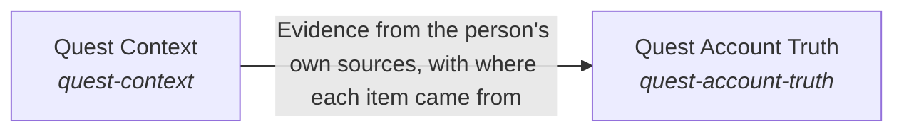

These are ESOI records rendered as a diagram (evolvable structure that optimizes intent). This page is generated from the solutions' outputs and the implementations' `uses_solution_ids` by `esoi diagram`; edit those records, not this page.

# Solution diagram: Quest Body

Quest Body is the form of the assistant and the Quest data that belongs to the person. Quest Body checks every claim about an account through Quest Account Truth, and takes requests in from where people work through Intake Sources. Quest Account Truth reads the account as it stands when the AI speaks, through Quest Context, which keeps each person's own notes, goals and decisions apart from everyone else's.

An arrow runs from the solution that provides to the solution that builds on it; its label is what the provider outputs.

