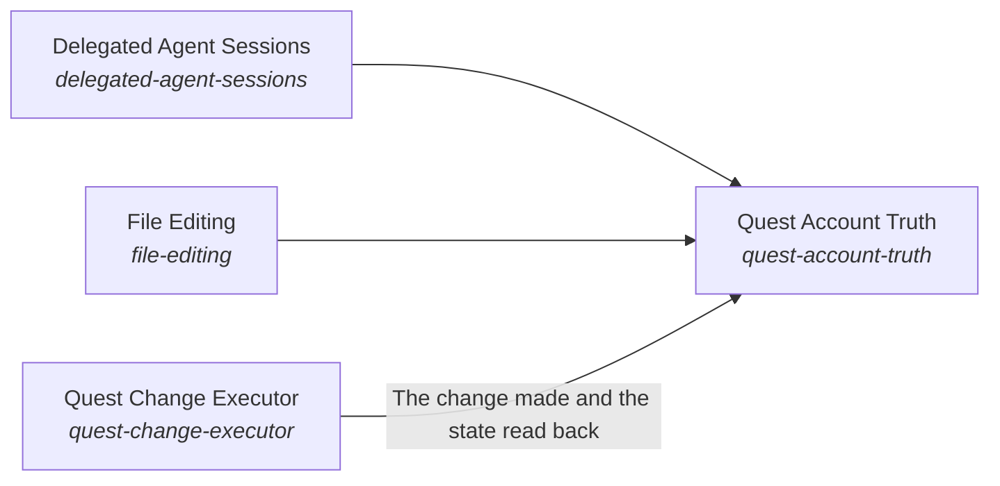

These are ESOI records rendered as a diagram (evolvable structure that optimizes intent). This page is generated from the solutions' outputs and the implementations' `uses_solution_ids` by `esoi diagram`; edit those records, not this page.

# Solution diagram: Quest Body

Quest Body is the form of the assistant and the Quest data that belongs to the person. Quest Body reads and writes Quest only through one client and declares the research search the host offers. Quest Context gathers what the person's own quests, notes, decisions and teammates say, and keeps it inside the person's scope. Quest Change Executor changes a quest exactly as the person asked, through Delegated Agent Sessions and File Editing when the work is more than one step. Quest Account Truth makes what the assistant says about an account the account as it is now.

An arrow runs from the solution that provides to the solution that builds on it; its label is what the provider outputs.

