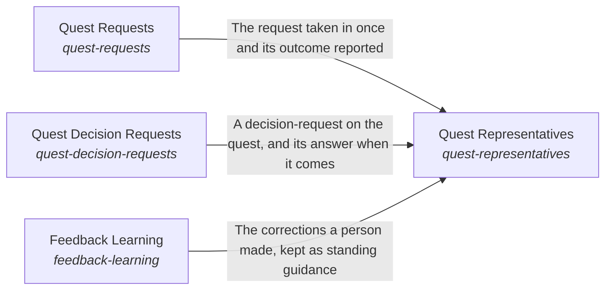

# Quest Consciousness

**Vision statement:** The AI acts for each person the way that person would want.

Breadcrumb: [Top](../../esoi/README.md) > Quest Consciousness

This sub-intent arises as the implementation `quest-consciousness:composition` of its parent intent [`quest-ai-runner`](../../esoi/README.md). Opportunities: Aligning an AI to a person is half of helping them; the other half is helping the person's own intents move, which no part of the hub's Consciousness does for them.

## How the solutions fit together

Quest Consciousness keeps the assistant aligned with the person it serves and helps their own intents move. Quest Requests takes each request in once, from every Quest surface. Quest Representatives resolves the representative a task is for from what Quest Requests took in. Hand Off A Goal says who a new goal belongs to and whether an AI can carry it. Quest Decision Requests carries a decision only a person can make to the person it belongs to. Feedback Learning keeps what the person corrected. Guide By Feedback shows the corrections that apply on the turns where they matter. Prioritization puts the work that competes for attention in order for the person: Quest's arm calls the hub's for everything generic and adds only Quest's own rules, in three uses: the standing work to start, the asks to put to the person and the person's goals at three levels (solution milestones, a quest's period goals, each one milestone of a solution, and the day's tasks). Intent Evolution suggests the option most likely to work for their intents.

## Diagram

An arrow runs from the solution that provides to the solution that builds on it; its label is what the provider outputs.

## One level below

This intent is implemented by the sub-intents and solutions below it; each shows whether it goes deeper.

- [Quest Requests](request_intake/README.md) (sub-intent): Every request made in Quest is taken in once by the same AI.
- Quest Representatives (solution with no page of its own, its implementations are in this intent's records): Put each request in the hands of the representative that fits it.
- Quest Decision Requests (solution with no page of its own, its implementations are in this intent's records): Make a decision reach the person it belongs to.
- Intent Evolution (solution with no page of its own, its implementations are in this intent's records): Help each Quest user discover what works for their intents.
- Hand Off A Goal (solution with no page of its own, its implementations are in this intent's records): Gives a person the verdicts on who a new goal belongs to and whether an AI representative can take it over at a cost and delay that its metric accepts.
- Guide By Feedback (solution with no page of its own, its implementations are in this intent's records): Help the assistant stop repeating a mistake a person has already corrected, so they only have to say it once.
- Prioritization (solution with no page of its own, its implementations are in this intent's records)
- [Feedback Learning](feedback_learning/README.md) (solution with implementations)

## Solutions at a glance

| Solution | Handle | Entry call | Selected implementation | Metric |
|---|---|---|---|---|
| Quest Requests | `quest-requests` | `quest_ai_runner.run("quest-requests", 'team-1')` | Offline lifecycle harness (`qar_runner`) | Task lifecycle correctness over offline cases |
| Quest Representatives | `quest-representatives` | `quest_ai_runner.run("quest-representatives", {'assignee_rep_id': 'rep-1'})` | Persona resolver precedence for queued tasks (today) (`persona_resolver_precedence`) | Representative choice accuracy and thread consistency |
| Quest Decision Requests | `quest-decision-requests` | `quest_ai_runner.run("quest-decision-requests")` | Decision-request sink (`quest_decision`) | Escalation delivery and detail completeness |
| Intent Evolution | `intent-evolution` | `quest_ai_runner.run("intent-evolution", ...)` | History floor (`history_floor`) | Intent evolution: the most likely option or a checkable experiment |
| Hand Off A Goal | `hand-off-a-goal` | `quest_ai_runner.run("hand-off-a-goal", ...)` | Two small model verdicts when a goal is created (today) (`model_judge`) | Hand-offs a person keeps per unit of cost and time |
| Guide By Feedback | `guide-by-feedback` | `quest_ai_runner.run("guide-by-feedback", 'What should I work on first this week?')` | Universal guidance provider (`universal`) | Repeat-correction recall and precision over feedback sequences |
| Prioritization | `prioritization` | no entry declared | Quest ordering (`quest_ordering`) | Quest's work in the order Quest's rules give |
| Feedback Learning | `feedback-learning` | `quest_ai_runner.run("feedback-learning", 'quest-id')` | File-backed feedback ledger (`ledger`) | Correction carry-through over the feedback-loop cases |

## Solutions from a library

- [Request Intake](https://github.com/SpiritualData/ai-hub-of-hubs-structure/hubofhubs/the_consciousness/README.md) (`quest-requests`): Takes in the requests people make from every source Body declares and attaches each to the person who made it, so the rest of the flow can ask for that person's Representative. Specializes the library `hub`.
- [Representatives](https://github.com/SpiritualData/ai-hub-of-hubs-structure/hubofhubs/the_consciousness/README.md) (`quest-representatives`): The AI personas that act for a person or a team. Specializes the library `hub`.
- [Judgment Calls](https://github.com/SpiritualData/ai-hub-of-hubs-structure/hubofhubs/the_consciousness/README.md) (`quest-decision-requests`): Decides, for one person, whether to ask, proceed or decline when the Nervous System raises a risk signal. Specializes the library `hub`.
- [Representatives](https://github.com/SpiritualData/ai-hub-of-hubs-structure/hubofhubs/the_consciousness/README.md) (`hand-off-a-goal`): The AI personas that act for a person or a team. Specializes the library `hub`.
- [Feedback Learning](https://github.com/SpiritualData/ai-hub-of-hubs-structure/hubofhubs/the_consciousness/README.md) (`guide-by-feedback`): Applies a person's feedback to the specs and metrics, not to the instructions of every task, so a correction given once is followed afterwards. Specializes the library `hub`.
- [Prioritization](https://github.com/SpiritualData/ai-hub-of-hubs-structure/hubofhubs/the_consciousness/README.md) (`prioritization`): The one solution that orders, for a person, the three things that compete for their attention: the work the AI is about to start unasked (tasks, standing-work triggers), the asks the AI puts to the person (questions, decisions and approvals waiting for them), and the person's own goals, which in the hub are the milestones of the solutions of their intents. Adopted from the library `hub`.
- [Feedback Learning](https://github.com/SpiritualData/ai-hub-of-hubs-structure/hubofhubs/the_consciousness/README.md) (`feedback-learning`): Applies a person's feedback to the specs and metrics, not to the instructions of every task, so a correction given once is followed afterwards. Adopted from the library `hub`.

## Problems and ideals

**Problems**

- Advice Without A Way To Check It (`prob-experiments-not-proposed`): Advice and plans are given as one answer, not as the option most likely to work for this person with a metric to check it, and when the better option is unknown the AI does not propose an experiment that would settle it, though the app has an Experiments feature built for that.
- Wrong Or Inconsistent Representative (`prob-wrong-or-inconsistent-rep`): Which AI representative handles a message, a queued task, a newly assigned goal or an autopilot pass is decided in several places by different rules, with no shared definition of the right representative, no labelled measure of how often it is right, and no rule that work spawned from a thread keeps that thread's representative.
- Long-Term Goal Goes Quiet (`prob-long-term-goal-goes-quiet`): The AI answers the request in front of it and lets the person's long-term goal go quiet, so each small task is done without the end in sight; a pointer to the goal in every reply nags, hijacks a simple question or lands on a person who is in a hurry or upset.
- Decisions Not Reaching The Person (`QP3`): A step only a person on the quest may decide can be taken without them, reach the wrong teammate, or be dropped before they answer.

**Ideals**

- Most-Likely Path (`ideal-most-likely-path`): Every recommendation is the option most likely to move the person's own metric toward their intent, and what is not known becomes an experiment.
- Right Representative (`ideal-right-rep`): Each request is handled by the representative whose role and assigned quests fit it, and work spawned from a thread keeps that thread's representative unless the person chooses another.
- Moves Me Forward Without Nagging (`ideal-moves-me-forward`): From the call: every reply answers what was asked first and, at a natural moment, keeps the person's next milestone in view, at the intent level they are working at.
- Trusted Autonomy (`QI3`): The AI acts first on what it may decide and brings the person exactly the decisions that are theirs.

## Metrics and their leaders

- Intent evolution: the most likely option or a checkable experiment (`metric-intent-evolution`)
- Quest Consciousness on Quest cases (`metric-quest-consciousness`)
- Quest's work in the order Quest's rules give (`metric-order-quest-work`): leader `quest_ordering`, 55 of 55 cases

## Where to go next

- Sub-intent: [Quest Requests](request_intake/README.md)
- Parent intent: [Quest AI Runner](../../esoi/README.md)
- Repository: [top README](../../README.md)
- Records beside the code: [quest_ai_runner/the_consciousness/feedback_learning](feedback_learning/README.md), [quest_ai_runner/the_consciousness/intent_evolution](intent_evolution/README.md), [quest_ai_runner/the_consciousness/prioritization](prioritization/README.md), [quest_ai_runner/the_consciousness/representatives](representatives/README.md)
- Records: [intent.csv](intent.csv), [problems.csv](problems.csv), [ideals.csv](ideals.csv), [solutions.csv](solutions.csv), [implementations.csv](implementations.csv), [metrics.csv](metrics.csv)
- Diagram page: [diagram.md](diagram.md)

---

## The full record

### Problems

- Advice Without A Way To Check It (`prob-experiments-not-proposed`): Advice and plans are given as one answer, not as the option most likely to work for this person with a metric to check it, and when the better option is unknown the AI does not propose an experiment that would settle it, though the app has an Experiments feature built for that.
- Wrong Or Inconsistent Representative (`prob-wrong-or-inconsistent-rep`): Which AI representative handles a message, a queued task, a newly assigned goal or an autopilot pass is decided in several places by different rules, with no shared definition of the right representative, no labelled measure of how often it is right, and no rule that work spawned from a thread keeps that thread's representative.
- Long-Term Goal Goes Quiet (`prob-long-term-goal-goes-quiet`): The AI answers the request in front of it and lets the person's long-term goal go quiet, so each small task is done without the end in sight; a pointer to the goal in every reply nags, hijacks a simple question or lands on a person who is in a hurry or upset.
- Decisions Not Reaching The Person (`QP3`): A step only a person on the quest may decide can be taken without them, reach the wrong teammate, or be dropped before they answer.

### Ideals

- Most-Likely Path (`ideal-most-likely-path`): Every recommendation is the option most likely to move the person's own metric toward their intent, and what is not known becomes an experiment.
- Right Representative (`ideal-right-rep`): Each request is handled by the representative whose role and assigned quests fit it, and work spawned from a thread keeps that thread's representative unless the person chooses another.
- Moves Me Forward Without Nagging (`ideal-moves-me-forward`): From the call: every reply answers what was asked first and, at a natural moment, keeps the person's next milestone in view, at the intent level they are working at.
- Trusted Autonomy (`QI3`): The AI acts first on what it may decide and brings the person exactly the decisions that are theirs.

### Solutions

| Solution | Handle | Selected | Metric |
|---|---|---|---|
| Quest Requests | `quest-requests` | Offline lifecycle harness (`qar_runner`) | Task lifecycle correctness over offline cases |
| Quest Representatives | `quest-representatives` | Persona resolver precedence for queued tasks (today) (`persona_resolver_precedence`) | Representative choice accuracy and thread consistency |
| Quest Decision Requests | `quest-decision-requests` | Decision-request sink (`quest_decision`) | Escalation delivery and detail completeness |
| Intent Evolution | `intent-evolution` | History floor (`history_floor`) | Intent evolution: the most likely option or a checkable experiment |
| Hand Off A Goal | `hand-off-a-goal` | Two small model verdicts when a goal is created (today) (`model_judge`) | Hand-offs a person keeps per unit of cost and time |
| Guide By Feedback | `guide-by-feedback` | Universal guidance provider (`universal`) | Repeat-correction recall and precision over feedback sequences |
| Prioritization | `prioritization` | Quest ordering (`quest_ordering`) | Quest's work in the order Quest's rules give |
| Feedback Learning | `feedback-learning` | File-backed feedback ledger (`ledger`) | Correction carry-through over the feedback-loop cases |

### Implementations

| Implementation | Handle | Where | Sub-intent |
|---|---|---|---|
| Offline lifecycle harness | `quest-requests:qar_runner` | [quest_ai_runner/the_body/area_body.py](../the_body/area_body.py) |  |
| Two small model verdicts when a goal is created (today) | `hand-off-a-goal:model_judge` | [quest_ai_runner/the_body/area_body.py](../the_body/area_body.py) |  |
| Task poller and claimer | `quest-requests:poller` | [quest_ai_runner/the_consciousness/request_intake/poller.py](request_intake/poller.py) | [request_intake](request_intake/README.md) |
| Single-task executor | `quest-requests:executor` | [quest_ai_runner/the_consciousness/request_intake/executor.py](request_intake/executor.py) |  |
| Shared lane entry point | `quest-requests:lane` | [quest_ai_runner/the_consciousness/request_intake/lane.py](request_intake/lane.py) |  |
| Universal guidance provider | `guide-by-feedback:universal` | [quest_ai_runner/the_intelligence/higher_mind/guidance/guidance_card_manager.py](../the_intelligence/higher_mind/guidance/guidance_card_manager.py) |  |
| Live ledger and provider arm | `guide-by-feedback:ledger_guidance` | [evaluation/components/feedback_loop/impls/ledger_guidance.py](../../evaluation/components/feedback_loop/impls/ledger_guidance.py) |  |
| No-feedback floor | `guide-by-feedback:no_memory` | [evaluation/components/feedback_loop/impls/no_memory.py](../../evaluation/components/feedback_loop/impls/no_memory.py) |  |
| Show-everything baseline | `guide-by-feedback:dump_all` | [evaluation/components/feedback_loop/impls/dump_all.py](../../evaluation/components/feedback_loop/impls/dump_all.py) |  |
| Host chat classifier among assigned representatives (today, in the host) | `quest-representatives:host_assigned_classifier` |  |  |
| A thread keeps its representative (proposed) | `quest-representatives:thread_holds_its_rep` |  |  |
| Fit by role, assigned quests and intent branch (proposed) | `quest-representatives:fit_by_role_and_quests` |  |  |
| Ask the person on an equal fit (proposed) | `quest-representatives:ask_the_person` |  |  |
| Work-folder sync | `quest-requests:quest_folder_sync` | [quest_ai_runner/the_intelligence/higher_mind/objectives/quest_folder_sync.py](../the_intelligence/higher_mind/objectives/quest_folder_sync.py) |  |
| Decision-request sink | `quest-decision-requests:quest_decision` | [quest_ai_runner/the_body/internal_context/quest/client/quest_client.py](../the_body/internal_context/quest/client/quest_client.py) |  |
| Fake-backend delivery check | `quest-decision-requests:quest_decision_sink` | [evaluation/components/escalate_to_a_human/impls/quest_decision_sink.py](../../evaluation/components/escalate_to_a_human/impls/quest_decision_sink.py) |  |
| File-backed feedback ledger | `feedback-learning:ledger` | [quest_ai_runner/the_consciousness/feedback_learning/feedback_ledger.py](feedback_learning/feedback_ledger.py) |  |
| History floor | `intent-evolution:history_floor` | [quest_ai_runner/the_consciousness/intent_evolution/history_floor.py](intent_evolution/history_floor.py) |  |
| Quest ordering | `prioritization:quest_ordering` | [quest_ai_runner/the_consciousness/prioritization/quest_ordering.py](prioritization/quest_ordering.py) |  |
| Configured persona resolver | `quest-requests:personas` | [quest_ai_runner/the_consciousness/representatives/personas.py](representatives/personas.py) |  |
| Persona resolver precedence for queued tasks (today) | `quest-representatives:persona_resolver_precedence` | [quest_ai_runner/the_consciousness/representatives/personas.py](representatives/personas.py) |  |

### Metrics

- Intent evolution: the most likely option or a checkable experiment (`metric-intent-evolution`): `none`
- Quest Consciousness on Quest cases (`metric-quest-consciousness`): `none`
- Quest's work in the order Quest's rules give (`metric-order-quest-work`): `esoi run order_quest_work --impl quest_ordering; esoi run order_quest_work --impl hub_stated_fields; esoi run order_quest_work --impl hub_as_given`

*Generated from the CSV files beside this page by `esoi readmes`. Edit the CSV files, not this page.*
