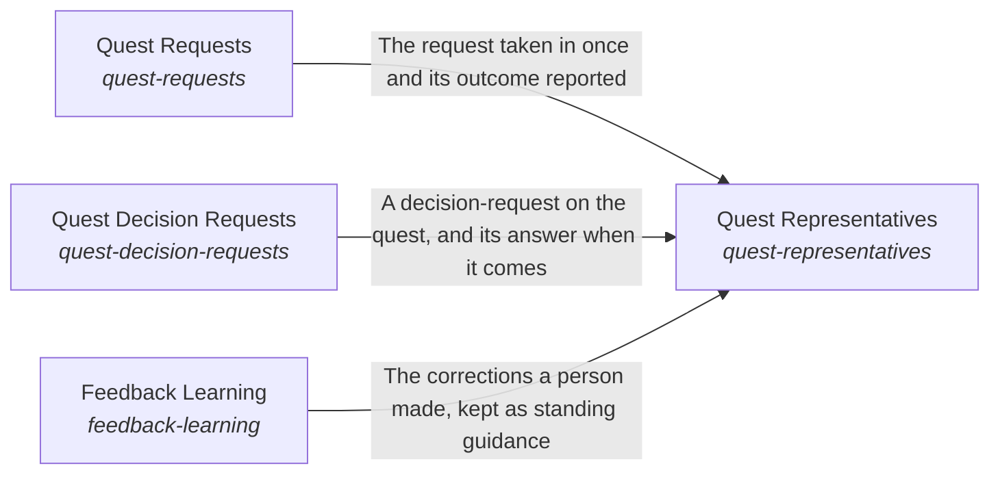

These are ESOI records rendered as a diagram (evolvable structure that optimizes intent). This page is generated from the solutions' outputs and the implementations' `uses_solution_ids` by `esoi diagram`; edit those records, not this page.

# Solution diagram: Quest Consciousness

Quest Consciousness keeps the assistant aligned with the person it serves and helps their own intents move. Quest Requests takes each request in once, from every Quest surface. Quest Representatives resolves the representative a task is for from what Quest Requests took in. Hand Off A Goal says who a new goal belongs to and whether an AI can carry it. Quest Decision Requests carries a decision only a person can make to the person it belongs to. Feedback Learning keeps what the person corrected. Guide By Feedback shows the corrections that apply on the turns where they matter. Prioritization puts the work that competes for attention in order for the person, in three uses with Quest's own rules: the standing work to start, the asks to put to the person and the person's goals at three levels (solution milestones, a quest's period goals, each one milestone of a solution, and the day's tasks). Intent Evolution suggests the option most likely to work for their intents.

An arrow runs from the solution that provides to the solution that builds on it; its label is what the provider outputs.

