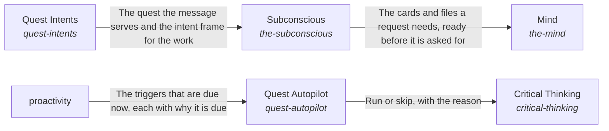

# Intelligence

**Vision statement:** Each request is understood against what the person is working toward.

Breadcrumb: [Top](../../esoi/README.md) > Intelligence

This sub-intent arises as the implementation `the-intelligence:composition` of its parent intent [`quest-ai-runner`](../../esoi/README.md). Opportunities: Which request deserves which handling changes as models and the person's intents change, so each part of handling a request is a swappable solution with its own measure.

## How the solutions fit together

Intelligence turns one request into a response. Quest Intents says which of the person's quests the request serves and what the work is for, and in what order its goals come, each period goal being one milestone of a solution. Subconscious prepares what the request needs before it is asked for. Mind thinks the request through step by step. Nervous System watches the run and brings in a person only where only a person can decide. Critical Thinking holds the work to the measure that serves the person's goals, and hands work nobody asked for to Quest Autopilot, which starts it only when the person allows. Quest Autopilot asks Proactivity what standing work is due, from the schedule a quest states and the events Quest reports.

## Diagram

An arrow runs from the solution that provides to the solution that builds on it; its label is what the provider outputs.

## One level below

This intent is implemented by the sub-intents and solutions below it; each shows whether it goes deeper.

- [Critical Thinking](critical_thinking/README.md) (sub-intent): Everything the AI does and says is held to the metric that serves the person's goals.
- [Mind](mind/README.md) (sub-intent): Each request is thought through step by step from everything its work has established so far.
- [Subconscious](subconscious/README.md) (sub-intent): The right part of a person's own knowledge is already in mind when they ask.
- [Quest Intents](higher_mind/objectives/README.md) (sub-intent): The AI works from the person's quests.
- Nervous System (solution with no page of its own, its implementations are in this intent's records)
- Quest Autopilot (solution with no page of its own, its implementations are in this intent's records): Run Quest work unasked only when the person allows it.
- Proactivity (solution with no page of its own, its implementations are in this intent's records)

## Solutions at a glance

| Solution | Handle | Entry call | Selected implementation | Metric |
|---|---|---|---|---|
| Subconscious | `the-subconscious` | `quest_ai_runner.run("the-subconscious", 'rust release')` | Start-of-run card filter and a recency window (today) (`recency_window`) | Goal-relevant admission at a precision floor with nothing out of scope |
| Mind | `the-mind` | `quest_ai_runner.run("the-mind", ...)` | Rebuilt prompt per step with a referenced context (today) (`rebuilt_per_step`) | Step continuity at cost over multi-step requests |
| Critical Thinking | `critical-thinking` | `quest_ai_runner.run("critical-thinking", ...)` | Code-enforced before and after on deep runs only (today) (`deep_runs_only`) | Requests held to their ESOI metric by code |
| Nervous System | `nervous-system` | `quest_ai_runner.run("nervous-system", 'delete the old backup folder')` | Digest-driven overseer (`overseer`) | Overseer digest evidence and signal correctness on labelled scenarios |
| Quest Autopilot | `quest-autopilot` | `quest_ai_runner.run("quest-autopilot", 'quest-id')` | Scripted-client gate evaluation arm (`live_pass`) | Autopilot gate decision correctness |
| Quest Intents | `quest-intents` | `quest_ai_runner.run("quest-intents", ...)` | Separate stores read at the start of a request (today) (`separate_stores`) | Representative long-view carry-through across assigned quests, with nothing outside its branch |
| Proactivity | `proactivity` | no entry declared | none selected | none yet |

## Solutions from a library

- [Subconscious](https://github.com/SpiritualData/ai-hub-of-hubs-structure/hubofhubs/the_intelligence/README.md) (`the-subconscious`): Finds and prepares information for the Mind. Adopted from the library `hub`.
- [Mind](https://github.com/SpiritualData/ai-hub-of-hubs-structure/hubofhubs/the_intelligence/README.md) (`the-mind`): What the planning and responding AI can see for one request and how it outputs plans, requests and communications. Adopted from the library `hub`.
- [Critical Thinking](https://github.com/SpiritualData/ai-hub-of-hubs-structure/hubofhubs/the_intelligence/README.md) (`critical-thinking`): Turns a request into a measurable target, and holds the result to it. Adopted from the library `hub`.
- [Nervous System](https://github.com/SpiritualData/ai-hub-of-hubs-structure/hubofhubs/the_intelligence/README.md) (`nervous-system`): Watches a run and raises at most one small risk signal, with a severity and a reason, when a step cannot be undone or belongs to a person, and leaves ordinary work alone. Adopted from the library `hub`.
- [Proactivity](https://github.com/SpiritualData/ai-hub-of-hubs-structure/hubofhubs/the_intelligence/README.md) (`quest-autopilot`): Says which of the system's standing schedules are due, by calendar period in their own zone, on the days of the week and at the time of day a schedule keeps (with a grace window), by a requested run or by an event since the last run, so the system acts without being asked. Specializes the library `hub`.
- [Objectives](https://github.com/SpiritualData/ai-hub-of-hubs-structure/hubofhubs/the_intelligence/higher_mind/README.md) (`quest-intents`): The live hierarchy of intents and goals across requests. Specializes the library `hub`.
- [Proactivity](https://github.com/SpiritualData/ai-hub-of-hubs-structure/hubofhubs/the_intelligence/README.md) (`proactivity`): Says which of the system's standing schedules are due, by calendar period in their own zone, on the days of the week and at the time of day a schedule keeps (with a grace window), by a requested run or by an event since the last run, so the system acts without being asked. Adopted from the library `hub`.

## Problems and ideals

**Problems**

- Work Cut Off From Its Purpose (`prob-work-misses-its-why`): Replies, experiments and finished work are chosen and judged from the quest alone, not from the top intent and metrics the quest serves, so effort can drift from what the person cares about most and gaps under an intent can go unnoticed.
- Answers Not Tied To The Person's Goal (`prob-quest-answer-not-tied-to-my-goal`): Asked how Quest could help, what a feature is for, or whether it is worth it, Quest AI can answer with a list of everything Quest has, or with a generic description, instead of the few features that fit this person's goal and circumstance, or it can assume a circumstance the person did not give.
- Unwanted Background Work (`prob-autopilot-works-when-unwanted`): Recurring background passes can work when the person's settings say they should not: past the daily budget, on a day outside the roster, or without a cadence being due.

**Ideals**

- Purposeful Work (`ideal-purposeful-work`): Every piece of work names the ideal or gap it serves and is judged by that intent's metric.
- Goal-Fitted Answer (`ideal-quest-answer-fits-my-goal`): When a person asks what Quest can do for them, the answer picks the few features that fit their own goal and circumstance and says why each helps, instead of listing everything.
- Permitted Timing (`ideal-permitted-timing`): Background work happens exactly when the person's settings allow and never otherwise.

## Metrics and their leaders

- Step continuity at cost over multi-step requests (`metric-keep-a-working-stream`): leader `rebuilt_full_context`, 14 of 14 cases
- Representative long-view carry-through across assigned quests, with nothing outside its branch (`metric-hold-the-long-view`): leader `separate_stores`, 13 of 15 cases
- Context handed to the planner (`metric-choose-the-context`): leader `per_lane_assembly`, 2 of 2 cases
- Goal-relevant admission at a precision floor with nothing out of scope (`metric-admit-to-the-mind`): leader `recency_window`, 4 of 9 cases
- Escalation delivery and detail completeness (`metric-escalate-to-a-human`): leader `quest_decision_sink`, 15 of 15 cases

## Where to go next

- Sub-intent: [Critical Thinking](critical_thinking/README.md)
- Sub-intent: [Mind](mind/README.md)
- Sub-intent: [Subconscious](subconscious/README.md)
- Sub-intent: [Quest Intents](higher_mind/objectives/README.md)
- Parent intent: [Quest AI Runner](../../esoi/README.md)
- Repository: [top README](../../README.md)
- Records beside the code: [quest_ai_runner/the_intelligence/nervous_system](nervous_system/README.md), [quest_ai_runner/the_intelligence/proactivity](proactivity/README.md)
- Records: [intent.csv](intent.csv), [problems.csv](problems.csv), [ideals.csv](ideals.csv), [solutions.csv](solutions.csv), [implementations.csv](implementations.csv), [metrics.csv](metrics.csv)
- Diagram page: [diagram.md](diagram.md)

---

## The full record

### Problems

- Work Cut Off From Its Purpose (`prob-work-misses-its-why`): Replies, experiments and finished work are chosen and judged from the quest alone, not from the top intent and metrics the quest serves, so effort can drift from what the person cares about most and gaps under an intent can go unnoticed.
- Answers Not Tied To The Person's Goal (`prob-quest-answer-not-tied-to-my-goal`): Asked how Quest could help, what a feature is for, or whether it is worth it, Quest AI can answer with a list of everything Quest has, or with a generic description, instead of the few features that fit this person's goal and circumstance, or it can assume a circumstance the person did not give.
- Unwanted Background Work (`prob-autopilot-works-when-unwanted`): Recurring background passes can work when the person's settings say they should not: past the daily budget, on a day outside the roster, or without a cadence being due.

### Ideals

- Purposeful Work (`ideal-purposeful-work`): Every piece of work names the ideal or gap it serves and is judged by that intent's metric.
- Goal-Fitted Answer (`ideal-quest-answer-fits-my-goal`): When a person asks what Quest can do for them, the answer picks the few features that fit their own goal and circumstance and says why each helps, instead of listing everything.
- Permitted Timing (`ideal-permitted-timing`): Background work happens exactly when the person's settings allow and never otherwise.

### Solutions

| Solution | Handle | Selected | Metric |
|---|---|---|---|
| Subconscious | `the-subconscious` | Start-of-run card filter and a recency window (today) (`recency_window`) | Goal-relevant admission at a precision floor with nothing out of scope |
| Mind | `the-mind` | Rebuilt prompt per step with a referenced context (today) (`rebuilt_per_step`) | Step continuity at cost over multi-step requests |
| Critical Thinking | `critical-thinking` | Code-enforced before and after on deep runs only (today) (`deep_runs_only`) | Requests held to their ESOI metric by code |
| Nervous System | `nervous-system` | Digest-driven overseer (`overseer`) | Overseer digest evidence and signal correctness on labelled scenarios |
| Quest Autopilot | `quest-autopilot` | Scripted-client gate evaluation arm (`live_pass`) | Autopilot gate decision correctness |
| Quest Intents | `quest-intents` | Separate stores read at the start of a request (today) (`separate_stores`) | Representative long-view carry-through across assigned quests, with nothing outside its branch |
| Proactivity | `proactivity` | none selected | none yet |

### Implementations

| Implementation | Handle | Where | Sub-intent |
|---|---|---|---|
| Carried message stream per request (proposed) | `the-mind:append_only_stream` |  |  |
| Carried stream with compaction (proposed) | `the-mind:stream_with_compaction` |  |  |
| Small-model judge of every candidate (proposed) | `the-subconscious:goal_judge` |  |  |
| Score thresholds per source (proposed) | `the-subconscious:score_thresholds` |  |  |
| Thresholds with a judge on the borderline (proposed) | `the-subconscious:thresholds_then_judge` |  |  |
| Maintained view per quest only (proposed) | `quest-intents:per_quest_note` |  |  |
| Periodic reflection on the best tier (proposed) | `quest-intents:periodic_reflection` |  |  |
| Outcome precedents surfaced at admission (proposed) | `the-subconscious:outcome_precedents` |  |  |
| Overseer that asks questions of fact (proposed) | `nervous-system:fact_questions` |  |  |
| Every request measured by code (proposed) | `critical-thinking:every_request_measured` |  |  |
| Measured, proposed and answered (proposed) | `critical-thinking:measured_proposed_and_answered` |  |  |
| Per-risk response chosen by metric (proposed) | `nervous-system:per_risk_response` |  |  |
| One view per intent, cascading down (proposed) | `quest-intents:per_intent_cascade` |  |  |
| One view per representative across its assigned quests, placed in the hierarchy (proposed, recommended) | `quest-intents:per_rep_assigned_view` |  |  |
| Scripted-client gate evaluation arm | `quest-autopilot:live_pass` | [quest_ai_runner/the_intelligence/critical_thinking/area.py](critical_thinking/area.py) |  |
| Rebuilt prompt per step with a referenced context (today) | `the-mind:rebuilt_per_step` | [quest_ai_runner/the_intelligence/mind/area_mind.py](mind/area_mind.py) | [mind](mind/README.md) |
| Separate stores read at the start of a request (today) | `quest-intents:separate_stores` | [quest_ai_runner/the_intelligence/higher_mind/objectives/area.py](higher_mind/objectives/area.py) | [objectives](objectives/README.md) |
| Code-enforced before and after on deep runs only (today) | `critical-thinking:deep_runs_only` | [quest_ai_runner/the_intelligence/critical_thinking/area.py](critical_thinking/area.py) | [critical_thinking](critical_thinking/README.md) |
| Rebuilt prompt per step with the context re-sent from cache | `the-mind:rebuilt_full_context` | [quest_ai_runner/the_intelligence/mind/planner/orchestrator_planning.py](mind/planner/orchestrator_planning.py) |  |
| Start-of-run card filter and a recency window (today) | `the-subconscious:recency_window` | [quest_ai_runner/the_intelligence/mind/context_intake/planner_context.py](mind/context_intake/planner_context.py) | [subconscious](subconscious/README.md) |
| No overseer (configuration off) | `nervous-system:no_overseer` | [quest_ai_runner/the_intelligence/mind/orchestrator_types.py](mind/orchestrator_types.py) |  |
| Shared quest ranker | `quest-intents:shared-quest-ranker` |  |  |
| Rank quests by words and meaning, with evidence | `quest-intents:hybrid-candidate-ranker` |  |  |
| Standing instruction alone (floor) | `critical-thinking:instruction_only` | [quest_ai_runner/the_self/integrity/prompts/standing_instructions.py](../the_self/integrity/prompts/standing_instructions.py) |  |
| Digest-driven overseer | `nervous-system:overseer` | [quest_ai_runner/the_intelligence/nervous_system/area.py](nervous_system/area.py) |  |
| Eligibility gate mixin | `quest-autopilot:autopilot_gates` | [quest_ai_runner/the_intelligence/proactivity/autopilot_gates.py](proactivity/autopilot_gates.py) |  |

### Metrics

- Step continuity at cost over multi-step requests (`metric-keep-a-working-stream`): `esoi run keep_a_working_stream --impl rebuilt_per_step --sample 3 --max-calls 40`
- Representative long-view carry-through across assigned quests, with nothing outside its branch (`metric-hold-the-long-view`): `esoi run hold_the_long_view --impl separate_stores`
- Context handed to the planner (`metric-choose-the-context`): `esoi run context_choice --impl per_lane_assembly`
- Goal-relevant admission at a precision floor with nothing out of scope (`metric-admit-to-the-mind`): `esoi run admit_to_the_mind --impl recency_window`
- Escalation delivery and detail completeness (`metric-escalate-to-a-human`): `esoi run escalate_to_a_human --impl quest_decision_sink`

*Generated from the CSV files beside this page by `esoi readmes`. Edit the CSV files, not this page.*
