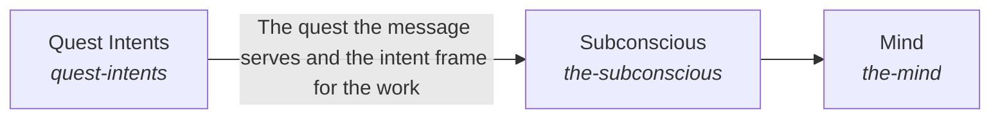

# Intelligence

AI requests are handled in the best way possible, given all relevant information.

*ESOI records of this intent (evolvable structure that optimizes intent), generated from the CSV files beside this page by `esoi readmes`. Edit the CSV files, not this page.*

This sub-intent arises as the implementation `the-intelligence:composition` of its parent intent [`quest-ai-runner`](../../esoi/README.md). Opportunities: Which request deserves which handling changes as models and the person's intents change, so each part of handling a request is a swappable solution with its own measure.

## How the solutions fit together

Intelligence turns one request into a response. Quest Intents says which of the person's quests the request serves. Subconscious finds the cards the request needs before it is asked for, from Card Store and Cards From Files, and Context Retriever picks among them. Mind plans the request in steps, through Planner and Context Intake, and Quest Work Shown tells the person what is happening. Critical Thinking holds the work to a measure through Metric Translation, Goal Completion and Response Quality, and Quest Autopilot starts standing work only when the person allows it.

## Diagram

An arrow runs from the solution that provides to the solution that builds on it; its label is what the provider outputs.

## Solutions at a glance

| Solution | Handle | Entry call | Selected implementation | Metric |
|---|---|---|---|---|
| Subconscious | `the-subconscious` | `quest_ai_runner.run("the-subconscious", 'rust release')` | Start-of-run card filter and a recency window (today) (`recency_window`) | Goal-relevant admission at a precision floor with nothing out of scope |
| Mind | `the-mind` | `quest_ai_runner.run("the-mind", ...)` | Rebuilt prompt per step with a referenced context (today) (`rebuilt_per_step`) | Step continuity at cost over multi-step requests |
| Quest Intents | `quest-intents` | `quest_ai_runner.run("quest-intents", ...)` | Separate stores read at the start of a request (today) (`separate_stores`) | Representative long-view carry-through across assigned quests, with nothing outside its branch |

## Solutions from a library

- [Subconscious](https://github.com/SpiritualData/ai-hub-of-hubs-structure/hubofhubs/the_intelligence/README.md) (`the-subconscious`): Finds and prepares information for the Mind. Adopted from the library `hub`.
- [Mind](https://github.com/SpiritualData/ai-hub-of-hubs-structure/hubofhubs/the_intelligence/README.md) (`the-mind`): What the planning and responding AI can see for one request and how it outputs plans, requests and communications. Adopted from the library `hub`.
- [Objectives](https://github.com/SpiritualData/ai-hub-of-hubs-structure/hubofhubs/the_intelligence/higher_mind/README.md) (`quest-intents`): The live hierarchy of intents and goals across requests. Specializes the library `hub`.

## Problems and ideals

**Problems**

- Work Cut Off From Its Purpose (`prob-work-misses-its-why`): Replies, experiments and finished work are chosen and judged from the quest alone, not from the top intent and metrics the quest serves, so effort can drift from what the person cares about most and gaps under an intent can go unnoticed.
- Answers Not Tied To The Person's Goal (`prob-quest-answer-not-tied-to-my-goal`): Asked how Quest could help, what a feature is for, or whether it is worth it, Quest AI can answer with a list of everything Quest has, or with a generic description, instead of the few features that fit this person's goal and circumstance, or it can assume a circumstance the person did not give.

**Ideals**

- Purposeful Work (`ideal-purposeful-work`): Every piece of work names the ideal or gap it serves and is judged by that intent's metric.
- Goal-Fitted Answer (`ideal-quest-answer-fits-my-goal`): When a person asks what Quest can do for them, the answer picks the few features that fit their own goal and circumstance and says why each helps, instead of listing everything.

## Metrics and their leaders

- Step continuity at cost over multi-step requests (`metric-keep-a-working-stream`): leader `rebuilt_full_context`, 14 of 14 cases
- Representative long-view carry-through across assigned quests, with nothing outside its branch (`metric-hold-the-long-view`): leader `separate_stores`, 13 of 15 cases
- Context handed to the planner (`metric-choose-the-context`): leader `per_lane_assembly`, 2 of 2 cases
- Goal-relevant admission at a precision floor with nothing out of scope (`metric-admit-to-the-mind`): leader `recency_window`, 4 of 9 cases

## Where to go next

- Sub-intent: [Critical Thinking](critical_thinking/README.md) (Everything the AI does and says is continuously held to the metric that serves the person's goals.)
- Sub-intent: [Mind](mind/README.md) (Every request is answered from everything its work has established so far, in the best way possible.)
- Sub-intent: [Nervous System](nervous_system/README.md) (The AI system watches every run and brings in a person only where only a person can decide.)
- Sub-intent: [Subconscious](subconscious/README.md) (The AI optimally recalls the part of the person's own knowledge that each request needs.)
- Sub-intent: [Quest Intents](higher_mind/objectives/README.md) (The AI works from the person's quests.)
- Parent intent: [Quest AI Runner](../../esoi/README.md)
- Repository: [top README](../../README.md)
- Records: [intent.csv](intent.csv), [problems.csv](problems.csv), [ideals.csv](ideals.csv), [solutions.csv](solutions.csv), [implementations.csv](implementations.csv), [metrics.csv](metrics.csv)
- Diagram page: [diagram.md](diagram.md)

---

## The full record

### Problems

- Work Cut Off From Its Purpose (`prob-work-misses-its-why`): Replies, experiments and finished work are chosen and judged from the quest alone, not from the top intent and metrics the quest serves, so effort can drift from what the person cares about most and gaps under an intent can go unnoticed.
- Answers Not Tied To The Person's Goal (`prob-quest-answer-not-tied-to-my-goal`): Asked how Quest could help, what a feature is for, or whether it is worth it, Quest AI can answer with a list of everything Quest has, or with a generic description, instead of the few features that fit this person's goal and circumstance, or it can assume a circumstance the person did not give.

### Ideals

- Purposeful Work (`ideal-purposeful-work`): Every piece of work names the ideal or gap it serves and is judged by that intent's metric.
- Goal-Fitted Answer (`ideal-quest-answer-fits-my-goal`): When a person asks what Quest can do for them, the answer picks the few features that fit their own goal and circumstance and says why each helps, instead of listing everything.

### Solutions

| Solution | Handle | Selected | Metric |
|---|---|---|---|
| Subconscious | `the-subconscious` | Start-of-run card filter and a recency window (today) (`recency_window`) | Goal-relevant admission at a precision floor with nothing out of scope |
| Mind | `the-mind` | Rebuilt prompt per step with a referenced context (today) (`rebuilt_per_step`) | Step continuity at cost over multi-step requests |
| Quest Intents | `quest-intents` | Separate stores read at the start of a request (today) (`separate_stores`) | Representative long-view carry-through across assigned quests, with nothing outside its branch |

### Implementations

| Implementation | Handle | Where | Sub-intent |
|---|---|---|---|
| Digest-driven overseer | `nervous-system:overseer` | [quest_ai_runner/the_intelligence/nervous_system/area.py](nervous_system/area.py) | [nervous_system](nervous_system/README.md) |
| Rebuilt prompt per step with a referenced context (today) | `the-mind:rebuilt_per_step` | [quest_ai_runner/the_intelligence/mind/area_mind.py](mind/area_mind.py) | [mind](mind/README.md) |
| Separate stores read at the start of a request (today) | `quest-intents:separate_stores` | [quest_ai_runner/the_intelligence/higher_mind/objectives/area.py](higher_mind/objectives/area.py) | [objectives](objectives/README.md) |
| Code-enforced before and after on deep runs only (today) | `critical-thinking:deep_runs_only` | [quest_ai_runner/the_intelligence/critical_thinking/area.py](critical_thinking/area.py) | [critical_thinking](critical_thinking/README.md) |
| Rebuilt prompt per step with the context re-sent from cache | `the-mind:rebuilt_full_context` | [quest_ai_runner/the_intelligence/mind/planner/orchestrator_planning.py](mind/planner/orchestrator_planning.py) |  |
| Start-of-run card filter and a recency window (today) | `the-subconscious:recency_window` | [quest_ai_runner/the_intelligence/mind/context_intake/planner_context.py](mind/context_intake/planner_context.py) | [subconscious](subconscious/README.md) |
| No overseer (configuration off) | `nervous-system:no_overseer` | [quest_ai_runner/the_intelligence/mind/orchestrator_types.py](mind/orchestrator_types.py) |  |
| Work-folder sync | `quest-requests:quest_folder_sync` | [quest_ai_runner/the_intelligence/higher_mind/objectives/quest_folder_sync.py](higher_mind/objectives/quest_folder_sync.py) |  |

### Metrics

- Step continuity at cost over multi-step requests (`metric-keep-a-working-stream`): `esoi run keep_a_working_stream --impl rebuilt_per_step --sample 3 --max-calls 40`
- Representative long-view carry-through across assigned quests, with nothing outside its branch (`metric-hold-the-long-view`): `esoi run hold_the_long_view --impl separate_stores`
- Context handed to the planner (`metric-choose-the-context`): `esoi run context_choice --impl per_lane_assembly`
- Goal-relevant admission at a precision floor with nothing out of scope (`metric-admit-to-the-mind`): `esoi run admit_to_the_mind --impl recency_window`
