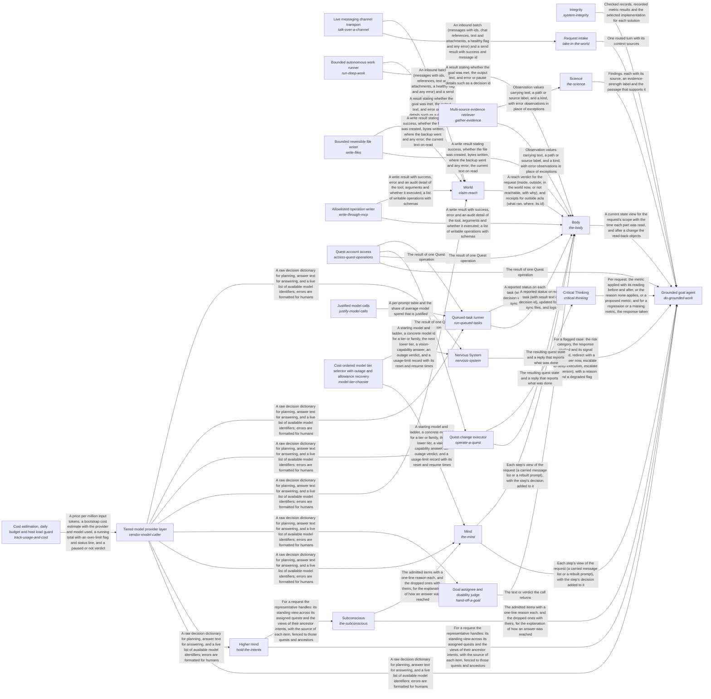
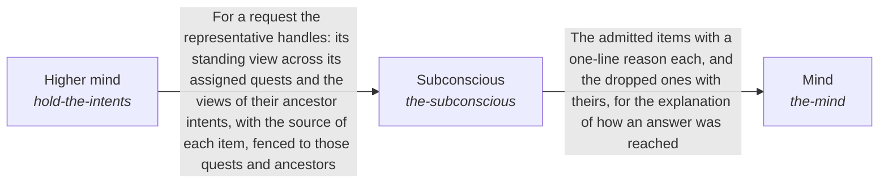

# the_intelligence

*ESOI records kept beside the code in `quest_ai_runner/the_intelligence`, generated from the CSV files in this folder by `esoi readmes`. Edit the CSV files, not this page.*

Goals keep moving between a person's sessions, because the work they delegated gets done to the standard they wrote, and every answer and action rests on the person's own goals, material and preferences, and never on another person's.

These are the solutions of [Grounded AI that advances people's goals](../../esoi/README.md).

## How the solutions fit together

quest-ai-runner turns a person's request or queued task into grounded work in one loop, and the Grounded goal agent is that loop. It asks the model through the Tiered model provider layer, works in the person's Quest account through Quest account access and takes in requests through Request intake. It reasons step by step through Mind, recalls what a request needs through Subconscious and acts on the account through Body. It holds its work to the metric that serves it through Critical Thinking, has every run watched through Nervous System and keeps the long view across turns through Higher mind. It stays comparable by metric through Integrity, answers questions beyond the person's own material through Science and chooses what a planner reads through Context choice. Subconscious recalls the cards that match a request through Hub card store. Tiered model provider layer accounts for every call through Cost estimation, daily budget and host load guard. Mind starts each step on the model tier it picks through Cost-ordered model tier selector with outage and allowance recovery. Nervous System has the model oversee a run through Tiered model provider layer. Queued-task runner claims, runs and reports a queued task, asking the model through Tiered model provider layer and working in the account through Quest account access. It writes each prompt as a registered spec with an owner and a metric through Justified model calls. Body reads and changes the quest through Context card persistence backend, Quest account access and Queued-task runner. Higher mind saves what it learned through Context card persistence backend. Request intake hears from a live channel through Live messaging channel transport. Body changes the quest as the person asks through Quest change executor and writes files inside one folder through Bounded reversible file writer. Body reads from the sources the person's work lives in through Multi-source evidence retriever and hands a new goal to the right owner through Goal assignee and doability judge. Body does heavy work through Bounded autonomous work runner, makes one named change on an outside tool server through Allowlisted operation writer and claims only the reach that World grants. Quest change executor reaches the account through Quest account access and decides through Tiered model provider layer. Goal assignee and doability judge asks the model whether a goal is doable through Tiered model provider layer. World reaches a person through Live messaging channel transport and judges through Tiered model provider layer.

## Overview diagram

An arrow runs from the solution that provides to the solution that builds on it; its label is what the provider outputs.

## Mind (`the-mind`)

Keeps every step of a person's request acting on everything the request has established so far, at the cost of the fast tier.

- Entry call: `quest_ai_runner.run("the-mind", ...)`
- Selected implementation: Rebuilt prompt per step with a referenced context (today) (`rebuilt_per_step`)
- Metric: Step continuity at cost over multi-step requests
- Implemented by: [`quest_ai_runner/the_intelligence/higher_mind/objectives/__init__.py`](higher_mind/objectives/__init__.py), [`quest_ai_runner/the_intelligence/higher_mind/objectives/area.py`](higher_mind/objectives/area.py), [`quest_ai_runner/the_intelligence/higher_mind/objectives/goal_handoff.py`](higher_mind/objectives/goal_handoff.py), [`quest_ai_runner/the_intelligence/higher_mind/objectives/plan_reconcile.py`](higher_mind/objectives/plan_reconcile.py), [`quest_ai_runner/the_intelligence/higher_mind/objectives/quest_experiments.py`](higher_mind/objectives/quest_experiments.py), [`quest_ai_runner/the_intelligence/higher_mind/objectives/quest_field_guidance.yaml`](higher_mind/objectives/quest_field_guidance.yaml), [`quest_ai_runner/the_intelligence/higher_mind/objectives/quest_field_instructions.py`](higher_mind/objectives/quest_field_instructions.py), [`quest_ai_runner/the_intelligence/higher_mind/objectives/quest_folder_index.py`](higher_mind/objectives/quest_folder_index.py) and 39 more

## Higher mind (`hold-the-intents`)

Gives each AI representative a broad, high-level context across the quests it is assigned, so every request it handles starts from what that whole set and its intents have already settled.

- Entry call: `quest_ai_runner.run("hold-the-intents", ...)`
- Selected implementation: Separate stores read at the start of a request (today) (`separate_stores`)
- Metric: Representative long-view carry-through across assigned quests, with nothing outside its branch
- Implemented by: [`quest_ai_runner/the_intelligence/higher_mind/objectives/__init__.py`](higher_mind/objectives/__init__.py), [`quest_ai_runner/the_intelligence/higher_mind/objectives/area.py`](higher_mind/objectives/area.py), [`quest_ai_runner/the_intelligence/higher_mind/objectives/goal_handoff.py`](higher_mind/objectives/goal_handoff.py), [`quest_ai_runner/the_intelligence/higher_mind/objectives/plan_reconcile.py`](higher_mind/objectives/plan_reconcile.py), [`quest_ai_runner/the_intelligence/higher_mind/objectives/quest_experiments.py`](higher_mind/objectives/quest_experiments.py), [`quest_ai_runner/the_intelligence/higher_mind/objectives/quest_field_guidance.yaml`](higher_mind/objectives/quest_field_guidance.yaml), [`quest_ai_runner/the_intelligence/higher_mind/objectives/quest_field_instructions.py`](higher_mind/objectives/quest_field_instructions.py), [`quest_ai_runner/the_intelligence/higher_mind/objectives/quest_folder_index.py`](higher_mind/objectives/quest_folder_index.py) and 38 more

## Request intake (`take-in-the-world`)

Let a person or a program reach the runner from wherever they work and be understood the same way.

- Entry call: `quest_ai_runner.run("take-in-the-world", 'Save a note that the launch moves to Friday.')`
- Selected implementation: Channels, terminal and package as ways in (`ways_in`)
- Metric: Ways in that pass their own metric
- Implemented by: [`quest_ai_runner/the_intelligence/mind/planner/__init__.py`](mind/planner/__init__.py), [`quest_ai_runner/the_intelligence/mind/planner/area_take_in_the_world.py`](mind/planner/area_take_in_the_world.py), [`quest_ai_runner/the_intelligence/mind/planner/message_routing.py`](mind/planner/message_routing.py), [`quest_ai_runner/the_intelligence/mind/planner/orchestrator_decide_tool.py`](mind/planner/orchestrator_decide_tool.py), [`quest_ai_runner/the_intelligence/mind/planner/orchestrator_decisions.py`](mind/planner/orchestrator_decisions.py), [`quest_ai_runner/the_intelligence/mind/planner/orchestrator_planning.py`](mind/planner/orchestrator_planning.py), [`quest_ai_runner/the_intelligence/mind/planner/orchestrator_preflight.py`](mind/planner/orchestrator_preflight.py), [`quest_ai_runner/the_intelligence/mind/planner/orchestrator_recipes.py`](mind/planner/orchestrator_recipes.py) and 6 more

## Subconscious (`the-subconscious`)

Keeps each request's working stream holding the part of the person's own knowledge its goal needs, so a fast model is neither misled by near misses nor buried in noise.

- Entry call: `quest_ai_runner.run("the-subconscious", 'rust release')`
- Selected implementation: Start-of-run card filter and a recency window (today) (`recency_window`)
- Metric: Goal-relevant admission at a precision floor with nothing out of scope
- Implemented by: [`quest_ai_runner/the_intelligence/higher_mind/objectives/__init__.py`](higher_mind/objectives/__init__.py), [`quest_ai_runner/the_intelligence/higher_mind/objectives/area.py`](higher_mind/objectives/area.py), [`quest_ai_runner/the_intelligence/higher_mind/objectives/goal_handoff.py`](higher_mind/objectives/goal_handoff.py), [`quest_ai_runner/the_intelligence/higher_mind/objectives/plan_reconcile.py`](higher_mind/objectives/plan_reconcile.py), [`quest_ai_runner/the_intelligence/higher_mind/objectives/quest_experiments.py`](higher_mind/objectives/quest_experiments.py), [`quest_ai_runner/the_intelligence/higher_mind/objectives/quest_field_guidance.yaml`](higher_mind/objectives/quest_field_guidance.yaml), [`quest_ai_runner/the_intelligence/higher_mind/objectives/quest_field_instructions.py`](higher_mind/objectives/quest_field_instructions.py), [`quest_ai_runner/the_intelligence/higher_mind/objectives/quest_folder_index.py`](higher_mind/objectives/quest_folder_index.py) and 38 more

## Diagram

An arrow runs from the solution that provides to the solution that builds on it; its label is what the provider outputs.

## Implementations

| Implementation | Handle | Code | Selected |
|---|---|---|---|
| Digest-driven overseer | `nervous-system:overseer` | [`quest_ai_runner/the_intelligence/nervous_system/area.py`](nervous_system/area.py) | selected |
| Apply the evolvable-structure library | `system-integrity:structure-library` | [`quest_ai_runner/the_intelligence/critical_thinking/response_quality/area.py`](critical_thinking/response_quality/area.py) | selected |
| Rebuilt prompt per step with a referenced context (today) | `the-mind:rebuilt_per_step` | [`quest_ai_runner/the_intelligence/mind/area_mind.py`](mind/area_mind.py) | selected |
| Separate stores read at the start of a request (today) | `hold-the-intents:separate_stores` | [`quest_ai_runner/the_intelligence/higher_mind/objectives/area.py`](higher_mind/objectives/area.py) | selected |
| Code-enforced before and after on deep runs only (today) | `critical-thinking:deep_runs_only` | [`quest_ai_runner/the_intelligence/critical_thinking/area.py`](critical_thinking/area.py) | selected |
| Channels, terminal and package as ways in | `take-in-the-world:ways_in` | [`quest_ai_runner/the_intelligence/mind/planner/area_take_in_the_world.py`](mind/planner/area_take_in_the_world.py) | selected |
| Rebuilt prompt per step with the context re-sent from cache | `the-mind:rebuilt_full_context` | [`quest_ai_runner/the_intelligence/mind/planner/orchestrator_planning.py`](mind/planner/orchestrator_planning.py) |  |
| Start-of-run card filter and a recency window (today) | `the-subconscious:recency_window` | [`quest_ai_runner/the_intelligence/mind/context_intake/planner_context.py`](mind/context_intake/planner_context.py) | selected |
| No overseer (configuration off) | `nervous-system:no_overseer` | [`quest_ai_runner/the_intelligence/mind/orchestrator_types.py`](mind/orchestrator_types.py) |  |
| Work-folder sync | `run-queued-tasks:quest_folder_sync` | [`quest_ai_runner/the_intelligence/higher_mind/objectives/quest_folder_sync.py`](higher_mind/objectives/quest_folder_sync.py) |  |

## Metrics

- Step continuity at cost over multi-step requests (`metric-keep-a-working-stream`): leader `rebuilt_full_context`, 14 of 14 cases
- Representative long-view carry-through across assigned quests, with nothing outside its branch (`metric-hold-the-long-view`): leader `separate_stores`, 13 of 15 cases
- Ways in that pass their own metric (`metric-take-in-the-world`)
- Context handed to the planner (`metric-choose-the-context`): leader `per_lane_assembly`, 2 of 2 cases
- Goal-relevant admission at a precision floor with nothing out of scope (`metric-admit-to-the-mind`): leader `recency_window`, 4 of 9 cases

## Problems

- Within one request, each planning step is a separate model call rebuilt from parts, not a continuation of the step before. (`prob-step-loses-the-request`)
- What is known across requests (what a quest has decided, declined and learned, what the person corrected, where the work is heading) is kept in several stores with their own keys, budgets and retrieval: past conversations, recent context, the feedback ledger and its guidance, the prediction store, the host's reflections and the quest cards. (`prob-long-view-scattered`)
- A representative's high-level view legitimately spans its assigned quests and the intents above them, but the library's fence compares flat tag sets: an item is visible to a turn only when their tags intersect, or everywhere when it has none. (`prob-long-view-scope-not-hierarchical`)
- What of the person's own material enters a step's view is decided by position and size, not by what the request needs: cards are chosen once from the request text at the start, the newest few observations are shown in full and older ones collapsed, and a lookup's result is admitted whether or not it is what was asked for. (`prob-admission-by-recency-not-relevance`)

## Ideals

- Standing Perspective (`ideal-standing-perspective`): Each quest carries one view across requests of what was decided, declined, learned and where it is heading, and every request on it starts from that view.
- Hierarchy-Contained Scope (`ideal-hierarchy-contained-scope`): What a representative learns reaches its own assigned quests and the intents above them, and never another representative's quests, a sibling intent or another person.
- Goal-Relevant Attention (`ideal-goal-relevant-attention`): Only what bears on the request's goal enters the working stream, and nothing from outside the request's scope ever does.
- Remembered Work (`ideal-remembered-work`): Work already worked out once is not worked out again, and what was learned is kept.
- Questions Only Where Theirs (`ideal-asks-only-what-is-theirs`): The person is asked only what is theirs to decide, and a question they waved off is not asked again.

## Where to go next

- Up: [quest_ai_runner](../README.md)
- Intent: [Grounded AI that advances people's goals](../../esoi/README.md)
- Down: [quest_ai_runner/the_intelligence/critical_thinking/esoi_application](critical_thinking/esoi_application/README.md)
- Down: [quest_ai_runner/the_intelligence/mind/response_writer](mind/response_writer/README.md)
- Down: [quest_ai_runner/the_intelligence/subconscious/cards_from_files](subconscious/cards_from_files/README.md)
- Repository: [top README](../../README.md)
