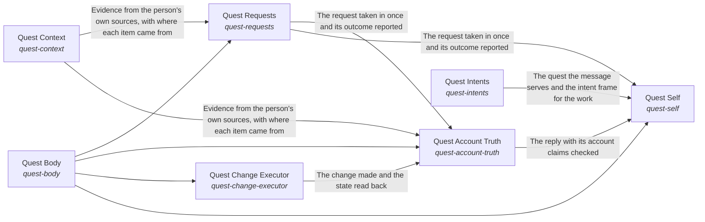

# Quest Intents

*ESOI records kept beside the code in `quest_ai_runner/the_intelligence`, generated from the CSV files in this folder by `esoi readmes`. Edit the CSV files, not this page.*

Goals keep moving between a person's sessions, because the work they delegated gets done to the standard they wrote, and every answer and action rests on the person's own goals, material and preferences, and never on another person's.

These are the solutions of [Grounded AI that advances people's goals](../../esoi/README.md).

## How the solutions fit together

quest-ai-runner turns a person's request or queued task into grounded work in one flow, and the Grounded goal agent is that flow. It takes the request in through Request intake, says what the person is working toward through Higher mind and chooses the context the request needs through Context choice. It reasons step by step through Mind, acts on the account through Body and Quest account access, and answers questions beyond the person's own material through Science. It has every run watched through Nervous System and holds the work to the metric that serves it through Critical Thinking. It asks the model through the Tiered model provider layer and stays comparable by metric through Integrity. It recalls what a request needs through Subconscious. Subconscious recalls the cards that match a request through Hub card store. Tiered model provider layer accounts for every call through Cost estimation, daily budget and host load guard. Mind starts each step on the model tier it picks through Cost-ordered model tier selector with outage and allowance recovery. Nervous System has the model oversee a run through Tiered model provider layer. Queued-task runner claims, runs and reports a queued task, asking the model through Tiered model provider layer and working in the account through Quest account access. It writes each prompt as a registered spec with an owner and a metric through Justified model calls. Body reads and changes the quest through Context card persistence backend, Quest account access and Queued-task runner. Higher mind saves what it learned through Context card persistence backend. Request intake hears from a live channel through Live messaging channel transport. Body changes the quest as the person asks through Quest change executor and writes files inside one folder through Bounded reversible file writer. Body reads from the sources the person's work lives in through Multi-source evidence retriever and hands a new goal to the right owner through Goal assignee and doability judge. Body does heavy work through Bounded autonomous work runner, makes one named change on an outside tool server through Allowlisted operation writer and claims only the reach that World grants. Quest change executor reaches the account through Quest account access and decides through Tiered model provider layer. Goal assignee and doability judge asks the model whether a goal is doable through Tiered model provider layer. World reaches a person through Live messaging channel transport and judges through Tiered model provider layer.

## Overview diagram

An arrow runs from the solution that provides to the solution that builds on it; its label is what the provider outputs.

## Quest Intents (`quest-intents`)

Make the AI work from the person's quests.

- Entry call: no entry declared
- Selected implementation: Separate stores read at the start of a request (today) (`separate_stores`)
- Metric: Representative long-view carry-through across assigned quests, with nothing outside its branch
- Implemented by: [`quest_ai_runner/the_intelligence/higher_mind/objectives/__init__.py`](higher_mind/objectives/__init__.py), [`quest_ai_runner/the_intelligence/higher_mind/objectives/area.py`](higher_mind/objectives/area.py), [`quest_ai_runner/the_intelligence/higher_mind/objectives/goal_handoff.py`](higher_mind/objectives/goal_handoff.py), [`quest_ai_runner/the_intelligence/higher_mind/objectives/interface.py`](higher_mind/objectives/interface.py), [`quest_ai_runner/the_intelligence/higher_mind/objectives/plan_reconcile.py`](higher_mind/objectives/plan_reconcile.py), [`quest_ai_runner/the_intelligence/higher_mind/objectives/quest_experiments.py`](higher_mind/objectives/quest_experiments.py), [`quest_ai_runner/the_intelligence/higher_mind/objectives/quest_field_guidance.yaml`](higher_mind/objectives/quest_field_guidance.yaml), [`quest_ai_runner/the_intelligence/higher_mind/objectives/quest_field_instructions.py`](higher_mind/objectives/quest_field_instructions.py) and 40 more

## Implementations

| Implementation | Handle | Code | Selected |
|---|---|---|---|
| Digest-driven overseer | `nervous-system:overseer` | [`quest_ai_runner/the_intelligence/nervous_system/area.py`](nervous_system/area.py) |  |
| Apply the evolvable-structure library | `system-integrity:structure-library` | [`quest_ai_runner/the_intelligence/critical_thinking/response_quality/area.py`](critical_thinking/response_quality/area.py) |  |
| Rebuilt prompt per step with a referenced context (today) | `the-mind:rebuilt_per_step` | [`quest_ai_runner/the_intelligence/mind/area_mind.py`](mind/area_mind.py) |  |
| Separate stores read at the start of a request (today) | `quest-intents:separate_stores` | [`quest_ai_runner/the_intelligence/higher_mind/objectives/area.py`](higher_mind/objectives/area.py) | selected |
| Code-enforced before and after on deep runs only (today) | `critical-thinking:deep_runs_only` | [`quest_ai_runner/the_intelligence/critical_thinking/area.py`](critical_thinking/area.py) |  |
| Channels, terminal and package as ways in | `quest-requests:ways_in` | [`quest_ai_runner/the_intelligence/mind/planner/area_take_in_the_world.py`](mind/planner/area_take_in_the_world.py) |  |
| Rebuilt prompt per step with the context re-sent from cache | `the-mind:rebuilt_full_context` | [`quest_ai_runner/the_intelligence/mind/planner/orchestrator_planning.py`](mind/planner/orchestrator_planning.py) |  |
| Start-of-run card filter and a recency window (today) | `the-subconscious:recency_window` | [`quest_ai_runner/the_intelligence/mind/context_intake/planner_context.py`](mind/context_intake/planner_context.py) |  |
| No overseer (configuration off) | `nervous-system:no_overseer` | [`quest_ai_runner/the_intelligence/mind/orchestrator_types.py`](mind/orchestrator_types.py) |  |
| Work-folder sync | `quest-requests:quest_folder_sync` | [`quest_ai_runner/the_intelligence/higher_mind/objectives/quest_folder_sync.py`](higher_mind/objectives/quest_folder_sync.py) |  |

## Metrics

- Step continuity at cost over multi-step requests (`metric-keep-a-working-stream`): leader `rebuilt_full_context`, 14 of 14 cases
- Representative long-view carry-through across assigned quests, with nothing outside its branch (`metric-hold-the-long-view`): leader `separate_stores`, 13 of 15 cases
- Context handed to the planner (`metric-choose-the-context`): leader `per_lane_assembly`, 2 of 2 cases
- Goal-relevant admission at a precision floor with nothing out of scope (`metric-admit-to-the-mind`): leader `recency_window`, 4 of 9 cases

## Problems

- Work Cut Off From Its Purpose (`prob-work-misses-its-why`): Replies, experiments and finished work are chosen and judged from the quest alone, not from the top intent and metrics the quest serves, so effort can drift from what the person cares about most and gaps under an intent can go unnoticed.
- Answers Not Tied To The Person's Goal (`prob-quest-answer-not-tied-to-my-goal`): Asked how Quest could help, what a feature is for, or whether it is worth it, Quest AI can answer with a list of everything Quest has, or with a generic description, instead of the few features that fit this person's goal and circumstance, or it can assume a circumstance the person did not give.

## Ideals

- Purposeful Work (`ideal-purposeful-work`): Every piece of work names the ideal or gap it serves and is judged by that intent's metric.
- Goal-Fitted Answer (`ideal-quest-answer-fits-my-goal`): When a person asks what Quest can do for them, the answer picks the few features that fit their own goal and circumstance and says why each helps, instead of listing everything.

## Where to go next

- Up: [quest_ai_runner](../README.md)
- Intent: [Grounded AI that advances people's goals](../../esoi/README.md)
- Down: [quest_ai_runner/the_intelligence/critical_thinking/esoi_application](critical_thinking/esoi_application/README.md)
- Down: [quest_ai_runner/the_intelligence/mind/response_writer](mind/response_writer/README.md)
- Down: [quest_ai_runner/the_intelligence/subconscious/cards_from_files](subconscious/cards_from_files/README.md)
- Repository: [top README](../../README.md)
