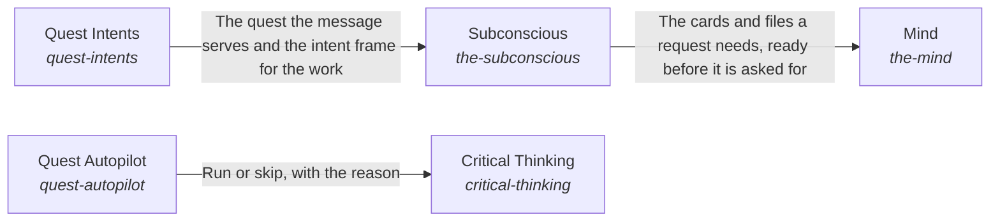

These are ESOI records rendered as a diagram (evolvable structure that optimizes intent). This page is generated from the solutions' outputs and the implementations' `uses_solution_ids` by `esoi diagram`; edit those records, not this page.

# Solution diagram: Intelligence

Intelligence turns one request into a response. Quest Intents says which of the person's quests the request serves and what the work is for. Subconscious prepares what the request needs before it is asked for. Mind thinks the request through step by step. Nervous System watches the run and brings in a person only where only a person can decide. Critical Thinking holds the work to the measure that serves the person's goals, and hands work nobody asked for to Quest Autopilot, which starts it only when the person allows.

An arrow runs from the solution that provides to the solution that builds on it; its label is what the provider outputs.

